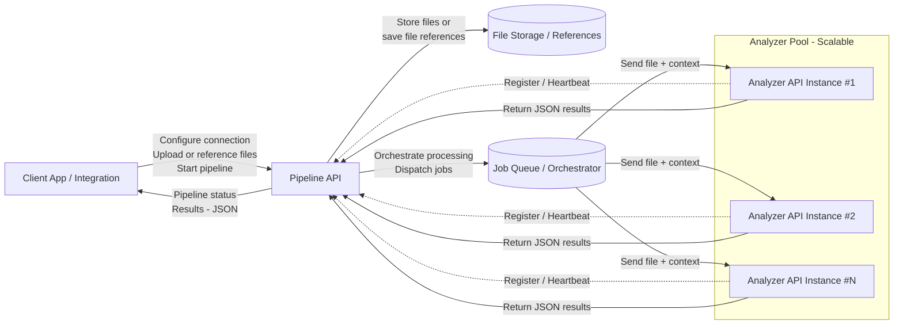

# Pipeline API

The Pipeline API is the primary interface used by client applications to interact with Dynizer. Client systems do not communicate directly with the Analyzer API.

The Analyzer API is a dedicated processing service. Its sole responsibility is to analyze files and return structured results in JSON format. It does not manage files, workflows, or configurations.

All orchestration is handled by the Pipeline API. Through this API, clients configure their connection to Dynizer, upload or reference files, and start processing pipelines. Once a pipeline is initiated, the Pipeline API automatically invokes one or more Analyzer services to process the data.

This architecture is designed for scalability and reliability. Multiple Analyzer instances can run in parallel and register with the Pipeline API, allowing Dynizer to scale processing capacity based on demand. For high-volume or performance-critical workloads, several Analyzer instances can operate simultaneously to ensure fast and efficient processing.




## Security Schemes

| Name              | Type              | Description              | Scheme              | Bearer Format             |
|-------------------|-------------------|--------------------------|---------------------|---------------------------|
| bearerAuth | http |  | bearer | JWT |

## APIs

### Endpoint: /login

`POST /login`

Send a login authentication request.


  

**Responses**

+ `200`: 
        [PostLoginResponse](#postloginresponse)

    
 
+ `400`: 
        [400ErrorResponse](#400errorresponse)

    
 
+ `401`: 
        [401ErrorResponse](#401errorresponse)

    
 
+ `default`: 
        [DefaultErrorResponse](#defaulterrorresponse)

    
 
  
 
### Endpoint: /authentication_configurations

`GET /authentication_configurations`

Get all defined authentication configurations.


***Parameters***

| Name | Type | Required | Description | Schema Reference |
|------|------|----------|-------------|-------------------|
| search | string | False | Search string to search within the collection. | [SearchString](#searchstring) |
| limit | integer |  | Defines how many records at max are returned. If fewer records are available, all will be returned. Omitting or setting this to -1 will be interpreted as no limit  | [Limit](#limit) |
| offset | integer |  | Defines the offset at which to start reading. An offset of 0 means to start from the first possible record.  | [Offset](#offset) |
  
  

**Responses**

+ `200`: 
        [GetAuthenticationConfigurationsResponse](#getauthenticationconfigurationsresponse)

    
 
+ `default`: 
        [DefaultErrorResponse](#defaulterrorresponse)

    
 
  
### Endpoint: /authentication_configurations

`POST /authentication_configurations`

Create a new authentication configuration.


  

**Responses**

+ `200`: 
        [CreateAuthenticationConfigurationResponse](#createauthenticationconfigurationresponse)

    
 
+ `400`: 
        [400ErrorResponse](#400errorresponse)

    
 
+ `default`: 
        [DefaultErrorResponse](#defaulterrorresponse)

    
 
  
 
### Endpoint: /authentication_configurations/{id}

`GET /authentication_configurations/{id}`

Get an authentication configuration by ID.


***Parameters***

| Name | Type | Required | Description | Schema Reference |
|------|------|----------|-------------|-------------------|
| id | string | True | ID of object to fetch. | [ID](#id) |
  
  

**Responses**

+ `200`: 
        [GetAuthenticationConfigurationByIDResponse](#getauthenticationconfigurationbyidresponse)

    
 
+ `400`: 
        [400ErrorResponse](#400errorresponse)

    
 
+ `404`: 
        [404ErrorResponse](#404errorresponse)

    
 
+ `default`: 
        [DefaultErrorResponse](#defaulterrorresponse)

    
 
  
### Endpoint: /authentication_configurations/{id}

`PUT /authentication_configurations/{id}`

Update an authentication configuration by ID.


***Parameters***

| Name | Type | Required | Description | Schema Reference |
|------|------|----------|-------------|-------------------|
| id | string | True | ID of object to fetch. | [ID](#id) |
  
  

**Responses**

+ `204`: 
        

    
 
+ `400`: 
        [400ErrorResponse](#400errorresponse)

    
 
+ `404`: 
        [404ErrorResponse](#404errorresponse)

    
 
+ `default`: 
        [DefaultErrorResponse](#defaulterrorresponse)

    
 
  
### Endpoint: /authentication_configurations/{id}

`DELETE /authentication_configurations/{id}`

Delete an authentication configuration by ID.


***Parameters***

| Name | Type | Required | Description | Schema Reference |
|------|------|----------|-------------|-------------------|
| id | string | True | ID of object to fetch. | [ID](#id) |
  
  

**Responses**

+ `204`: 
        

    
 
+ `400`: 
        [400ErrorResponse](#400errorresponse)

    
 
+ `404`: 
        [404ErrorResponse](#404errorresponse)

    
 
+ `409`: 
        [409ErrorResponse](#409errorresponse)

    
 
+ `default`: 
        [DefaultErrorResponse](#defaulterrorresponse)

    
 
  
 
### Endpoint: /connections

`GET /connections`

Get all defined connections.


***Parameters***

| Name | Type | Required | Description | Schema Reference |
|------|------|----------|-------------|-------------------|
| search | string | False | Search string to search within the collection. | [SearchString](#searchstring) |
| limit | integer |  | Defines how many records at max are returned. If fewer records are available, all will be returned. Omitting or setting this to -1 will be interpreted as no limit  | [Limit](#limit) |
| offset | integer |  | Defines the offset at which to start reading. An offset of 0 means to start from the first possible record.  | [Offset](#offset) |
  
  

**Responses**

+ `200`: 
        [GetConnectionsResponse](#getconnectionsresponse)

    
 
+ `default`: 
        [DefaultErrorResponse](#defaulterrorresponse)

    
 
  
### Endpoint: /connections

`POST /connections`

Create a new connection.


  

**Responses**

+ `200`: 
        [CreateConnectionResponse](#createconnectionresponse)

    
 
+ `400`: 
        [400ErrorResponse](#400errorresponse)

    
 
+ `default`: 
        [DefaultErrorResponse](#defaulterrorresponse)

    
 
  
 
### Endpoint: /connections/{id}

`GET /connections/{id}`

Get a connection by ID.


***Parameters***

| Name | Type | Required | Description | Schema Reference |
|------|------|----------|-------------|-------------------|
| id | string | True | ID of object to fetch. | [ID](#id) |
  
  

**Responses**

+ `200`: 
        [GetConnectionByIDResponse](#getconnectionbyidresponse)

    
 
+ `400`: 
        [400ErrorResponse](#400errorresponse)

    
 
+ `404`: 
        [404ErrorResponse](#404errorresponse)

    
 
+ `default`: 
        [DefaultErrorResponse](#defaulterrorresponse)

    
 
  
### Endpoint: /connections/{id}

`PUT /connections/{id}`

Update a connection by ID.


***Parameters***

| Name | Type | Required | Description | Schema Reference |
|------|------|----------|-------------|-------------------|
| id | string | True | ID of object to fetch. | [ID](#id) |
  
  

**Responses**

+ `204`: 
        

    
 
+ `400`: 
        [400ErrorResponse](#400errorresponse)

    
 
+ `404`: 
        [404ErrorResponse](#404errorresponse)

    
 
+ `default`: 
        [DefaultErrorResponse](#defaulterrorresponse)

    
 
  
### Endpoint: /connections/{id}

`DELETE /connections/{id}`

Delete a connection by ID. This operation will not delete any data on the storage itself.


***Parameters***

| Name | Type | Required | Description | Schema Reference |
|------|------|----------|-------------|-------------------|
| id | string | True | ID of object to fetch. | [ID](#id) |
  
  

**Responses**

+ `204`: 
        

    
 
+ `400`: 
        [400ErrorResponse](#400errorresponse)

    
 
+ `404`: 
        [404ErrorResponse](#404errorresponse)

    
 
+ `409`: 
        [409ErrorResponse](#409errorresponse)

    
 
+ `default`: 
        [DefaultErrorResponse](#defaulterrorresponse)

    
 
  
 
### Endpoint: /connections/{id}/storage

`GET /connections/{id}/storage`

Download a large object from a connection. Specify the connection ID in the path parameter, and the server path in the query parameters.


***Parameters***

| Name | Type | Required | Description | Schema Reference |
|------|------|----------|-------------|-------------------|
| id | string | True | ID of object to fetch. | [ID](#id) |
| path | string | True | Server path to upload/download a large object. | [URIPath](#uripath) |
  
  

**Responses**

+ `200`: 
        [DownloadLOBResponse](#downloadlobresponse)

    
 
+ `400`: 
        [400ErrorResponse](#400errorresponse)

    
 
+ `404`: 
        [404ErrorResponse](#404errorresponse)

    
 
+ `default`: 
        [DefaultErrorResponse](#defaulterrorresponse)

    
 
  
### Endpoint: /connections/{id}/storage

`POST /connections/{id}/storage`

Upload a large object to a connection. Specify the connection ID in the path parameter, and the server path in the query parameters.


***Parameters***

| Name | Type | Required | Description | Schema Reference |
|------|------|----------|-------------|-------------------|
| id | string | True | ID of object to fetch. | [ID](#id) |
| path | string | True | Server path to upload/download a large object. | [URIPath](#uripath) |
  
  

**Responses**

+ `200`: 
        [UploadLOBResponse](#uploadlobresponse)

    
 
+ `400`: 
        [400ErrorResponse](#400errorresponse)

    
 
+ `404`: 
        [404ErrorResponse](#404errorresponse)

    
 
+ `default`: 
        [DefaultErrorResponse](#defaulterrorresponse)

    
 
  
### Endpoint: /connections/{id}/storage

`DELETE /connections/{id}/storage`

Delete a large object from a connection. Specify the connection ID in the path parameter, and the server path in the query parameters.


***Parameters***

| Name | Type | Required | Description | Schema Reference |
|------|------|----------|-------------|-------------------|
| id | string | True | ID of object to fetch. | [ID](#id) |
| path | string | True | Server path to upload/download a large object. | [URIPath](#uripath) |
  
  

**Responses**

+ `204`: 
        

    
 
+ `400`: 
        [400ErrorResponse](#400errorresponse)

    
 
+ `404`: 
        [404ErrorResponse](#404errorresponse)

    
 
+ `default`: 
        [DefaultErrorResponse](#defaulterrorresponse)

    
 
  
 
### Endpoint: /documents

`GET /documents`

Get all defined documents.


***Parameters***

| Name | Type | Required | Description | Schema Reference |
|------|------|----------|-------------|-------------------|
| search | string | False | Search string to search within the collection. | [SearchString](#searchstring) |
| limit | integer |  | Defines how many records at max are returned. If fewer records are available, all will be returned. Omitting or setting this to -1 will be interpreted as no limit  | [Limit](#limit) |
| offset | integer |  | Defines the offset at which to start reading. An offset of 0 means to start from the first possible record.  | [Offset](#offset) |
  
  

**Responses**

+ `200`: 
        [GetDocumentsResponse](#getdocumentsresponse)

    
 
+ `default`: 
        [DefaultErrorResponse](#defaulterrorresponse)

    
 
  
### Endpoint: /documents

`POST /documents`

Create a new document.


  

**Responses**

+ `200`: 
        [CreateDocumentResponse](#createdocumentresponse)

    
 
+ `400`: 
        [400ErrorResponse](#400errorresponse)

    
 
+ `default`: 
        [DefaultErrorResponse](#defaulterrorresponse)

    
 
  
 
### Endpoint: /documents/{id}

`GET /documents/{id}`

Get a document by ID.


***Parameters***

| Name | Type | Required | Description | Schema Reference |
|------|------|----------|-------------|-------------------|
| id | string | True | ID of object to fetch. | [ID](#id) |
  
  

**Responses**

+ `200`: 
        [GetDocumentByIDResponse](#getdocumentbyidresponse)

    
 
+ `400`: 
        [400ErrorResponse](#400errorresponse)

    
 
+ `404`: 
        [404ErrorResponse](#404errorresponse)

    
 
+ `default`: 
        [DefaultErrorResponse](#defaulterrorresponse)

    
 
  
### Endpoint: /documents/{id}

`PUT /documents/{id}`

Update a document by ID.


***Parameters***

| Name | Type | Required | Description | Schema Reference |
|------|------|----------|-------------|-------------------|
| id | string | True | ID of object to fetch. | [ID](#id) |
  
  

**Responses**

+ `204`: 
        

    
 
+ `400`: 
        [400ErrorResponse](#400errorresponse)

    
 
+ `404`: 
        [404ErrorResponse](#404errorresponse)

    
 
+ `default`: 
        [DefaultErrorResponse](#defaulterrorresponse)

    
 
  
### Endpoint: /documents/{id}

`DELETE /documents/{id}`

Delete a document by ID.


***Parameters***

| Name | Type | Required | Description | Schema Reference |
|------|------|----------|-------------|-------------------|
| id | string | True | ID of object to fetch. | [ID](#id) |
  
  

**Responses**

+ `204`: 
        

    
 
+ `400`: 
        [400ErrorResponse](#400errorresponse)

    
 
+ `404`: 
        [404ErrorResponse](#404errorresponse)

    
 
+ `409`: 
        [409ErrorResponse](#409errorresponse)

    
 
+ `default`: 
        [DefaultErrorResponse](#defaulterrorresponse)

    
 
  
 
### Endpoint: /flows

`GET /flows`

Get all flows.


***Parameters***

| Name | Type | Required | Description | Schema Reference |
|------|------|----------|-------------|-------------------|
| search | string | False | Search string to search within the collection. | [SearchString](#searchstring) |
| limit | integer |  | Defines how many records at max are returned. If fewer records are available, all will be returned. Omitting or setting this to -1 will be interpreted as no limit  | [Limit](#limit) |
| offset | integer |  | Defines the offset at which to start reading. An offset of 0 means to start from the first possible record.  | [Offset](#offset) |
  
  

**Responses**

+ `200`: 
        [GetFlowsResponse](#getflowsresponse)

    
 
+ `default`: 
        [DefaultErrorResponse](#defaulterrorresponse)

    
 
  
 
### Endpoint: /flows/{name}

`GET /flows/{name}`

Get a flow by Name.


***Parameters***

| Name | Type | Required | Description | Schema Reference |
|------|------|----------|-------------|-------------------|
| name | string | True | Name of object to fetch. | [Name](#name) |
  
  

**Responses**

+ `200`: 
        [GetFlowByNameResponse](#getflowbynameresponse)

    
 
+ `400`: 
        [400ErrorResponse](#400errorresponse)

    
 
+ `404`: 
        [404ErrorResponse](#404errorresponse)

    
 
+ `default`: 
        [DefaultErrorResponse](#defaulterrorresponse)

    
 
  
 
### Endpoint: /filetype_configurations

`GET /filetype_configurations`

Get all filetype configurations.


***Parameters***

| Name | Type | Required | Description | Schema Reference |
|------|------|----------|-------------|-------------------|
| search | string | False | Search string to search within the collection. | [SearchString](#searchstring) |
| limit | integer |  | Defines how many records at max are returned. If fewer records are available, all will be returned. Omitting or setting this to -1 will be interpreted as no limit  | [Limit](#limit) |
| offset | integer |  | Defines the offset at which to start reading. An offset of 0 means to start from the first possible record.  | [Offset](#offset) |
  
  

**Responses**

+ `200`: 
        [GetFiletypeConfigurationsResponse](#getfiletypeconfigurationsresponse)

    
 
+ `default`: 
        [DefaultErrorResponse](#defaulterrorresponse)

    
 
  
 
### Endpoint: /filetype_configurations/{name}

`GET /filetype_configurations/{name}`

Get a filetype configuration by name.


***Parameters***

| Name | Type | Required | Description | Schema Reference |
|------|------|----------|-------------|-------------------|
| name | string | True | Name of object to fetch. | [Name](#name) |
  
  

**Responses**

+ `200`: 
        [GetFiletypeConfigurationByNameResponse](#getfiletypeconfigurationbynameresponse)

    
 
+ `400`: 
        [400ErrorResponse](#400errorresponse)

    
 
+ `404`: 
        [404ErrorResponse](#404errorresponse)

    
 
+ `default`: 
        [DefaultErrorResponse](#defaulterrorresponse)

    
 
  
 
### Endpoint: /connectiontypes

`GET /connectiontypes`

Get all connectiontypes.


***Parameters***

| Name | Type | Required | Description | Schema Reference |
|------|------|----------|-------------|-------------------|
| search | string | False | Search string to search within the collection. | [SearchString](#searchstring) |
| limit | integer |  | Defines how many records at max are returned. If fewer records are available, all will be returned. Omitting or setting this to -1 will be interpreted as no limit  | [Limit](#limit) |
| offset | integer |  | Defines the offset at which to start reading. An offset of 0 means to start from the first possible record.  | [Offset](#offset) |
  
  

**Responses**

+ `200`: 
        [GetConnectiontypesResponse](#getconnectiontypesresponse)

    
 
+ `default`: 
        [DefaultErrorResponse](#defaulterrorresponse)

    
 
  
 
### Endpoint: /connectiontypes/{name}

`GET /connectiontypes/{name}`

Get a connectiontype by Name.


***Parameters***

| Name | Type | Required | Description | Schema Reference |
|------|------|----------|-------------|-------------------|
| name | string | True | Name of object to fetch. | [Name](#name) |
  
  

**Responses**

+ `200`: 
        [GetConnectiontypeByNameResponse](#getconnectiontypebynameresponse)

    
 
+ `400`: 
        [400ErrorResponse](#400errorresponse)

    
 
+ `404`: 
        [404ErrorResponse](#404errorresponse)

    
 
+ `default`: 
        [DefaultErrorResponse](#defaulterrorresponse)

    
 
  
 
### Endpoint: /pipeline_configurations

`GET /pipeline_configurations`

Get all defined pipeline configurations.


***Parameters***

| Name | Type | Required | Description | Schema Reference |
|------|------|----------|-------------|-------------------|
| search | string | False | Search string to search within the collection. | [SearchString](#searchstring) |
| limit | integer |  | Defines how many records at max are returned. If fewer records are available, all will be returned. Omitting or setting this to -1 will be interpreted as no limit  | [Limit](#limit) |
| offset | integer |  | Defines the offset at which to start reading. An offset of 0 means to start from the first possible record.  | [Offset](#offset) |
  
  

**Responses**

+ `200`: 
        [GetPipelineConfigurationsResponse](#getpipelineconfigurationsresponse)

    
 
+ `default`: 
        [DefaultErrorResponse](#defaulterrorresponse)

    
 
  
### Endpoint: /pipeline_configurations

`POST /pipeline_configurations`

Create a new pipeline configuration.


  

**Responses**

+ `200`: 
        [CreatePipelineConfigurationResponse](#createpipelineconfigurationresponse)

    
 
+ `400`: 
        [400ErrorResponse](#400errorresponse)

    
 
+ `default`: 
        [DefaultErrorResponse](#defaulterrorresponse)

    
 
  
 
### Endpoint: /pipeline_configurations/{id}

`GET /pipeline_configurations/{id}`

Get a pipeline configuration by ID.


***Parameters***

| Name | Type | Required | Description | Schema Reference |
|------|------|----------|-------------|-------------------|
| id | string | True | ID of object to fetch. | [ID](#id) |
  
  

**Responses**

+ `200`: 
        [GetPipelineConfigurationByIDResponse](#getpipelineconfigurationbyidresponse)

    
 
+ `400`: 
        [400ErrorResponse](#400errorresponse)

    
 
+ `404`: 
        [404ErrorResponse](#404errorresponse)

    
 
+ `default`: 
        [DefaultErrorResponse](#defaulterrorresponse)

    
 
  
### Endpoint: /pipeline_configurations/{id}

`PUT /pipeline_configurations/{id}`

Update a pipeline configuration by ID. This update only applies to new pipelines and does not impact existing pipelines.


***Parameters***

| Name | Type | Required | Description | Schema Reference |
|------|------|----------|-------------|-------------------|
| id | string | True | ID of object to fetch. | [ID](#id) |
  
  

**Responses**

+ `204`: 
        

    
 
+ `400`: 
        [400ErrorResponse](#400errorresponse)

    
 
+ `404`: 
        [404ErrorResponse](#404errorresponse)

    
 
+ `default`: 
        [DefaultErrorResponse](#defaulterrorresponse)

    
 
  
### Endpoint: /pipeline_configurations/{id}

`DELETE /pipeline_configurations/{id}`

Delete a pipeline configuration by ID.


***Parameters***

| Name | Type | Required | Description | Schema Reference |
|------|------|----------|-------------|-------------------|
| id | string | True | ID of object to fetch. | [ID](#id) |
  
  

**Responses**

+ `204`: 
        

    
 
+ `400`: 
        [400ErrorResponse](#400errorresponse)

    
 
+ `404`: 
        [404ErrorResponse](#404errorresponse)

    
 
+ `409`: 
        [409ErrorResponse](#409errorresponse)

    
 
+ `default`: 
        [DefaultErrorResponse](#defaulterrorresponse)

    
 
  
 
### Endpoint: /pipelines

`GET /pipelines`

Get all executed pipelines.


***Parameters***

| Name | Type | Required | Description | Schema Reference |
|------|------|----------|-------------|-------------------|
| search | string | False | Search string to search within the collection. | [SearchString](#searchstring) |
| status | string | False | Status string to filter on pipeline status within the collection. | [PipelineStatus](#pipelinestatus) |
| limit | integer |  | Defines how many records at max are returned. If fewer records are available, all will be returned. Omitting or setting this to -1 will be interpreted as no limit  | [Limit](#limit) |
| offset | integer |  | Defines the offset at which to start reading. An offset of 0 means to start from the first possible record.  | [Offset](#offset) |
| include_output | boolean | False | Flag to indicate wether to include the pipeline output. | [IncludeOutput](#includeoutput) |
| include_document | boolean | False | Flag to indicate wether to include the pipeline document. | [IncludeDocument](#includedocument) |
  
  

**Responses**

+ `200`: 
        [GetPipelinesResponse](#getpipelinesresponse)

    
 
+ `default`: 
        [DefaultErrorResponse](#defaulterrorresponse)

    
 
  
### Endpoint: /pipelines

`POST /pipelines`

Execute a new pipeline.


  

**Responses**

+ `200`: 
        [CreatePipelineResponse](#createpipelineresponse)

    
 
+ `400`: 
        [400ErrorResponse](#400errorresponse)

    
 
+ `503`: 
        [503ErrorResponse](#503errorresponse)

    
 
+ `default`: 
        [DefaultErrorResponse](#defaulterrorresponse)

    
 
  
 
### Endpoint: /pipelines/{id}

`GET /pipelines/{id}`

Get a pipeline by ID.


***Parameters***

| Name | Type | Required | Description | Schema Reference |
|------|------|----------|-------------|-------------------|
| id | string | True | ID of object to fetch. | [ID](#id) |
| include_output | boolean | False | Flag to indicate wether to include the pipeline output. | [IncludeOutput](#includeoutput) |
| include_document | boolean | False | Flag to indicate wether to include the pipeline document. | [IncludeDocument](#includedocument) |
  
  

**Responses**

+ `200`: 
        [GetPipelineByIDResponse](#getpipelinebyidresponse)

    
 
+ `400`: 
        [400ErrorResponse](#400errorresponse)

    
 
+ `404`: 
        [404ErrorResponse](#404errorresponse)

    
 
+ `default`: 
        [DefaultErrorResponse](#defaulterrorresponse)

    
 
  
### Endpoint: /pipelines/{id}

`PUT /pipelines/{id}`

Update a pipeline by ID.


***Parameters***

| Name | Type | Required | Description | Schema Reference |
|------|------|----------|-------------|-------------------|
| id | string | True | ID of object to fetch. | [ID](#id) |
  
  

**Responses**

+ `204`: 
        

    
 
+ `400`: 
        [400ErrorResponse](#400errorresponse)

    
 
+ `404`: 
        [404ErrorResponse](#404errorresponse)

    
 
+ `410`: 
        [410ErrorResponse](#410errorresponse)

    
 
+ `503`: 
        [503ErrorResponse](#503errorresponse)

    
 
+ `default`: 
        [DefaultErrorResponse](#defaulterrorresponse)

    
 
  
### Endpoint: /pipelines/{id}

`DELETE /pipelines/{id}`

Delete a pipeline by ID.


***Parameters***

| Name | Type | Required | Description | Schema Reference |
|------|------|----------|-------------|-------------------|
| id | string | True | ID of object to fetch. | [ID](#id) |
  
  

**Responses**

+ `204`: 
        

    
 
+ `400`: 
        [400ErrorResponse](#400errorresponse)

    
 
+ `404`: 
        [404ErrorResponse](#404errorresponse)

    
 
+ `default`: 
        [DefaultErrorResponse](#defaulterrorresponse)

    
 
  
 
### Endpoint: /pipelines/{id}/restart

`POST /pipelines/{id}/restart`

Restart (a part of) a pipeline.


***Parameters***

| Name | Type | Required | Description | Schema Reference |
|------|------|----------|-------------|-------------------|
| id | string | True | ID of object to fetch. | [ID](#id) |
  
  

**Responses**

+ `204`: 
        

    
 
+ `400`: 
        [400ErrorResponse](#400errorresponse)

    
 
+ `404`: 
        [404ErrorResponse](#404errorresponse)

    
 
+ `409`: 
        [409ErrorResponse](#409errorresponse)

    
 
+ `default`: 
        [DefaultErrorResponse](#defaulterrorresponse)

    
 
  
 
### Endpoint: /pipelines/filter

`POST /pipelines/filter`

Get the pipelines that meet the specified filter criteria.


***Parameters***

| Name | Type | Required | Description | Schema Reference |
|------|------|----------|-------------|-------------------|
| include_output | boolean | False | Flag to indicate wether to include the pipeline output. | [IncludeOutput](#includeoutput) |
| include_document | boolean | False | Flag to indicate wether to include the pipeline document. | [IncludeDocument](#includedocument) |
  
  

**Responses**

+ `200`: 
        [GetPipelinesResponse](#getpipelinesresponse)

    
 
+ `default`: 
        [DefaultErrorResponse](#defaulterrorresponse)

    
 
  
 
### Endpoint: /plugins

`GET /plugins`

Get all configured plugins.


***Parameters***

| Name | Type | Required | Description | Schema Reference |
|------|------|----------|-------------|-------------------|
| search | string | False | Search string to search within the collection. | [SearchString](#searchstring) |
| limit | integer |  | Defines how many records at max are returned. If fewer records are available, all will be returned. Omitting or setting this to -1 will be interpreted as no limit  | [Limit](#limit) |
| offset | integer |  | Defines the offset at which to start reading. An offset of 0 means to start from the first possible record.  | [Offset](#offset) |
  
  

**Responses**

+ `200`: 
        [GetPluginsResponse](#getpluginsresponse)

    
 
+ `default`: 
        [DefaultErrorResponse](#defaulterrorresponse)

    
 
  
### Endpoint: /plugins

`POST /plugins`

Create a new plugin.


  

**Responses**

+ `204`: 
        

    
 
+ `400`: 
        [400ErrorResponse](#400errorresponse)

    
 
+ `default`: 
        [DefaultErrorResponse](#defaulterrorresponse)

    
 
  
 
### Endpoint: /plugins/{name}

`GET /plugins/{name}`

Get a plugin by name.


***Parameters***

| Name | Type | Required | Description | Schema Reference |
|------|------|----------|-------------|-------------------|
| name | string | True | Name of object to fetch. | [Name](#name) |
  
  

**Responses**

+ `200`: 
        [GetPluginByNameResponse](#getpluginbynameresponse)

    
 
+ `400`: 
        [400ErrorResponse](#400errorresponse)

    
 
+ `404`: 
        [404ErrorResponse](#404errorresponse)

    
 
+ `default`: 
        [DefaultErrorResponse](#defaulterrorresponse)

    
 
  
### Endpoint: /plugins/{name}

`PUT /plugins/{name}`

Update a plugin by Name.


***Parameters***

| Name | Type | Required | Description | Schema Reference |
|------|------|----------|-------------|-------------------|
| name | string | True | Name of object to fetch. | [Name](#name) |
  
  

**Responses**

+ `204`: 
        

    
 
+ `400`: 
        [400ErrorResponse](#400errorresponse)

    
 
+ `404`: 
        [404ErrorResponse](#404errorresponse)

    
 
+ `default`: 
        [DefaultErrorResponse](#defaulterrorresponse)

    
 
  
### Endpoint: /plugins/{name}

`DELETE /plugins/{name}`

Delete a plugin by name.


***Parameters***

| Name | Type | Required | Description | Schema Reference |
|------|------|----------|-------------|-------------------|
| name | string | True | Name of object to fetch. | [Name](#name) |
  
  

**Responses**

+ `204`: 
        

    
 
+ `400`: 
        [400ErrorResponse](#400errorresponse)

    
 
+ `404`: 
        [404ErrorResponse](#404errorresponse)

    
 
+ `default`: 
        [DefaultErrorResponse](#defaulterrorresponse)

    
 
  
 
### Endpoint: /analyzers

`GET /analyzers`

Get all registered analyzers.


***Parameters***

| Name | Type | Required | Description | Schema Reference |
|------|------|----------|-------------|-------------------|
| limit | integer |  | Defines how many records at max are returned. If fewer records are available, all will be returned. Omitting or setting this to -1 will be interpreted as no limit  | [Limit](#limit) |
| offset | integer |  | Defines the offset at which to start reading. An offset of 0 means to start from the first possible record.  | [Offset](#offset) |
  
  

**Responses**

+ `200`: 
        [GetAnalyzersResponse](#getanalyzersresponse)

    
 
+ `default`: 
        [DefaultErrorResponse](#defaulterrorresponse)

    
 
  
 
### Endpoint: /healthz

`GET /healthz`

k8s style health check. Returns 200 if running correctly


  

**Responses**

+ `200`: 
        

    
 
+ `503`: 
        [503ErrorResponse](#503errorresponse)

    
 
+ `default`: 
        [DefaultErrorResponse](#defaulterrorresponse)

    
 
  
 
---

# Components

## DefaultErrorResponse


Unexpected error.


### application/json
schema:

  
  [Error](#error)


## Limit


Limits the amount of records to return.


## Offset


Offsets the records to return.


## ID


ID of an object within the collection.


## Name


Name of an object within the collection (searchable).


## SearchString


Search string to search for objects within a collection (by name).


## Data


Raw text string.


## Encoding


Encoding of a document.


## ExternalID


A client side ID that can be set to reference a document.


## URIPath


Path part of a URI.


## URI


Full URI string.


## Total


Total number of records available within a collection query


## User


User name.


## Password


User password


## Token


Authentication token


## ServiceToken


Service token to be used to login to Dynizer


## Host


hostname of a service


## Port


port of a service


## ProcessAvailable


Number of processes available


## MemoryAvailable


Amount of memory available


## ProcessQueued


Number of processes queued


## IncludeOutput


Include output data


## IncludeDocument


Include document


## NameList


List of names.


## Login


Login parameters. Currently only dynizer supported.


| Field | Type | Schema Reference |
|-------|------|------------------|
| dynizer |  | [DynizerAuth](#dynizerauth) |

## LoginToken


Login response token.


| Field | Type | Schema Reference |
|-------|------|------------------|
| token |  | [Token](#token) |

## BasicAuth


Basic authentication parameters. User and password.


| Field | Type | Schema Reference |
|-------|------|------------------|
| user |  | [User](#user) |
| password |  | [Password](#password) |

## BearerAuth


Bearer authentication parameters. Token.


| Field | Type | Schema Reference |
|-------|------|------------------|
| token |  | [Token](#token) |

## DynizerUserAuth


Dynizer user authentication parameters. User and password.


| Field | Type | Schema Reference |
|-------|------|------------------|
| user |  | [User](#user) |
| password |  | [Password](#password) |

## DynizerServiceTokenAuth


Dynizer service token authentication parameters. Service token string.


| Field | Type | Schema Reference |
|-------|------|------------------|
| token |  | [ServiceToken](#servicetoken) |

## DynizerAuth


Dynizer authentication parameters. Either a user and password or a service token.


| Field | Type | Schema Reference |
|-------|------|------------------|
| user |  | [DynizerUserAuth](#dynizeruserauth) |
| service_token |  | [DynizerServiceTokenAuth](#dynizerservicetokenauth) |

## AuthenticationParameters


Authentication configuration parameters
Set (only) one of the supported methods: 'basic', 'bearer', 'dynizer'


| Field | Type | Schema Reference |
|-------|------|------------------|
| basic |  | [BasicAuth](#basicauth) |
| bearer |  | [BearerAuth](#bearerauth) |
| dynizer |  | [DynizerAuth](#dynizerauth) |

## CreateAuthenticationConfiguration


Create authentication configuration request object. Contains a name and the authentication parameters to use.


| Field | Type | Schema Reference |
|-------|------|------------------|
| name |  | [Name](#name) |
| parameters |  | [AuthenticationParameters](#authenticationparameters) |

## UpdateAuthenticationConfiguration


Update authentication configuration request object. Both the name as well as the authentication parameters can be updated


| Field | Type | Schema Reference |
|-------|------|------------------|
| name |  | [Name](#name) |
| parameters |  | [AuthenticationParameters](#authenticationparameters) |

## CreateAuthenticationConfigurationResult


Create authentication configuration response object. Contains a unique ID to refer to the configuration.


| Field | Type | Schema Reference |
|-------|------|------------------|
| id |  | [ID](#id) |

## GetAuthenticationConfigurations


Get authentication configuration response object. A list of authentication configurations along with the total number that can be returned.


| Field | Type | Schema Reference |
|-------|------|------------------|
| total |  | [Total](#total) |
| records |  | [GetAuthenticationConfigurationsList](#getauthenticationconfigurationslist) |

## GetAuthenticationConfigurationsList


List of authentication configurations.


## GetAuthenticationConfiguration


Get authentication configuration response object. Contains the ID along with the configured name and authentication parameters.


| Field | Type | Schema Reference |
|-------|------|------------------|
| id |  | [ID](#id) |
| name |  | [Name](#name) |
| parameters |  | [AuthenticationParameters](#authenticationparameters) |

## ConnectionParameters


Connection parameters.


| Field | Type | Schema Reference |
|-------|------|------------------|
| host |  | [Host](#host) |
| port |  | [Port](#port) |
| authentication_configuration_id |  | [ID](#id) |

## CreateConnection


Create connection request object. Contains a name, type and the authentication parameters to use. Use /connectiontypes to get a list of supported connection types.


| Field | Type | Schema Reference |
|-------|------|------------------|
| name |  | [Name](#name) |
| type_name |  | [Name](#name) |
| parameters |  | [ConnectionParameters](#connectionparameters) |

## UpdateConnection


Update connection request object. Both the name, type as well as the connection parameters can be updated. Use /connectiontypes to get a list of supported connection types.


| Field | Type | Schema Reference |
|-------|------|------------------|
| name |  | [Name](#name) |
| type_name |  | [Name](#name) |
| parameters |  | [ConnectionParameters](#connectionparameters) |

## CreateConnectionResult


Create connection response object. Contains a unique ID to refer to the connection.


| Field | Type | Schema Reference |
|-------|------|------------------|
| id |  | [ID](#id) |

## GetConnections


Get connection response object. A list of connections along with the total number that can be returned.


| Field | Type | Schema Reference |
|-------|------|------------------|
| total |  | [Total](#total) |
| records |  | [GetConnectionsList](#getconnectionslist) |

## GetConnectionsList


List of connections.


## GetConnection


Get connection response object. Contains the ID along with the configured name, type and connection parameters. Use /connectiontypes to get a list of supported connection types.


| Field | Type | Schema Reference |
|-------|------|------------------|
| id |  | [ID](#id) |
| name |  | [Name](#name) |
| type_name |  | [Name](#name) |
| parameters |  | [ConnectionParameters](#connectionparameters) |

## TextDocument


Document raw text


| Field | Type | Schema Reference |
|-------|------|------------------|
| data |  | [Data](#data) |

## Base64Document


Document serialized in base64 string


| Field | Type | Schema Reference |
|-------|------|------------------|
| data |  | [Data](#data) |

## PrivateDocument


Document stored in a private storage. Needs a **Connection** defined to store the parameters on where to reach the storage, and a path to the file on that storage.


| Field | Type | Schema Reference |
|-------|------|------------------|
| path |  | [URIPath](#uripath) |
| connection_id |  | [ID](#id) |

## PublicDocument


Document which is publicly available. Full URI must be given.


| Field | Type | Schema Reference |
|-------|------|------------------|
| uri |  | [URI](#uri) |

## FiletypeConfiguration


## FlowConfiguration


## PluginConfiguration


## DocumentFiletypeConfiguration


Filetype and configuration of a document


| Field | Type | Schema Reference |
|-------|------|------------------|
| name |  | [Name](#name) |
| config |  | [FiletypeConfiguration](#filetypeconfiguration) |

## Document


Data to store for the document. The filetype describes the type of document. Call /filetype_configurations endpoint to get a list of supported filetypes.
Optionally the encoding of the document can be given. If this is not set, the process will try to detect the encoding of the data.
To add data, set (only) one of the following fields: text, base64, private, public.
In case the data is passed on as 'text' or 'base64', it is not stored permanently and cannot be accessed again.


| Field | Type | Schema Reference |
|-------|------|------------------|
| filetype_configuration |  | [DocumentFiletypeConfiguration](#documentfiletypeconfiguration) |
| encoding |  | [Encoding](#encoding) |
| text |  | [TextDocument](#textdocument) |
| base64 |  | [Base64Document](#base64document) |
| private |  | [PrivateDocument](#privatedocument) |
| public |  | [PublicDocument](#publicdocument) |
| external_id |  | [ExternalID](#externalid) |

## CreateDocument


Create document request object. Contains a name and the document data.


| Field | Type | Schema Reference |
|-------|------|------------------|
| name |  | [Name](#name) |
| document |  | [Document](#document) |

## CreateDocumentResult


Create document response object. Contains a unique ID to refer to the document.


| Field | Type | Schema Reference |
|-------|------|------------------|
| id |  | [ID](#id) |

## GetDocuments


Get documents response object. A list of documents along with the total number of documents that can be returned.


| Field | Type | Schema Reference |
|-------|------|------------------|
| total |  | [Total](#total) |
| records |  | [GetDocumentsList](#getdocumentslist) |

## GetDocumentsList


List of documents.


## GetDocument


Get document response object. Contains the ID along with the configured name and document.


| Field | Type | Schema Reference |
|-------|------|------------------|
| id |  | [ID](#id) |
| name |  | [Name](#name) |
| document |  | [Document](#document) |

## UpdateDocument


Update document request object. Both name and document can be updated.


| Field | Type | Schema Reference |
|-------|------|------------------|
| name |  | [Name](#name) |
| document |  | [Document](#document) |

## GetFlows


Get flows response object. A list of flows along with the total number of flows that can be returned.


| Field | Type | Schema Reference |
|-------|------|------------------|
| total |  | [Total](#total) |
| records |  | [GetFlowsList](#getflowslist) |

## GetFlowsList


List of flows.


## GetFlow


Get flow response object. Contains the name of the flow and a JSON Schema of the flow config.


| Field | Type | Schema Reference |
|-------|------|------------------|
| name |  | [Name](#name) |
| config_model |  | [JSONSchema](#jsonschema) |

## GetFiletypeConfigurations


Get filetype configurations response object. A list of filetype configurations along with the total number that can be returned.


| Field | Type | Schema Reference |
|-------|------|------------------|
| total |  | [Total](#total) |
| records |  | [GetFiletypeConfigurationsList](#getfiletypeconfigurationslist) |

## GetFiletypeConfigurationsList


List of filetype configurations.


## GetFiletypeConfiguration


Get filetype configuration response object. Contains the name of the filetype and a JSON Schema of the filetype config.


| Field | Type | Schema Reference |
|-------|------|------------------|
| name |  | [Name](#name) |
| config_model |  | [JSONSchema](#jsonschema) |

## GetConnectiontypes


Get connectiontypes response object. A list of connectiontypes along with the total number of connectiontypes that can be returned.


| Field | Type | Schema Reference |
|-------|------|------------------|
| total |  | [Total](#total) |
| records |  | [GetConnectiontypesList](#getconnectiontypeslist) |

## GetConnectiontypesList


List of connectiontypes.


## DocumentSupport


Wether the connection can be used to refer documents.


## DestinationSupport


Wether the connection can be used to store the output of the pipeline and plugins.


## GetConnectiontype


Get connectiontype response object. Contains the name of the connectiontype and wether it is a document and/or destination connection.


| Field | Type | Schema Reference |
|-------|------|------------------|
| name |  | [Name](#name) |
| document_support |  | [DocumentSupport](#documentsupport) |
| destination_support |  | [DestinationSupport](#destinationsupport) |

## FlowPlugin


Plugin to execute on the flow result once it has been completed.


| Field | Type | Schema Reference |
|-------|------|------------------|
| name |  | [Name](#name) |
| config |  | [PluginConfiguration](#pluginconfiguration) |

## FlowPluginsList


List of flow plugins.


## PipelineFlowConfiguration


Flow configuration of a pipeline


| Field | Type | Schema Reference |
|-------|------|------------------|
| name |  | [Name](#name) |
| config |  | [FlowConfiguration](#flowconfiguration) |

## CreatePipelineConfiguration


Create pipeline configuration request object. Contains a name, the flow, config and plugin(s) to execute, the Dynizer connection to store the result, webhook configuration and a client ID.
Each field except 'name' can be omitted. In case fields connection_id or flow_configuration are empty, they will have to be provided when starting the pipeline.


| Field | Type | Schema Reference |
|-------|------|------------------|
| name |  | [Name](#name) |
| connection_id |  | [ID](#id) |
| flow_configuration |  | [PipelineFlowConfiguration](#pipelineflowconfiguration) |
| plugins |  | [FlowPluginsList](#flowpluginslist) |
| instance |  | [Instance](#instance) |
| webhook |  | [Webhook](#webhook) |
| client_id |  | [ClientID](#clientid) |

## CreatePipelineConfigurationResult


Create pipeline configuration response object. Contains a unique ID to refer to the pipeline configuration.


| Field | Type | Schema Reference |
|-------|------|------------------|
| id |  | [ID](#id) |

## GetPipelineConfigurations


Get pipeline configurations response object. A list of pipeline configurations along with the total number of configurations that can be returned.


| Field | Type | Schema Reference |
|-------|------|------------------|
| total |  | [Total](#total) |
| records |  | [GetPipelineConfigurationsList](#getpipelineconfigurationslist) |

## GetPipelineConfigurationsList


List of pipeline configurations.


## GetPipelineConfiguration


Get pipeline configuration response object. Contains the ID along with the configured name, flow, config, plugins, connection, instance, webhook and client ID.


| Field | Type | Schema Reference |
|-------|------|------------------|
| id |  | [ID](#id) |
| name |  | [Name](#name) |
| connection_id |  | [ID](#id) |
| flow_configuration |  | [PipelineFlowConfiguration](#pipelineflowconfiguration) |
| plugins |  | [FlowPluginsList](#flowpluginslist) |
| instance |  | [Instance](#instance) |
| webhook |  | [Webhook](#webhook) |
| client_id |  | [ClientID](#clientid) |

## UpdatePipelineConfiguration


Update pipeline configuration request object. The name, flow, config, plugins, connection, instance, webhook and client ID can be updated.


| Field | Type | Schema Reference |
|-------|------|------------------|
| name |  | [Name](#name) |
| connection_id |  | [ID](#id) |
| flow_configuration |  | [PipelineFlowConfiguration](#pipelineflowconfiguration) |
| plugins |  | [FlowPluginsList](#flowpluginslist) |
| instance |  | [Instance](#instance) |
| webhook |  | [Webhook](#webhook) |
| client_id |  | [ClientID](#clientid) |

## CreatePipeline


Execute pipeline request object. Set the 'configuration_id' field to the pipeline configuration ID to execute.
Additionally, 'configuration' can be set to override any parameters from the pipeline configuration. The configurations will be merged before execution.
It is allowed to omit the 'configuration_id' and pass a full config in the 'configuration' field.
Either the document ID can be set in the 'document_id' field to refer to a previously configured document, or a full document can be passed in the 'document' field.
In the case a full document is given, it will not be stored and available via the /documents endpoint.


| Field | Type | Schema Reference |
|-------|------|------------------|
| configuration_id |  | [ID](#id) |
| configuration |  | [CreatePipelineConfiguration](#createpipelineconfiguration) |
| document_id |  | [ID](#id) |
| document |  | [Document](#document) |

## GetFilteredPipelines


A request object used for retrieving pipelines based on specific filtering criteria.
Use the 'client_ids' property to retrieve only those pipelines associated with any of the specified client IDs.
No pipelines will be returned if client_ids is not given or empty.


| Field | Type | Schema Reference |
|-------|------|------------------|
| client_ids |  | [ClientIDs](#clientids) |

## Webhook


Webhook configuration object. Optionally configure a webhook that will be called on status updates.
The endpoint will be called with method POST. The body contains the pipeline ID and status.
The provided endpoint should be reachable without authentication by the API and should return HTTP 200 when succesfully handled.
If the endpoint is unreachable or returns a status code that is not HTTP 200, the API will retry the webhook up until a maximum of 10 times with an increasing timeout.
The receiving webhook handler should always fetch the pipeline by its ID to be sure the incoming request and/or data is valid.
The status is only informative to be able to discard updates that aren't relevant to an implementation, but should only be used for this purpose.


| Field | Type | Schema Reference |
|-------|------|------------------|
| endpoint |  | [URI](#uri) |

## PipelineRestart


Restart pipeline request object. Contains optional plugin(s) to execute, instance to write as metadata, webhook configuration and a client ID.
All options will overwite the current stored values of the pipeline. If the options are not given, the run will use the original values for these fields.
Setting flag 'reanalyze' to 'true' reanalyzes the document and clears the output. If 'false', only the plugins are executed.
The 'clear_data' flag causes plugins to erase all data, if supported, before they are restarted. Data is cleared from the current configured plugins, not the new ones passed in the body (if there are any).
The pipeline's status, start and finish times are reset.


| Field | Type | Schema Reference |
|-------|------|------------------|
| reanalyze |  | [Reanalyze](#reanalyze) |
| clear_data |  | [ClearData](#cleardata) |
| plugins |  | [FlowPluginsList](#flowpluginslist) |
| instance |  | [Instance](#instance) |
| webhook |  | [Webhook](#webhook) |
| client_id |  | [ClientID](#clientid) |

## Reanalyze


Wether to reanalyze the result


## ClearData


Wether to clear the data generated by the plugins (if the plugin supports it)


## ClearPlugins


Wether to clear all the plugins (empty array does no changes)


## ClientIDs


List of client IDs.


## ClientID


Optional ID for client side verification


## Timestamp


Timestamp


## PipelineStatus


The status the pipeline is currently in. The following statuses can be returned: QUEUED_LOCAL, QUEUED, RUNNING, FAILED, SUCCESS, CANCELED, PAUSED


## PipelineStep


A pipeline step. Contains data about the start/end time and the status it is currently in


| Field | Type | Schema Reference |
|-------|------|------------------|
| name |  | [Name](#name) |
| started_at |  | [Timestamp](#timestamp) |
| finished_at |  | [Timestamp](#timestamp) |
| status |  | [PipelineStatus](#pipelinestatus) |

## PipelineSteps


The pipeline individual steps'


## PipelineInfo


Info of a pipeline. Contains data about the start/end time, status/step it is currently in and additional error info if the pipeline failed.


| Field | Type | Schema Reference |
|-------|------|------------------|
| requested_at |  | [Timestamp](#timestamp) |
| started_at |  | [Timestamp](#timestamp) |
| finished_at |  | [Timestamp](#timestamp) |
| status |  | [PipelineStatus](#pipelinestatus) |
| steps |  | [PipelineSteps](#pipelinesteps) |
| error |  | [PipelineError](#pipelineerror) |

## PipelineError


Pipeline error information


| Field | Type | Schema Reference |
|-------|------|------------------|
| message |  | [PipelineErrorMessage](#pipelineerrormessage) |
| log |  | [PipelineErrorLog](#pipelineerrorlog) |

## PipelineErrorMessage


Pipeline error message


## PipelineErrorLog


Pipeline error log


## CreatePipelineResult


Execute pipeline response object. Contains a unique ID to refer to the pipeline and an info object describing the current status of the pipeline.


| Field | Type | Schema Reference |
|-------|------|------------------|
| id |  | [ID](#id) |
| info |  | [PipelineInfo](#pipelineinfo) |

## GetPipelines


Get pipelines response object. A list of pipelines along with the total number of pipelines that can be returned.


| Field | Type | Schema Reference |
|-------|------|------------------|
| total |  | [Total](#total) |
| records |  | [GetPipelinesList](#getpipelineslist) |

## GetPipelinesList


List of pipelines.


## GetPipeline


Get pipeline response object. Contains the ID along with the status, configuration and document of the pipeline run.
Optionally contains the output of the the pipeline, if there is any.


| Field | Type | Schema Reference |
|-------|------|------------------|
| id |  | [ID](#id) |
| configuration_id |  | [ID](#id) |
| configuration |  | [CreatePipelineConfiguration](#createpipelineconfiguration) |
| info |  | [PipelineInfo](#pipelineinfo) |
| document_id |  | [ID](#id) |
| document |  | [GetDocument](#getdocument) |
| output |  | [PipelineOutput](#pipelineoutput) |

## PipelineOutput


## Operation


The operation to execute on the pipeline update.


## UpdatePipeline


Update pipeline request object. The following operations are supported: CANCEL, PAUSE, RESUME.


| Field | Type | Schema Reference |
|-------|------|------------------|
| operation |  | [Operation](#operation) |

## DockerRepository


The docker repository of the plugin container


## DockerImageTag


The docker image tag of the plugin container


## CreatePlugin


Create a plugin. Contains a name, the docker repository and image tag, documentation URL and an icon URL. The name of the plugin must be unique.


| Field | Type | Schema Reference |
|-------|------|------------------|
| name |  | [Name](#name) |
| docker_repository |  | [DockerRepository](#dockerrepository) |
| docker_image_tag |  | [DockerImageTag](#dockerimagetag) |
| documentation_url |  | [URI](#uri) |
| icon |  | [URI](#uri) |

## GetPlugins


Get plugins response object. A list of plugins along with the total number that can be returned.


| Field | Type | Schema Reference |
|-------|------|------------------|
| total |  | [Total](#total) |
| records |  | [GetPluginsList](#getpluginslist) |

## GetPluginsList


List of plugins.


## GetPlugin


Get plugin response object. Contains the name along with the configuration.


| Field | Type | Schema Reference |
|-------|------|------------------|
| name |  | [Name](#name) |
| docker_repository |  | [DockerRepository](#dockerrepository) |
| docker_image_tag |  | [DockerImageTag](#dockerimagetag) |
| documentation_url |  | [URI](#uri) |
| icon |  | [URI](#uri) |
| config_model |  | [JSONSchema](#jsonschema) |

## UpdatePlugin


Update plugin request object.


| Field | Type | Schema Reference |
|-------|------|------------------|
| name |  | [Name](#name) |
| docker_repository |  | [DockerRepository](#dockerrepository) |
| docker_image_tag |  | [DockerImageTag](#dockerimagetag) |
| documentation_url |  | [URI](#uri) |
| icon |  | [URI](#uri) |

## GetAnalyzers


Get analyzers response object. A list of registered analyzers.


| Field | Type | Schema Reference |
|-------|------|------------------|
| records |  | [GetAnalyzerList](#getanalyzerlist) |

## GetAnalyzerList


## GetAnalyzer


A registered Analyzer. Contains the endpoint of the analyzer, how much processes are available and the flow names it supports.


| Field | Type | Schema Reference |
|-------|------|------------------|
| endpoint |  | [URI](#uri) |
| process_available |  | [ProcessAvailable](#processavailable) |
| memory_available |  | [MemoryAvailable](#memoryavailable) |
| process_queued |  | [ProcessQueued](#processqueued) |
| flow_names |  | [NameList](#namelist) |
| updated_at |  | [Timestamp](#timestamp) |

## UploadLOB


Result information about an uploaded large object.


| Field | Type | Schema Reference |
|-------|------|------------------|
| path |  | [URIPath](#uripath) |

## JSONSchemaID


The $id keyword defines a URI for the schema, and the base URI that other URI references within the schema are resolved against.


## JSONSchemaSchema


The $schema keyword states that this schema is written according to a specific draft of the standard and used for a variety of reasons, primarily version control.


## JSONSchemaTitle


The title and description annotation keywords are descriptive only. They do not add constraints to the data being validated. The intent of the schema is stated with these two keywords.


## JSONSchemaDescription


The title and description annotation keywords are descriptive only. They do not add constraints to the data being validated. The intent of the schema is stated with these two keywords.


## JSONSchemaType


The type validation keyword defines the first constraint on our JSON data.


## JSONSchemaRequired


## JSONSchemaProperties


## JSONSchema


JSON Schema definition


| Field | Type | Schema Reference |
|-------|------|------------------|
| $id |  | [JSONSchemaID](#jsonschemaid) |
| $schema |  | [JSONSchemaSchema](#jsonschemaschema) |
| title |  | [JSONSchemaTitle](#jsonschematitle) |
| description |  | [JSONSchemaDescription](#jsonschemadescription) |
| type |  | [JSONSchemaType](#jsonschematype) |
| required |  | [JSONSchemaRequired](#jsonschemarequired) |
| properties |  | [JSONSchemaProperties](#jsonschemaproperties) |

## Instance


Setting this will add these static values to the resulting instances.


| Field | Type | Schema Reference |
|-------|------|------------------|
| instance_elements |  | [InstanceElements](#instanceelements) |

## InstanceElements


A list of Dynizer instance elements


## InstanceElement


| Field | Type | Schema Reference |
|-------|------|------------------|
| action_label |  | [ActionLabel](#actionlabel) |
| component |  | [Component](#component) |
| default_data_type |  | [DataType](#datatype) |
| specs |  | [Specs](#specs) |
| min_occurence |  | [MinOccurence](#minoccurence) |
| max_occurence |  | [MaxOccurence](#maxoccurence) |
| values |  | [InstanceValues](#instancevalues) |

## MinOccurence


Amount of values that have to occur for a dynizer action label


## MaxOccurence


Amount of values that may occur for a dynizer action label


## Specs


A list of value specs.


## Position


A position of a Dynizer action label.


## Spec


Spec of a value. Contains the position of the value and a datatype/format pair.


| Field | Type | Schema Reference |
|-------|------|------------------|
| position |  | [Position](#position) |
| override |  | [DataTypeFormat](#datatypeformat) |

## DataTypeFormat


Datatype and/or format of a value


| Field | Type | Schema Reference |
|-------|------|------------------|
| data_type |  | [DataType](#datatype) |
| format |  | [Format](#format) |

## DataType


A datatype of a Dynizer action label.


## Format


A format string of a Dynizer instance value.


## Component


A component of a Dynizer action label.


## InstanceValues


A list of dynizer instance values.


## ActionLabel


A label within a Dynizer instance.


## InstanceValue


A value within a Dynizer instance.


## Error


API error.


| Field | Type | Schema Reference |
|-------|------|------------------|
| code | integer | integer |
| message | string | string |
## 400ErrorResponse


Bad request.


### application/json
schema:

  
  [Error](#error)


## Limit


Limits the amount of records to return.


## Offset


Offsets the records to return.


## ID


ID of an object within the collection.


## Name


Name of an object within the collection (searchable).


## SearchString


Search string to search for objects within a collection (by name).


## Data


Raw text string.


## Encoding


Encoding of a document.


## ExternalID


A client side ID that can be set to reference a document.


## URIPath


Path part of a URI.


## URI


Full URI string.


## Total


Total number of records available within a collection query


## User


User name.


## Password


User password


## Token


Authentication token


## ServiceToken


Service token to be used to login to Dynizer


## Host


hostname of a service


## Port


port of a service


## ProcessAvailable


Number of processes available


## MemoryAvailable


Amount of memory available


## ProcessQueued


Number of processes queued


## IncludeOutput


Include output data


## IncludeDocument


Include document


## NameList


List of names.


## Login


Login parameters. Currently only dynizer supported.


| Field | Type | Schema Reference |
|-------|------|------------------|
| dynizer |  | [DynizerAuth](#dynizerauth) |

## LoginToken


Login response token.


| Field | Type | Schema Reference |
|-------|------|------------------|
| token |  | [Token](#token) |

## BasicAuth


Basic authentication parameters. User and password.


| Field | Type | Schema Reference |
|-------|------|------------------|
| user |  | [User](#user) |
| password |  | [Password](#password) |

## BearerAuth


Bearer authentication parameters. Token.


| Field | Type | Schema Reference |
|-------|------|------------------|
| token |  | [Token](#token) |

## DynizerUserAuth


Dynizer user authentication parameters. User and password.


| Field | Type | Schema Reference |
|-------|------|------------------|
| user |  | [User](#user) |
| password |  | [Password](#password) |

## DynizerServiceTokenAuth


Dynizer service token authentication parameters. Service token string.


| Field | Type | Schema Reference |
|-------|------|------------------|
| token |  | [ServiceToken](#servicetoken) |

## DynizerAuth


Dynizer authentication parameters. Either a user and password or a service token.


| Field | Type | Schema Reference |
|-------|------|------------------|
| user |  | [DynizerUserAuth](#dynizeruserauth) |
| service_token |  | [DynizerServiceTokenAuth](#dynizerservicetokenauth) |

## AuthenticationParameters


Authentication configuration parameters
Set (only) one of the supported methods: 'basic', 'bearer', 'dynizer'


| Field | Type | Schema Reference |
|-------|------|------------------|
| basic |  | [BasicAuth](#basicauth) |
| bearer |  | [BearerAuth](#bearerauth) |
| dynizer |  | [DynizerAuth](#dynizerauth) |

## CreateAuthenticationConfiguration


Create authentication configuration request object. Contains a name and the authentication parameters to use.


| Field | Type | Schema Reference |
|-------|------|------------------|
| name |  | [Name](#name) |
| parameters |  | [AuthenticationParameters](#authenticationparameters) |

## UpdateAuthenticationConfiguration


Update authentication configuration request object. Both the name as well as the authentication parameters can be updated


| Field | Type | Schema Reference |
|-------|------|------------------|
| name |  | [Name](#name) |
| parameters |  | [AuthenticationParameters](#authenticationparameters) |

## CreateAuthenticationConfigurationResult


Create authentication configuration response object. Contains a unique ID to refer to the configuration.


| Field | Type | Schema Reference |
|-------|------|------------------|
| id |  | [ID](#id) |

## GetAuthenticationConfigurations


Get authentication configuration response object. A list of authentication configurations along with the total number that can be returned.


| Field | Type | Schema Reference |
|-------|------|------------------|
| total |  | [Total](#total) |
| records |  | [GetAuthenticationConfigurationsList](#getauthenticationconfigurationslist) |

## GetAuthenticationConfigurationsList


List of authentication configurations.


## GetAuthenticationConfiguration


Get authentication configuration response object. Contains the ID along with the configured name and authentication parameters.


| Field | Type | Schema Reference |
|-------|------|------------------|
| id |  | [ID](#id) |
| name |  | [Name](#name) |
| parameters |  | [AuthenticationParameters](#authenticationparameters) |

## ConnectionParameters


Connection parameters.


| Field | Type | Schema Reference |
|-------|------|------------------|
| host |  | [Host](#host) |
| port |  | [Port](#port) |
| authentication_configuration_id |  | [ID](#id) |

## CreateConnection


Create connection request object. Contains a name, type and the authentication parameters to use. Use /connectiontypes to get a list of supported connection types.


| Field | Type | Schema Reference |
|-------|------|------------------|
| name |  | [Name](#name) |
| type_name |  | [Name](#name) |
| parameters |  | [ConnectionParameters](#connectionparameters) |

## UpdateConnection


Update connection request object. Both the name, type as well as the connection parameters can be updated. Use /connectiontypes to get a list of supported connection types.


| Field | Type | Schema Reference |
|-------|------|------------------|
| name |  | [Name](#name) |
| type_name |  | [Name](#name) |
| parameters |  | [ConnectionParameters](#connectionparameters) |

## CreateConnectionResult


Create connection response object. Contains a unique ID to refer to the connection.


| Field | Type | Schema Reference |
|-------|------|------------------|
| id |  | [ID](#id) |

## GetConnections


Get connection response object. A list of connections along with the total number that can be returned.


| Field | Type | Schema Reference |
|-------|------|------------------|
| total |  | [Total](#total) |
| records |  | [GetConnectionsList](#getconnectionslist) |

## GetConnectionsList


List of connections.


## GetConnection


Get connection response object. Contains the ID along with the configured name, type and connection parameters. Use /connectiontypes to get a list of supported connection types.


| Field | Type | Schema Reference |
|-------|------|------------------|
| id |  | [ID](#id) |
| name |  | [Name](#name) |
| type_name |  | [Name](#name) |
| parameters |  | [ConnectionParameters](#connectionparameters) |

## TextDocument


Document raw text


| Field | Type | Schema Reference |
|-------|------|------------------|
| data |  | [Data](#data) |

## Base64Document


Document serialized in base64 string


| Field | Type | Schema Reference |
|-------|------|------------------|
| data |  | [Data](#data) |

## PrivateDocument


Document stored in a private storage. Needs a **Connection** defined to store the parameters on where to reach the storage, and a path to the file on that storage.


| Field | Type | Schema Reference |
|-------|------|------------------|
| path |  | [URIPath](#uripath) |
| connection_id |  | [ID](#id) |

## PublicDocument


Document which is publicly available. Full URI must be given.


| Field | Type | Schema Reference |
|-------|------|------------------|
| uri |  | [URI](#uri) |

## FiletypeConfiguration


## FlowConfiguration


## PluginConfiguration


## DocumentFiletypeConfiguration


Filetype and configuration of a document


| Field | Type | Schema Reference |
|-------|------|------------------|
| name |  | [Name](#name) |
| config |  | [FiletypeConfiguration](#filetypeconfiguration) |

## Document


Data to store for the document. The filetype describes the type of document. Call /filetype_configurations endpoint to get a list of supported filetypes.
Optionally the encoding of the document can be given. If this is not set, the process will try to detect the encoding of the data.
To add data, set (only) one of the following fields: text, base64, private, public.
In case the data is passed on as 'text' or 'base64', it is not stored permanently and cannot be accessed again.


| Field | Type | Schema Reference |
|-------|------|------------------|
| filetype_configuration |  | [DocumentFiletypeConfiguration](#documentfiletypeconfiguration) |
| encoding |  | [Encoding](#encoding) |
| text |  | [TextDocument](#textdocument) |
| base64 |  | [Base64Document](#base64document) |
| private |  | [PrivateDocument](#privatedocument) |
| public |  | [PublicDocument](#publicdocument) |
| external_id |  | [ExternalID](#externalid) |

## CreateDocument


Create document request object. Contains a name and the document data.


| Field | Type | Schema Reference |
|-------|------|------------------|
| name |  | [Name](#name) |
| document |  | [Document](#document) |

## CreateDocumentResult


Create document response object. Contains a unique ID to refer to the document.


| Field | Type | Schema Reference |
|-------|------|------------------|
| id |  | [ID](#id) |

## GetDocuments


Get documents response object. A list of documents along with the total number of documents that can be returned.


| Field | Type | Schema Reference |
|-------|------|------------------|
| total |  | [Total](#total) |
| records |  | [GetDocumentsList](#getdocumentslist) |

## GetDocumentsList


List of documents.


## GetDocument


Get document response object. Contains the ID along with the configured name and document.


| Field | Type | Schema Reference |
|-------|------|------------------|
| id |  | [ID](#id) |
| name |  | [Name](#name) |
| document |  | [Document](#document) |

## UpdateDocument


Update document request object. Both name and document can be updated.


| Field | Type | Schema Reference |
|-------|------|------------------|
| name |  | [Name](#name) |
| document |  | [Document](#document) |

## GetFlows


Get flows response object. A list of flows along with the total number of flows that can be returned.


| Field | Type | Schema Reference |
|-------|------|------------------|
| total |  | [Total](#total) |
| records |  | [GetFlowsList](#getflowslist) |

## GetFlowsList


List of flows.


## GetFlow


Get flow response object. Contains the name of the flow and a JSON Schema of the flow config.


| Field | Type | Schema Reference |
|-------|------|------------------|
| name |  | [Name](#name) |
| config_model |  | [JSONSchema](#jsonschema) |

## GetFiletypeConfigurations


Get filetype configurations response object. A list of filetype configurations along with the total number that can be returned.


| Field | Type | Schema Reference |
|-------|------|------------------|
| total |  | [Total](#total) |
| records |  | [GetFiletypeConfigurationsList](#getfiletypeconfigurationslist) |

## GetFiletypeConfigurationsList


List of filetype configurations.


## GetFiletypeConfiguration


Get filetype configuration response object. Contains the name of the filetype and a JSON Schema of the filetype config.


| Field | Type | Schema Reference |
|-------|------|------------------|
| name |  | [Name](#name) |
| config_model |  | [JSONSchema](#jsonschema) |

## GetConnectiontypes


Get connectiontypes response object. A list of connectiontypes along with the total number of connectiontypes that can be returned.


| Field | Type | Schema Reference |
|-------|------|------------------|
| total |  | [Total](#total) |
| records |  | [GetConnectiontypesList](#getconnectiontypeslist) |

## GetConnectiontypesList


List of connectiontypes.


## DocumentSupport


Wether the connection can be used to refer documents.


## DestinationSupport


Wether the connection can be used to store the output of the pipeline and plugins.


## GetConnectiontype


Get connectiontype response object. Contains the name of the connectiontype and wether it is a document and/or destination connection.


| Field | Type | Schema Reference |
|-------|------|------------------|
| name |  | [Name](#name) |
| document_support |  | [DocumentSupport](#documentsupport) |
| destination_support |  | [DestinationSupport](#destinationsupport) |

## FlowPlugin


Plugin to execute on the flow result once it has been completed.


| Field | Type | Schema Reference |
|-------|------|------------------|
| name |  | [Name](#name) |
| config |  | [PluginConfiguration](#pluginconfiguration) |

## FlowPluginsList


List of flow plugins.


## PipelineFlowConfiguration


Flow configuration of a pipeline


| Field | Type | Schema Reference |
|-------|------|------------------|
| name |  | [Name](#name) |
| config |  | [FlowConfiguration](#flowconfiguration) |

## CreatePipelineConfiguration


Create pipeline configuration request object. Contains a name, the flow, config and plugin(s) to execute, the Dynizer connection to store the result, webhook configuration and a client ID.
Each field except 'name' can be omitted. In case fields connection_id or flow_configuration are empty, they will have to be provided when starting the pipeline.


| Field | Type | Schema Reference |
|-------|------|------------------|
| name |  | [Name](#name) |
| connection_id |  | [ID](#id) |
| flow_configuration |  | [PipelineFlowConfiguration](#pipelineflowconfiguration) |
| plugins |  | [FlowPluginsList](#flowpluginslist) |
| instance |  | [Instance](#instance) |
| webhook |  | [Webhook](#webhook) |
| client_id |  | [ClientID](#clientid) |

## CreatePipelineConfigurationResult


Create pipeline configuration response object. Contains a unique ID to refer to the pipeline configuration.


| Field | Type | Schema Reference |
|-------|------|------------------|
| id |  | [ID](#id) |

## GetPipelineConfigurations


Get pipeline configurations response object. A list of pipeline configurations along with the total number of configurations that can be returned.


| Field | Type | Schema Reference |
|-------|------|------------------|
| total |  | [Total](#total) |
| records |  | [GetPipelineConfigurationsList](#getpipelineconfigurationslist) |

## GetPipelineConfigurationsList


List of pipeline configurations.


## GetPipelineConfiguration


Get pipeline configuration response object. Contains the ID along with the configured name, flow, config, plugins, connection, instance, webhook and client ID.


| Field | Type | Schema Reference |
|-------|------|------------------|
| id |  | [ID](#id) |
| name |  | [Name](#name) |
| connection_id |  | [ID](#id) |
| flow_configuration |  | [PipelineFlowConfiguration](#pipelineflowconfiguration) |
| plugins |  | [FlowPluginsList](#flowpluginslist) |
| instance |  | [Instance](#instance) |
| webhook |  | [Webhook](#webhook) |
| client_id |  | [ClientID](#clientid) |

## UpdatePipelineConfiguration


Update pipeline configuration request object. The name, flow, config, plugins, connection, instance, webhook and client ID can be updated.


| Field | Type | Schema Reference |
|-------|------|------------------|
| name |  | [Name](#name) |
| connection_id |  | [ID](#id) |
| flow_configuration |  | [PipelineFlowConfiguration](#pipelineflowconfiguration) |
| plugins |  | [FlowPluginsList](#flowpluginslist) |
| instance |  | [Instance](#instance) |
| webhook |  | [Webhook](#webhook) |
| client_id |  | [ClientID](#clientid) |

## CreatePipeline


Execute pipeline request object. Set the 'configuration_id' field to the pipeline configuration ID to execute.
Additionally, 'configuration' can be set to override any parameters from the pipeline configuration. The configurations will be merged before execution.
It is allowed to omit the 'configuration_id' and pass a full config in the 'configuration' field.
Either the document ID can be set in the 'document_id' field to refer to a previously configured document, or a full document can be passed in the 'document' field.
In the case a full document is given, it will not be stored and available via the /documents endpoint.


| Field | Type | Schema Reference |
|-------|------|------------------|
| configuration_id |  | [ID](#id) |
| configuration |  | [CreatePipelineConfiguration](#createpipelineconfiguration) |
| document_id |  | [ID](#id) |
| document |  | [Document](#document) |

## GetFilteredPipelines


A request object used for retrieving pipelines based on specific filtering criteria.
Use the 'client_ids' property to retrieve only those pipelines associated with any of the specified client IDs.
No pipelines will be returned if client_ids is not given or empty.


| Field | Type | Schema Reference |
|-------|------|------------------|
| client_ids |  | [ClientIDs](#clientids) |

## Webhook


Webhook configuration object. Optionally configure a webhook that will be called on status updates.
The endpoint will be called with method POST. The body contains the pipeline ID and status.
The provided endpoint should be reachable without authentication by the API and should return HTTP 200 when succesfully handled.
If the endpoint is unreachable or returns a status code that is not HTTP 200, the API will retry the webhook up until a maximum of 10 times with an increasing timeout.
The receiving webhook handler should always fetch the pipeline by its ID to be sure the incoming request and/or data is valid.
The status is only informative to be able to discard updates that aren't relevant to an implementation, but should only be used for this purpose.


| Field | Type | Schema Reference |
|-------|------|------------------|
| endpoint |  | [URI](#uri) |

## PipelineRestart


Restart pipeline request object. Contains optional plugin(s) to execute, instance to write as metadata, webhook configuration and a client ID.
All options will overwite the current stored values of the pipeline. If the options are not given, the run will use the original values for these fields.
Setting flag 'reanalyze' to 'true' reanalyzes the document and clears the output. If 'false', only the plugins are executed.
The 'clear_data' flag causes plugins to erase all data, if supported, before they are restarted. Data is cleared from the current configured plugins, not the new ones passed in the body (if there are any).
The pipeline's status, start and finish times are reset.


| Field | Type | Schema Reference |
|-------|------|------------------|
| reanalyze |  | [Reanalyze](#reanalyze) |
| clear_data |  | [ClearData](#cleardata) |
| plugins |  | [FlowPluginsList](#flowpluginslist) |
| instance |  | [Instance](#instance) |
| webhook |  | [Webhook](#webhook) |
| client_id |  | [ClientID](#clientid) |

## Reanalyze


Wether to reanalyze the result


## ClearData


Wether to clear the data generated by the plugins (if the plugin supports it)


## ClearPlugins


Wether to clear all the plugins (empty array does no changes)


## ClientIDs


List of client IDs.


## ClientID


Optional ID for client side verification


## Timestamp


Timestamp


## PipelineStatus


The status the pipeline is currently in. The following statuses can be returned: QUEUED_LOCAL, QUEUED, RUNNING, FAILED, SUCCESS, CANCELED, PAUSED


## PipelineStep


A pipeline step. Contains data about the start/end time and the status it is currently in


| Field | Type | Schema Reference |
|-------|------|------------------|
| name |  | [Name](#name) |
| started_at |  | [Timestamp](#timestamp) |
| finished_at |  | [Timestamp](#timestamp) |
| status |  | [PipelineStatus](#pipelinestatus) |

## PipelineSteps


The pipeline individual steps'


## PipelineInfo


Info of a pipeline. Contains data about the start/end time, status/step it is currently in and additional error info if the pipeline failed.


| Field | Type | Schema Reference |
|-------|------|------------------|
| requested_at |  | [Timestamp](#timestamp) |
| started_at |  | [Timestamp](#timestamp) |
| finished_at |  | [Timestamp](#timestamp) |
| status |  | [PipelineStatus](#pipelinestatus) |
| steps |  | [PipelineSteps](#pipelinesteps) |
| error |  | [PipelineError](#pipelineerror) |

## PipelineError


Pipeline error information


| Field | Type | Schema Reference |
|-------|------|------------------|
| message |  | [PipelineErrorMessage](#pipelineerrormessage) |
| log |  | [PipelineErrorLog](#pipelineerrorlog) |

## PipelineErrorMessage


Pipeline error message


## PipelineErrorLog


Pipeline error log


## CreatePipelineResult


Execute pipeline response object. Contains a unique ID to refer to the pipeline and an info object describing the current status of the pipeline.


| Field | Type | Schema Reference |
|-------|------|------------------|
| id |  | [ID](#id) |
| info |  | [PipelineInfo](#pipelineinfo) |

## GetPipelines


Get pipelines response object. A list of pipelines along with the total number of pipelines that can be returned.


| Field | Type | Schema Reference |
|-------|------|------------------|
| total |  | [Total](#total) |
| records |  | [GetPipelinesList](#getpipelineslist) |

## GetPipelinesList


List of pipelines.


## GetPipeline


Get pipeline response object. Contains the ID along with the status, configuration and document of the pipeline run.
Optionally contains the output of the the pipeline, if there is any.


| Field | Type | Schema Reference |
|-------|------|------------------|
| id |  | [ID](#id) |
| configuration_id |  | [ID](#id) |
| configuration |  | [CreatePipelineConfiguration](#createpipelineconfiguration) |
| info |  | [PipelineInfo](#pipelineinfo) |
| document_id |  | [ID](#id) |
| document |  | [GetDocument](#getdocument) |
| output |  | [PipelineOutput](#pipelineoutput) |

## PipelineOutput


## Operation


The operation to execute on the pipeline update.


## UpdatePipeline


Update pipeline request object. The following operations are supported: CANCEL, PAUSE, RESUME.


| Field | Type | Schema Reference |
|-------|------|------------------|
| operation |  | [Operation](#operation) |

## DockerRepository


The docker repository of the plugin container


## DockerImageTag


The docker image tag of the plugin container


## CreatePlugin


Create a plugin. Contains a name, the docker repository and image tag, documentation URL and an icon URL. The name of the plugin must be unique.


| Field | Type | Schema Reference |
|-------|------|------------------|
| name |  | [Name](#name) |
| docker_repository |  | [DockerRepository](#dockerrepository) |
| docker_image_tag |  | [DockerImageTag](#dockerimagetag) |
| documentation_url |  | [URI](#uri) |
| icon |  | [URI](#uri) |

## GetPlugins


Get plugins response object. A list of plugins along with the total number that can be returned.


| Field | Type | Schema Reference |
|-------|------|------------------|
| total |  | [Total](#total) |
| records |  | [GetPluginsList](#getpluginslist) |

## GetPluginsList


List of plugins.


## GetPlugin


Get plugin response object. Contains the name along with the configuration.


| Field | Type | Schema Reference |
|-------|------|------------------|
| name |  | [Name](#name) |
| docker_repository |  | [DockerRepository](#dockerrepository) |
| docker_image_tag |  | [DockerImageTag](#dockerimagetag) |
| documentation_url |  | [URI](#uri) |
| icon |  | [URI](#uri) |
| config_model |  | [JSONSchema](#jsonschema) |

## UpdatePlugin


Update plugin request object.


| Field | Type | Schema Reference |
|-------|------|------------------|
| name |  | [Name](#name) |
| docker_repository |  | [DockerRepository](#dockerrepository) |
| docker_image_tag |  | [DockerImageTag](#dockerimagetag) |
| documentation_url |  | [URI](#uri) |
| icon |  | [URI](#uri) |

## GetAnalyzers


Get analyzers response object. A list of registered analyzers.


| Field | Type | Schema Reference |
|-------|------|------------------|
| records |  | [GetAnalyzerList](#getanalyzerlist) |

## GetAnalyzerList


## GetAnalyzer


A registered Analyzer. Contains the endpoint of the analyzer, how much processes are available and the flow names it supports.


| Field | Type | Schema Reference |
|-------|------|------------------|
| endpoint |  | [URI](#uri) |
| process_available |  | [ProcessAvailable](#processavailable) |
| memory_available |  | [MemoryAvailable](#memoryavailable) |
| process_queued |  | [ProcessQueued](#processqueued) |
| flow_names |  | [NameList](#namelist) |
| updated_at |  | [Timestamp](#timestamp) |

## UploadLOB


Result information about an uploaded large object.


| Field | Type | Schema Reference |
|-------|------|------------------|
| path |  | [URIPath](#uripath) |

## JSONSchemaID


The $id keyword defines a URI for the schema, and the base URI that other URI references within the schema are resolved against.


## JSONSchemaSchema


The $schema keyword states that this schema is written according to a specific draft of the standard and used for a variety of reasons, primarily version control.


## JSONSchemaTitle


The title and description annotation keywords are descriptive only. They do not add constraints to the data being validated. The intent of the schema is stated with these two keywords.


## JSONSchemaDescription


The title and description annotation keywords are descriptive only. They do not add constraints to the data being validated. The intent of the schema is stated with these two keywords.


## JSONSchemaType


The type validation keyword defines the first constraint on our JSON data.


## JSONSchemaRequired


## JSONSchemaProperties


## JSONSchema


JSON Schema definition


| Field | Type | Schema Reference |
|-------|------|------------------|
| $id |  | [JSONSchemaID](#jsonschemaid) |
| $schema |  | [JSONSchemaSchema](#jsonschemaschema) |
| title |  | [JSONSchemaTitle](#jsonschematitle) |
| description |  | [JSONSchemaDescription](#jsonschemadescription) |
| type |  | [JSONSchemaType](#jsonschematype) |
| required |  | [JSONSchemaRequired](#jsonschemarequired) |
| properties |  | [JSONSchemaProperties](#jsonschemaproperties) |

## Instance


Setting this will add these static values to the resulting instances.


| Field | Type | Schema Reference |
|-------|------|------------------|
| instance_elements |  | [InstanceElements](#instanceelements) |

## InstanceElements


A list of Dynizer instance elements


## InstanceElement


| Field | Type | Schema Reference |
|-------|------|------------------|
| action_label |  | [ActionLabel](#actionlabel) |
| component |  | [Component](#component) |
| default_data_type |  | [DataType](#datatype) |
| specs |  | [Specs](#specs) |
| min_occurence |  | [MinOccurence](#minoccurence) |
| max_occurence |  | [MaxOccurence](#maxoccurence) |
| values |  | [InstanceValues](#instancevalues) |

## MinOccurence


Amount of values that have to occur for a dynizer action label


## MaxOccurence


Amount of values that may occur for a dynizer action label


## Specs


A list of value specs.


## Position


A position of a Dynizer action label.


## Spec


Spec of a value. Contains the position of the value and a datatype/format pair.


| Field | Type | Schema Reference |
|-------|------|------------------|
| position |  | [Position](#position) |
| override |  | [DataTypeFormat](#datatypeformat) |

## DataTypeFormat


Datatype and/or format of a value


| Field | Type | Schema Reference |
|-------|------|------------------|
| data_type |  | [DataType](#datatype) |
| format |  | [Format](#format) |

## DataType


A datatype of a Dynizer action label.


## Format


A format string of a Dynizer instance value.


## Component


A component of a Dynizer action label.


## InstanceValues


A list of dynizer instance values.


## ActionLabel


A label within a Dynizer instance.


## InstanceValue


A value within a Dynizer instance.


## Error


API error.


| Field | Type | Schema Reference |
|-------|------|------------------|
| code | integer | integer |
| message | string | string |
## 401ErrorResponse


Unauthorized.


### application/json
schema:

  
  [Error](#error)


## Limit


Limits the amount of records to return.


## Offset


Offsets the records to return.


## ID


ID of an object within the collection.


## Name


Name of an object within the collection (searchable).


## SearchString


Search string to search for objects within a collection (by name).


## Data


Raw text string.


## Encoding


Encoding of a document.


## ExternalID


A client side ID that can be set to reference a document.


## URIPath


Path part of a URI.


## URI


Full URI string.


## Total


Total number of records available within a collection query


## User


User name.


## Password


User password


## Token


Authentication token


## ServiceToken


Service token to be used to login to Dynizer


## Host


hostname of a service


## Port


port of a service


## ProcessAvailable


Number of processes available


## MemoryAvailable


Amount of memory available


## ProcessQueued


Number of processes queued


## IncludeOutput


Include output data


## IncludeDocument


Include document


## NameList


List of names.


## Login


Login parameters. Currently only dynizer supported.


| Field | Type | Schema Reference |
|-------|------|------------------|
| dynizer |  | [DynizerAuth](#dynizerauth) |

## LoginToken


Login response token.


| Field | Type | Schema Reference |
|-------|------|------------------|
| token |  | [Token](#token) |

## BasicAuth


Basic authentication parameters. User and password.


| Field | Type | Schema Reference |
|-------|------|------------------|
| user |  | [User](#user) |
| password |  | [Password](#password) |

## BearerAuth


Bearer authentication parameters. Token.


| Field | Type | Schema Reference |
|-------|------|------------------|
| token |  | [Token](#token) |

## DynizerUserAuth


Dynizer user authentication parameters. User and password.


| Field | Type | Schema Reference |
|-------|------|------------------|
| user |  | [User](#user) |
| password |  | [Password](#password) |

## DynizerServiceTokenAuth


Dynizer service token authentication parameters. Service token string.


| Field | Type | Schema Reference |
|-------|------|------------------|
| token |  | [ServiceToken](#servicetoken) |

## DynizerAuth


Dynizer authentication parameters. Either a user and password or a service token.


| Field | Type | Schema Reference |
|-------|------|------------------|
| user |  | [DynizerUserAuth](#dynizeruserauth) |
| service_token |  | [DynizerServiceTokenAuth](#dynizerservicetokenauth) |

## AuthenticationParameters


Authentication configuration parameters
Set (only) one of the supported methods: 'basic', 'bearer', 'dynizer'


| Field | Type | Schema Reference |
|-------|------|------------------|
| basic |  | [BasicAuth](#basicauth) |
| bearer |  | [BearerAuth](#bearerauth) |
| dynizer |  | [DynizerAuth](#dynizerauth) |

## CreateAuthenticationConfiguration


Create authentication configuration request object. Contains a name and the authentication parameters to use.


| Field | Type | Schema Reference |
|-------|------|------------------|
| name |  | [Name](#name) |
| parameters |  | [AuthenticationParameters](#authenticationparameters) |

## UpdateAuthenticationConfiguration


Update authentication configuration request object. Both the name as well as the authentication parameters can be updated


| Field | Type | Schema Reference |
|-------|------|------------------|
| name |  | [Name](#name) |
| parameters |  | [AuthenticationParameters](#authenticationparameters) |

## CreateAuthenticationConfigurationResult


Create authentication configuration response object. Contains a unique ID to refer to the configuration.


| Field | Type | Schema Reference |
|-------|------|------------------|
| id |  | [ID](#id) |

## GetAuthenticationConfigurations


Get authentication configuration response object. A list of authentication configurations along with the total number that can be returned.


| Field | Type | Schema Reference |
|-------|------|------------------|
| total |  | [Total](#total) |
| records |  | [GetAuthenticationConfigurationsList](#getauthenticationconfigurationslist) |

## GetAuthenticationConfigurationsList


List of authentication configurations.


## GetAuthenticationConfiguration


Get authentication configuration response object. Contains the ID along with the configured name and authentication parameters.


| Field | Type | Schema Reference |
|-------|------|------------------|
| id |  | [ID](#id) |
| name |  | [Name](#name) |
| parameters |  | [AuthenticationParameters](#authenticationparameters) |

## ConnectionParameters


Connection parameters.


| Field | Type | Schema Reference |
|-------|------|------------------|
| host |  | [Host](#host) |
| port |  | [Port](#port) |
| authentication_configuration_id |  | [ID](#id) |

## CreateConnection


Create connection request object. Contains a name, type and the authentication parameters to use. Use /connectiontypes to get a list of supported connection types.


| Field | Type | Schema Reference |
|-------|------|------------------|
| name |  | [Name](#name) |
| type_name |  | [Name](#name) |
| parameters |  | [ConnectionParameters](#connectionparameters) |

## UpdateConnection


Update connection request object. Both the name, type as well as the connection parameters can be updated. Use /connectiontypes to get a list of supported connection types.


| Field | Type | Schema Reference |
|-------|------|------------------|
| name |  | [Name](#name) |
| type_name |  | [Name](#name) |
| parameters |  | [ConnectionParameters](#connectionparameters) |

## CreateConnectionResult


Create connection response object. Contains a unique ID to refer to the connection.


| Field | Type | Schema Reference |
|-------|------|------------------|
| id |  | [ID](#id) |

## GetConnections


Get connection response object. A list of connections along with the total number that can be returned.


| Field | Type | Schema Reference |
|-------|------|------------------|
| total |  | [Total](#total) |
| records |  | [GetConnectionsList](#getconnectionslist) |

## GetConnectionsList


List of connections.


## GetConnection


Get connection response object. Contains the ID along with the configured name, type and connection parameters. Use /connectiontypes to get a list of supported connection types.


| Field | Type | Schema Reference |
|-------|------|------------------|
| id |  | [ID](#id) |
| name |  | [Name](#name) |
| type_name |  | [Name](#name) |
| parameters |  | [ConnectionParameters](#connectionparameters) |

## TextDocument


Document raw text


| Field | Type | Schema Reference |
|-------|------|------------------|
| data |  | [Data](#data) |

## Base64Document


Document serialized in base64 string


| Field | Type | Schema Reference |
|-------|------|------------------|
| data |  | [Data](#data) |

## PrivateDocument


Document stored in a private storage. Needs a **Connection** defined to store the parameters on where to reach the storage, and a path to the file on that storage.


| Field | Type | Schema Reference |
|-------|------|------------------|
| path |  | [URIPath](#uripath) |
| connection_id |  | [ID](#id) |

## PublicDocument


Document which is publicly available. Full URI must be given.


| Field | Type | Schema Reference |
|-------|------|------------------|
| uri |  | [URI](#uri) |

## FiletypeConfiguration


## FlowConfiguration


## PluginConfiguration


## DocumentFiletypeConfiguration


Filetype and configuration of a document


| Field | Type | Schema Reference |
|-------|------|------------------|
| name |  | [Name](#name) |
| config |  | [FiletypeConfiguration](#filetypeconfiguration) |

## Document


Data to store for the document. The filetype describes the type of document. Call /filetype_configurations endpoint to get a list of supported filetypes.
Optionally the encoding of the document can be given. If this is not set, the process will try to detect the encoding of the data.
To add data, set (only) one of the following fields: text, base64, private, public.
In case the data is passed on as 'text' or 'base64', it is not stored permanently and cannot be accessed again.


| Field | Type | Schema Reference |
|-------|------|------------------|
| filetype_configuration |  | [DocumentFiletypeConfiguration](#documentfiletypeconfiguration) |
| encoding |  | [Encoding](#encoding) |
| text |  | [TextDocument](#textdocument) |
| base64 |  | [Base64Document](#base64document) |
| private |  | [PrivateDocument](#privatedocument) |
| public |  | [PublicDocument](#publicdocument) |
| external_id |  | [ExternalID](#externalid) |

## CreateDocument


Create document request object. Contains a name and the document data.


| Field | Type | Schema Reference |
|-------|------|------------------|
| name |  | [Name](#name) |
| document |  | [Document](#document) |

## CreateDocumentResult


Create document response object. Contains a unique ID to refer to the document.


| Field | Type | Schema Reference |
|-------|------|------------------|
| id |  | [ID](#id) |

## GetDocuments


Get documents response object. A list of documents along with the total number of documents that can be returned.


| Field | Type | Schema Reference |
|-------|------|------------------|
| total |  | [Total](#total) |
| records |  | [GetDocumentsList](#getdocumentslist) |

## GetDocumentsList


List of documents.


## GetDocument


Get document response object. Contains the ID along with the configured name and document.


| Field | Type | Schema Reference |
|-------|------|------------------|
| id |  | [ID](#id) |
| name |  | [Name](#name) |
| document |  | [Document](#document) |

## UpdateDocument


Update document request object. Both name and document can be updated.


| Field | Type | Schema Reference |
|-------|------|------------------|
| name |  | [Name](#name) |
| document |  | [Document](#document) |

## GetFlows


Get flows response object. A list of flows along with the total number of flows that can be returned.


| Field | Type | Schema Reference |
|-------|------|------------------|
| total |  | [Total](#total) |
| records |  | [GetFlowsList](#getflowslist) |

## GetFlowsList


List of flows.


## GetFlow


Get flow response object. Contains the name of the flow and a JSON Schema of the flow config.


| Field | Type | Schema Reference |
|-------|------|------------------|
| name |  | [Name](#name) |
| config_model |  | [JSONSchema](#jsonschema) |

## GetFiletypeConfigurations


Get filetype configurations response object. A list of filetype configurations along with the total number that can be returned.


| Field | Type | Schema Reference |
|-------|------|------------------|
| total |  | [Total](#total) |
| records |  | [GetFiletypeConfigurationsList](#getfiletypeconfigurationslist) |

## GetFiletypeConfigurationsList


List of filetype configurations.


## GetFiletypeConfiguration


Get filetype configuration response object. Contains the name of the filetype and a JSON Schema of the filetype config.


| Field | Type | Schema Reference |
|-------|------|------------------|
| name |  | [Name](#name) |
| config_model |  | [JSONSchema](#jsonschema) |

## GetConnectiontypes


Get connectiontypes response object. A list of connectiontypes along with the total number of connectiontypes that can be returned.


| Field | Type | Schema Reference |
|-------|------|------------------|
| total |  | [Total](#total) |
| records |  | [GetConnectiontypesList](#getconnectiontypeslist) |

## GetConnectiontypesList


List of connectiontypes.


## DocumentSupport


Wether the connection can be used to refer documents.


## DestinationSupport


Wether the connection can be used to store the output of the pipeline and plugins.


## GetConnectiontype


Get connectiontype response object. Contains the name of the connectiontype and wether it is a document and/or destination connection.


| Field | Type | Schema Reference |
|-------|------|------------------|
| name |  | [Name](#name) |
| document_support |  | [DocumentSupport](#documentsupport) |
| destination_support |  | [DestinationSupport](#destinationsupport) |

## FlowPlugin


Plugin to execute on the flow result once it has been completed.


| Field | Type | Schema Reference |
|-------|------|------------------|
| name |  | [Name](#name) |
| config |  | [PluginConfiguration](#pluginconfiguration) |

## FlowPluginsList


List of flow plugins.


## PipelineFlowConfiguration


Flow configuration of a pipeline


| Field | Type | Schema Reference |
|-------|------|------------------|
| name |  | [Name](#name) |
| config |  | [FlowConfiguration](#flowconfiguration) |

## CreatePipelineConfiguration


Create pipeline configuration request object. Contains a name, the flow, config and plugin(s) to execute, the Dynizer connection to store the result, webhook configuration and a client ID.
Each field except 'name' can be omitted. In case fields connection_id or flow_configuration are empty, they will have to be provided when starting the pipeline.


| Field | Type | Schema Reference |
|-------|------|------------------|
| name |  | [Name](#name) |
| connection_id |  | [ID](#id) |
| flow_configuration |  | [PipelineFlowConfiguration](#pipelineflowconfiguration) |
| plugins |  | [FlowPluginsList](#flowpluginslist) |
| instance |  | [Instance](#instance) |
| webhook |  | [Webhook](#webhook) |
| client_id |  | [ClientID](#clientid) |

## CreatePipelineConfigurationResult


Create pipeline configuration response object. Contains a unique ID to refer to the pipeline configuration.


| Field | Type | Schema Reference |
|-------|------|------------------|
| id |  | [ID](#id) |

## GetPipelineConfigurations


Get pipeline configurations response object. A list of pipeline configurations along with the total number of configurations that can be returned.


| Field | Type | Schema Reference |
|-------|------|------------------|
| total |  | [Total](#total) |
| records |  | [GetPipelineConfigurationsList](#getpipelineconfigurationslist) |

## GetPipelineConfigurationsList


List of pipeline configurations.


## GetPipelineConfiguration


Get pipeline configuration response object. Contains the ID along with the configured name, flow, config, plugins, connection, instance, webhook and client ID.


| Field | Type | Schema Reference |
|-------|------|------------------|
| id |  | [ID](#id) |
| name |  | [Name](#name) |
| connection_id |  | [ID](#id) |
| flow_configuration |  | [PipelineFlowConfiguration](#pipelineflowconfiguration) |
| plugins |  | [FlowPluginsList](#flowpluginslist) |
| instance |  | [Instance](#instance) |
| webhook |  | [Webhook](#webhook) |
| client_id |  | [ClientID](#clientid) |

## UpdatePipelineConfiguration


Update pipeline configuration request object. The name, flow, config, plugins, connection, instance, webhook and client ID can be updated.


| Field | Type | Schema Reference |
|-------|------|------------------|
| name |  | [Name](#name) |
| connection_id |  | [ID](#id) |
| flow_configuration |  | [PipelineFlowConfiguration](#pipelineflowconfiguration) |
| plugins |  | [FlowPluginsList](#flowpluginslist) |
| instance |  | [Instance](#instance) |
| webhook |  | [Webhook](#webhook) |
| client_id |  | [ClientID](#clientid) |

## CreatePipeline


Execute pipeline request object. Set the 'configuration_id' field to the pipeline configuration ID to execute.
Additionally, 'configuration' can be set to override any parameters from the pipeline configuration. The configurations will be merged before execution.
It is allowed to omit the 'configuration_id' and pass a full config in the 'configuration' field.
Either the document ID can be set in the 'document_id' field to refer to a previously configured document, or a full document can be passed in the 'document' field.
In the case a full document is given, it will not be stored and available via the /documents endpoint.


| Field | Type | Schema Reference |
|-------|------|------------------|
| configuration_id |  | [ID](#id) |
| configuration |  | [CreatePipelineConfiguration](#createpipelineconfiguration) |
| document_id |  | [ID](#id) |
| document |  | [Document](#document) |

## GetFilteredPipelines


A request object used for retrieving pipelines based on specific filtering criteria.
Use the 'client_ids' property to retrieve only those pipelines associated with any of the specified client IDs.
No pipelines will be returned if client_ids is not given or empty.


| Field | Type | Schema Reference |
|-------|------|------------------|
| client_ids |  | [ClientIDs](#clientids) |

## Webhook


Webhook configuration object. Optionally configure a webhook that will be called on status updates.
The endpoint will be called with method POST. The body contains the pipeline ID and status.
The provided endpoint should be reachable without authentication by the API and should return HTTP 200 when succesfully handled.
If the endpoint is unreachable or returns a status code that is not HTTP 200, the API will retry the webhook up until a maximum of 10 times with an increasing timeout.
The receiving webhook handler should always fetch the pipeline by its ID to be sure the incoming request and/or data is valid.
The status is only informative to be able to discard updates that aren't relevant to an implementation, but should only be used for this purpose.


| Field | Type | Schema Reference |
|-------|------|------------------|
| endpoint |  | [URI](#uri) |

## PipelineRestart


Restart pipeline request object. Contains optional plugin(s) to execute, instance to write as metadata, webhook configuration and a client ID.
All options will overwite the current stored values of the pipeline. If the options are not given, the run will use the original values for these fields.
Setting flag 'reanalyze' to 'true' reanalyzes the document and clears the output. If 'false', only the plugins are executed.
The 'clear_data' flag causes plugins to erase all data, if supported, before they are restarted. Data is cleared from the current configured plugins, not the new ones passed in the body (if there are any).
The pipeline's status, start and finish times are reset.


| Field | Type | Schema Reference |
|-------|------|------------------|
| reanalyze |  | [Reanalyze](#reanalyze) |
| clear_data |  | [ClearData](#cleardata) |
| plugins |  | [FlowPluginsList](#flowpluginslist) |
| instance |  | [Instance](#instance) |
| webhook |  | [Webhook](#webhook) |
| client_id |  | [ClientID](#clientid) |

## Reanalyze


Wether to reanalyze the result


## ClearData


Wether to clear the data generated by the plugins (if the plugin supports it)


## ClearPlugins


Wether to clear all the plugins (empty array does no changes)


## ClientIDs


List of client IDs.


## ClientID


Optional ID for client side verification


## Timestamp


Timestamp


## PipelineStatus


The status the pipeline is currently in. The following statuses can be returned: QUEUED_LOCAL, QUEUED, RUNNING, FAILED, SUCCESS, CANCELED, PAUSED


## PipelineStep


A pipeline step. Contains data about the start/end time and the status it is currently in


| Field | Type | Schema Reference |
|-------|------|------------------|
| name |  | [Name](#name) |
| started_at |  | [Timestamp](#timestamp) |
| finished_at |  | [Timestamp](#timestamp) |
| status |  | [PipelineStatus](#pipelinestatus) |

## PipelineSteps


The pipeline individual steps'


## PipelineInfo


Info of a pipeline. Contains data about the start/end time, status/step it is currently in and additional error info if the pipeline failed.


| Field | Type | Schema Reference |
|-------|------|------------------|
| requested_at |  | [Timestamp](#timestamp) |
| started_at |  | [Timestamp](#timestamp) |
| finished_at |  | [Timestamp](#timestamp) |
| status |  | [PipelineStatus](#pipelinestatus) |
| steps |  | [PipelineSteps](#pipelinesteps) |
| error |  | [PipelineError](#pipelineerror) |

## PipelineError


Pipeline error information


| Field | Type | Schema Reference |
|-------|------|------------------|
| message |  | [PipelineErrorMessage](#pipelineerrormessage) |
| log |  | [PipelineErrorLog](#pipelineerrorlog) |

## PipelineErrorMessage


Pipeline error message


## PipelineErrorLog


Pipeline error log


## CreatePipelineResult


Execute pipeline response object. Contains a unique ID to refer to the pipeline and an info object describing the current status of the pipeline.


| Field | Type | Schema Reference |
|-------|------|------------------|
| id |  | [ID](#id) |
| info |  | [PipelineInfo](#pipelineinfo) |

## GetPipelines


Get pipelines response object. A list of pipelines along with the total number of pipelines that can be returned.


| Field | Type | Schema Reference |
|-------|------|------------------|
| total |  | [Total](#total) |
| records |  | [GetPipelinesList](#getpipelineslist) |

## GetPipelinesList


List of pipelines.


## GetPipeline


Get pipeline response object. Contains the ID along with the status, configuration and document of the pipeline run.
Optionally contains the output of the the pipeline, if there is any.


| Field | Type | Schema Reference |
|-------|------|------------------|
| id |  | [ID](#id) |
| configuration_id |  | [ID](#id) |
| configuration |  | [CreatePipelineConfiguration](#createpipelineconfiguration) |
| info |  | [PipelineInfo](#pipelineinfo) |
| document_id |  | [ID](#id) |
| document |  | [GetDocument](#getdocument) |
| output |  | [PipelineOutput](#pipelineoutput) |

## PipelineOutput


## Operation


The operation to execute on the pipeline update.


## UpdatePipeline


Update pipeline request object. The following operations are supported: CANCEL, PAUSE, RESUME.


| Field | Type | Schema Reference |
|-------|------|------------------|
| operation |  | [Operation](#operation) |

## DockerRepository


The docker repository of the plugin container


## DockerImageTag


The docker image tag of the plugin container


## CreatePlugin


Create a plugin. Contains a name, the docker repository and image tag, documentation URL and an icon URL. The name of the plugin must be unique.


| Field | Type | Schema Reference |
|-------|------|------------------|
| name |  | [Name](#name) |
| docker_repository |  | [DockerRepository](#dockerrepository) |
| docker_image_tag |  | [DockerImageTag](#dockerimagetag) |
| documentation_url |  | [URI](#uri) |
| icon |  | [URI](#uri) |

## GetPlugins


Get plugins response object. A list of plugins along with the total number that can be returned.


| Field | Type | Schema Reference |
|-------|------|------------------|
| total |  | [Total](#total) |
| records |  | [GetPluginsList](#getpluginslist) |

## GetPluginsList


List of plugins.


## GetPlugin


Get plugin response object. Contains the name along with the configuration.


| Field | Type | Schema Reference |
|-------|------|------------------|
| name |  | [Name](#name) |
| docker_repository |  | [DockerRepository](#dockerrepository) |
| docker_image_tag |  | [DockerImageTag](#dockerimagetag) |
| documentation_url |  | [URI](#uri) |
| icon |  | [URI](#uri) |
| config_model |  | [JSONSchema](#jsonschema) |

## UpdatePlugin


Update plugin request object.


| Field | Type | Schema Reference |
|-------|------|------------------|
| name |  | [Name](#name) |
| docker_repository |  | [DockerRepository](#dockerrepository) |
| docker_image_tag |  | [DockerImageTag](#dockerimagetag) |
| documentation_url |  | [URI](#uri) |
| icon |  | [URI](#uri) |

## GetAnalyzers


Get analyzers response object. A list of registered analyzers.


| Field | Type | Schema Reference |
|-------|------|------------------|
| records |  | [GetAnalyzerList](#getanalyzerlist) |

## GetAnalyzerList


## GetAnalyzer


A registered Analyzer. Contains the endpoint of the analyzer, how much processes are available and the flow names it supports.


| Field | Type | Schema Reference |
|-------|------|------------------|
| endpoint |  | [URI](#uri) |
| process_available |  | [ProcessAvailable](#processavailable) |
| memory_available |  | [MemoryAvailable](#memoryavailable) |
| process_queued |  | [ProcessQueued](#processqueued) |
| flow_names |  | [NameList](#namelist) |
| updated_at |  | [Timestamp](#timestamp) |

## UploadLOB


Result information about an uploaded large object.


| Field | Type | Schema Reference |
|-------|------|------------------|
| path |  | [URIPath](#uripath) |

## JSONSchemaID


The $id keyword defines a URI for the schema, and the base URI that other URI references within the schema are resolved against.


## JSONSchemaSchema


The $schema keyword states that this schema is written according to a specific draft of the standard and used for a variety of reasons, primarily version control.


## JSONSchemaTitle


The title and description annotation keywords are descriptive only. They do not add constraints to the data being validated. The intent of the schema is stated with these two keywords.


## JSONSchemaDescription


The title and description annotation keywords are descriptive only. They do not add constraints to the data being validated. The intent of the schema is stated with these two keywords.


## JSONSchemaType


The type validation keyword defines the first constraint on our JSON data.


## JSONSchemaRequired


## JSONSchemaProperties


## JSONSchema


JSON Schema definition


| Field | Type | Schema Reference |
|-------|------|------------------|
| $id |  | [JSONSchemaID](#jsonschemaid) |
| $schema |  | [JSONSchemaSchema](#jsonschemaschema) |
| title |  | [JSONSchemaTitle](#jsonschematitle) |
| description |  | [JSONSchemaDescription](#jsonschemadescription) |
| type |  | [JSONSchemaType](#jsonschematype) |
| required |  | [JSONSchemaRequired](#jsonschemarequired) |
| properties |  | [JSONSchemaProperties](#jsonschemaproperties) |

## Instance


Setting this will add these static values to the resulting instances.


| Field | Type | Schema Reference |
|-------|------|------------------|
| instance_elements |  | [InstanceElements](#instanceelements) |

## InstanceElements


A list of Dynizer instance elements


## InstanceElement


| Field | Type | Schema Reference |
|-------|------|------------------|
| action_label |  | [ActionLabel](#actionlabel) |
| component |  | [Component](#component) |
| default_data_type |  | [DataType](#datatype) |
| specs |  | [Specs](#specs) |
| min_occurence |  | [MinOccurence](#minoccurence) |
| max_occurence |  | [MaxOccurence](#maxoccurence) |
| values |  | [InstanceValues](#instancevalues) |

## MinOccurence


Amount of values that have to occur for a dynizer action label


## MaxOccurence


Amount of values that may occur for a dynizer action label


## Specs


A list of value specs.


## Position


A position of a Dynizer action label.


## Spec


Spec of a value. Contains the position of the value and a datatype/format pair.


| Field | Type | Schema Reference |
|-------|------|------------------|
| position |  | [Position](#position) |
| override |  | [DataTypeFormat](#datatypeformat) |

## DataTypeFormat


Datatype and/or format of a value


| Field | Type | Schema Reference |
|-------|------|------------------|
| data_type |  | [DataType](#datatype) |
| format |  | [Format](#format) |

## DataType


A datatype of a Dynizer action label.


## Format


A format string of a Dynizer instance value.


## Component


A component of a Dynizer action label.


## InstanceValues


A list of dynizer instance values.


## ActionLabel


A label within a Dynizer instance.


## InstanceValue


A value within a Dynizer instance.


## Error


API error.


| Field | Type | Schema Reference |
|-------|------|------------------|
| code | integer | integer |
| message | string | string |
## 404ErrorResponse


Not found.


### application/json
schema:

  
  [Error](#error)


## Limit


Limits the amount of records to return.


## Offset


Offsets the records to return.


## ID


ID of an object within the collection.


## Name


Name of an object within the collection (searchable).


## SearchString


Search string to search for objects within a collection (by name).


## Data


Raw text string.


## Encoding


Encoding of a document.


## ExternalID


A client side ID that can be set to reference a document.


## URIPath


Path part of a URI.


## URI


Full URI string.


## Total


Total number of records available within a collection query


## User


User name.


## Password


User password


## Token


Authentication token


## ServiceToken


Service token to be used to login to Dynizer


## Host


hostname of a service


## Port


port of a service


## ProcessAvailable


Number of processes available


## MemoryAvailable


Amount of memory available


## ProcessQueued


Number of processes queued


## IncludeOutput


Include output data


## IncludeDocument


Include document


## NameList


List of names.


## Login


Login parameters. Currently only dynizer supported.


| Field | Type | Schema Reference |
|-------|------|------------------|
| dynizer |  | [DynizerAuth](#dynizerauth) |

## LoginToken


Login response token.


| Field | Type | Schema Reference |
|-------|------|------------------|
| token |  | [Token](#token) |

## BasicAuth


Basic authentication parameters. User and password.


| Field | Type | Schema Reference |
|-------|------|------------------|
| user |  | [User](#user) |
| password |  | [Password](#password) |

## BearerAuth


Bearer authentication parameters. Token.


| Field | Type | Schema Reference |
|-------|------|------------------|
| token |  | [Token](#token) |

## DynizerUserAuth


Dynizer user authentication parameters. User and password.


| Field | Type | Schema Reference |
|-------|------|------------------|
| user |  | [User](#user) |
| password |  | [Password](#password) |

## DynizerServiceTokenAuth


Dynizer service token authentication parameters. Service token string.


| Field | Type | Schema Reference |
|-------|------|------------------|
| token |  | [ServiceToken](#servicetoken) |

## DynizerAuth


Dynizer authentication parameters. Either a user and password or a service token.


| Field | Type | Schema Reference |
|-------|------|------------------|
| user |  | [DynizerUserAuth](#dynizeruserauth) |
| service_token |  | [DynizerServiceTokenAuth](#dynizerservicetokenauth) |

## AuthenticationParameters


Authentication configuration parameters
Set (only) one of the supported methods: 'basic', 'bearer', 'dynizer'


| Field | Type | Schema Reference |
|-------|------|------------------|
| basic |  | [BasicAuth](#basicauth) |
| bearer |  | [BearerAuth](#bearerauth) |
| dynizer |  | [DynizerAuth](#dynizerauth) |

## CreateAuthenticationConfiguration


Create authentication configuration request object. Contains a name and the authentication parameters to use.


| Field | Type | Schema Reference |
|-------|------|------------------|
| name |  | [Name](#name) |
| parameters |  | [AuthenticationParameters](#authenticationparameters) |

## UpdateAuthenticationConfiguration


Update authentication configuration request object. Both the name as well as the authentication parameters can be updated


| Field | Type | Schema Reference |
|-------|------|------------------|
| name |  | [Name](#name) |
| parameters |  | [AuthenticationParameters](#authenticationparameters) |

## CreateAuthenticationConfigurationResult


Create authentication configuration response object. Contains a unique ID to refer to the configuration.


| Field | Type | Schema Reference |
|-------|------|------------------|
| id |  | [ID](#id) |

## GetAuthenticationConfigurations


Get authentication configuration response object. A list of authentication configurations along with the total number that can be returned.


| Field | Type | Schema Reference |
|-------|------|------------------|
| total |  | [Total](#total) |
| records |  | [GetAuthenticationConfigurationsList](#getauthenticationconfigurationslist) |

## GetAuthenticationConfigurationsList


List of authentication configurations.


## GetAuthenticationConfiguration


Get authentication configuration response object. Contains the ID along with the configured name and authentication parameters.


| Field | Type | Schema Reference |
|-------|------|------------------|
| id |  | [ID](#id) |
| name |  | [Name](#name) |
| parameters |  | [AuthenticationParameters](#authenticationparameters) |

## ConnectionParameters


Connection parameters.


| Field | Type | Schema Reference |
|-------|------|------------------|
| host |  | [Host](#host) |
| port |  | [Port](#port) |
| authentication_configuration_id |  | [ID](#id) |

## CreateConnection


Create connection request object. Contains a name, type and the authentication parameters to use. Use /connectiontypes to get a list of supported connection types.


| Field | Type | Schema Reference |
|-------|------|------------------|
| name |  | [Name](#name) |
| type_name |  | [Name](#name) |
| parameters |  | [ConnectionParameters](#connectionparameters) |

## UpdateConnection


Update connection request object. Both the name, type as well as the connection parameters can be updated. Use /connectiontypes to get a list of supported connection types.


| Field | Type | Schema Reference |
|-------|------|------------------|
| name |  | [Name](#name) |
| type_name |  | [Name](#name) |
| parameters |  | [ConnectionParameters](#connectionparameters) |

## CreateConnectionResult


Create connection response object. Contains a unique ID to refer to the connection.


| Field | Type | Schema Reference |
|-------|------|------------------|
| id |  | [ID](#id) |

## GetConnections


Get connection response object. A list of connections along with the total number that can be returned.


| Field | Type | Schema Reference |
|-------|------|------------------|
| total |  | [Total](#total) |
| records |  | [GetConnectionsList](#getconnectionslist) |

## GetConnectionsList


List of connections.


## GetConnection


Get connection response object. Contains the ID along with the configured name, type and connection parameters. Use /connectiontypes to get a list of supported connection types.


| Field | Type | Schema Reference |
|-------|------|------------------|
| id |  | [ID](#id) |
| name |  | [Name](#name) |
| type_name |  | [Name](#name) |
| parameters |  | [ConnectionParameters](#connectionparameters) |

## TextDocument


Document raw text


| Field | Type | Schema Reference |
|-------|------|------------------|
| data |  | [Data](#data) |

## Base64Document


Document serialized in base64 string


| Field | Type | Schema Reference |
|-------|------|------------------|
| data |  | [Data](#data) |

## PrivateDocument


Document stored in a private storage. Needs a **Connection** defined to store the parameters on where to reach the storage, and a path to the file on that storage.


| Field | Type | Schema Reference |
|-------|------|------------------|
| path |  | [URIPath](#uripath) |
| connection_id |  | [ID](#id) |

## PublicDocument


Document which is publicly available. Full URI must be given.


| Field | Type | Schema Reference |
|-------|------|------------------|
| uri |  | [URI](#uri) |

## FiletypeConfiguration


## FlowConfiguration


## PluginConfiguration


## DocumentFiletypeConfiguration


Filetype and configuration of a document


| Field | Type | Schema Reference |
|-------|------|------------------|
| name |  | [Name](#name) |
| config |  | [FiletypeConfiguration](#filetypeconfiguration) |

## Document


Data to store for the document. The filetype describes the type of document. Call /filetype_configurations endpoint to get a list of supported filetypes.
Optionally the encoding of the document can be given. If this is not set, the process will try to detect the encoding of the data.
To add data, set (only) one of the following fields: text, base64, private, public.
In case the data is passed on as 'text' or 'base64', it is not stored permanently and cannot be accessed again.


| Field | Type | Schema Reference |
|-------|------|------------------|
| filetype_configuration |  | [DocumentFiletypeConfiguration](#documentfiletypeconfiguration) |
| encoding |  | [Encoding](#encoding) |
| text |  | [TextDocument](#textdocument) |
| base64 |  | [Base64Document](#base64document) |
| private |  | [PrivateDocument](#privatedocument) |
| public |  | [PublicDocument](#publicdocument) |
| external_id |  | [ExternalID](#externalid) |

## CreateDocument


Create document request object. Contains a name and the document data.


| Field | Type | Schema Reference |
|-------|------|------------------|
| name |  | [Name](#name) |
| document |  | [Document](#document) |

## CreateDocumentResult


Create document response object. Contains a unique ID to refer to the document.


| Field | Type | Schema Reference |
|-------|------|------------------|
| id |  | [ID](#id) |

## GetDocuments


Get documents response object. A list of documents along with the total number of documents that can be returned.


| Field | Type | Schema Reference |
|-------|------|------------------|
| total |  | [Total](#total) |
| records |  | [GetDocumentsList](#getdocumentslist) |

## GetDocumentsList


List of documents.


## GetDocument


Get document response object. Contains the ID along with the configured name and document.


| Field | Type | Schema Reference |
|-------|------|------------------|
| id |  | [ID](#id) |
| name |  | [Name](#name) |
| document |  | [Document](#document) |

## UpdateDocument


Update document request object. Both name and document can be updated.


| Field | Type | Schema Reference |
|-------|------|------------------|
| name |  | [Name](#name) |
| document |  | [Document](#document) |

## GetFlows


Get flows response object. A list of flows along with the total number of flows that can be returned.


| Field | Type | Schema Reference |
|-------|------|------------------|
| total |  | [Total](#total) |
| records |  | [GetFlowsList](#getflowslist) |

## GetFlowsList


List of flows.


## GetFlow


Get flow response object. Contains the name of the flow and a JSON Schema of the flow config.


| Field | Type | Schema Reference |
|-------|------|------------------|
| name |  | [Name](#name) |
| config_model |  | [JSONSchema](#jsonschema) |

## GetFiletypeConfigurations


Get filetype configurations response object. A list of filetype configurations along with the total number that can be returned.


| Field | Type | Schema Reference |
|-------|------|------------------|
| total |  | [Total](#total) |
| records |  | [GetFiletypeConfigurationsList](#getfiletypeconfigurationslist) |

## GetFiletypeConfigurationsList


List of filetype configurations.


## GetFiletypeConfiguration


Get filetype configuration response object. Contains the name of the filetype and a JSON Schema of the filetype config.


| Field | Type | Schema Reference |
|-------|------|------------------|
| name |  | [Name](#name) |
| config_model |  | [JSONSchema](#jsonschema) |

## GetConnectiontypes


Get connectiontypes response object. A list of connectiontypes along with the total number of connectiontypes that can be returned.


| Field | Type | Schema Reference |
|-------|------|------------------|
| total |  | [Total](#total) |
| records |  | [GetConnectiontypesList](#getconnectiontypeslist) |

## GetConnectiontypesList


List of connectiontypes.


## DocumentSupport


Wether the connection can be used to refer documents.


## DestinationSupport


Wether the connection can be used to store the output of the pipeline and plugins.


## GetConnectiontype


Get connectiontype response object. Contains the name of the connectiontype and wether it is a document and/or destination connection.


| Field | Type | Schema Reference |
|-------|------|------------------|
| name |  | [Name](#name) |
| document_support |  | [DocumentSupport](#documentsupport) |
| destination_support |  | [DestinationSupport](#destinationsupport) |

## FlowPlugin


Plugin to execute on the flow result once it has been completed.


| Field | Type | Schema Reference |
|-------|------|------------------|
| name |  | [Name](#name) |
| config |  | [PluginConfiguration](#pluginconfiguration) |

## FlowPluginsList


List of flow plugins.


## PipelineFlowConfiguration


Flow configuration of a pipeline


| Field | Type | Schema Reference |
|-------|------|------------------|
| name |  | [Name](#name) |
| config |  | [FlowConfiguration](#flowconfiguration) |

## CreatePipelineConfiguration


Create pipeline configuration request object. Contains a name, the flow, config and plugin(s) to execute, the Dynizer connection to store the result, webhook configuration and a client ID.
Each field except 'name' can be omitted. In case fields connection_id or flow_configuration are empty, they will have to be provided when starting the pipeline.


| Field | Type | Schema Reference |
|-------|------|------------------|
| name |  | [Name](#name) |
| connection_id |  | [ID](#id) |
| flow_configuration |  | [PipelineFlowConfiguration](#pipelineflowconfiguration) |
| plugins |  | [FlowPluginsList](#flowpluginslist) |
| instance |  | [Instance](#instance) |
| webhook |  | [Webhook](#webhook) |
| client_id |  | [ClientID](#clientid) |

## CreatePipelineConfigurationResult


Create pipeline configuration response object. Contains a unique ID to refer to the pipeline configuration.


| Field | Type | Schema Reference |
|-------|------|------------------|
| id |  | [ID](#id) |

## GetPipelineConfigurations


Get pipeline configurations response object. A list of pipeline configurations along with the total number of configurations that can be returned.


| Field | Type | Schema Reference |
|-------|------|------------------|
| total |  | [Total](#total) |
| records |  | [GetPipelineConfigurationsList](#getpipelineconfigurationslist) |

## GetPipelineConfigurationsList


List of pipeline configurations.


## GetPipelineConfiguration


Get pipeline configuration response object. Contains the ID along with the configured name, flow, config, plugins, connection, instance, webhook and client ID.


| Field | Type | Schema Reference |
|-------|------|------------------|
| id |  | [ID](#id) |
| name |  | [Name](#name) |
| connection_id |  | [ID](#id) |
| flow_configuration |  | [PipelineFlowConfiguration](#pipelineflowconfiguration) |
| plugins |  | [FlowPluginsList](#flowpluginslist) |
| instance |  | [Instance](#instance) |
| webhook |  | [Webhook](#webhook) |
| client_id |  | [ClientID](#clientid) |

## UpdatePipelineConfiguration


Update pipeline configuration request object. The name, flow, config, plugins, connection, instance, webhook and client ID can be updated.


| Field | Type | Schema Reference |
|-------|------|------------------|
| name |  | [Name](#name) |
| connection_id |  | [ID](#id) |
| flow_configuration |  | [PipelineFlowConfiguration](#pipelineflowconfiguration) |
| plugins |  | [FlowPluginsList](#flowpluginslist) |
| instance |  | [Instance](#instance) |
| webhook |  | [Webhook](#webhook) |
| client_id |  | [ClientID](#clientid) |

## CreatePipeline


Execute pipeline request object. Set the 'configuration_id' field to the pipeline configuration ID to execute.
Additionally, 'configuration' can be set to override any parameters from the pipeline configuration. The configurations will be merged before execution.
It is allowed to omit the 'configuration_id' and pass a full config in the 'configuration' field.
Either the document ID can be set in the 'document_id' field to refer to a previously configured document, or a full document can be passed in the 'document' field.
In the case a full document is given, it will not be stored and available via the /documents endpoint.


| Field | Type | Schema Reference |
|-------|------|------------------|
| configuration_id |  | [ID](#id) |
| configuration |  | [CreatePipelineConfiguration](#createpipelineconfiguration) |
| document_id |  | [ID](#id) |
| document |  | [Document](#document) |

## GetFilteredPipelines


A request object used for retrieving pipelines based on specific filtering criteria.
Use the 'client_ids' property to retrieve only those pipelines associated with any of the specified client IDs.
No pipelines will be returned if client_ids is not given or empty.


| Field | Type | Schema Reference |
|-------|------|------------------|
| client_ids |  | [ClientIDs](#clientids) |

## Webhook


Webhook configuration object. Optionally configure a webhook that will be called on status updates.
The endpoint will be called with method POST. The body contains the pipeline ID and status.
The provided endpoint should be reachable without authentication by the API and should return HTTP 200 when succesfully handled.
If the endpoint is unreachable or returns a status code that is not HTTP 200, the API will retry the webhook up until a maximum of 10 times with an increasing timeout.
The receiving webhook handler should always fetch the pipeline by its ID to be sure the incoming request and/or data is valid.
The status is only informative to be able to discard updates that aren't relevant to an implementation, but should only be used for this purpose.


| Field | Type | Schema Reference |
|-------|------|------------------|
| endpoint |  | [URI](#uri) |

## PipelineRestart


Restart pipeline request object. Contains optional plugin(s) to execute, instance to write as metadata, webhook configuration and a client ID.
All options will overwite the current stored values of the pipeline. If the options are not given, the run will use the original values for these fields.
Setting flag 'reanalyze' to 'true' reanalyzes the document and clears the output. If 'false', only the plugins are executed.
The 'clear_data' flag causes plugins to erase all data, if supported, before they are restarted. Data is cleared from the current configured plugins, not the new ones passed in the body (if there are any).
The pipeline's status, start and finish times are reset.


| Field | Type | Schema Reference |
|-------|------|------------------|
| reanalyze |  | [Reanalyze](#reanalyze) |
| clear_data |  | [ClearData](#cleardata) |
| plugins |  | [FlowPluginsList](#flowpluginslist) |
| instance |  | [Instance](#instance) |
| webhook |  | [Webhook](#webhook) |
| client_id |  | [ClientID](#clientid) |

## Reanalyze


Wether to reanalyze the result


## ClearData


Wether to clear the data generated by the plugins (if the plugin supports it)


## ClearPlugins


Wether to clear all the plugins (empty array does no changes)


## ClientIDs


List of client IDs.


## ClientID


Optional ID for client side verification


## Timestamp


Timestamp


## PipelineStatus


The status the pipeline is currently in. The following statuses can be returned: QUEUED_LOCAL, QUEUED, RUNNING, FAILED, SUCCESS, CANCELED, PAUSED


## PipelineStep


A pipeline step. Contains data about the start/end time and the status it is currently in


| Field | Type | Schema Reference |
|-------|------|------------------|
| name |  | [Name](#name) |
| started_at |  | [Timestamp](#timestamp) |
| finished_at |  | [Timestamp](#timestamp) |
| status |  | [PipelineStatus](#pipelinestatus) |

## PipelineSteps


The pipeline individual steps'


## PipelineInfo


Info of a pipeline. Contains data about the start/end time, status/step it is currently in and additional error info if the pipeline failed.


| Field | Type | Schema Reference |
|-------|------|------------------|
| requested_at |  | [Timestamp](#timestamp) |
| started_at |  | [Timestamp](#timestamp) |
| finished_at |  | [Timestamp](#timestamp) |
| status |  | [PipelineStatus](#pipelinestatus) |
| steps |  | [PipelineSteps](#pipelinesteps) |
| error |  | [PipelineError](#pipelineerror) |

## PipelineError


Pipeline error information


| Field | Type | Schema Reference |
|-------|------|------------------|
| message |  | [PipelineErrorMessage](#pipelineerrormessage) |
| log |  | [PipelineErrorLog](#pipelineerrorlog) |

## PipelineErrorMessage


Pipeline error message


## PipelineErrorLog


Pipeline error log


## CreatePipelineResult


Execute pipeline response object. Contains a unique ID to refer to the pipeline and an info object describing the current status of the pipeline.


| Field | Type | Schema Reference |
|-------|------|------------------|
| id |  | [ID](#id) |
| info |  | [PipelineInfo](#pipelineinfo) |

## GetPipelines


Get pipelines response object. A list of pipelines along with the total number of pipelines that can be returned.


| Field | Type | Schema Reference |
|-------|------|------------------|
| total |  | [Total](#total) |
| records |  | [GetPipelinesList](#getpipelineslist) |

## GetPipelinesList


List of pipelines.


## GetPipeline


Get pipeline response object. Contains the ID along with the status, configuration and document of the pipeline run.
Optionally contains the output of the the pipeline, if there is any.


| Field | Type | Schema Reference |
|-------|------|------------------|
| id |  | [ID](#id) |
| configuration_id |  | [ID](#id) |
| configuration |  | [CreatePipelineConfiguration](#createpipelineconfiguration) |
| info |  | [PipelineInfo](#pipelineinfo) |
| document_id |  | [ID](#id) |
| document |  | [GetDocument](#getdocument) |
| output |  | [PipelineOutput](#pipelineoutput) |

## PipelineOutput


## Operation


The operation to execute on the pipeline update.


## UpdatePipeline


Update pipeline request object. The following operations are supported: CANCEL, PAUSE, RESUME.


| Field | Type | Schema Reference |
|-------|------|------------------|
| operation |  | [Operation](#operation) |

## DockerRepository


The docker repository of the plugin container


## DockerImageTag


The docker image tag of the plugin container


## CreatePlugin


Create a plugin. Contains a name, the docker repository and image tag, documentation URL and an icon URL. The name of the plugin must be unique.


| Field | Type | Schema Reference |
|-------|------|------------------|
| name |  | [Name](#name) |
| docker_repository |  | [DockerRepository](#dockerrepository) |
| docker_image_tag |  | [DockerImageTag](#dockerimagetag) |
| documentation_url |  | [URI](#uri) |
| icon |  | [URI](#uri) |

## GetPlugins


Get plugins response object. A list of plugins along with the total number that can be returned.


| Field | Type | Schema Reference |
|-------|------|------------------|
| total |  | [Total](#total) |
| records |  | [GetPluginsList](#getpluginslist) |

## GetPluginsList


List of plugins.


## GetPlugin


Get plugin response object. Contains the name along with the configuration.


| Field | Type | Schema Reference |
|-------|------|------------------|
| name |  | [Name](#name) |
| docker_repository |  | [DockerRepository](#dockerrepository) |
| docker_image_tag |  | [DockerImageTag](#dockerimagetag) |
| documentation_url |  | [URI](#uri) |
| icon |  | [URI](#uri) |
| config_model |  | [JSONSchema](#jsonschema) |

## UpdatePlugin


Update plugin request object.


| Field | Type | Schema Reference |
|-------|------|------------------|
| name |  | [Name](#name) |
| docker_repository |  | [DockerRepository](#dockerrepository) |
| docker_image_tag |  | [DockerImageTag](#dockerimagetag) |
| documentation_url |  | [URI](#uri) |
| icon |  | [URI](#uri) |

## GetAnalyzers


Get analyzers response object. A list of registered analyzers.


| Field | Type | Schema Reference |
|-------|------|------------------|
| records |  | [GetAnalyzerList](#getanalyzerlist) |

## GetAnalyzerList


## GetAnalyzer


A registered Analyzer. Contains the endpoint of the analyzer, how much processes are available and the flow names it supports.


| Field | Type | Schema Reference |
|-------|------|------------------|
| endpoint |  | [URI](#uri) |
| process_available |  | [ProcessAvailable](#processavailable) |
| memory_available |  | [MemoryAvailable](#memoryavailable) |
| process_queued |  | [ProcessQueued](#processqueued) |
| flow_names |  | [NameList](#namelist) |
| updated_at |  | [Timestamp](#timestamp) |

## UploadLOB


Result information about an uploaded large object.


| Field | Type | Schema Reference |
|-------|------|------------------|
| path |  | [URIPath](#uripath) |

## JSONSchemaID


The $id keyword defines a URI for the schema, and the base URI that other URI references within the schema are resolved against.


## JSONSchemaSchema


The $schema keyword states that this schema is written according to a specific draft of the standard and used for a variety of reasons, primarily version control.


## JSONSchemaTitle


The title and description annotation keywords are descriptive only. They do not add constraints to the data being validated. The intent of the schema is stated with these two keywords.


## JSONSchemaDescription


The title and description annotation keywords are descriptive only. They do not add constraints to the data being validated. The intent of the schema is stated with these two keywords.


## JSONSchemaType


The type validation keyword defines the first constraint on our JSON data.


## JSONSchemaRequired


## JSONSchemaProperties


## JSONSchema


JSON Schema definition


| Field | Type | Schema Reference |
|-------|------|------------------|
| $id |  | [JSONSchemaID](#jsonschemaid) |
| $schema |  | [JSONSchemaSchema](#jsonschemaschema) |
| title |  | [JSONSchemaTitle](#jsonschematitle) |
| description |  | [JSONSchemaDescription](#jsonschemadescription) |
| type |  | [JSONSchemaType](#jsonschematype) |
| required |  | [JSONSchemaRequired](#jsonschemarequired) |
| properties |  | [JSONSchemaProperties](#jsonschemaproperties) |

## Instance


Setting this will add these static values to the resulting instances.


| Field | Type | Schema Reference |
|-------|------|------------------|
| instance_elements |  | [InstanceElements](#instanceelements) |

## InstanceElements


A list of Dynizer instance elements


## InstanceElement


| Field | Type | Schema Reference |
|-------|------|------------------|
| action_label |  | [ActionLabel](#actionlabel) |
| component |  | [Component](#component) |
| default_data_type |  | [DataType](#datatype) |
| specs |  | [Specs](#specs) |
| min_occurence |  | [MinOccurence](#minoccurence) |
| max_occurence |  | [MaxOccurence](#maxoccurence) |
| values |  | [InstanceValues](#instancevalues) |

## MinOccurence


Amount of values that have to occur for a dynizer action label


## MaxOccurence


Amount of values that may occur for a dynizer action label


## Specs


A list of value specs.


## Position


A position of a Dynizer action label.


## Spec


Spec of a value. Contains the position of the value and a datatype/format pair.


| Field | Type | Schema Reference |
|-------|------|------------------|
| position |  | [Position](#position) |
| override |  | [DataTypeFormat](#datatypeformat) |

## DataTypeFormat


Datatype and/or format of a value


| Field | Type | Schema Reference |
|-------|------|------------------|
| data_type |  | [DataType](#datatype) |
| format |  | [Format](#format) |

## DataType


A datatype of a Dynizer action label.


## Format


A format string of a Dynizer instance value.


## Component


A component of a Dynizer action label.


## InstanceValues


A list of dynizer instance values.


## ActionLabel


A label within a Dynizer instance.


## InstanceValue


A value within a Dynizer instance.


## Error


API error.


| Field | Type | Schema Reference |
|-------|------|------------------|
| code | integer | integer |
| message | string | string |
## 409ErrorResponse


Conflict.


### application/json
schema:

  
  [Error](#error)


## Limit


Limits the amount of records to return.


## Offset


Offsets the records to return.


## ID


ID of an object within the collection.


## Name


Name of an object within the collection (searchable).


## SearchString


Search string to search for objects within a collection (by name).


## Data


Raw text string.


## Encoding


Encoding of a document.


## ExternalID


A client side ID that can be set to reference a document.


## URIPath


Path part of a URI.


## URI


Full URI string.


## Total


Total number of records available within a collection query


## User


User name.


## Password


User password


## Token


Authentication token


## ServiceToken


Service token to be used to login to Dynizer


## Host


hostname of a service


## Port


port of a service


## ProcessAvailable


Number of processes available


## MemoryAvailable


Amount of memory available


## ProcessQueued


Number of processes queued


## IncludeOutput


Include output data


## IncludeDocument


Include document


## NameList


List of names.


## Login


Login parameters. Currently only dynizer supported.


| Field | Type | Schema Reference |
|-------|------|------------------|
| dynizer |  | [DynizerAuth](#dynizerauth) |

## LoginToken


Login response token.


| Field | Type | Schema Reference |
|-------|------|------------------|
| token |  | [Token](#token) |

## BasicAuth


Basic authentication parameters. User and password.


| Field | Type | Schema Reference |
|-------|------|------------------|
| user |  | [User](#user) |
| password |  | [Password](#password) |

## BearerAuth


Bearer authentication parameters. Token.


| Field | Type | Schema Reference |
|-------|------|------------------|
| token |  | [Token](#token) |

## DynizerUserAuth


Dynizer user authentication parameters. User and password.


| Field | Type | Schema Reference |
|-------|------|------------------|
| user |  | [User](#user) |
| password |  | [Password](#password) |

## DynizerServiceTokenAuth


Dynizer service token authentication parameters. Service token string.


| Field | Type | Schema Reference |
|-------|------|------------------|
| token |  | [ServiceToken](#servicetoken) |

## DynizerAuth


Dynizer authentication parameters. Either a user and password or a service token.


| Field | Type | Schema Reference |
|-------|------|------------------|
| user |  | [DynizerUserAuth](#dynizeruserauth) |
| service_token |  | [DynizerServiceTokenAuth](#dynizerservicetokenauth) |

## AuthenticationParameters


Authentication configuration parameters
Set (only) one of the supported methods: 'basic', 'bearer', 'dynizer'


| Field | Type | Schema Reference |
|-------|------|------------------|
| basic |  | [BasicAuth](#basicauth) |
| bearer |  | [BearerAuth](#bearerauth) |
| dynizer |  | [DynizerAuth](#dynizerauth) |

## CreateAuthenticationConfiguration


Create authentication configuration request object. Contains a name and the authentication parameters to use.


| Field | Type | Schema Reference |
|-------|------|------------------|
| name |  | [Name](#name) |
| parameters |  | [AuthenticationParameters](#authenticationparameters) |

## UpdateAuthenticationConfiguration


Update authentication configuration request object. Both the name as well as the authentication parameters can be updated


| Field | Type | Schema Reference |
|-------|------|------------------|
| name |  | [Name](#name) |
| parameters |  | [AuthenticationParameters](#authenticationparameters) |

## CreateAuthenticationConfigurationResult


Create authentication configuration response object. Contains a unique ID to refer to the configuration.


| Field | Type | Schema Reference |
|-------|------|------------------|
| id |  | [ID](#id) |

## GetAuthenticationConfigurations


Get authentication configuration response object. A list of authentication configurations along with the total number that can be returned.


| Field | Type | Schema Reference |
|-------|------|------------------|
| total |  | [Total](#total) |
| records |  | [GetAuthenticationConfigurationsList](#getauthenticationconfigurationslist) |

## GetAuthenticationConfigurationsList


List of authentication configurations.


## GetAuthenticationConfiguration


Get authentication configuration response object. Contains the ID along with the configured name and authentication parameters.


| Field | Type | Schema Reference |
|-------|------|------------------|
| id |  | [ID](#id) |
| name |  | [Name](#name) |
| parameters |  | [AuthenticationParameters](#authenticationparameters) |

## ConnectionParameters


Connection parameters.


| Field | Type | Schema Reference |
|-------|------|------------------|
| host |  | [Host](#host) |
| port |  | [Port](#port) |
| authentication_configuration_id |  | [ID](#id) |

## CreateConnection


Create connection request object. Contains a name, type and the authentication parameters to use. Use /connectiontypes to get a list of supported connection types.


| Field | Type | Schema Reference |
|-------|------|------------------|
| name |  | [Name](#name) |
| type_name |  | [Name](#name) |
| parameters |  | [ConnectionParameters](#connectionparameters) |

## UpdateConnection


Update connection request object. Both the name, type as well as the connection parameters can be updated. Use /connectiontypes to get a list of supported connection types.


| Field | Type | Schema Reference |
|-------|------|------------------|
| name |  | [Name](#name) |
| type_name |  | [Name](#name) |
| parameters |  | [ConnectionParameters](#connectionparameters) |

## CreateConnectionResult


Create connection response object. Contains a unique ID to refer to the connection.


| Field | Type | Schema Reference |
|-------|------|------------------|
| id |  | [ID](#id) |

## GetConnections


Get connection response object. A list of connections along with the total number that can be returned.


| Field | Type | Schema Reference |
|-------|------|------------------|
| total |  | [Total](#total) |
| records |  | [GetConnectionsList](#getconnectionslist) |

## GetConnectionsList


List of connections.


## GetConnection


Get connection response object. Contains the ID along with the configured name, type and connection parameters. Use /connectiontypes to get a list of supported connection types.


| Field | Type | Schema Reference |
|-------|------|------------------|
| id |  | [ID](#id) |
| name |  | [Name](#name) |
| type_name |  | [Name](#name) |
| parameters |  | [ConnectionParameters](#connectionparameters) |

## TextDocument


Document raw text


| Field | Type | Schema Reference |
|-------|------|------------------|
| data |  | [Data](#data) |

## Base64Document


Document serialized in base64 string


| Field | Type | Schema Reference |
|-------|------|------------------|
| data |  | [Data](#data) |

## PrivateDocument


Document stored in a private storage. Needs a **Connection** defined to store the parameters on where to reach the storage, and a path to the file on that storage.


| Field | Type | Schema Reference |
|-------|------|------------------|
| path |  | [URIPath](#uripath) |
| connection_id |  | [ID](#id) |

## PublicDocument


Document which is publicly available. Full URI must be given.


| Field | Type | Schema Reference |
|-------|------|------------------|
| uri |  | [URI](#uri) |

## FiletypeConfiguration


## FlowConfiguration


## PluginConfiguration


## DocumentFiletypeConfiguration


Filetype and configuration of a document


| Field | Type | Schema Reference |
|-------|------|------------------|
| name |  | [Name](#name) |
| config |  | [FiletypeConfiguration](#filetypeconfiguration) |

## Document


Data to store for the document. The filetype describes the type of document. Call /filetype_configurations endpoint to get a list of supported filetypes.
Optionally the encoding of the document can be given. If this is not set, the process will try to detect the encoding of the data.
To add data, set (only) one of the following fields: text, base64, private, public.
In case the data is passed on as 'text' or 'base64', it is not stored permanently and cannot be accessed again.


| Field | Type | Schema Reference |
|-------|------|------------------|
| filetype_configuration |  | [DocumentFiletypeConfiguration](#documentfiletypeconfiguration) |
| encoding |  | [Encoding](#encoding) |
| text |  | [TextDocument](#textdocument) |
| base64 |  | [Base64Document](#base64document) |
| private |  | [PrivateDocument](#privatedocument) |
| public |  | [PublicDocument](#publicdocument) |
| external_id |  | [ExternalID](#externalid) |

## CreateDocument


Create document request object. Contains a name and the document data.


| Field | Type | Schema Reference |
|-------|------|------------------|
| name |  | [Name](#name) |
| document |  | [Document](#document) |

## CreateDocumentResult


Create document response object. Contains a unique ID to refer to the document.


| Field | Type | Schema Reference |
|-------|------|------------------|
| id |  | [ID](#id) |

## GetDocuments


Get documents response object. A list of documents along with the total number of documents that can be returned.


| Field | Type | Schema Reference |
|-------|------|------------------|
| total |  | [Total](#total) |
| records |  | [GetDocumentsList](#getdocumentslist) |

## GetDocumentsList


List of documents.


## GetDocument


Get document response object. Contains the ID along with the configured name and document.


| Field | Type | Schema Reference |
|-------|------|------------------|
| id |  | [ID](#id) |
| name |  | [Name](#name) |
| document |  | [Document](#document) |

## UpdateDocument


Update document request object. Both name and document can be updated.


| Field | Type | Schema Reference |
|-------|------|------------------|
| name |  | [Name](#name) |
| document |  | [Document](#document) |

## GetFlows


Get flows response object. A list of flows along with the total number of flows that can be returned.


| Field | Type | Schema Reference |
|-------|------|------------------|
| total |  | [Total](#total) |
| records |  | [GetFlowsList](#getflowslist) |

## GetFlowsList


List of flows.


## GetFlow


Get flow response object. Contains the name of the flow and a JSON Schema of the flow config.


| Field | Type | Schema Reference |
|-------|------|------------------|
| name |  | [Name](#name) |
| config_model |  | [JSONSchema](#jsonschema) |

## GetFiletypeConfigurations


Get filetype configurations response object. A list of filetype configurations along with the total number that can be returned.


| Field | Type | Schema Reference |
|-------|------|------------------|
| total |  | [Total](#total) |
| records |  | [GetFiletypeConfigurationsList](#getfiletypeconfigurationslist) |

## GetFiletypeConfigurationsList


List of filetype configurations.


## GetFiletypeConfiguration


Get filetype configuration response object. Contains the name of the filetype and a JSON Schema of the filetype config.


| Field | Type | Schema Reference |
|-------|------|------------------|
| name |  | [Name](#name) |
| config_model |  | [JSONSchema](#jsonschema) |

## GetConnectiontypes


Get connectiontypes response object. A list of connectiontypes along with the total number of connectiontypes that can be returned.


| Field | Type | Schema Reference |
|-------|------|------------------|
| total |  | [Total](#total) |
| records |  | [GetConnectiontypesList](#getconnectiontypeslist) |

## GetConnectiontypesList


List of connectiontypes.


## DocumentSupport


Wether the connection can be used to refer documents.


## DestinationSupport


Wether the connection can be used to store the output of the pipeline and plugins.


## GetConnectiontype


Get connectiontype response object. Contains the name of the connectiontype and wether it is a document and/or destination connection.


| Field | Type | Schema Reference |
|-------|------|------------------|
| name |  | [Name](#name) |
| document_support |  | [DocumentSupport](#documentsupport) |
| destination_support |  | [DestinationSupport](#destinationsupport) |

## FlowPlugin


Plugin to execute on the flow result once it has been completed.


| Field | Type | Schema Reference |
|-------|------|------------------|
| name |  | [Name](#name) |
| config |  | [PluginConfiguration](#pluginconfiguration) |

## FlowPluginsList


List of flow plugins.


## PipelineFlowConfiguration


Flow configuration of a pipeline


| Field | Type | Schema Reference |
|-------|------|------------------|
| name |  | [Name](#name) |
| config |  | [FlowConfiguration](#flowconfiguration) |

## CreatePipelineConfiguration


Create pipeline configuration request object. Contains a name, the flow, config and plugin(s) to execute, the Dynizer connection to store the result, webhook configuration and a client ID.
Each field except 'name' can be omitted. In case fields connection_id or flow_configuration are empty, they will have to be provided when starting the pipeline.


| Field | Type | Schema Reference |
|-------|------|------------------|
| name |  | [Name](#name) |
| connection_id |  | [ID](#id) |
| flow_configuration |  | [PipelineFlowConfiguration](#pipelineflowconfiguration) |
| plugins |  | [FlowPluginsList](#flowpluginslist) |
| instance |  | [Instance](#instance) |
| webhook |  | [Webhook](#webhook) |
| client_id |  | [ClientID](#clientid) |

## CreatePipelineConfigurationResult


Create pipeline configuration response object. Contains a unique ID to refer to the pipeline configuration.


| Field | Type | Schema Reference |
|-------|------|------------------|
| id |  | [ID](#id) |

## GetPipelineConfigurations


Get pipeline configurations response object. A list of pipeline configurations along with the total number of configurations that can be returned.


| Field | Type | Schema Reference |
|-------|------|------------------|
| total |  | [Total](#total) |
| records |  | [GetPipelineConfigurationsList](#getpipelineconfigurationslist) |

## GetPipelineConfigurationsList


List of pipeline configurations.


## GetPipelineConfiguration


Get pipeline configuration response object. Contains the ID along with the configured name, flow, config, plugins, connection, instance, webhook and client ID.


| Field | Type | Schema Reference |
|-------|------|------------------|
| id |  | [ID](#id) |
| name |  | [Name](#name) |
| connection_id |  | [ID](#id) |
| flow_configuration |  | [PipelineFlowConfiguration](#pipelineflowconfiguration) |
| plugins |  | [FlowPluginsList](#flowpluginslist) |
| instance |  | [Instance](#instance) |
| webhook |  | [Webhook](#webhook) |
| client_id |  | [ClientID](#clientid) |

## UpdatePipelineConfiguration


Update pipeline configuration request object. The name, flow, config, plugins, connection, instance, webhook and client ID can be updated.


| Field | Type | Schema Reference |
|-------|------|------------------|
| name |  | [Name](#name) |
| connection_id |  | [ID](#id) |
| flow_configuration |  | [PipelineFlowConfiguration](#pipelineflowconfiguration) |
| plugins |  | [FlowPluginsList](#flowpluginslist) |
| instance |  | [Instance](#instance) |
| webhook |  | [Webhook](#webhook) |
| client_id |  | [ClientID](#clientid) |

## CreatePipeline


Execute pipeline request object. Set the 'configuration_id' field to the pipeline configuration ID to execute.
Additionally, 'configuration' can be set to override any parameters from the pipeline configuration. The configurations will be merged before execution.
It is allowed to omit the 'configuration_id' and pass a full config in the 'configuration' field.
Either the document ID can be set in the 'document_id' field to refer to a previously configured document, or a full document can be passed in the 'document' field.
In the case a full document is given, it will not be stored and available via the /documents endpoint.


| Field | Type | Schema Reference |
|-------|------|------------------|
| configuration_id |  | [ID](#id) |
| configuration |  | [CreatePipelineConfiguration](#createpipelineconfiguration) |
| document_id |  | [ID](#id) |
| document |  | [Document](#document) |

## GetFilteredPipelines


A request object used for retrieving pipelines based on specific filtering criteria.
Use the 'client_ids' property to retrieve only those pipelines associated with any of the specified client IDs.
No pipelines will be returned if client_ids is not given or empty.


| Field | Type | Schema Reference |
|-------|------|------------------|
| client_ids |  | [ClientIDs](#clientids) |

## Webhook


Webhook configuration object. Optionally configure a webhook that will be called on status updates.
The endpoint will be called with method POST. The body contains the pipeline ID and status.
The provided endpoint should be reachable without authentication by the API and should return HTTP 200 when succesfully handled.
If the endpoint is unreachable or returns a status code that is not HTTP 200, the API will retry the webhook up until a maximum of 10 times with an increasing timeout.
The receiving webhook handler should always fetch the pipeline by its ID to be sure the incoming request and/or data is valid.
The status is only informative to be able to discard updates that aren't relevant to an implementation, but should only be used for this purpose.


| Field | Type | Schema Reference |
|-------|------|------------------|
| endpoint |  | [URI](#uri) |

## PipelineRestart


Restart pipeline request object. Contains optional plugin(s) to execute, instance to write as metadata, webhook configuration and a client ID.
All options will overwite the current stored values of the pipeline. If the options are not given, the run will use the original values for these fields.
Setting flag 'reanalyze' to 'true' reanalyzes the document and clears the output. If 'false', only the plugins are executed.
The 'clear_data' flag causes plugins to erase all data, if supported, before they are restarted. Data is cleared from the current configured plugins, not the new ones passed in the body (if there are any).
The pipeline's status, start and finish times are reset.


| Field | Type | Schema Reference |
|-------|------|------------------|
| reanalyze |  | [Reanalyze](#reanalyze) |
| clear_data |  | [ClearData](#cleardata) |
| plugins |  | [FlowPluginsList](#flowpluginslist) |
| instance |  | [Instance](#instance) |
| webhook |  | [Webhook](#webhook) |
| client_id |  | [ClientID](#clientid) |

## Reanalyze


Wether to reanalyze the result


## ClearData


Wether to clear the data generated by the plugins (if the plugin supports it)


## ClearPlugins


Wether to clear all the plugins (empty array does no changes)


## ClientIDs


List of client IDs.


## ClientID


Optional ID for client side verification


## Timestamp


Timestamp


## PipelineStatus


The status the pipeline is currently in. The following statuses can be returned: QUEUED_LOCAL, QUEUED, RUNNING, FAILED, SUCCESS, CANCELED, PAUSED


## PipelineStep


A pipeline step. Contains data about the start/end time and the status it is currently in


| Field | Type | Schema Reference |
|-------|------|------------------|
| name |  | [Name](#name) |
| started_at |  | [Timestamp](#timestamp) |
| finished_at |  | [Timestamp](#timestamp) |
| status |  | [PipelineStatus](#pipelinestatus) |

## PipelineSteps


The pipeline individual steps'


## PipelineInfo


Info of a pipeline. Contains data about the start/end time, status/step it is currently in and additional error info if the pipeline failed.


| Field | Type | Schema Reference |
|-------|------|------------------|
| requested_at |  | [Timestamp](#timestamp) |
| started_at |  | [Timestamp](#timestamp) |
| finished_at |  | [Timestamp](#timestamp) |
| status |  | [PipelineStatus](#pipelinestatus) |
| steps |  | [PipelineSteps](#pipelinesteps) |
| error |  | [PipelineError](#pipelineerror) |

## PipelineError


Pipeline error information


| Field | Type | Schema Reference |
|-------|------|------------------|
| message |  | [PipelineErrorMessage](#pipelineerrormessage) |
| log |  | [PipelineErrorLog](#pipelineerrorlog) |

## PipelineErrorMessage


Pipeline error message


## PipelineErrorLog


Pipeline error log


## CreatePipelineResult


Execute pipeline response object. Contains a unique ID to refer to the pipeline and an info object describing the current status of the pipeline.


| Field | Type | Schema Reference |
|-------|------|------------------|
| id |  | [ID](#id) |
| info |  | [PipelineInfo](#pipelineinfo) |

## GetPipelines


Get pipelines response object. A list of pipelines along with the total number of pipelines that can be returned.


| Field | Type | Schema Reference |
|-------|------|------------------|
| total |  | [Total](#total) |
| records |  | [GetPipelinesList](#getpipelineslist) |

## GetPipelinesList


List of pipelines.


## GetPipeline


Get pipeline response object. Contains the ID along with the status, configuration and document of the pipeline run.
Optionally contains the output of the the pipeline, if there is any.


| Field | Type | Schema Reference |
|-------|------|------------------|
| id |  | [ID](#id) |
| configuration_id |  | [ID](#id) |
| configuration |  | [CreatePipelineConfiguration](#createpipelineconfiguration) |
| info |  | [PipelineInfo](#pipelineinfo) |
| document_id |  | [ID](#id) |
| document |  | [GetDocument](#getdocument) |
| output |  | [PipelineOutput](#pipelineoutput) |

## PipelineOutput


## Operation


The operation to execute on the pipeline update.


## UpdatePipeline


Update pipeline request object. The following operations are supported: CANCEL, PAUSE, RESUME.


| Field | Type | Schema Reference |
|-------|------|------------------|
| operation |  | [Operation](#operation) |

## DockerRepository


The docker repository of the plugin container


## DockerImageTag


The docker image tag of the plugin container


## CreatePlugin


Create a plugin. Contains a name, the docker repository and image tag, documentation URL and an icon URL. The name of the plugin must be unique.


| Field | Type | Schema Reference |
|-------|------|------------------|
| name |  | [Name](#name) |
| docker_repository |  | [DockerRepository](#dockerrepository) |
| docker_image_tag |  | [DockerImageTag](#dockerimagetag) |
| documentation_url |  | [URI](#uri) |
| icon |  | [URI](#uri) |

## GetPlugins


Get plugins response object. A list of plugins along with the total number that can be returned.


| Field | Type | Schema Reference |
|-------|------|------------------|
| total |  | [Total](#total) |
| records |  | [GetPluginsList](#getpluginslist) |

## GetPluginsList


List of plugins.


## GetPlugin


Get plugin response object. Contains the name along with the configuration.


| Field | Type | Schema Reference |
|-------|------|------------------|
| name |  | [Name](#name) |
| docker_repository |  | [DockerRepository](#dockerrepository) |
| docker_image_tag |  | [DockerImageTag](#dockerimagetag) |
| documentation_url |  | [URI](#uri) |
| icon |  | [URI](#uri) |
| config_model |  | [JSONSchema](#jsonschema) |

## UpdatePlugin


Update plugin request object.


| Field | Type | Schema Reference |
|-------|------|------------------|
| name |  | [Name](#name) |
| docker_repository |  | [DockerRepository](#dockerrepository) |
| docker_image_tag |  | [DockerImageTag](#dockerimagetag) |
| documentation_url |  | [URI](#uri) |
| icon |  | [URI](#uri) |

## GetAnalyzers


Get analyzers response object. A list of registered analyzers.


| Field | Type | Schema Reference |
|-------|------|------------------|
| records |  | [GetAnalyzerList](#getanalyzerlist) |

## GetAnalyzerList


## GetAnalyzer


A registered Analyzer. Contains the endpoint of the analyzer, how much processes are available and the flow names it supports.


| Field | Type | Schema Reference |
|-------|------|------------------|
| endpoint |  | [URI](#uri) |
| process_available |  | [ProcessAvailable](#processavailable) |
| memory_available |  | [MemoryAvailable](#memoryavailable) |
| process_queued |  | [ProcessQueued](#processqueued) |
| flow_names |  | [NameList](#namelist) |
| updated_at |  | [Timestamp](#timestamp) |

## UploadLOB


Result information about an uploaded large object.


| Field | Type | Schema Reference |
|-------|------|------------------|
| path |  | [URIPath](#uripath) |

## JSONSchemaID


The $id keyword defines a URI for the schema, and the base URI that other URI references within the schema are resolved against.


## JSONSchemaSchema


The $schema keyword states that this schema is written according to a specific draft of the standard and used for a variety of reasons, primarily version control.


## JSONSchemaTitle


The title and description annotation keywords are descriptive only. They do not add constraints to the data being validated. The intent of the schema is stated with these two keywords.


## JSONSchemaDescription


The title and description annotation keywords are descriptive only. They do not add constraints to the data being validated. The intent of the schema is stated with these two keywords.


## JSONSchemaType


The type validation keyword defines the first constraint on our JSON data.


## JSONSchemaRequired


## JSONSchemaProperties


## JSONSchema


JSON Schema definition


| Field | Type | Schema Reference |
|-------|------|------------------|
| $id |  | [JSONSchemaID](#jsonschemaid) |
| $schema |  | [JSONSchemaSchema](#jsonschemaschema) |
| title |  | [JSONSchemaTitle](#jsonschematitle) |
| description |  | [JSONSchemaDescription](#jsonschemadescription) |
| type |  | [JSONSchemaType](#jsonschematype) |
| required |  | [JSONSchemaRequired](#jsonschemarequired) |
| properties |  | [JSONSchemaProperties](#jsonschemaproperties) |

## Instance


Setting this will add these static values to the resulting instances.


| Field | Type | Schema Reference |
|-------|------|------------------|
| instance_elements |  | [InstanceElements](#instanceelements) |

## InstanceElements


A list of Dynizer instance elements


## InstanceElement


| Field | Type | Schema Reference |
|-------|------|------------------|
| action_label |  | [ActionLabel](#actionlabel) |
| component |  | [Component](#component) |
| default_data_type |  | [DataType](#datatype) |
| specs |  | [Specs](#specs) |
| min_occurence |  | [MinOccurence](#minoccurence) |
| max_occurence |  | [MaxOccurence](#maxoccurence) |
| values |  | [InstanceValues](#instancevalues) |

## MinOccurence


Amount of values that have to occur for a dynizer action label


## MaxOccurence


Amount of values that may occur for a dynizer action label


## Specs


A list of value specs.


## Position


A position of a Dynizer action label.


## Spec


Spec of a value. Contains the position of the value and a datatype/format pair.


| Field | Type | Schema Reference |
|-------|------|------------------|
| position |  | [Position](#position) |
| override |  | [DataTypeFormat](#datatypeformat) |

## DataTypeFormat


Datatype and/or format of a value


| Field | Type | Schema Reference |
|-------|------|------------------|
| data_type |  | [DataType](#datatype) |
| format |  | [Format](#format) |

## DataType


A datatype of a Dynizer action label.


## Format


A format string of a Dynizer instance value.


## Component


A component of a Dynizer action label.


## InstanceValues


A list of dynizer instance values.


## ActionLabel


A label within a Dynizer instance.


## InstanceValue


A value within a Dynizer instance.


## Error


API error.


| Field | Type | Schema Reference |
|-------|------|------------------|
| code | integer | integer |
| message | string | string |
## 410ErrorResponse


Gone.


### application/json
schema:

  
  [Error](#error)


## Limit


Limits the amount of records to return.


## Offset


Offsets the records to return.


## ID


ID of an object within the collection.


## Name


Name of an object within the collection (searchable).


## SearchString


Search string to search for objects within a collection (by name).


## Data


Raw text string.


## Encoding


Encoding of a document.


## ExternalID


A client side ID that can be set to reference a document.


## URIPath


Path part of a URI.


## URI


Full URI string.


## Total


Total number of records available within a collection query


## User


User name.


## Password


User password


## Token


Authentication token


## ServiceToken


Service token to be used to login to Dynizer


## Host


hostname of a service


## Port


port of a service


## ProcessAvailable


Number of processes available


## MemoryAvailable


Amount of memory available


## ProcessQueued


Number of processes queued


## IncludeOutput


Include output data


## IncludeDocument


Include document


## NameList


List of names.


## Login


Login parameters. Currently only dynizer supported.


| Field | Type | Schema Reference |
|-------|------|------------------|
| dynizer |  | [DynizerAuth](#dynizerauth) |

## LoginToken


Login response token.


| Field | Type | Schema Reference |
|-------|------|------------------|
| token |  | [Token](#token) |

## BasicAuth


Basic authentication parameters. User and password.


| Field | Type | Schema Reference |
|-------|------|------------------|
| user |  | [User](#user) |
| password |  | [Password](#password) |

## BearerAuth


Bearer authentication parameters. Token.


| Field | Type | Schema Reference |
|-------|------|------------------|
| token |  | [Token](#token) |

## DynizerUserAuth


Dynizer user authentication parameters. User and password.


| Field | Type | Schema Reference |
|-------|------|------------------|
| user |  | [User](#user) |
| password |  | [Password](#password) |

## DynizerServiceTokenAuth


Dynizer service token authentication parameters. Service token string.


| Field | Type | Schema Reference |
|-------|------|------------------|
| token |  | [ServiceToken](#servicetoken) |

## DynizerAuth


Dynizer authentication parameters. Either a user and password or a service token.


| Field | Type | Schema Reference |
|-------|------|------------------|
| user |  | [DynizerUserAuth](#dynizeruserauth) |
| service_token |  | [DynizerServiceTokenAuth](#dynizerservicetokenauth) |

## AuthenticationParameters


Authentication configuration parameters
Set (only) one of the supported methods: 'basic', 'bearer', 'dynizer'


| Field | Type | Schema Reference |
|-------|------|------------------|
| basic |  | [BasicAuth](#basicauth) |
| bearer |  | [BearerAuth](#bearerauth) |
| dynizer |  | [DynizerAuth](#dynizerauth) |

## CreateAuthenticationConfiguration


Create authentication configuration request object. Contains a name and the authentication parameters to use.


| Field | Type | Schema Reference |
|-------|------|------------------|
| name |  | [Name](#name) |
| parameters |  | [AuthenticationParameters](#authenticationparameters) |

## UpdateAuthenticationConfiguration


Update authentication configuration request object. Both the name as well as the authentication parameters can be updated


| Field | Type | Schema Reference |
|-------|------|------------------|
| name |  | [Name](#name) |
| parameters |  | [AuthenticationParameters](#authenticationparameters) |

## CreateAuthenticationConfigurationResult


Create authentication configuration response object. Contains a unique ID to refer to the configuration.


| Field | Type | Schema Reference |
|-------|------|------------------|
| id |  | [ID](#id) |

## GetAuthenticationConfigurations


Get authentication configuration response object. A list of authentication configurations along with the total number that can be returned.


| Field | Type | Schema Reference |
|-------|------|------------------|
| total |  | [Total](#total) |
| records |  | [GetAuthenticationConfigurationsList](#getauthenticationconfigurationslist) |

## GetAuthenticationConfigurationsList


List of authentication configurations.


## GetAuthenticationConfiguration


Get authentication configuration response object. Contains the ID along with the configured name and authentication parameters.


| Field | Type | Schema Reference |
|-------|------|------------------|
| id |  | [ID](#id) |
| name |  | [Name](#name) |
| parameters |  | [AuthenticationParameters](#authenticationparameters) |

## ConnectionParameters


Connection parameters.


| Field | Type | Schema Reference |
|-------|------|------------------|
| host |  | [Host](#host) |
| port |  | [Port](#port) |
| authentication_configuration_id |  | [ID](#id) |

## CreateConnection


Create connection request object. Contains a name, type and the authentication parameters to use. Use /connectiontypes to get a list of supported connection types.


| Field | Type | Schema Reference |
|-------|------|------------------|
| name |  | [Name](#name) |
| type_name |  | [Name](#name) |
| parameters |  | [ConnectionParameters](#connectionparameters) |

## UpdateConnection


Update connection request object. Both the name, type as well as the connection parameters can be updated. Use /connectiontypes to get a list of supported connection types.


| Field | Type | Schema Reference |
|-------|------|------------------|
| name |  | [Name](#name) |
| type_name |  | [Name](#name) |
| parameters |  | [ConnectionParameters](#connectionparameters) |

## CreateConnectionResult


Create connection response object. Contains a unique ID to refer to the connection.


| Field | Type | Schema Reference |
|-------|------|------------------|
| id |  | [ID](#id) |

## GetConnections


Get connection response object. A list of connections along with the total number that can be returned.


| Field | Type | Schema Reference |
|-------|------|------------------|
| total |  | [Total](#total) |
| records |  | [GetConnectionsList](#getconnectionslist) |

## GetConnectionsList


List of connections.


## GetConnection


Get connection response object. Contains the ID along with the configured name, type and connection parameters. Use /connectiontypes to get a list of supported connection types.


| Field | Type | Schema Reference |
|-------|------|------------------|
| id |  | [ID](#id) |
| name |  | [Name](#name) |
| type_name |  | [Name](#name) |
| parameters |  | [ConnectionParameters](#connectionparameters) |

## TextDocument


Document raw text


| Field | Type | Schema Reference |
|-------|------|------------------|
| data |  | [Data](#data) |

## Base64Document


Document serialized in base64 string


| Field | Type | Schema Reference |
|-------|------|------------------|
| data |  | [Data](#data) |

## PrivateDocument


Document stored in a private storage. Needs a **Connection** defined to store the parameters on where to reach the storage, and a path to the file on that storage.


| Field | Type | Schema Reference |
|-------|------|------------------|
| path |  | [URIPath](#uripath) |
| connection_id |  | [ID](#id) |

## PublicDocument


Document which is publicly available. Full URI must be given.


| Field | Type | Schema Reference |
|-------|------|------------------|
| uri |  | [URI](#uri) |

## FiletypeConfiguration


## FlowConfiguration


## PluginConfiguration


## DocumentFiletypeConfiguration


Filetype and configuration of a document


| Field | Type | Schema Reference |
|-------|------|------------------|
| name |  | [Name](#name) |
| config |  | [FiletypeConfiguration](#filetypeconfiguration) |

## Document


Data to store for the document. The filetype describes the type of document. Call /filetype_configurations endpoint to get a list of supported filetypes.
Optionally the encoding of the document can be given. If this is not set, the process will try to detect the encoding of the data.
To add data, set (only) one of the following fields: text, base64, private, public.
In case the data is passed on as 'text' or 'base64', it is not stored permanently and cannot be accessed again.


| Field | Type | Schema Reference |
|-------|------|------------------|
| filetype_configuration |  | [DocumentFiletypeConfiguration](#documentfiletypeconfiguration) |
| encoding |  | [Encoding](#encoding) |
| text |  | [TextDocument](#textdocument) |
| base64 |  | [Base64Document](#base64document) |
| private |  | [PrivateDocument](#privatedocument) |
| public |  | [PublicDocument](#publicdocument) |
| external_id |  | [ExternalID](#externalid) |

## CreateDocument


Create document request object. Contains a name and the document data.


| Field | Type | Schema Reference |
|-------|------|------------------|
| name |  | [Name](#name) |
| document |  | [Document](#document) |

## CreateDocumentResult


Create document response object. Contains a unique ID to refer to the document.


| Field | Type | Schema Reference |
|-------|------|------------------|
| id |  | [ID](#id) |

## GetDocuments


Get documents response object. A list of documents along with the total number of documents that can be returned.


| Field | Type | Schema Reference |
|-------|------|------------------|
| total |  | [Total](#total) |
| records |  | [GetDocumentsList](#getdocumentslist) |

## GetDocumentsList


List of documents.


## GetDocument


Get document response object. Contains the ID along with the configured name and document.


| Field | Type | Schema Reference |
|-------|------|------------------|
| id |  | [ID](#id) |
| name |  | [Name](#name) |
| document |  | [Document](#document) |

## UpdateDocument


Update document request object. Both name and document can be updated.


| Field | Type | Schema Reference |
|-------|------|------------------|
| name |  | [Name](#name) |
| document |  | [Document](#document) |

## GetFlows


Get flows response object. A list of flows along with the total number of flows that can be returned.


| Field | Type | Schema Reference |
|-------|------|------------------|
| total |  | [Total](#total) |
| records |  | [GetFlowsList](#getflowslist) |

## GetFlowsList


List of flows.


## GetFlow


Get flow response object. Contains the name of the flow and a JSON Schema of the flow config.


| Field | Type | Schema Reference |
|-------|------|------------------|
| name |  | [Name](#name) |
| config_model |  | [JSONSchema](#jsonschema) |

## GetFiletypeConfigurations


Get filetype configurations response object. A list of filetype configurations along with the total number that can be returned.


| Field | Type | Schema Reference |
|-------|------|------------------|
| total |  | [Total](#total) |
| records |  | [GetFiletypeConfigurationsList](#getfiletypeconfigurationslist) |

## GetFiletypeConfigurationsList


List of filetype configurations.


## GetFiletypeConfiguration


Get filetype configuration response object. Contains the name of the filetype and a JSON Schema of the filetype config.


| Field | Type | Schema Reference |
|-------|------|------------------|
| name |  | [Name](#name) |
| config_model |  | [JSONSchema](#jsonschema) |

## GetConnectiontypes


Get connectiontypes response object. A list of connectiontypes along with the total number of connectiontypes that can be returned.


| Field | Type | Schema Reference |
|-------|------|------------------|
| total |  | [Total](#total) |
| records |  | [GetConnectiontypesList](#getconnectiontypeslist) |

## GetConnectiontypesList


List of connectiontypes.


## DocumentSupport


Wether the connection can be used to refer documents.


## DestinationSupport


Wether the connection can be used to store the output of the pipeline and plugins.


## GetConnectiontype


Get connectiontype response object. Contains the name of the connectiontype and wether it is a document and/or destination connection.


| Field | Type | Schema Reference |
|-------|------|------------------|
| name |  | [Name](#name) |
| document_support |  | [DocumentSupport](#documentsupport) |
| destination_support |  | [DestinationSupport](#destinationsupport) |

## FlowPlugin


Plugin to execute on the flow result once it has been completed.


| Field | Type | Schema Reference |
|-------|------|------------------|
| name |  | [Name](#name) |
| config |  | [PluginConfiguration](#pluginconfiguration) |

## FlowPluginsList


List of flow plugins.


## PipelineFlowConfiguration


Flow configuration of a pipeline


| Field | Type | Schema Reference |
|-------|------|------------------|
| name |  | [Name](#name) |
| config |  | [FlowConfiguration](#flowconfiguration) |

## CreatePipelineConfiguration


Create pipeline configuration request object. Contains a name, the flow, config and plugin(s) to execute, the Dynizer connection to store the result, webhook configuration and a client ID.
Each field except 'name' can be omitted. In case fields connection_id or flow_configuration are empty, they will have to be provided when starting the pipeline.


| Field | Type | Schema Reference |
|-------|------|------------------|
| name |  | [Name](#name) |
| connection_id |  | [ID](#id) |
| flow_configuration |  | [PipelineFlowConfiguration](#pipelineflowconfiguration) |
| plugins |  | [FlowPluginsList](#flowpluginslist) |
| instance |  | [Instance](#instance) |
| webhook |  | [Webhook](#webhook) |
| client_id |  | [ClientID](#clientid) |

## CreatePipelineConfigurationResult


Create pipeline configuration response object. Contains a unique ID to refer to the pipeline configuration.


| Field | Type | Schema Reference |
|-------|------|------------------|
| id |  | [ID](#id) |

## GetPipelineConfigurations


Get pipeline configurations response object. A list of pipeline configurations along with the total number of configurations that can be returned.


| Field | Type | Schema Reference |
|-------|------|------------------|
| total |  | [Total](#total) |
| records |  | [GetPipelineConfigurationsList](#getpipelineconfigurationslist) |

## GetPipelineConfigurationsList


List of pipeline configurations.


## GetPipelineConfiguration


Get pipeline configuration response object. Contains the ID along with the configured name, flow, config, plugins, connection, instance, webhook and client ID.


| Field | Type | Schema Reference |
|-------|------|------------------|
| id |  | [ID](#id) |
| name |  | [Name](#name) |
| connection_id |  | [ID](#id) |
| flow_configuration |  | [PipelineFlowConfiguration](#pipelineflowconfiguration) |
| plugins |  | [FlowPluginsList](#flowpluginslist) |
| instance |  | [Instance](#instance) |
| webhook |  | [Webhook](#webhook) |
| client_id |  | [ClientID](#clientid) |

## UpdatePipelineConfiguration


Update pipeline configuration request object. The name, flow, config, plugins, connection, instance, webhook and client ID can be updated.


| Field | Type | Schema Reference |
|-------|------|------------------|
| name |  | [Name](#name) |
| connection_id |  | [ID](#id) |
| flow_configuration |  | [PipelineFlowConfiguration](#pipelineflowconfiguration) |
| plugins |  | [FlowPluginsList](#flowpluginslist) |
| instance |  | [Instance](#instance) |
| webhook |  | [Webhook](#webhook) |
| client_id |  | [ClientID](#clientid) |

## CreatePipeline


Execute pipeline request object. Set the 'configuration_id' field to the pipeline configuration ID to execute.
Additionally, 'configuration' can be set to override any parameters from the pipeline configuration. The configurations will be merged before execution.
It is allowed to omit the 'configuration_id' and pass a full config in the 'configuration' field.
Either the document ID can be set in the 'document_id' field to refer to a previously configured document, or a full document can be passed in the 'document' field.
In the case a full document is given, it will not be stored and available via the /documents endpoint.


| Field | Type | Schema Reference |
|-------|------|------------------|
| configuration_id |  | [ID](#id) |
| configuration |  | [CreatePipelineConfiguration](#createpipelineconfiguration) |
| document_id |  | [ID](#id) |
| document |  | [Document](#document) |

## GetFilteredPipelines


A request object used for retrieving pipelines based on specific filtering criteria.
Use the 'client_ids' property to retrieve only those pipelines associated with any of the specified client IDs.
No pipelines will be returned if client_ids is not given or empty.


| Field | Type | Schema Reference |
|-------|------|------------------|
| client_ids |  | [ClientIDs](#clientids) |

## Webhook


Webhook configuration object. Optionally configure a webhook that will be called on status updates.
The endpoint will be called with method POST. The body contains the pipeline ID and status.
The provided endpoint should be reachable without authentication by the API and should return HTTP 200 when succesfully handled.
If the endpoint is unreachable or returns a status code that is not HTTP 200, the API will retry the webhook up until a maximum of 10 times with an increasing timeout.
The receiving webhook handler should always fetch the pipeline by its ID to be sure the incoming request and/or data is valid.
The status is only informative to be able to discard updates that aren't relevant to an implementation, but should only be used for this purpose.


| Field | Type | Schema Reference |
|-------|------|------------------|
| endpoint |  | [URI](#uri) |

## PipelineRestart


Restart pipeline request object. Contains optional plugin(s) to execute, instance to write as metadata, webhook configuration and a client ID.
All options will overwite the current stored values of the pipeline. If the options are not given, the run will use the original values for these fields.
Setting flag 'reanalyze' to 'true' reanalyzes the document and clears the output. If 'false', only the plugins are executed.
The 'clear_data' flag causes plugins to erase all data, if supported, before they are restarted. Data is cleared from the current configured plugins, not the new ones passed in the body (if there are any).
The pipeline's status, start and finish times are reset.


| Field | Type | Schema Reference |
|-------|------|------------------|
| reanalyze |  | [Reanalyze](#reanalyze) |
| clear_data |  | [ClearData](#cleardata) |
| plugins |  | [FlowPluginsList](#flowpluginslist) |
| instance |  | [Instance](#instance) |
| webhook |  | [Webhook](#webhook) |
| client_id |  | [ClientID](#clientid) |

## Reanalyze


Wether to reanalyze the result


## ClearData


Wether to clear the data generated by the plugins (if the plugin supports it)


## ClearPlugins


Wether to clear all the plugins (empty array does no changes)


## ClientIDs


List of client IDs.


## ClientID


Optional ID for client side verification


## Timestamp


Timestamp


## PipelineStatus


The status the pipeline is currently in. The following statuses can be returned: QUEUED_LOCAL, QUEUED, RUNNING, FAILED, SUCCESS, CANCELED, PAUSED


## PipelineStep


A pipeline step. Contains data about the start/end time and the status it is currently in


| Field | Type | Schema Reference |
|-------|------|------------------|
| name |  | [Name](#name) |
| started_at |  | [Timestamp](#timestamp) |
| finished_at |  | [Timestamp](#timestamp) |
| status |  | [PipelineStatus](#pipelinestatus) |

## PipelineSteps


The pipeline individual steps'


## PipelineInfo


Info of a pipeline. Contains data about the start/end time, status/step it is currently in and additional error info if the pipeline failed.


| Field | Type | Schema Reference |
|-------|------|------------------|
| requested_at |  | [Timestamp](#timestamp) |
| started_at |  | [Timestamp](#timestamp) |
| finished_at |  | [Timestamp](#timestamp) |
| status |  | [PipelineStatus](#pipelinestatus) |
| steps |  | [PipelineSteps](#pipelinesteps) |
| error |  | [PipelineError](#pipelineerror) |

## PipelineError


Pipeline error information


| Field | Type | Schema Reference |
|-------|------|------------------|
| message |  | [PipelineErrorMessage](#pipelineerrormessage) |
| log |  | [PipelineErrorLog](#pipelineerrorlog) |

## PipelineErrorMessage


Pipeline error message


## PipelineErrorLog


Pipeline error log


## CreatePipelineResult


Execute pipeline response object. Contains a unique ID to refer to the pipeline and an info object describing the current status of the pipeline.


| Field | Type | Schema Reference |
|-------|------|------------------|
| id |  | [ID](#id) |
| info |  | [PipelineInfo](#pipelineinfo) |

## GetPipelines


Get pipelines response object. A list of pipelines along with the total number of pipelines that can be returned.


| Field | Type | Schema Reference |
|-------|------|------------------|
| total |  | [Total](#total) |
| records |  | [GetPipelinesList](#getpipelineslist) |

## GetPipelinesList


List of pipelines.


## GetPipeline


Get pipeline response object. Contains the ID along with the status, configuration and document of the pipeline run.
Optionally contains the output of the the pipeline, if there is any.


| Field | Type | Schema Reference |
|-------|------|------------------|
| id |  | [ID](#id) |
| configuration_id |  | [ID](#id) |
| configuration |  | [CreatePipelineConfiguration](#createpipelineconfiguration) |
| info |  | [PipelineInfo](#pipelineinfo) |
| document_id |  | [ID](#id) |
| document |  | [GetDocument](#getdocument) |
| output |  | [PipelineOutput](#pipelineoutput) |

## PipelineOutput


## Operation


The operation to execute on the pipeline update.


## UpdatePipeline


Update pipeline request object. The following operations are supported: CANCEL, PAUSE, RESUME.


| Field | Type | Schema Reference |
|-------|------|------------------|
| operation |  | [Operation](#operation) |

## DockerRepository


The docker repository of the plugin container


## DockerImageTag


The docker image tag of the plugin container


## CreatePlugin


Create a plugin. Contains a name, the docker repository and image tag, documentation URL and an icon URL. The name of the plugin must be unique.


| Field | Type | Schema Reference |
|-------|------|------------------|
| name |  | [Name](#name) |
| docker_repository |  | [DockerRepository](#dockerrepository) |
| docker_image_tag |  | [DockerImageTag](#dockerimagetag) |
| documentation_url |  | [URI](#uri) |
| icon |  | [URI](#uri) |

## GetPlugins


Get plugins response object. A list of plugins along with the total number that can be returned.


| Field | Type | Schema Reference |
|-------|------|------------------|
| total |  | [Total](#total) |
| records |  | [GetPluginsList](#getpluginslist) |

## GetPluginsList


List of plugins.


## GetPlugin


Get plugin response object. Contains the name along with the configuration.


| Field | Type | Schema Reference |
|-------|------|------------------|
| name |  | [Name](#name) |
| docker_repository |  | [DockerRepository](#dockerrepository) |
| docker_image_tag |  | [DockerImageTag](#dockerimagetag) |
| documentation_url |  | [URI](#uri) |
| icon |  | [URI](#uri) |
| config_model |  | [JSONSchema](#jsonschema) |

## UpdatePlugin


Update plugin request object.


| Field | Type | Schema Reference |
|-------|------|------------------|
| name |  | [Name](#name) |
| docker_repository |  | [DockerRepository](#dockerrepository) |
| docker_image_tag |  | [DockerImageTag](#dockerimagetag) |
| documentation_url |  | [URI](#uri) |
| icon |  | [URI](#uri) |

## GetAnalyzers


Get analyzers response object. A list of registered analyzers.


| Field | Type | Schema Reference |
|-------|------|------------------|
| records |  | [GetAnalyzerList](#getanalyzerlist) |

## GetAnalyzerList


## GetAnalyzer


A registered Analyzer. Contains the endpoint of the analyzer, how much processes are available and the flow names it supports.


| Field | Type | Schema Reference |
|-------|------|------------------|
| endpoint |  | [URI](#uri) |
| process_available |  | [ProcessAvailable](#processavailable) |
| memory_available |  | [MemoryAvailable](#memoryavailable) |
| process_queued |  | [ProcessQueued](#processqueued) |
| flow_names |  | [NameList](#namelist) |
| updated_at |  | [Timestamp](#timestamp) |

## UploadLOB


Result information about an uploaded large object.


| Field | Type | Schema Reference |
|-------|------|------------------|
| path |  | [URIPath](#uripath) |

## JSONSchemaID


The $id keyword defines a URI for the schema, and the base URI that other URI references within the schema are resolved against.


## JSONSchemaSchema


The $schema keyword states that this schema is written according to a specific draft of the standard and used for a variety of reasons, primarily version control.


## JSONSchemaTitle


The title and description annotation keywords are descriptive only. They do not add constraints to the data being validated. The intent of the schema is stated with these two keywords.


## JSONSchemaDescription


The title and description annotation keywords are descriptive only. They do not add constraints to the data being validated. The intent of the schema is stated with these two keywords.


## JSONSchemaType


The type validation keyword defines the first constraint on our JSON data.


## JSONSchemaRequired


## JSONSchemaProperties


## JSONSchema


JSON Schema definition


| Field | Type | Schema Reference |
|-------|------|------------------|
| $id |  | [JSONSchemaID](#jsonschemaid) |
| $schema |  | [JSONSchemaSchema](#jsonschemaschema) |
| title |  | [JSONSchemaTitle](#jsonschematitle) |
| description |  | [JSONSchemaDescription](#jsonschemadescription) |
| type |  | [JSONSchemaType](#jsonschematype) |
| required |  | [JSONSchemaRequired](#jsonschemarequired) |
| properties |  | [JSONSchemaProperties](#jsonschemaproperties) |

## Instance


Setting this will add these static values to the resulting instances.


| Field | Type | Schema Reference |
|-------|------|------------------|
| instance_elements |  | [InstanceElements](#instanceelements) |

## InstanceElements


A list of Dynizer instance elements


## InstanceElement


| Field | Type | Schema Reference |
|-------|------|------------------|
| action_label |  | [ActionLabel](#actionlabel) |
| component |  | [Component](#component) |
| default_data_type |  | [DataType](#datatype) |
| specs |  | [Specs](#specs) |
| min_occurence |  | [MinOccurence](#minoccurence) |
| max_occurence |  | [MaxOccurence](#maxoccurence) |
| values |  | [InstanceValues](#instancevalues) |

## MinOccurence


Amount of values that have to occur for a dynizer action label


## MaxOccurence


Amount of values that may occur for a dynizer action label


## Specs


A list of value specs.


## Position


A position of a Dynizer action label.


## Spec


Spec of a value. Contains the position of the value and a datatype/format pair.


| Field | Type | Schema Reference |
|-------|------|------------------|
| position |  | [Position](#position) |
| override |  | [DataTypeFormat](#datatypeformat) |

## DataTypeFormat


Datatype and/or format of a value


| Field | Type | Schema Reference |
|-------|------|------------------|
| data_type |  | [DataType](#datatype) |
| format |  | [Format](#format) |

## DataType


A datatype of a Dynizer action label.


## Format


A format string of a Dynizer instance value.


## Component


A component of a Dynizer action label.


## InstanceValues


A list of dynizer instance values.


## ActionLabel


A label within a Dynizer instance.


## InstanceValue


A value within a Dynizer instance.


## Error


API error.


| Field | Type | Schema Reference |
|-------|------|------------------|
| code | integer | integer |
| message | string | string |
## 503ErrorResponse


Service unavailable.


### application/json
schema:

  
  [Error](#error)


## Limit


Limits the amount of records to return.


## Offset


Offsets the records to return.


## ID


ID of an object within the collection.


## Name


Name of an object within the collection (searchable).


## SearchString


Search string to search for objects within a collection (by name).


## Data


Raw text string.


## Encoding


Encoding of a document.


## ExternalID


A client side ID that can be set to reference a document.


## URIPath


Path part of a URI.


## URI


Full URI string.


## Total


Total number of records available within a collection query


## User


User name.


## Password


User password


## Token


Authentication token


## ServiceToken


Service token to be used to login to Dynizer


## Host


hostname of a service


## Port


port of a service


## ProcessAvailable


Number of processes available


## MemoryAvailable


Amount of memory available


## ProcessQueued


Number of processes queued


## IncludeOutput


Include output data


## IncludeDocument


Include document


## NameList


List of names.


## Login


Login parameters. Currently only dynizer supported.


| Field | Type | Schema Reference |
|-------|------|------------------|
| dynizer |  | [DynizerAuth](#dynizerauth) |

## LoginToken


Login response token.


| Field | Type | Schema Reference |
|-------|------|------------------|
| token |  | [Token](#token) |

## BasicAuth


Basic authentication parameters. User and password.


| Field | Type | Schema Reference |
|-------|------|------------------|
| user |  | [User](#user) |
| password |  | [Password](#password) |

## BearerAuth


Bearer authentication parameters. Token.


| Field | Type | Schema Reference |
|-------|------|------------------|
| token |  | [Token](#token) |

## DynizerUserAuth


Dynizer user authentication parameters. User and password.


| Field | Type | Schema Reference |
|-------|------|------------------|
| user |  | [User](#user) |
| password |  | [Password](#password) |

## DynizerServiceTokenAuth


Dynizer service token authentication parameters. Service token string.


| Field | Type | Schema Reference |
|-------|------|------------------|
| token |  | [ServiceToken](#servicetoken) |

## DynizerAuth


Dynizer authentication parameters. Either a user and password or a service token.


| Field | Type | Schema Reference |
|-------|------|------------------|
| user |  | [DynizerUserAuth](#dynizeruserauth) |
| service_token |  | [DynizerServiceTokenAuth](#dynizerservicetokenauth) |

## AuthenticationParameters


Authentication configuration parameters
Set (only) one of the supported methods: 'basic', 'bearer', 'dynizer'


| Field | Type | Schema Reference |
|-------|------|------------------|
| basic |  | [BasicAuth](#basicauth) |
| bearer |  | [BearerAuth](#bearerauth) |
| dynizer |  | [DynizerAuth](#dynizerauth) |

## CreateAuthenticationConfiguration


Create authentication configuration request object. Contains a name and the authentication parameters to use.


| Field | Type | Schema Reference |
|-------|------|------------------|
| name |  | [Name](#name) |
| parameters |  | [AuthenticationParameters](#authenticationparameters) |

## UpdateAuthenticationConfiguration


Update authentication configuration request object. Both the name as well as the authentication parameters can be updated


| Field | Type | Schema Reference |
|-------|------|------------------|
| name |  | [Name](#name) |
| parameters |  | [AuthenticationParameters](#authenticationparameters) |

## CreateAuthenticationConfigurationResult


Create authentication configuration response object. Contains a unique ID to refer to the configuration.


| Field | Type | Schema Reference |
|-------|------|------------------|
| id |  | [ID](#id) |

## GetAuthenticationConfigurations


Get authentication configuration response object. A list of authentication configurations along with the total number that can be returned.


| Field | Type | Schema Reference |
|-------|------|------------------|
| total |  | [Total](#total) |
| records |  | [GetAuthenticationConfigurationsList](#getauthenticationconfigurationslist) |

## GetAuthenticationConfigurationsList


List of authentication configurations.


## GetAuthenticationConfiguration


Get authentication configuration response object. Contains the ID along with the configured name and authentication parameters.


| Field | Type | Schema Reference |
|-------|------|------------------|
| id |  | [ID](#id) |
| name |  | [Name](#name) |
| parameters |  | [AuthenticationParameters](#authenticationparameters) |

## ConnectionParameters


Connection parameters.


| Field | Type | Schema Reference |
|-------|------|------------------|
| host |  | [Host](#host) |
| port |  | [Port](#port) |
| authentication_configuration_id |  | [ID](#id) |

## CreateConnection


Create connection request object. Contains a name, type and the authentication parameters to use. Use /connectiontypes to get a list of supported connection types.


| Field | Type | Schema Reference |
|-------|------|------------------|
| name |  | [Name](#name) |
| type_name |  | [Name](#name) |
| parameters |  | [ConnectionParameters](#connectionparameters) |

## UpdateConnection


Update connection request object. Both the name, type as well as the connection parameters can be updated. Use /connectiontypes to get a list of supported connection types.


| Field | Type | Schema Reference |
|-------|------|------------------|
| name |  | [Name](#name) |
| type_name |  | [Name](#name) |
| parameters |  | [ConnectionParameters](#connectionparameters) |

## CreateConnectionResult


Create connection response object. Contains a unique ID to refer to the connection.


| Field | Type | Schema Reference |
|-------|------|------------------|
| id |  | [ID](#id) |

## GetConnections


Get connection response object. A list of connections along with the total number that can be returned.


| Field | Type | Schema Reference |
|-------|------|------------------|
| total |  | [Total](#total) |
| records |  | [GetConnectionsList](#getconnectionslist) |

## GetConnectionsList


List of connections.


## GetConnection


Get connection response object. Contains the ID along with the configured name, type and connection parameters. Use /connectiontypes to get a list of supported connection types.


| Field | Type | Schema Reference |
|-------|------|------------------|
| id |  | [ID](#id) |
| name |  | [Name](#name) |
| type_name |  | [Name](#name) |
| parameters |  | [ConnectionParameters](#connectionparameters) |

## TextDocument


Document raw text


| Field | Type | Schema Reference |
|-------|------|------------------|
| data |  | [Data](#data) |

## Base64Document


Document serialized in base64 string


| Field | Type | Schema Reference |
|-------|------|------------------|
| data |  | [Data](#data) |

## PrivateDocument


Document stored in a private storage. Needs a **Connection** defined to store the parameters on where to reach the storage, and a path to the file on that storage.


| Field | Type | Schema Reference |
|-------|------|------------------|
| path |  | [URIPath](#uripath) |
| connection_id |  | [ID](#id) |

## PublicDocument


Document which is publicly available. Full URI must be given.


| Field | Type | Schema Reference |
|-------|------|------------------|
| uri |  | [URI](#uri) |

## FiletypeConfiguration


## FlowConfiguration


## PluginConfiguration


## DocumentFiletypeConfiguration


Filetype and configuration of a document


| Field | Type | Schema Reference |
|-------|------|------------------|
| name |  | [Name](#name) |
| config |  | [FiletypeConfiguration](#filetypeconfiguration) |

## Document


Data to store for the document. The filetype describes the type of document. Call /filetype_configurations endpoint to get a list of supported filetypes.
Optionally the encoding of the document can be given. If this is not set, the process will try to detect the encoding of the data.
To add data, set (only) one of the following fields: text, base64, private, public.
In case the data is passed on as 'text' or 'base64', it is not stored permanently and cannot be accessed again.


| Field | Type | Schema Reference |
|-------|------|------------------|
| filetype_configuration |  | [DocumentFiletypeConfiguration](#documentfiletypeconfiguration) |
| encoding |  | [Encoding](#encoding) |
| text |  | [TextDocument](#textdocument) |
| base64 |  | [Base64Document](#base64document) |
| private |  | [PrivateDocument](#privatedocument) |
| public |  | [PublicDocument](#publicdocument) |
| external_id |  | [ExternalID](#externalid) |

## CreateDocument


Create document request object. Contains a name and the document data.


| Field | Type | Schema Reference |
|-------|------|------------------|
| name |  | [Name](#name) |
| document |  | [Document](#document) |

## CreateDocumentResult


Create document response object. Contains a unique ID to refer to the document.


| Field | Type | Schema Reference |
|-------|------|------------------|
| id |  | [ID](#id) |

## GetDocuments


Get documents response object. A list of documents along with the total number of documents that can be returned.


| Field | Type | Schema Reference |
|-------|------|------------------|
| total |  | [Total](#total) |
| records |  | [GetDocumentsList](#getdocumentslist) |

## GetDocumentsList


List of documents.


## GetDocument


Get document response object. Contains the ID along with the configured name and document.


| Field | Type | Schema Reference |
|-------|------|------------------|
| id |  | [ID](#id) |
| name |  | [Name](#name) |
| document |  | [Document](#document) |

## UpdateDocument


Update document request object. Both name and document can be updated.


| Field | Type | Schema Reference |
|-------|------|------------------|
| name |  | [Name](#name) |
| document |  | [Document](#document) |

## GetFlows


Get flows response object. A list of flows along with the total number of flows that can be returned.


| Field | Type | Schema Reference |
|-------|------|------------------|
| total |  | [Total](#total) |
| records |  | [GetFlowsList](#getflowslist) |

## GetFlowsList


List of flows.


## GetFlow


Get flow response object. Contains the name of the flow and a JSON Schema of the flow config.


| Field | Type | Schema Reference |
|-------|------|------------------|
| name |  | [Name](#name) |
| config_model |  | [JSONSchema](#jsonschema) |

## GetFiletypeConfigurations


Get filetype configurations response object. A list of filetype configurations along with the total number that can be returned.


| Field | Type | Schema Reference |
|-------|------|------------------|
| total |  | [Total](#total) |
| records |  | [GetFiletypeConfigurationsList](#getfiletypeconfigurationslist) |

## GetFiletypeConfigurationsList


List of filetype configurations.


## GetFiletypeConfiguration


Get filetype configuration response object. Contains the name of the filetype and a JSON Schema of the filetype config.


| Field | Type | Schema Reference |
|-------|------|------------------|
| name |  | [Name](#name) |
| config_model |  | [JSONSchema](#jsonschema) |

## GetConnectiontypes


Get connectiontypes response object. A list of connectiontypes along with the total number of connectiontypes that can be returned.


| Field | Type | Schema Reference |
|-------|------|------------------|
| total |  | [Total](#total) |
| records |  | [GetConnectiontypesList](#getconnectiontypeslist) |

## GetConnectiontypesList


List of connectiontypes.


## DocumentSupport


Wether the connection can be used to refer documents.


## DestinationSupport


Wether the connection can be used to store the output of the pipeline and plugins.


## GetConnectiontype


Get connectiontype response object. Contains the name of the connectiontype and wether it is a document and/or destination connection.


| Field | Type | Schema Reference |
|-------|------|------------------|
| name |  | [Name](#name) |
| document_support |  | [DocumentSupport](#documentsupport) |
| destination_support |  | [DestinationSupport](#destinationsupport) |

## FlowPlugin


Plugin to execute on the flow result once it has been completed.


| Field | Type | Schema Reference |
|-------|------|------------------|
| name |  | [Name](#name) |
| config |  | [PluginConfiguration](#pluginconfiguration) |

## FlowPluginsList


List of flow plugins.


## PipelineFlowConfiguration


Flow configuration of a pipeline


| Field | Type | Schema Reference |
|-------|------|------------------|
| name |  | [Name](#name) |
| config |  | [FlowConfiguration](#flowconfiguration) |

## CreatePipelineConfiguration


Create pipeline configuration request object. Contains a name, the flow, config and plugin(s) to execute, the Dynizer connection to store the result, webhook configuration and a client ID.
Each field except 'name' can be omitted. In case fields connection_id or flow_configuration are empty, they will have to be provided when starting the pipeline.


| Field | Type | Schema Reference |
|-------|------|------------------|
| name |  | [Name](#name) |
| connection_id |  | [ID](#id) |
| flow_configuration |  | [PipelineFlowConfiguration](#pipelineflowconfiguration) |
| plugins |  | [FlowPluginsList](#flowpluginslist) |
| instance |  | [Instance](#instance) |
| webhook |  | [Webhook](#webhook) |
| client_id |  | [ClientID](#clientid) |

## CreatePipelineConfigurationResult


Create pipeline configuration response object. Contains a unique ID to refer to the pipeline configuration.


| Field | Type | Schema Reference |
|-------|------|------------------|
| id |  | [ID](#id) |

## GetPipelineConfigurations


Get pipeline configurations response object. A list of pipeline configurations along with the total number of configurations that can be returned.


| Field | Type | Schema Reference |
|-------|------|------------------|
| total |  | [Total](#total) |
| records |  | [GetPipelineConfigurationsList](#getpipelineconfigurationslist) |

## GetPipelineConfigurationsList


List of pipeline configurations.


## GetPipelineConfiguration


Get pipeline configuration response object. Contains the ID along with the configured name, flow, config, plugins, connection, instance, webhook and client ID.


| Field | Type | Schema Reference |
|-------|------|------------------|
| id |  | [ID](#id) |
| name |  | [Name](#name) |
| connection_id |  | [ID](#id) |
| flow_configuration |  | [PipelineFlowConfiguration](#pipelineflowconfiguration) |
| plugins |  | [FlowPluginsList](#flowpluginslist) |
| instance |  | [Instance](#instance) |
| webhook |  | [Webhook](#webhook) |
| client_id |  | [ClientID](#clientid) |

## UpdatePipelineConfiguration


Update pipeline configuration request object. The name, flow, config, plugins, connection, instance, webhook and client ID can be updated.


| Field | Type | Schema Reference |
|-------|------|------------------|
| name |  | [Name](#name) |
| connection_id |  | [ID](#id) |
| flow_configuration |  | [PipelineFlowConfiguration](#pipelineflowconfiguration) |
| plugins |  | [FlowPluginsList](#flowpluginslist) |
| instance |  | [Instance](#instance) |
| webhook |  | [Webhook](#webhook) |
| client_id |  | [ClientID](#clientid) |

## CreatePipeline


Execute pipeline request object. Set the 'configuration_id' field to the pipeline configuration ID to execute.
Additionally, 'configuration' can be set to override any parameters from the pipeline configuration. The configurations will be merged before execution.
It is allowed to omit the 'configuration_id' and pass a full config in the 'configuration' field.
Either the document ID can be set in the 'document_id' field to refer to a previously configured document, or a full document can be passed in the 'document' field.
In the case a full document is given, it will not be stored and available via the /documents endpoint.


| Field | Type | Schema Reference |
|-------|------|------------------|
| configuration_id |  | [ID](#id) |
| configuration |  | [CreatePipelineConfiguration](#createpipelineconfiguration) |
| document_id |  | [ID](#id) |
| document |  | [Document](#document) |

## GetFilteredPipelines


A request object used for retrieving pipelines based on specific filtering criteria.
Use the 'client_ids' property to retrieve only those pipelines associated with any of the specified client IDs.
No pipelines will be returned if client_ids is not given or empty.


| Field | Type | Schema Reference |
|-------|------|------------------|
| client_ids |  | [ClientIDs](#clientids) |

## Webhook


Webhook configuration object. Optionally configure a webhook that will be called on status updates.
The endpoint will be called with method POST. The body contains the pipeline ID and status.
The provided endpoint should be reachable without authentication by the API and should return HTTP 200 when succesfully handled.
If the endpoint is unreachable or returns a status code that is not HTTP 200, the API will retry the webhook up until a maximum of 10 times with an increasing timeout.
The receiving webhook handler should always fetch the pipeline by its ID to be sure the incoming request and/or data is valid.
The status is only informative to be able to discard updates that aren't relevant to an implementation, but should only be used for this purpose.


| Field | Type | Schema Reference |
|-------|------|------------------|
| endpoint |  | [URI](#uri) |

## PipelineRestart


Restart pipeline request object. Contains optional plugin(s) to execute, instance to write as metadata, webhook configuration and a client ID.
All options will overwite the current stored values of the pipeline. If the options are not given, the run will use the original values for these fields.
Setting flag 'reanalyze' to 'true' reanalyzes the document and clears the output. If 'false', only the plugins are executed.
The 'clear_data' flag causes plugins to erase all data, if supported, before they are restarted. Data is cleared from the current configured plugins, not the new ones passed in the body (if there are any).
The pipeline's status, start and finish times are reset.


| Field | Type | Schema Reference |
|-------|------|------------------|
| reanalyze |  | [Reanalyze](#reanalyze) |
| clear_data |  | [ClearData](#cleardata) |
| plugins |  | [FlowPluginsList](#flowpluginslist) |
| instance |  | [Instance](#instance) |
| webhook |  | [Webhook](#webhook) |
| client_id |  | [ClientID](#clientid) |

## Reanalyze


Wether to reanalyze the result


## ClearData


Wether to clear the data generated by the plugins (if the plugin supports it)


## ClearPlugins


Wether to clear all the plugins (empty array does no changes)


## ClientIDs


List of client IDs.


## ClientID


Optional ID for client side verification


## Timestamp


Timestamp


## PipelineStatus


The status the pipeline is currently in. The following statuses can be returned: QUEUED_LOCAL, QUEUED, RUNNING, FAILED, SUCCESS, CANCELED, PAUSED


## PipelineStep


A pipeline step. Contains data about the start/end time and the status it is currently in


| Field | Type | Schema Reference |
|-------|------|------------------|
| name |  | [Name](#name) |
| started_at |  | [Timestamp](#timestamp) |
| finished_at |  | [Timestamp](#timestamp) |
| status |  | [PipelineStatus](#pipelinestatus) |

## PipelineSteps


The pipeline individual steps'


## PipelineInfo


Info of a pipeline. Contains data about the start/end time, status/step it is currently in and additional error info if the pipeline failed.


| Field | Type | Schema Reference |
|-------|------|------------------|
| requested_at |  | [Timestamp](#timestamp) |
| started_at |  | [Timestamp](#timestamp) |
| finished_at |  | [Timestamp](#timestamp) |
| status |  | [PipelineStatus](#pipelinestatus) |
| steps |  | [PipelineSteps](#pipelinesteps) |
| error |  | [PipelineError](#pipelineerror) |

## PipelineError


Pipeline error information


| Field | Type | Schema Reference |
|-------|------|------------------|
| message |  | [PipelineErrorMessage](#pipelineerrormessage) |
| log |  | [PipelineErrorLog](#pipelineerrorlog) |

## PipelineErrorMessage


Pipeline error message


## PipelineErrorLog


Pipeline error log


## CreatePipelineResult


Execute pipeline response object. Contains a unique ID to refer to the pipeline and an info object describing the current status of the pipeline.


| Field | Type | Schema Reference |
|-------|------|------------------|
| id |  | [ID](#id) |
| info |  | [PipelineInfo](#pipelineinfo) |

## GetPipelines


Get pipelines response object. A list of pipelines along with the total number of pipelines that can be returned.


| Field | Type | Schema Reference |
|-------|------|------------------|
| total |  | [Total](#total) |
| records |  | [GetPipelinesList](#getpipelineslist) |

## GetPipelinesList


List of pipelines.


## GetPipeline


Get pipeline response object. Contains the ID along with the status, configuration and document of the pipeline run.
Optionally contains the output of the the pipeline, if there is any.


| Field | Type | Schema Reference |
|-------|------|------------------|
| id |  | [ID](#id) |
| configuration_id |  | [ID](#id) |
| configuration |  | [CreatePipelineConfiguration](#createpipelineconfiguration) |
| info |  | [PipelineInfo](#pipelineinfo) |
| document_id |  | [ID](#id) |
| document |  | [GetDocument](#getdocument) |
| output |  | [PipelineOutput](#pipelineoutput) |

## PipelineOutput


## Operation


The operation to execute on the pipeline update.


## UpdatePipeline


Update pipeline request object. The following operations are supported: CANCEL, PAUSE, RESUME.


| Field | Type | Schema Reference |
|-------|------|------------------|
| operation |  | [Operation](#operation) |

## DockerRepository


The docker repository of the plugin container


## DockerImageTag


The docker image tag of the plugin container


## CreatePlugin


Create a plugin. Contains a name, the docker repository and image tag, documentation URL and an icon URL. The name of the plugin must be unique.


| Field | Type | Schema Reference |
|-------|------|------------------|
| name |  | [Name](#name) |
| docker_repository |  | [DockerRepository](#dockerrepository) |
| docker_image_tag |  | [DockerImageTag](#dockerimagetag) |
| documentation_url |  | [URI](#uri) |
| icon |  | [URI](#uri) |

## GetPlugins


Get plugins response object. A list of plugins along with the total number that can be returned.


| Field | Type | Schema Reference |
|-------|------|------------------|
| total |  | [Total](#total) |
| records |  | [GetPluginsList](#getpluginslist) |

## GetPluginsList


List of plugins.


## GetPlugin


Get plugin response object. Contains the name along with the configuration.


| Field | Type | Schema Reference |
|-------|------|------------------|
| name |  | [Name](#name) |
| docker_repository |  | [DockerRepository](#dockerrepository) |
| docker_image_tag |  | [DockerImageTag](#dockerimagetag) |
| documentation_url |  | [URI](#uri) |
| icon |  | [URI](#uri) |
| config_model |  | [JSONSchema](#jsonschema) |

## UpdatePlugin


Update plugin request object.


| Field | Type | Schema Reference |
|-------|------|------------------|
| name |  | [Name](#name) |
| docker_repository |  | [DockerRepository](#dockerrepository) |
| docker_image_tag |  | [DockerImageTag](#dockerimagetag) |
| documentation_url |  | [URI](#uri) |
| icon |  | [URI](#uri) |

## GetAnalyzers


Get analyzers response object. A list of registered analyzers.


| Field | Type | Schema Reference |
|-------|------|------------------|
| records |  | [GetAnalyzerList](#getanalyzerlist) |

## GetAnalyzerList


## GetAnalyzer


A registered Analyzer. Contains the endpoint of the analyzer, how much processes are available and the flow names it supports.


| Field | Type | Schema Reference |
|-------|------|------------------|
| endpoint |  | [URI](#uri) |
| process_available |  | [ProcessAvailable](#processavailable) |
| memory_available |  | [MemoryAvailable](#memoryavailable) |
| process_queued |  | [ProcessQueued](#processqueued) |
| flow_names |  | [NameList](#namelist) |
| updated_at |  | [Timestamp](#timestamp) |

## UploadLOB


Result information about an uploaded large object.


| Field | Type | Schema Reference |
|-------|------|------------------|
| path |  | [URIPath](#uripath) |

## JSONSchemaID


The $id keyword defines a URI for the schema, and the base URI that other URI references within the schema are resolved against.


## JSONSchemaSchema


The $schema keyword states that this schema is written according to a specific draft of the standard and used for a variety of reasons, primarily version control.


## JSONSchemaTitle


The title and description annotation keywords are descriptive only. They do not add constraints to the data being validated. The intent of the schema is stated with these two keywords.


## JSONSchemaDescription


The title and description annotation keywords are descriptive only. They do not add constraints to the data being validated. The intent of the schema is stated with these two keywords.


## JSONSchemaType


The type validation keyword defines the first constraint on our JSON data.


## JSONSchemaRequired


## JSONSchemaProperties


## JSONSchema


JSON Schema definition


| Field | Type | Schema Reference |
|-------|------|------------------|
| $id |  | [JSONSchemaID](#jsonschemaid) |
| $schema |  | [JSONSchemaSchema](#jsonschemaschema) |
| title |  | [JSONSchemaTitle](#jsonschematitle) |
| description |  | [JSONSchemaDescription](#jsonschemadescription) |
| type |  | [JSONSchemaType](#jsonschematype) |
| required |  | [JSONSchemaRequired](#jsonschemarequired) |
| properties |  | [JSONSchemaProperties](#jsonschemaproperties) |

## Instance


Setting this will add these static values to the resulting instances.


| Field | Type | Schema Reference |
|-------|------|------------------|
| instance_elements |  | [InstanceElements](#instanceelements) |

## InstanceElements


A list of Dynizer instance elements


## InstanceElement


| Field | Type | Schema Reference |
|-------|------|------------------|
| action_label |  | [ActionLabel](#actionlabel) |
| component |  | [Component](#component) |
| default_data_type |  | [DataType](#datatype) |
| specs |  | [Specs](#specs) |
| min_occurence |  | [MinOccurence](#minoccurence) |
| max_occurence |  | [MaxOccurence](#maxoccurence) |
| values |  | [InstanceValues](#instancevalues) |

## MinOccurence


Amount of values that have to occur for a dynizer action label


## MaxOccurence


Amount of values that may occur for a dynizer action label


## Specs


A list of value specs.


## Position


A position of a Dynizer action label.


## Spec


Spec of a value. Contains the position of the value and a datatype/format pair.


| Field | Type | Schema Reference |
|-------|------|------------------|
| position |  | [Position](#position) |
| override |  | [DataTypeFormat](#datatypeformat) |

## DataTypeFormat


Datatype and/or format of a value


| Field | Type | Schema Reference |
|-------|------|------------------|
| data_type |  | [DataType](#datatype) |
| format |  | [Format](#format) |

## DataType


A datatype of a Dynizer action label.


## Format


A format string of a Dynizer instance value.


## Component


A component of a Dynizer action label.


## InstanceValues


A list of dynizer instance values.


## ActionLabel


A label within a Dynizer instance.


## InstanceValue


A value within a Dynizer instance.


## Error


API error.


| Field | Type | Schema Reference |
|-------|------|------------------|
| code | integer | integer |
| message | string | string |
## PostLoginResponse


Post login response body.


### application/json
schema:

  
  [LoginToken](#logintoken)


## Limit


Limits the amount of records to return.


## Offset


Offsets the records to return.


## ID


ID of an object within the collection.


## Name


Name of an object within the collection (searchable).


## SearchString


Search string to search for objects within a collection (by name).


## Data


Raw text string.


## Encoding


Encoding of a document.


## ExternalID


A client side ID that can be set to reference a document.


## URIPath


Path part of a URI.


## URI


Full URI string.


## Total


Total number of records available within a collection query


## User


User name.


## Password


User password


## Token


Authentication token


## ServiceToken


Service token to be used to login to Dynizer


## Host


hostname of a service


## Port


port of a service


## ProcessAvailable


Number of processes available


## MemoryAvailable


Amount of memory available


## ProcessQueued


Number of processes queued


## IncludeOutput


Include output data


## IncludeDocument


Include document


## NameList


List of names.


## Login


Login parameters. Currently only dynizer supported.


| Field | Type | Schema Reference |
|-------|------|------------------|
| dynizer |  | [DynizerAuth](#dynizerauth) |

## LoginToken


Login response token.


| Field | Type | Schema Reference |
|-------|------|------------------|
| token |  | [Token](#token) |

## BasicAuth


Basic authentication parameters. User and password.


| Field | Type | Schema Reference |
|-------|------|------------------|
| user |  | [User](#user) |
| password |  | [Password](#password) |

## BearerAuth


Bearer authentication parameters. Token.


| Field | Type | Schema Reference |
|-------|------|------------------|
| token |  | [Token](#token) |

## DynizerUserAuth


Dynizer user authentication parameters. User and password.


| Field | Type | Schema Reference |
|-------|------|------------------|
| user |  | [User](#user) |
| password |  | [Password](#password) |

## DynizerServiceTokenAuth


Dynizer service token authentication parameters. Service token string.


| Field | Type | Schema Reference |
|-------|------|------------------|
| token |  | [ServiceToken](#servicetoken) |

## DynizerAuth


Dynizer authentication parameters. Either a user and password or a service token.


| Field | Type | Schema Reference |
|-------|------|------------------|
| user |  | [DynizerUserAuth](#dynizeruserauth) |
| service_token |  | [DynizerServiceTokenAuth](#dynizerservicetokenauth) |

## AuthenticationParameters


Authentication configuration parameters
Set (only) one of the supported methods: 'basic', 'bearer', 'dynizer'


| Field | Type | Schema Reference |
|-------|------|------------------|
| basic |  | [BasicAuth](#basicauth) |
| bearer |  | [BearerAuth](#bearerauth) |
| dynizer |  | [DynizerAuth](#dynizerauth) |

## CreateAuthenticationConfiguration


Create authentication configuration request object. Contains a name and the authentication parameters to use.


| Field | Type | Schema Reference |
|-------|------|------------------|
| name |  | [Name](#name) |
| parameters |  | [AuthenticationParameters](#authenticationparameters) |

## UpdateAuthenticationConfiguration


Update authentication configuration request object. Both the name as well as the authentication parameters can be updated


| Field | Type | Schema Reference |
|-------|------|------------------|
| name |  | [Name](#name) |
| parameters |  | [AuthenticationParameters](#authenticationparameters) |

## CreateAuthenticationConfigurationResult


Create authentication configuration response object. Contains a unique ID to refer to the configuration.


| Field | Type | Schema Reference |
|-------|------|------------------|
| id |  | [ID](#id) |

## GetAuthenticationConfigurations


Get authentication configuration response object. A list of authentication configurations along with the total number that can be returned.


| Field | Type | Schema Reference |
|-------|------|------------------|
| total |  | [Total](#total) |
| records |  | [GetAuthenticationConfigurationsList](#getauthenticationconfigurationslist) |

## GetAuthenticationConfigurationsList


List of authentication configurations.


## GetAuthenticationConfiguration


Get authentication configuration response object. Contains the ID along with the configured name and authentication parameters.


| Field | Type | Schema Reference |
|-------|------|------------------|
| id |  | [ID](#id) |
| name |  | [Name](#name) |
| parameters |  | [AuthenticationParameters](#authenticationparameters) |

## ConnectionParameters


Connection parameters.


| Field | Type | Schema Reference |
|-------|------|------------------|
| host |  | [Host](#host) |
| port |  | [Port](#port) |
| authentication_configuration_id |  | [ID](#id) |

## CreateConnection


Create connection request object. Contains a name, type and the authentication parameters to use. Use /connectiontypes to get a list of supported connection types.


| Field | Type | Schema Reference |
|-------|------|------------------|
| name |  | [Name](#name) |
| type_name |  | [Name](#name) |
| parameters |  | [ConnectionParameters](#connectionparameters) |

## UpdateConnection


Update connection request object. Both the name, type as well as the connection parameters can be updated. Use /connectiontypes to get a list of supported connection types.


| Field | Type | Schema Reference |
|-------|------|------------------|
| name |  | [Name](#name) |
| type_name |  | [Name](#name) |
| parameters |  | [ConnectionParameters](#connectionparameters) |

## CreateConnectionResult


Create connection response object. Contains a unique ID to refer to the connection.


| Field | Type | Schema Reference |
|-------|------|------------------|
| id |  | [ID](#id) |

## GetConnections


Get connection response object. A list of connections along with the total number that can be returned.


| Field | Type | Schema Reference |
|-------|------|------------------|
| total |  | [Total](#total) |
| records |  | [GetConnectionsList](#getconnectionslist) |

## GetConnectionsList


List of connections.


## GetConnection


Get connection response object. Contains the ID along with the configured name, type and connection parameters. Use /connectiontypes to get a list of supported connection types.


| Field | Type | Schema Reference |
|-------|------|------------------|
| id |  | [ID](#id) |
| name |  | [Name](#name) |
| type_name |  | [Name](#name) |
| parameters |  | [ConnectionParameters](#connectionparameters) |

## TextDocument


Document raw text


| Field | Type | Schema Reference |
|-------|------|------------------|
| data |  | [Data](#data) |

## Base64Document


Document serialized in base64 string


| Field | Type | Schema Reference |
|-------|------|------------------|
| data |  | [Data](#data) |

## PrivateDocument


Document stored in a private storage. Needs a **Connection** defined to store the parameters on where to reach the storage, and a path to the file on that storage.


| Field | Type | Schema Reference |
|-------|------|------------------|
| path |  | [URIPath](#uripath) |
| connection_id |  | [ID](#id) |

## PublicDocument


Document which is publicly available. Full URI must be given.


| Field | Type | Schema Reference |
|-------|------|------------------|
| uri |  | [URI](#uri) |

## FiletypeConfiguration


## FlowConfiguration


## PluginConfiguration


## DocumentFiletypeConfiguration


Filetype and configuration of a document


| Field | Type | Schema Reference |
|-------|------|------------------|
| name |  | [Name](#name) |
| config |  | [FiletypeConfiguration](#filetypeconfiguration) |

## Document


Data to store for the document. The filetype describes the type of document. Call /filetype_configurations endpoint to get a list of supported filetypes.
Optionally the encoding of the document can be given. If this is not set, the process will try to detect the encoding of the data.
To add data, set (only) one of the following fields: text, base64, private, public.
In case the data is passed on as 'text' or 'base64', it is not stored permanently and cannot be accessed again.


| Field | Type | Schema Reference |
|-------|------|------------------|
| filetype_configuration |  | [DocumentFiletypeConfiguration](#documentfiletypeconfiguration) |
| encoding |  | [Encoding](#encoding) |
| text |  | [TextDocument](#textdocument) |
| base64 |  | [Base64Document](#base64document) |
| private |  | [PrivateDocument](#privatedocument) |
| public |  | [PublicDocument](#publicdocument) |
| external_id |  | [ExternalID](#externalid) |

## CreateDocument


Create document request object. Contains a name and the document data.


| Field | Type | Schema Reference |
|-------|------|------------------|
| name |  | [Name](#name) |
| document |  | [Document](#document) |

## CreateDocumentResult


Create document response object. Contains a unique ID to refer to the document.


| Field | Type | Schema Reference |
|-------|------|------------------|
| id |  | [ID](#id) |

## GetDocuments


Get documents response object. A list of documents along with the total number of documents that can be returned.


| Field | Type | Schema Reference |
|-------|------|------------------|
| total |  | [Total](#total) |
| records |  | [GetDocumentsList](#getdocumentslist) |

## GetDocumentsList


List of documents.


## GetDocument


Get document response object. Contains the ID along with the configured name and document.


| Field | Type | Schema Reference |
|-------|------|------------------|
| id |  | [ID](#id) |
| name |  | [Name](#name) |
| document |  | [Document](#document) |

## UpdateDocument


Update document request object. Both name and document can be updated.


| Field | Type | Schema Reference |
|-------|------|------------------|
| name |  | [Name](#name) |
| document |  | [Document](#document) |

## GetFlows


Get flows response object. A list of flows along with the total number of flows that can be returned.


| Field | Type | Schema Reference |
|-------|------|------------------|
| total |  | [Total](#total) |
| records |  | [GetFlowsList](#getflowslist) |

## GetFlowsList


List of flows.


## GetFlow


Get flow response object. Contains the name of the flow and a JSON Schema of the flow config.


| Field | Type | Schema Reference |
|-------|------|------------------|
| name |  | [Name](#name) |
| config_model |  | [JSONSchema](#jsonschema) |

## GetFiletypeConfigurations


Get filetype configurations response object. A list of filetype configurations along with the total number that can be returned.


| Field | Type | Schema Reference |
|-------|------|------------------|
| total |  | [Total](#total) |
| records |  | [GetFiletypeConfigurationsList](#getfiletypeconfigurationslist) |

## GetFiletypeConfigurationsList


List of filetype configurations.


## GetFiletypeConfiguration


Get filetype configuration response object. Contains the name of the filetype and a JSON Schema of the filetype config.


| Field | Type | Schema Reference |
|-------|------|------------------|
| name |  | [Name](#name) |
| config_model |  | [JSONSchema](#jsonschema) |

## GetConnectiontypes


Get connectiontypes response object. A list of connectiontypes along with the total number of connectiontypes that can be returned.


| Field | Type | Schema Reference |
|-------|------|------------------|
| total |  | [Total](#total) |
| records |  | [GetConnectiontypesList](#getconnectiontypeslist) |

## GetConnectiontypesList


List of connectiontypes.


## DocumentSupport


Wether the connection can be used to refer documents.


## DestinationSupport


Wether the connection can be used to store the output of the pipeline and plugins.


## GetConnectiontype


Get connectiontype response object. Contains the name of the connectiontype and wether it is a document and/or destination connection.


| Field | Type | Schema Reference |
|-------|------|------------------|
| name |  | [Name](#name) |
| document_support |  | [DocumentSupport](#documentsupport) |
| destination_support |  | [DestinationSupport](#destinationsupport) |

## FlowPlugin


Plugin to execute on the flow result once it has been completed.


| Field | Type | Schema Reference |
|-------|------|------------------|
| name |  | [Name](#name) |
| config |  | [PluginConfiguration](#pluginconfiguration) |

## FlowPluginsList


List of flow plugins.


## PipelineFlowConfiguration


Flow configuration of a pipeline


| Field | Type | Schema Reference |
|-------|------|------------------|
| name |  | [Name](#name) |
| config |  | [FlowConfiguration](#flowconfiguration) |

## CreatePipelineConfiguration


Create pipeline configuration request object. Contains a name, the flow, config and plugin(s) to execute, the Dynizer connection to store the result, webhook configuration and a client ID.
Each field except 'name' can be omitted. In case fields connection_id or flow_configuration are empty, they will have to be provided when starting the pipeline.


| Field | Type | Schema Reference |
|-------|------|------------------|
| name |  | [Name](#name) |
| connection_id |  | [ID](#id) |
| flow_configuration |  | [PipelineFlowConfiguration](#pipelineflowconfiguration) |
| plugins |  | [FlowPluginsList](#flowpluginslist) |
| instance |  | [Instance](#instance) |
| webhook |  | [Webhook](#webhook) |
| client_id |  | [ClientID](#clientid) |

## CreatePipelineConfigurationResult


Create pipeline configuration response object. Contains a unique ID to refer to the pipeline configuration.


| Field | Type | Schema Reference |
|-------|------|------------------|
| id |  | [ID](#id) |

## GetPipelineConfigurations


Get pipeline configurations response object. A list of pipeline configurations along with the total number of configurations that can be returned.


| Field | Type | Schema Reference |
|-------|------|------------------|
| total |  | [Total](#total) |
| records |  | [GetPipelineConfigurationsList](#getpipelineconfigurationslist) |

## GetPipelineConfigurationsList


List of pipeline configurations.


## GetPipelineConfiguration


Get pipeline configuration response object. Contains the ID along with the configured name, flow, config, plugins, connection, instance, webhook and client ID.


| Field | Type | Schema Reference |
|-------|------|------------------|
| id |  | [ID](#id) |
| name |  | [Name](#name) |
| connection_id |  | [ID](#id) |
| flow_configuration |  | [PipelineFlowConfiguration](#pipelineflowconfiguration) |
| plugins |  | [FlowPluginsList](#flowpluginslist) |
| instance |  | [Instance](#instance) |
| webhook |  | [Webhook](#webhook) |
| client_id |  | [ClientID](#clientid) |

## UpdatePipelineConfiguration


Update pipeline configuration request object. The name, flow, config, plugins, connection, instance, webhook and client ID can be updated.


| Field | Type | Schema Reference |
|-------|------|------------------|
| name |  | [Name](#name) |
| connection_id |  | [ID](#id) |
| flow_configuration |  | [PipelineFlowConfiguration](#pipelineflowconfiguration) |
| plugins |  | [FlowPluginsList](#flowpluginslist) |
| instance |  | [Instance](#instance) |
| webhook |  | [Webhook](#webhook) |
| client_id |  | [ClientID](#clientid) |

## CreatePipeline


Execute pipeline request object. Set the 'configuration_id' field to the pipeline configuration ID to execute.
Additionally, 'configuration' can be set to override any parameters from the pipeline configuration. The configurations will be merged before execution.
It is allowed to omit the 'configuration_id' and pass a full config in the 'configuration' field.
Either the document ID can be set in the 'document_id' field to refer to a previously configured document, or a full document can be passed in the 'document' field.
In the case a full document is given, it will not be stored and available via the /documents endpoint.


| Field | Type | Schema Reference |
|-------|------|------------------|
| configuration_id |  | [ID](#id) |
| configuration |  | [CreatePipelineConfiguration](#createpipelineconfiguration) |
| document_id |  | [ID](#id) |
| document |  | [Document](#document) |

## GetFilteredPipelines


A request object used for retrieving pipelines based on specific filtering criteria.
Use the 'client_ids' property to retrieve only those pipelines associated with any of the specified client IDs.
No pipelines will be returned if client_ids is not given or empty.


| Field | Type | Schema Reference |
|-------|------|------------------|
| client_ids |  | [ClientIDs](#clientids) |

## Webhook


Webhook configuration object. Optionally configure a webhook that will be called on status updates.
The endpoint will be called with method POST. The body contains the pipeline ID and status.
The provided endpoint should be reachable without authentication by the API and should return HTTP 200 when succesfully handled.
If the endpoint is unreachable or returns a status code that is not HTTP 200, the API will retry the webhook up until a maximum of 10 times with an increasing timeout.
The receiving webhook handler should always fetch the pipeline by its ID to be sure the incoming request and/or data is valid.
The status is only informative to be able to discard updates that aren't relevant to an implementation, but should only be used for this purpose.


| Field | Type | Schema Reference |
|-------|------|------------------|
| endpoint |  | [URI](#uri) |

## PipelineRestart


Restart pipeline request object. Contains optional plugin(s) to execute, instance to write as metadata, webhook configuration and a client ID.
All options will overwite the current stored values of the pipeline. If the options are not given, the run will use the original values for these fields.
Setting flag 'reanalyze' to 'true' reanalyzes the document and clears the output. If 'false', only the plugins are executed.
The 'clear_data' flag causes plugins to erase all data, if supported, before they are restarted. Data is cleared from the current configured plugins, not the new ones passed in the body (if there are any).
The pipeline's status, start and finish times are reset.


| Field | Type | Schema Reference |
|-------|------|------------------|
| reanalyze |  | [Reanalyze](#reanalyze) |
| clear_data |  | [ClearData](#cleardata) |
| plugins |  | [FlowPluginsList](#flowpluginslist) |
| instance |  | [Instance](#instance) |
| webhook |  | [Webhook](#webhook) |
| client_id |  | [ClientID](#clientid) |

## Reanalyze


Wether to reanalyze the result


## ClearData


Wether to clear the data generated by the plugins (if the plugin supports it)


## ClearPlugins


Wether to clear all the plugins (empty array does no changes)


## ClientIDs


List of client IDs.


## ClientID


Optional ID for client side verification


## Timestamp


Timestamp


## PipelineStatus


The status the pipeline is currently in. The following statuses can be returned: QUEUED_LOCAL, QUEUED, RUNNING, FAILED, SUCCESS, CANCELED, PAUSED


## PipelineStep


A pipeline step. Contains data about the start/end time and the status it is currently in


| Field | Type | Schema Reference |
|-------|------|------------------|
| name |  | [Name](#name) |
| started_at |  | [Timestamp](#timestamp) |
| finished_at |  | [Timestamp](#timestamp) |
| status |  | [PipelineStatus](#pipelinestatus) |

## PipelineSteps


The pipeline individual steps'


## PipelineInfo


Info of a pipeline. Contains data about the start/end time, status/step it is currently in and additional error info if the pipeline failed.


| Field | Type | Schema Reference |
|-------|------|------------------|
| requested_at |  | [Timestamp](#timestamp) |
| started_at |  | [Timestamp](#timestamp) |
| finished_at |  | [Timestamp](#timestamp) |
| status |  | [PipelineStatus](#pipelinestatus) |
| steps |  | [PipelineSteps](#pipelinesteps) |
| error |  | [PipelineError](#pipelineerror) |

## PipelineError


Pipeline error information


| Field | Type | Schema Reference |
|-------|------|------------------|
| message |  | [PipelineErrorMessage](#pipelineerrormessage) |
| log |  | [PipelineErrorLog](#pipelineerrorlog) |

## PipelineErrorMessage


Pipeline error message


## PipelineErrorLog


Pipeline error log


## CreatePipelineResult


Execute pipeline response object. Contains a unique ID to refer to the pipeline and an info object describing the current status of the pipeline.


| Field | Type | Schema Reference |
|-------|------|------------------|
| id |  | [ID](#id) |
| info |  | [PipelineInfo](#pipelineinfo) |

## GetPipelines


Get pipelines response object. A list of pipelines along with the total number of pipelines that can be returned.


| Field | Type | Schema Reference |
|-------|------|------------------|
| total |  | [Total](#total) |
| records |  | [GetPipelinesList](#getpipelineslist) |

## GetPipelinesList


List of pipelines.


## GetPipeline


Get pipeline response object. Contains the ID along with the status, configuration and document of the pipeline run.
Optionally contains the output of the the pipeline, if there is any.


| Field | Type | Schema Reference |
|-------|------|------------------|
| id |  | [ID](#id) |
| configuration_id |  | [ID](#id) |
| configuration |  | [CreatePipelineConfiguration](#createpipelineconfiguration) |
| info |  | [PipelineInfo](#pipelineinfo) |
| document_id |  | [ID](#id) |
| document |  | [GetDocument](#getdocument) |
| output |  | [PipelineOutput](#pipelineoutput) |

## PipelineOutput


## Operation


The operation to execute on the pipeline update.


## UpdatePipeline


Update pipeline request object. The following operations are supported: CANCEL, PAUSE, RESUME.


| Field | Type | Schema Reference |
|-------|------|------------------|
| operation |  | [Operation](#operation) |

## DockerRepository


The docker repository of the plugin container


## DockerImageTag


The docker image tag of the plugin container


## CreatePlugin


Create a plugin. Contains a name, the docker repository and image tag, documentation URL and an icon URL. The name of the plugin must be unique.


| Field | Type | Schema Reference |
|-------|------|------------------|
| name |  | [Name](#name) |
| docker_repository |  | [DockerRepository](#dockerrepository) |
| docker_image_tag |  | [DockerImageTag](#dockerimagetag) |
| documentation_url |  | [URI](#uri) |
| icon |  | [URI](#uri) |

## GetPlugins


Get plugins response object. A list of plugins along with the total number that can be returned.


| Field | Type | Schema Reference |
|-------|------|------------------|
| total |  | [Total](#total) |
| records |  | [GetPluginsList](#getpluginslist) |

## GetPluginsList


List of plugins.


## GetPlugin


Get plugin response object. Contains the name along with the configuration.


| Field | Type | Schema Reference |
|-------|------|------------------|
| name |  | [Name](#name) |
| docker_repository |  | [DockerRepository](#dockerrepository) |
| docker_image_tag |  | [DockerImageTag](#dockerimagetag) |
| documentation_url |  | [URI](#uri) |
| icon |  | [URI](#uri) |
| config_model |  | [JSONSchema](#jsonschema) |

## UpdatePlugin


Update plugin request object.


| Field | Type | Schema Reference |
|-------|------|------------------|
| name |  | [Name](#name) |
| docker_repository |  | [DockerRepository](#dockerrepository) |
| docker_image_tag |  | [DockerImageTag](#dockerimagetag) |
| documentation_url |  | [URI](#uri) |
| icon |  | [URI](#uri) |

## GetAnalyzers


Get analyzers response object. A list of registered analyzers.


| Field | Type | Schema Reference |
|-------|------|------------------|
| records |  | [GetAnalyzerList](#getanalyzerlist) |

## GetAnalyzerList


## GetAnalyzer


A registered Analyzer. Contains the endpoint of the analyzer, how much processes are available and the flow names it supports.


| Field | Type | Schema Reference |
|-------|------|------------------|
| endpoint |  | [URI](#uri) |
| process_available |  | [ProcessAvailable](#processavailable) |
| memory_available |  | [MemoryAvailable](#memoryavailable) |
| process_queued |  | [ProcessQueued](#processqueued) |
| flow_names |  | [NameList](#namelist) |
| updated_at |  | [Timestamp](#timestamp) |

## UploadLOB


Result information about an uploaded large object.


| Field | Type | Schema Reference |
|-------|------|------------------|
| path |  | [URIPath](#uripath) |

## JSONSchemaID


The $id keyword defines a URI for the schema, and the base URI that other URI references within the schema are resolved against.


## JSONSchemaSchema


The $schema keyword states that this schema is written according to a specific draft of the standard and used for a variety of reasons, primarily version control.


## JSONSchemaTitle


The title and description annotation keywords are descriptive only. They do not add constraints to the data being validated. The intent of the schema is stated with these two keywords.


## JSONSchemaDescription


The title and description annotation keywords are descriptive only. They do not add constraints to the data being validated. The intent of the schema is stated with these two keywords.


## JSONSchemaType


The type validation keyword defines the first constraint on our JSON data.


## JSONSchemaRequired


## JSONSchemaProperties


## JSONSchema


JSON Schema definition


| Field | Type | Schema Reference |
|-------|------|------------------|
| $id |  | [JSONSchemaID](#jsonschemaid) |
| $schema |  | [JSONSchemaSchema](#jsonschemaschema) |
| title |  | [JSONSchemaTitle](#jsonschematitle) |
| description |  | [JSONSchemaDescription](#jsonschemadescription) |
| type |  | [JSONSchemaType](#jsonschematype) |
| required |  | [JSONSchemaRequired](#jsonschemarequired) |
| properties |  | [JSONSchemaProperties](#jsonschemaproperties) |

## Instance


Setting this will add these static values to the resulting instances.


| Field | Type | Schema Reference |
|-------|------|------------------|
| instance_elements |  | [InstanceElements](#instanceelements) |

## InstanceElements


A list of Dynizer instance elements


## InstanceElement


| Field | Type | Schema Reference |
|-------|------|------------------|
| action_label |  | [ActionLabel](#actionlabel) |
| component |  | [Component](#component) |
| default_data_type |  | [DataType](#datatype) |
| specs |  | [Specs](#specs) |
| min_occurence |  | [MinOccurence](#minoccurence) |
| max_occurence |  | [MaxOccurence](#maxoccurence) |
| values |  | [InstanceValues](#instancevalues) |

## MinOccurence


Amount of values that have to occur for a dynizer action label


## MaxOccurence


Amount of values that may occur for a dynizer action label


## Specs


A list of value specs.


## Position


A position of a Dynizer action label.


## Spec


Spec of a value. Contains the position of the value and a datatype/format pair.


| Field | Type | Schema Reference |
|-------|------|------------------|
| position |  | [Position](#position) |
| override |  | [DataTypeFormat](#datatypeformat) |

## DataTypeFormat


Datatype and/or format of a value


| Field | Type | Schema Reference |
|-------|------|------------------|
| data_type |  | [DataType](#datatype) |
| format |  | [Format](#format) |

## DataType


A datatype of a Dynizer action label.


## Format


A format string of a Dynizer instance value.


## Component


A component of a Dynizer action label.


## InstanceValues


A list of dynizer instance values.


## ActionLabel


A label within a Dynizer instance.


## InstanceValue


A value within a Dynizer instance.


## Error


API error.


| Field | Type | Schema Reference |
|-------|------|------------------|
| code | integer | integer |
| message | string | string |
## GetAuthenticationConfigurationByIDResponse


Get document by ID response body.


### application/json
schema:

  
  [GetAuthenticationConfiguration](#getauthenticationconfiguration)


## Limit


Limits the amount of records to return.


## Offset


Offsets the records to return.


## ID


ID of an object within the collection.


## Name


Name of an object within the collection (searchable).


## SearchString


Search string to search for objects within a collection (by name).


## Data


Raw text string.


## Encoding


Encoding of a document.


## ExternalID


A client side ID that can be set to reference a document.


## URIPath


Path part of a URI.


## URI


Full URI string.


## Total


Total number of records available within a collection query


## User


User name.


## Password


User password


## Token


Authentication token


## ServiceToken


Service token to be used to login to Dynizer


## Host


hostname of a service


## Port


port of a service


## ProcessAvailable


Number of processes available


## MemoryAvailable


Amount of memory available


## ProcessQueued


Number of processes queued


## IncludeOutput


Include output data


## IncludeDocument


Include document


## NameList


List of names.


## Login


Login parameters. Currently only dynizer supported.


| Field | Type | Schema Reference |
|-------|------|------------------|
| dynizer |  | [DynizerAuth](#dynizerauth) |

## LoginToken


Login response token.


| Field | Type | Schema Reference |
|-------|------|------------------|
| token |  | [Token](#token) |

## BasicAuth


Basic authentication parameters. User and password.


| Field | Type | Schema Reference |
|-------|------|------------------|
| user |  | [User](#user) |
| password |  | [Password](#password) |

## BearerAuth


Bearer authentication parameters. Token.


| Field | Type | Schema Reference |
|-------|------|------------------|
| token |  | [Token](#token) |

## DynizerUserAuth


Dynizer user authentication parameters. User and password.


| Field | Type | Schema Reference |
|-------|------|------------------|
| user |  | [User](#user) |
| password |  | [Password](#password) |

## DynizerServiceTokenAuth


Dynizer service token authentication parameters. Service token string.


| Field | Type | Schema Reference |
|-------|------|------------------|
| token |  | [ServiceToken](#servicetoken) |

## DynizerAuth


Dynizer authentication parameters. Either a user and password or a service token.


| Field | Type | Schema Reference |
|-------|------|------------------|
| user |  | [DynizerUserAuth](#dynizeruserauth) |
| service_token |  | [DynizerServiceTokenAuth](#dynizerservicetokenauth) |

## AuthenticationParameters


Authentication configuration parameters
Set (only) one of the supported methods: 'basic', 'bearer', 'dynizer'


| Field | Type | Schema Reference |
|-------|------|------------------|
| basic |  | [BasicAuth](#basicauth) |
| bearer |  | [BearerAuth](#bearerauth) |
| dynizer |  | [DynizerAuth](#dynizerauth) |

## CreateAuthenticationConfiguration


Create authentication configuration request object. Contains a name and the authentication parameters to use.


| Field | Type | Schema Reference |
|-------|------|------------------|
| name |  | [Name](#name) |
| parameters |  | [AuthenticationParameters](#authenticationparameters) |

## UpdateAuthenticationConfiguration


Update authentication configuration request object. Both the name as well as the authentication parameters can be updated


| Field | Type | Schema Reference |
|-------|------|------------------|
| name |  | [Name](#name) |
| parameters |  | [AuthenticationParameters](#authenticationparameters) |

## CreateAuthenticationConfigurationResult


Create authentication configuration response object. Contains a unique ID to refer to the configuration.


| Field | Type | Schema Reference |
|-------|------|------------------|
| id |  | [ID](#id) |

## GetAuthenticationConfigurations


Get authentication configuration response object. A list of authentication configurations along with the total number that can be returned.


| Field | Type | Schema Reference |
|-------|------|------------------|
| total |  | [Total](#total) |
| records |  | [GetAuthenticationConfigurationsList](#getauthenticationconfigurationslist) |

## GetAuthenticationConfigurationsList


List of authentication configurations.


## GetAuthenticationConfiguration


Get authentication configuration response object. Contains the ID along with the configured name and authentication parameters.


| Field | Type | Schema Reference |
|-------|------|------------------|
| id |  | [ID](#id) |
| name |  | [Name](#name) |
| parameters |  | [AuthenticationParameters](#authenticationparameters) |

## ConnectionParameters


Connection parameters.


| Field | Type | Schema Reference |
|-------|------|------------------|
| host |  | [Host](#host) |
| port |  | [Port](#port) |
| authentication_configuration_id |  | [ID](#id) |

## CreateConnection


Create connection request object. Contains a name, type and the authentication parameters to use. Use /connectiontypes to get a list of supported connection types.


| Field | Type | Schema Reference |
|-------|------|------------------|
| name |  | [Name](#name) |
| type_name |  | [Name](#name) |
| parameters |  | [ConnectionParameters](#connectionparameters) |

## UpdateConnection


Update connection request object. Both the name, type as well as the connection parameters can be updated. Use /connectiontypes to get a list of supported connection types.


| Field | Type | Schema Reference |
|-------|------|------------------|
| name |  | [Name](#name) |
| type_name |  | [Name](#name) |
| parameters |  | [ConnectionParameters](#connectionparameters) |

## CreateConnectionResult


Create connection response object. Contains a unique ID to refer to the connection.


| Field | Type | Schema Reference |
|-------|------|------------------|
| id |  | [ID](#id) |

## GetConnections


Get connection response object. A list of connections along with the total number that can be returned.


| Field | Type | Schema Reference |
|-------|------|------------------|
| total |  | [Total](#total) |
| records |  | [GetConnectionsList](#getconnectionslist) |

## GetConnectionsList


List of connections.


## GetConnection


Get connection response object. Contains the ID along with the configured name, type and connection parameters. Use /connectiontypes to get a list of supported connection types.


| Field | Type | Schema Reference |
|-------|------|------------------|
| id |  | [ID](#id) |
| name |  | [Name](#name) |
| type_name |  | [Name](#name) |
| parameters |  | [ConnectionParameters](#connectionparameters) |

## TextDocument


Document raw text


| Field | Type | Schema Reference |
|-------|------|------------------|
| data |  | [Data](#data) |

## Base64Document


Document serialized in base64 string


| Field | Type | Schema Reference |
|-------|------|------------------|
| data |  | [Data](#data) |

## PrivateDocument


Document stored in a private storage. Needs a **Connection** defined to store the parameters on where to reach the storage, and a path to the file on that storage.


| Field | Type | Schema Reference |
|-------|------|------------------|
| path |  | [URIPath](#uripath) |
| connection_id |  | [ID](#id) |

## PublicDocument


Document which is publicly available. Full URI must be given.


| Field | Type | Schema Reference |
|-------|------|------------------|
| uri |  | [URI](#uri) |

## FiletypeConfiguration


## FlowConfiguration


## PluginConfiguration


## DocumentFiletypeConfiguration


Filetype and configuration of a document


| Field | Type | Schema Reference |
|-------|------|------------------|
| name |  | [Name](#name) |
| config |  | [FiletypeConfiguration](#filetypeconfiguration) |

## Document


Data to store for the document. The filetype describes the type of document. Call /filetype_configurations endpoint to get a list of supported filetypes.
Optionally the encoding of the document can be given. If this is not set, the process will try to detect the encoding of the data.
To add data, set (only) one of the following fields: text, base64, private, public.
In case the data is passed on as 'text' or 'base64', it is not stored permanently and cannot be accessed again.


| Field | Type | Schema Reference |
|-------|------|------------------|
| filetype_configuration |  | [DocumentFiletypeConfiguration](#documentfiletypeconfiguration) |
| encoding |  | [Encoding](#encoding) |
| text |  | [TextDocument](#textdocument) |
| base64 |  | [Base64Document](#base64document) |
| private |  | [PrivateDocument](#privatedocument) |
| public |  | [PublicDocument](#publicdocument) |
| external_id |  | [ExternalID](#externalid) |

## CreateDocument


Create document request object. Contains a name and the document data.


| Field | Type | Schema Reference |
|-------|------|------------------|
| name |  | [Name](#name) |
| document |  | [Document](#document) |

## CreateDocumentResult


Create document response object. Contains a unique ID to refer to the document.


| Field | Type | Schema Reference |
|-------|------|------------------|
| id |  | [ID](#id) |

## GetDocuments


Get documents response object. A list of documents along with the total number of documents that can be returned.


| Field | Type | Schema Reference |
|-------|------|------------------|
| total |  | [Total](#total) |
| records |  | [GetDocumentsList](#getdocumentslist) |

## GetDocumentsList


List of documents.


## GetDocument


Get document response object. Contains the ID along with the configured name and document.


| Field | Type | Schema Reference |
|-------|------|------------------|
| id |  | [ID](#id) |
| name |  | [Name](#name) |
| document |  | [Document](#document) |

## UpdateDocument


Update document request object. Both name and document can be updated.


| Field | Type | Schema Reference |
|-------|------|------------------|
| name |  | [Name](#name) |
| document |  | [Document](#document) |

## GetFlows


Get flows response object. A list of flows along with the total number of flows that can be returned.


| Field | Type | Schema Reference |
|-------|------|------------------|
| total |  | [Total](#total) |
| records |  | [GetFlowsList](#getflowslist) |

## GetFlowsList


List of flows.


## GetFlow


Get flow response object. Contains the name of the flow and a JSON Schema of the flow config.


| Field | Type | Schema Reference |
|-------|------|------------------|
| name |  | [Name](#name) |
| config_model |  | [JSONSchema](#jsonschema) |

## GetFiletypeConfigurations


Get filetype configurations response object. A list of filetype configurations along with the total number that can be returned.


| Field | Type | Schema Reference |
|-------|------|------------------|
| total |  | [Total](#total) |
| records |  | [GetFiletypeConfigurationsList](#getfiletypeconfigurationslist) |

## GetFiletypeConfigurationsList


List of filetype configurations.


## GetFiletypeConfiguration


Get filetype configuration response object. Contains the name of the filetype and a JSON Schema of the filetype config.


| Field | Type | Schema Reference |
|-------|------|------------------|
| name |  | [Name](#name) |
| config_model |  | [JSONSchema](#jsonschema) |

## GetConnectiontypes


Get connectiontypes response object. A list of connectiontypes along with the total number of connectiontypes that can be returned.


| Field | Type | Schema Reference |
|-------|------|------------------|
| total |  | [Total](#total) |
| records |  | [GetConnectiontypesList](#getconnectiontypeslist) |

## GetConnectiontypesList


List of connectiontypes.


## DocumentSupport


Wether the connection can be used to refer documents.


## DestinationSupport


Wether the connection can be used to store the output of the pipeline and plugins.


## GetConnectiontype


Get connectiontype response object. Contains the name of the connectiontype and wether it is a document and/or destination connection.


| Field | Type | Schema Reference |
|-------|------|------------------|
| name |  | [Name](#name) |
| document_support |  | [DocumentSupport](#documentsupport) |
| destination_support |  | [DestinationSupport](#destinationsupport) |

## FlowPlugin


Plugin to execute on the flow result once it has been completed.


| Field | Type | Schema Reference |
|-------|------|------------------|
| name |  | [Name](#name) |
| config |  | [PluginConfiguration](#pluginconfiguration) |

## FlowPluginsList


List of flow plugins.


## PipelineFlowConfiguration


Flow configuration of a pipeline


| Field | Type | Schema Reference |
|-------|------|------------------|
| name |  | [Name](#name) |
| config |  | [FlowConfiguration](#flowconfiguration) |

## CreatePipelineConfiguration


Create pipeline configuration request object. Contains a name, the flow, config and plugin(s) to execute, the Dynizer connection to store the result, webhook configuration and a client ID.
Each field except 'name' can be omitted. In case fields connection_id or flow_configuration are empty, they will have to be provided when starting the pipeline.


| Field | Type | Schema Reference |
|-------|------|------------------|
| name |  | [Name](#name) |
| connection_id |  | [ID](#id) |
| flow_configuration |  | [PipelineFlowConfiguration](#pipelineflowconfiguration) |
| plugins |  | [FlowPluginsList](#flowpluginslist) |
| instance |  | [Instance](#instance) |
| webhook |  | [Webhook](#webhook) |
| client_id |  | [ClientID](#clientid) |

## CreatePipelineConfigurationResult


Create pipeline configuration response object. Contains a unique ID to refer to the pipeline configuration.


| Field | Type | Schema Reference |
|-------|------|------------------|
| id |  | [ID](#id) |

## GetPipelineConfigurations


Get pipeline configurations response object. A list of pipeline configurations along with the total number of configurations that can be returned.


| Field | Type | Schema Reference |
|-------|------|------------------|
| total |  | [Total](#total) |
| records |  | [GetPipelineConfigurationsList](#getpipelineconfigurationslist) |

## GetPipelineConfigurationsList


List of pipeline configurations.


## GetPipelineConfiguration


Get pipeline configuration response object. Contains the ID along with the configured name, flow, config, plugins, connection, instance, webhook and client ID.


| Field | Type | Schema Reference |
|-------|------|------------------|
| id |  | [ID](#id) |
| name |  | [Name](#name) |
| connection_id |  | [ID](#id) |
| flow_configuration |  | [PipelineFlowConfiguration](#pipelineflowconfiguration) |
| plugins |  | [FlowPluginsList](#flowpluginslist) |
| instance |  | [Instance](#instance) |
| webhook |  | [Webhook](#webhook) |
| client_id |  | [ClientID](#clientid) |

## UpdatePipelineConfiguration


Update pipeline configuration request object. The name, flow, config, plugins, connection, instance, webhook and client ID can be updated.


| Field | Type | Schema Reference |
|-------|------|------------------|
| name |  | [Name](#name) |
| connection_id |  | [ID](#id) |
| flow_configuration |  | [PipelineFlowConfiguration](#pipelineflowconfiguration) |
| plugins |  | [FlowPluginsList](#flowpluginslist) |
| instance |  | [Instance](#instance) |
| webhook |  | [Webhook](#webhook) |
| client_id |  | [ClientID](#clientid) |

## CreatePipeline


Execute pipeline request object. Set the 'configuration_id' field to the pipeline configuration ID to execute.
Additionally, 'configuration' can be set to override any parameters from the pipeline configuration. The configurations will be merged before execution.
It is allowed to omit the 'configuration_id' and pass a full config in the 'configuration' field.
Either the document ID can be set in the 'document_id' field to refer to a previously configured document, or a full document can be passed in the 'document' field.
In the case a full document is given, it will not be stored and available via the /documents endpoint.


| Field | Type | Schema Reference |
|-------|------|------------------|
| configuration_id |  | [ID](#id) |
| configuration |  | [CreatePipelineConfiguration](#createpipelineconfiguration) |
| document_id |  | [ID](#id) |
| document |  | [Document](#document) |

## GetFilteredPipelines


A request object used for retrieving pipelines based on specific filtering criteria.
Use the 'client_ids' property to retrieve only those pipelines associated with any of the specified client IDs.
No pipelines will be returned if client_ids is not given or empty.


| Field | Type | Schema Reference |
|-------|------|------------------|
| client_ids |  | [ClientIDs](#clientids) |

## Webhook


Webhook configuration object. Optionally configure a webhook that will be called on status updates.
The endpoint will be called with method POST. The body contains the pipeline ID and status.
The provided endpoint should be reachable without authentication by the API and should return HTTP 200 when succesfully handled.
If the endpoint is unreachable or returns a status code that is not HTTP 200, the API will retry the webhook up until a maximum of 10 times with an increasing timeout.
The receiving webhook handler should always fetch the pipeline by its ID to be sure the incoming request and/or data is valid.
The status is only informative to be able to discard updates that aren't relevant to an implementation, but should only be used for this purpose.


| Field | Type | Schema Reference |
|-------|------|------------------|
| endpoint |  | [URI](#uri) |

## PipelineRestart


Restart pipeline request object. Contains optional plugin(s) to execute, instance to write as metadata, webhook configuration and a client ID.
All options will overwite the current stored values of the pipeline. If the options are not given, the run will use the original values for these fields.
Setting flag 'reanalyze' to 'true' reanalyzes the document and clears the output. If 'false', only the plugins are executed.
The 'clear_data' flag causes plugins to erase all data, if supported, before they are restarted. Data is cleared from the current configured plugins, not the new ones passed in the body (if there are any).
The pipeline's status, start and finish times are reset.


| Field | Type | Schema Reference |
|-------|------|------------------|
| reanalyze |  | [Reanalyze](#reanalyze) |
| clear_data |  | [ClearData](#cleardata) |
| plugins |  | [FlowPluginsList](#flowpluginslist) |
| instance |  | [Instance](#instance) |
| webhook |  | [Webhook](#webhook) |
| client_id |  | [ClientID](#clientid) |

## Reanalyze


Wether to reanalyze the result


## ClearData


Wether to clear the data generated by the plugins (if the plugin supports it)


## ClearPlugins


Wether to clear all the plugins (empty array does no changes)


## ClientIDs


List of client IDs.


## ClientID


Optional ID for client side verification


## Timestamp


Timestamp


## PipelineStatus


The status the pipeline is currently in. The following statuses can be returned: QUEUED_LOCAL, QUEUED, RUNNING, FAILED, SUCCESS, CANCELED, PAUSED


## PipelineStep


A pipeline step. Contains data about the start/end time and the status it is currently in


| Field | Type | Schema Reference |
|-------|------|------------------|
| name |  | [Name](#name) |
| started_at |  | [Timestamp](#timestamp) |
| finished_at |  | [Timestamp](#timestamp) |
| status |  | [PipelineStatus](#pipelinestatus) |

## PipelineSteps


The pipeline individual steps'


## PipelineInfo


Info of a pipeline. Contains data about the start/end time, status/step it is currently in and additional error info if the pipeline failed.


| Field | Type | Schema Reference |
|-------|------|------------------|
| requested_at |  | [Timestamp](#timestamp) |
| started_at |  | [Timestamp](#timestamp) |
| finished_at |  | [Timestamp](#timestamp) |
| status |  | [PipelineStatus](#pipelinestatus) |
| steps |  | [PipelineSteps](#pipelinesteps) |
| error |  | [PipelineError](#pipelineerror) |

## PipelineError


Pipeline error information


| Field | Type | Schema Reference |
|-------|------|------------------|
| message |  | [PipelineErrorMessage](#pipelineerrormessage) |
| log |  | [PipelineErrorLog](#pipelineerrorlog) |

## PipelineErrorMessage


Pipeline error message


## PipelineErrorLog


Pipeline error log


## CreatePipelineResult


Execute pipeline response object. Contains a unique ID to refer to the pipeline and an info object describing the current status of the pipeline.


| Field | Type | Schema Reference |
|-------|------|------------------|
| id |  | [ID](#id) |
| info |  | [PipelineInfo](#pipelineinfo) |

## GetPipelines


Get pipelines response object. A list of pipelines along with the total number of pipelines that can be returned.


| Field | Type | Schema Reference |
|-------|------|------------------|
| total |  | [Total](#total) |
| records |  | [GetPipelinesList](#getpipelineslist) |

## GetPipelinesList


List of pipelines.


## GetPipeline


Get pipeline response object. Contains the ID along with the status, configuration and document of the pipeline run.
Optionally contains the output of the the pipeline, if there is any.


| Field | Type | Schema Reference |
|-------|------|------------------|
| id |  | [ID](#id) |
| configuration_id |  | [ID](#id) |
| configuration |  | [CreatePipelineConfiguration](#createpipelineconfiguration) |
| info |  | [PipelineInfo](#pipelineinfo) |
| document_id |  | [ID](#id) |
| document |  | [GetDocument](#getdocument) |
| output |  | [PipelineOutput](#pipelineoutput) |

## PipelineOutput


## Operation


The operation to execute on the pipeline update.


## UpdatePipeline


Update pipeline request object. The following operations are supported: CANCEL, PAUSE, RESUME.


| Field | Type | Schema Reference |
|-------|------|------------------|
| operation |  | [Operation](#operation) |

## DockerRepository


The docker repository of the plugin container


## DockerImageTag


The docker image tag of the plugin container


## CreatePlugin


Create a plugin. Contains a name, the docker repository and image tag, documentation URL and an icon URL. The name of the plugin must be unique.


| Field | Type | Schema Reference |
|-------|------|------------------|
| name |  | [Name](#name) |
| docker_repository |  | [DockerRepository](#dockerrepository) |
| docker_image_tag |  | [DockerImageTag](#dockerimagetag) |
| documentation_url |  | [URI](#uri) |
| icon |  | [URI](#uri) |

## GetPlugins


Get plugins response object. A list of plugins along with the total number that can be returned.


| Field | Type | Schema Reference |
|-------|------|------------------|
| total |  | [Total](#total) |
| records |  | [GetPluginsList](#getpluginslist) |

## GetPluginsList


List of plugins.


## GetPlugin


Get plugin response object. Contains the name along with the configuration.


| Field | Type | Schema Reference |
|-------|------|------------------|
| name |  | [Name](#name) |
| docker_repository |  | [DockerRepository](#dockerrepository) |
| docker_image_tag |  | [DockerImageTag](#dockerimagetag) |
| documentation_url |  | [URI](#uri) |
| icon |  | [URI](#uri) |
| config_model |  | [JSONSchema](#jsonschema) |

## UpdatePlugin


Update plugin request object.


| Field | Type | Schema Reference |
|-------|------|------------------|
| name |  | [Name](#name) |
| docker_repository |  | [DockerRepository](#dockerrepository) |
| docker_image_tag |  | [DockerImageTag](#dockerimagetag) |
| documentation_url |  | [URI](#uri) |
| icon |  | [URI](#uri) |

## GetAnalyzers


Get analyzers response object. A list of registered analyzers.


| Field | Type | Schema Reference |
|-------|------|------------------|
| records |  | [GetAnalyzerList](#getanalyzerlist) |

## GetAnalyzerList


## GetAnalyzer


A registered Analyzer. Contains the endpoint of the analyzer, how much processes are available and the flow names it supports.


| Field | Type | Schema Reference |
|-------|------|------------------|
| endpoint |  | [URI](#uri) |
| process_available |  | [ProcessAvailable](#processavailable) |
| memory_available |  | [MemoryAvailable](#memoryavailable) |
| process_queued |  | [ProcessQueued](#processqueued) |
| flow_names |  | [NameList](#namelist) |
| updated_at |  | [Timestamp](#timestamp) |

## UploadLOB


Result information about an uploaded large object.


| Field | Type | Schema Reference |
|-------|------|------------------|
| path |  | [URIPath](#uripath) |

## JSONSchemaID


The $id keyword defines a URI for the schema, and the base URI that other URI references within the schema are resolved against.


## JSONSchemaSchema


The $schema keyword states that this schema is written according to a specific draft of the standard and used for a variety of reasons, primarily version control.


## JSONSchemaTitle


The title and description annotation keywords are descriptive only. They do not add constraints to the data being validated. The intent of the schema is stated with these two keywords.


## JSONSchemaDescription


The title and description annotation keywords are descriptive only. They do not add constraints to the data being validated. The intent of the schema is stated with these two keywords.


## JSONSchemaType


The type validation keyword defines the first constraint on our JSON data.


## JSONSchemaRequired


## JSONSchemaProperties


## JSONSchema


JSON Schema definition


| Field | Type | Schema Reference |
|-------|------|------------------|
| $id |  | [JSONSchemaID](#jsonschemaid) |
| $schema |  | [JSONSchemaSchema](#jsonschemaschema) |
| title |  | [JSONSchemaTitle](#jsonschematitle) |
| description |  | [JSONSchemaDescription](#jsonschemadescription) |
| type |  | [JSONSchemaType](#jsonschematype) |
| required |  | [JSONSchemaRequired](#jsonschemarequired) |
| properties |  | [JSONSchemaProperties](#jsonschemaproperties) |

## Instance


Setting this will add these static values to the resulting instances.


| Field | Type | Schema Reference |
|-------|------|------------------|
| instance_elements |  | [InstanceElements](#instanceelements) |

## InstanceElements


A list of Dynizer instance elements


## InstanceElement


| Field | Type | Schema Reference |
|-------|------|------------------|
| action_label |  | [ActionLabel](#actionlabel) |
| component |  | [Component](#component) |
| default_data_type |  | [DataType](#datatype) |
| specs |  | [Specs](#specs) |
| min_occurence |  | [MinOccurence](#minoccurence) |
| max_occurence |  | [MaxOccurence](#maxoccurence) |
| values |  | [InstanceValues](#instancevalues) |

## MinOccurence


Amount of values that have to occur for a dynizer action label


## MaxOccurence


Amount of values that may occur for a dynizer action label


## Specs


A list of value specs.


## Position


A position of a Dynizer action label.


## Spec


Spec of a value. Contains the position of the value and a datatype/format pair.


| Field | Type | Schema Reference |
|-------|------|------------------|
| position |  | [Position](#position) |
| override |  | [DataTypeFormat](#datatypeformat) |

## DataTypeFormat


Datatype and/or format of a value


| Field | Type | Schema Reference |
|-------|------|------------------|
| data_type |  | [DataType](#datatype) |
| format |  | [Format](#format) |

## DataType


A datatype of a Dynizer action label.


## Format


A format string of a Dynizer instance value.


## Component


A component of a Dynizer action label.


## InstanceValues


A list of dynizer instance values.


## ActionLabel


A label within a Dynizer instance.


## InstanceValue


A value within a Dynizer instance.


## Error


API error.


| Field | Type | Schema Reference |
|-------|------|------------------|
| code | integer | integer |
| message | string | string |
## GetAuthenticationConfigurationsResponse


Get documents response body.


### application/json
schema:

  
  [GetAuthenticationConfigurations](#getauthenticationconfigurations)


## Limit


Limits the amount of records to return.


## Offset


Offsets the records to return.


## ID


ID of an object within the collection.


## Name


Name of an object within the collection (searchable).


## SearchString


Search string to search for objects within a collection (by name).


## Data


Raw text string.


## Encoding


Encoding of a document.


## ExternalID


A client side ID that can be set to reference a document.


## URIPath


Path part of a URI.


## URI


Full URI string.


## Total


Total number of records available within a collection query


## User


User name.


## Password


User password


## Token


Authentication token


## ServiceToken


Service token to be used to login to Dynizer


## Host


hostname of a service


## Port


port of a service


## ProcessAvailable


Number of processes available


## MemoryAvailable


Amount of memory available


## ProcessQueued


Number of processes queued


## IncludeOutput


Include output data


## IncludeDocument


Include document


## NameList


List of names.


## Login


Login parameters. Currently only dynizer supported.


| Field | Type | Schema Reference |
|-------|------|------------------|
| dynizer |  | [DynizerAuth](#dynizerauth) |

## LoginToken


Login response token.


| Field | Type | Schema Reference |
|-------|------|------------------|
| token |  | [Token](#token) |

## BasicAuth


Basic authentication parameters. User and password.


| Field | Type | Schema Reference |
|-------|------|------------------|
| user |  | [User](#user) |
| password |  | [Password](#password) |

## BearerAuth


Bearer authentication parameters. Token.


| Field | Type | Schema Reference |
|-------|------|------------------|
| token |  | [Token](#token) |

## DynizerUserAuth


Dynizer user authentication parameters. User and password.


| Field | Type | Schema Reference |
|-------|------|------------------|
| user |  | [User](#user) |
| password |  | [Password](#password) |

## DynizerServiceTokenAuth


Dynizer service token authentication parameters. Service token string.


| Field | Type | Schema Reference |
|-------|------|------------------|
| token |  | [ServiceToken](#servicetoken) |

## DynizerAuth


Dynizer authentication parameters. Either a user and password or a service token.


| Field | Type | Schema Reference |
|-------|------|------------------|
| user |  | [DynizerUserAuth](#dynizeruserauth) |
| service_token |  | [DynizerServiceTokenAuth](#dynizerservicetokenauth) |

## AuthenticationParameters


Authentication configuration parameters
Set (only) one of the supported methods: 'basic', 'bearer', 'dynizer'


| Field | Type | Schema Reference |
|-------|------|------------------|
| basic |  | [BasicAuth](#basicauth) |
| bearer |  | [BearerAuth](#bearerauth) |
| dynizer |  | [DynizerAuth](#dynizerauth) |

## CreateAuthenticationConfiguration


Create authentication configuration request object. Contains a name and the authentication parameters to use.


| Field | Type | Schema Reference |
|-------|------|------------------|
| name |  | [Name](#name) |
| parameters |  | [AuthenticationParameters](#authenticationparameters) |

## UpdateAuthenticationConfiguration


Update authentication configuration request object. Both the name as well as the authentication parameters can be updated


| Field | Type | Schema Reference |
|-------|------|------------------|
| name |  | [Name](#name) |
| parameters |  | [AuthenticationParameters](#authenticationparameters) |

## CreateAuthenticationConfigurationResult


Create authentication configuration response object. Contains a unique ID to refer to the configuration.


| Field | Type | Schema Reference |
|-------|------|------------------|
| id |  | [ID](#id) |

## GetAuthenticationConfigurations


Get authentication configuration response object. A list of authentication configurations along with the total number that can be returned.


| Field | Type | Schema Reference |
|-------|------|------------------|
| total |  | [Total](#total) |
| records |  | [GetAuthenticationConfigurationsList](#getauthenticationconfigurationslist) |

## GetAuthenticationConfigurationsList


List of authentication configurations.


## GetAuthenticationConfiguration


Get authentication configuration response object. Contains the ID along with the configured name and authentication parameters.


| Field | Type | Schema Reference |
|-------|------|------------------|
| id |  | [ID](#id) |
| name |  | [Name](#name) |
| parameters |  | [AuthenticationParameters](#authenticationparameters) |

## ConnectionParameters


Connection parameters.


| Field | Type | Schema Reference |
|-------|------|------------------|
| host |  | [Host](#host) |
| port |  | [Port](#port) |
| authentication_configuration_id |  | [ID](#id) |

## CreateConnection


Create connection request object. Contains a name, type and the authentication parameters to use. Use /connectiontypes to get a list of supported connection types.


| Field | Type | Schema Reference |
|-------|------|------------------|
| name |  | [Name](#name) |
| type_name |  | [Name](#name) |
| parameters |  | [ConnectionParameters](#connectionparameters) |

## UpdateConnection


Update connection request object. Both the name, type as well as the connection parameters can be updated. Use /connectiontypes to get a list of supported connection types.


| Field | Type | Schema Reference |
|-------|------|------------------|
| name |  | [Name](#name) |
| type_name |  | [Name](#name) |
| parameters |  | [ConnectionParameters](#connectionparameters) |

## CreateConnectionResult


Create connection response object. Contains a unique ID to refer to the connection.


| Field | Type | Schema Reference |
|-------|------|------------------|
| id |  | [ID](#id) |

## GetConnections


Get connection response object. A list of connections along with the total number that can be returned.


| Field | Type | Schema Reference |
|-------|------|------------------|
| total |  | [Total](#total) |
| records |  | [GetConnectionsList](#getconnectionslist) |

## GetConnectionsList


List of connections.


## GetConnection


Get connection response object. Contains the ID along with the configured name, type and connection parameters. Use /connectiontypes to get a list of supported connection types.


| Field | Type | Schema Reference |
|-------|------|------------------|
| id |  | [ID](#id) |
| name |  | [Name](#name) |
| type_name |  | [Name](#name) |
| parameters |  | [ConnectionParameters](#connectionparameters) |

## TextDocument


Document raw text


| Field | Type | Schema Reference |
|-------|------|------------------|
| data |  | [Data](#data) |

## Base64Document


Document serialized in base64 string


| Field | Type | Schema Reference |
|-------|------|------------------|
| data |  | [Data](#data) |

## PrivateDocument


Document stored in a private storage. Needs a **Connection** defined to store the parameters on where to reach the storage, and a path to the file on that storage.


| Field | Type | Schema Reference |
|-------|------|------------------|
| path |  | [URIPath](#uripath) |
| connection_id |  | [ID](#id) |

## PublicDocument


Document which is publicly available. Full URI must be given.


| Field | Type | Schema Reference |
|-------|------|------------------|
| uri |  | [URI](#uri) |

## FiletypeConfiguration


## FlowConfiguration


## PluginConfiguration


## DocumentFiletypeConfiguration


Filetype and configuration of a document


| Field | Type | Schema Reference |
|-------|------|------------------|
| name |  | [Name](#name) |
| config |  | [FiletypeConfiguration](#filetypeconfiguration) |

## Document


Data to store for the document. The filetype describes the type of document. Call /filetype_configurations endpoint to get a list of supported filetypes.
Optionally the encoding of the document can be given. If this is not set, the process will try to detect the encoding of the data.
To add data, set (only) one of the following fields: text, base64, private, public.
In case the data is passed on as 'text' or 'base64', it is not stored permanently and cannot be accessed again.


| Field | Type | Schema Reference |
|-------|------|------------------|
| filetype_configuration |  | [DocumentFiletypeConfiguration](#documentfiletypeconfiguration) |
| encoding |  | [Encoding](#encoding) |
| text |  | [TextDocument](#textdocument) |
| base64 |  | [Base64Document](#base64document) |
| private |  | [PrivateDocument](#privatedocument) |
| public |  | [PublicDocument](#publicdocument) |
| external_id |  | [ExternalID](#externalid) |

## CreateDocument


Create document request object. Contains a name and the document data.


| Field | Type | Schema Reference |
|-------|------|------------------|
| name |  | [Name](#name) |
| document |  | [Document](#document) |

## CreateDocumentResult


Create document response object. Contains a unique ID to refer to the document.


| Field | Type | Schema Reference |
|-------|------|------------------|
| id |  | [ID](#id) |

## GetDocuments


Get documents response object. A list of documents along with the total number of documents that can be returned.


| Field | Type | Schema Reference |
|-------|------|------------------|
| total |  | [Total](#total) |
| records |  | [GetDocumentsList](#getdocumentslist) |

## GetDocumentsList


List of documents.


## GetDocument


Get document response object. Contains the ID along with the configured name and document.


| Field | Type | Schema Reference |
|-------|------|------------------|
| id |  | [ID](#id) |
| name |  | [Name](#name) |
| document |  | [Document](#document) |

## UpdateDocument


Update document request object. Both name and document can be updated.


| Field | Type | Schema Reference |
|-------|------|------------------|
| name |  | [Name](#name) |
| document |  | [Document](#document) |

## GetFlows


Get flows response object. A list of flows along with the total number of flows that can be returned.


| Field | Type | Schema Reference |
|-------|------|------------------|
| total |  | [Total](#total) |
| records |  | [GetFlowsList](#getflowslist) |

## GetFlowsList


List of flows.


## GetFlow


Get flow response object. Contains the name of the flow and a JSON Schema of the flow config.


| Field | Type | Schema Reference |
|-------|------|------------------|
| name |  | [Name](#name) |
| config_model |  | [JSONSchema](#jsonschema) |

## GetFiletypeConfigurations


Get filetype configurations response object. A list of filetype configurations along with the total number that can be returned.


| Field | Type | Schema Reference |
|-------|------|------------------|
| total |  | [Total](#total) |
| records |  | [GetFiletypeConfigurationsList](#getfiletypeconfigurationslist) |

## GetFiletypeConfigurationsList


List of filetype configurations.


## GetFiletypeConfiguration


Get filetype configuration response object. Contains the name of the filetype and a JSON Schema of the filetype config.


| Field | Type | Schema Reference |
|-------|------|------------------|
| name |  | [Name](#name) |
| config_model |  | [JSONSchema](#jsonschema) |

## GetConnectiontypes


Get connectiontypes response object. A list of connectiontypes along with the total number of connectiontypes that can be returned.


| Field | Type | Schema Reference |
|-------|------|------------------|
| total |  | [Total](#total) |
| records |  | [GetConnectiontypesList](#getconnectiontypeslist) |

## GetConnectiontypesList


List of connectiontypes.


## DocumentSupport


Wether the connection can be used to refer documents.


## DestinationSupport


Wether the connection can be used to store the output of the pipeline and plugins.


## GetConnectiontype


Get connectiontype response object. Contains the name of the connectiontype and wether it is a document and/or destination connection.


| Field | Type | Schema Reference |
|-------|------|------------------|
| name |  | [Name](#name) |
| document_support |  | [DocumentSupport](#documentsupport) |
| destination_support |  | [DestinationSupport](#destinationsupport) |

## FlowPlugin


Plugin to execute on the flow result once it has been completed.


| Field | Type | Schema Reference |
|-------|------|------------------|
| name |  | [Name](#name) |
| config |  | [PluginConfiguration](#pluginconfiguration) |

## FlowPluginsList


List of flow plugins.


## PipelineFlowConfiguration


Flow configuration of a pipeline


| Field | Type | Schema Reference |
|-------|------|------------------|
| name |  | [Name](#name) |
| config |  | [FlowConfiguration](#flowconfiguration) |

## CreatePipelineConfiguration


Create pipeline configuration request object. Contains a name, the flow, config and plugin(s) to execute, the Dynizer connection to store the result, webhook configuration and a client ID.
Each field except 'name' can be omitted. In case fields connection_id or flow_configuration are empty, they will have to be provided when starting the pipeline.


| Field | Type | Schema Reference |
|-------|------|------------------|
| name |  | [Name](#name) |
| connection_id |  | [ID](#id) |
| flow_configuration |  | [PipelineFlowConfiguration](#pipelineflowconfiguration) |
| plugins |  | [FlowPluginsList](#flowpluginslist) |
| instance |  | [Instance](#instance) |
| webhook |  | [Webhook](#webhook) |
| client_id |  | [ClientID](#clientid) |

## CreatePipelineConfigurationResult


Create pipeline configuration response object. Contains a unique ID to refer to the pipeline configuration.


| Field | Type | Schema Reference |
|-------|------|------------------|
| id |  | [ID](#id) |

## GetPipelineConfigurations


Get pipeline configurations response object. A list of pipeline configurations along with the total number of configurations that can be returned.


| Field | Type | Schema Reference |
|-------|------|------------------|
| total |  | [Total](#total) |
| records |  | [GetPipelineConfigurationsList](#getpipelineconfigurationslist) |

## GetPipelineConfigurationsList


List of pipeline configurations.


## GetPipelineConfiguration


Get pipeline configuration response object. Contains the ID along with the configured name, flow, config, plugins, connection, instance, webhook and client ID.


| Field | Type | Schema Reference |
|-------|------|------------------|
| id |  | [ID](#id) |
| name |  | [Name](#name) |
| connection_id |  | [ID](#id) |
| flow_configuration |  | [PipelineFlowConfiguration](#pipelineflowconfiguration) |
| plugins |  | [FlowPluginsList](#flowpluginslist) |
| instance |  | [Instance](#instance) |
| webhook |  | [Webhook](#webhook) |
| client_id |  | [ClientID](#clientid) |

## UpdatePipelineConfiguration


Update pipeline configuration request object. The name, flow, config, plugins, connection, instance, webhook and client ID can be updated.


| Field | Type | Schema Reference |
|-------|------|------------------|
| name |  | [Name](#name) |
| connection_id |  | [ID](#id) |
| flow_configuration |  | [PipelineFlowConfiguration](#pipelineflowconfiguration) |
| plugins |  | [FlowPluginsList](#flowpluginslist) |
| instance |  | [Instance](#instance) |
| webhook |  | [Webhook](#webhook) |
| client_id |  | [ClientID](#clientid) |

## CreatePipeline


Execute pipeline request object. Set the 'configuration_id' field to the pipeline configuration ID to execute.
Additionally, 'configuration' can be set to override any parameters from the pipeline configuration. The configurations will be merged before execution.
It is allowed to omit the 'configuration_id' and pass a full config in the 'configuration' field.
Either the document ID can be set in the 'document_id' field to refer to a previously configured document, or a full document can be passed in the 'document' field.
In the case a full document is given, it will not be stored and available via the /documents endpoint.


| Field | Type | Schema Reference |
|-------|------|------------------|
| configuration_id |  | [ID](#id) |
| configuration |  | [CreatePipelineConfiguration](#createpipelineconfiguration) |
| document_id |  | [ID](#id) |
| document |  | [Document](#document) |

## GetFilteredPipelines


A request object used for retrieving pipelines based on specific filtering criteria.
Use the 'client_ids' property to retrieve only those pipelines associated with any of the specified client IDs.
No pipelines will be returned if client_ids is not given or empty.


| Field | Type | Schema Reference |
|-------|------|------------------|
| client_ids |  | [ClientIDs](#clientids) |

## Webhook


Webhook configuration object. Optionally configure a webhook that will be called on status updates.
The endpoint will be called with method POST. The body contains the pipeline ID and status.
The provided endpoint should be reachable without authentication by the API and should return HTTP 200 when succesfully handled.
If the endpoint is unreachable or returns a status code that is not HTTP 200, the API will retry the webhook up until a maximum of 10 times with an increasing timeout.
The receiving webhook handler should always fetch the pipeline by its ID to be sure the incoming request and/or data is valid.
The status is only informative to be able to discard updates that aren't relevant to an implementation, but should only be used for this purpose.


| Field | Type | Schema Reference |
|-------|------|------------------|
| endpoint |  | [URI](#uri) |

## PipelineRestart


Restart pipeline request object. Contains optional plugin(s) to execute, instance to write as metadata, webhook configuration and a client ID.
All options will overwite the current stored values of the pipeline. If the options are not given, the run will use the original values for these fields.
Setting flag 'reanalyze' to 'true' reanalyzes the document and clears the output. If 'false', only the plugins are executed.
The 'clear_data' flag causes plugins to erase all data, if supported, before they are restarted. Data is cleared from the current configured plugins, not the new ones passed in the body (if there are any).
The pipeline's status, start and finish times are reset.


| Field | Type | Schema Reference |
|-------|------|------------------|
| reanalyze |  | [Reanalyze](#reanalyze) |
| clear_data |  | [ClearData](#cleardata) |
| plugins |  | [FlowPluginsList](#flowpluginslist) |
| instance |  | [Instance](#instance) |
| webhook |  | [Webhook](#webhook) |
| client_id |  | [ClientID](#clientid) |

## Reanalyze


Wether to reanalyze the result


## ClearData


Wether to clear the data generated by the plugins (if the plugin supports it)


## ClearPlugins


Wether to clear all the plugins (empty array does no changes)


## ClientIDs


List of client IDs.


## ClientID


Optional ID for client side verification


## Timestamp


Timestamp


## PipelineStatus


The status the pipeline is currently in. The following statuses can be returned: QUEUED_LOCAL, QUEUED, RUNNING, FAILED, SUCCESS, CANCELED, PAUSED


## PipelineStep


A pipeline step. Contains data about the start/end time and the status it is currently in


| Field | Type | Schema Reference |
|-------|------|------------------|
| name |  | [Name](#name) |
| started_at |  | [Timestamp](#timestamp) |
| finished_at |  | [Timestamp](#timestamp) |
| status |  | [PipelineStatus](#pipelinestatus) |

## PipelineSteps


The pipeline individual steps'


## PipelineInfo


Info of a pipeline. Contains data about the start/end time, status/step it is currently in and additional error info if the pipeline failed.


| Field | Type | Schema Reference |
|-------|------|------------------|
| requested_at |  | [Timestamp](#timestamp) |
| started_at |  | [Timestamp](#timestamp) |
| finished_at |  | [Timestamp](#timestamp) |
| status |  | [PipelineStatus](#pipelinestatus) |
| steps |  | [PipelineSteps](#pipelinesteps) |
| error |  | [PipelineError](#pipelineerror) |

## PipelineError


Pipeline error information


| Field | Type | Schema Reference |
|-------|------|------------------|
| message |  | [PipelineErrorMessage](#pipelineerrormessage) |
| log |  | [PipelineErrorLog](#pipelineerrorlog) |

## PipelineErrorMessage


Pipeline error message


## PipelineErrorLog


Pipeline error log


## CreatePipelineResult


Execute pipeline response object. Contains a unique ID to refer to the pipeline and an info object describing the current status of the pipeline.


| Field | Type | Schema Reference |
|-------|------|------------------|
| id |  | [ID](#id) |
| info |  | [PipelineInfo](#pipelineinfo) |

## GetPipelines


Get pipelines response object. A list of pipelines along with the total number of pipelines that can be returned.


| Field | Type | Schema Reference |
|-------|------|------------------|
| total |  | [Total](#total) |
| records |  | [GetPipelinesList](#getpipelineslist) |

## GetPipelinesList


List of pipelines.


## GetPipeline


Get pipeline response object. Contains the ID along with the status, configuration and document of the pipeline run.
Optionally contains the output of the the pipeline, if there is any.


| Field | Type | Schema Reference |
|-------|------|------------------|
| id |  | [ID](#id) |
| configuration_id |  | [ID](#id) |
| configuration |  | [CreatePipelineConfiguration](#createpipelineconfiguration) |
| info |  | [PipelineInfo](#pipelineinfo) |
| document_id |  | [ID](#id) |
| document |  | [GetDocument](#getdocument) |
| output |  | [PipelineOutput](#pipelineoutput) |

## PipelineOutput


## Operation


The operation to execute on the pipeline update.


## UpdatePipeline


Update pipeline request object. The following operations are supported: CANCEL, PAUSE, RESUME.


| Field | Type | Schema Reference |
|-------|------|------------------|
| operation |  | [Operation](#operation) |

## DockerRepository


The docker repository of the plugin container


## DockerImageTag


The docker image tag of the plugin container


## CreatePlugin


Create a plugin. Contains a name, the docker repository and image tag, documentation URL and an icon URL. The name of the plugin must be unique.


| Field | Type | Schema Reference |
|-------|------|------------------|
| name |  | [Name](#name) |
| docker_repository |  | [DockerRepository](#dockerrepository) |
| docker_image_tag |  | [DockerImageTag](#dockerimagetag) |
| documentation_url |  | [URI](#uri) |
| icon |  | [URI](#uri) |

## GetPlugins


Get plugins response object. A list of plugins along with the total number that can be returned.


| Field | Type | Schema Reference |
|-------|------|------------------|
| total |  | [Total](#total) |
| records |  | [GetPluginsList](#getpluginslist) |

## GetPluginsList


List of plugins.


## GetPlugin


Get plugin response object. Contains the name along with the configuration.


| Field | Type | Schema Reference |
|-------|------|------------------|
| name |  | [Name](#name) |
| docker_repository |  | [DockerRepository](#dockerrepository) |
| docker_image_tag |  | [DockerImageTag](#dockerimagetag) |
| documentation_url |  | [URI](#uri) |
| icon |  | [URI](#uri) |
| config_model |  | [JSONSchema](#jsonschema) |

## UpdatePlugin


Update plugin request object.


| Field | Type | Schema Reference |
|-------|------|------------------|
| name |  | [Name](#name) |
| docker_repository |  | [DockerRepository](#dockerrepository) |
| docker_image_tag |  | [DockerImageTag](#dockerimagetag) |
| documentation_url |  | [URI](#uri) |
| icon |  | [URI](#uri) |

## GetAnalyzers


Get analyzers response object. A list of registered analyzers.


| Field | Type | Schema Reference |
|-------|------|------------------|
| records |  | [GetAnalyzerList](#getanalyzerlist) |

## GetAnalyzerList


## GetAnalyzer


A registered Analyzer. Contains the endpoint of the analyzer, how much processes are available and the flow names it supports.


| Field | Type | Schema Reference |
|-------|------|------------------|
| endpoint |  | [URI](#uri) |
| process_available |  | [ProcessAvailable](#processavailable) |
| memory_available |  | [MemoryAvailable](#memoryavailable) |
| process_queued |  | [ProcessQueued](#processqueued) |
| flow_names |  | [NameList](#namelist) |
| updated_at |  | [Timestamp](#timestamp) |

## UploadLOB


Result information about an uploaded large object.


| Field | Type | Schema Reference |
|-------|------|------------------|
| path |  | [URIPath](#uripath) |

## JSONSchemaID


The $id keyword defines a URI for the schema, and the base URI that other URI references within the schema are resolved against.


## JSONSchemaSchema


The $schema keyword states that this schema is written according to a specific draft of the standard and used for a variety of reasons, primarily version control.


## JSONSchemaTitle


The title and description annotation keywords are descriptive only. They do not add constraints to the data being validated. The intent of the schema is stated with these two keywords.


## JSONSchemaDescription


The title and description annotation keywords are descriptive only. They do not add constraints to the data being validated. The intent of the schema is stated with these two keywords.


## JSONSchemaType


The type validation keyword defines the first constraint on our JSON data.


## JSONSchemaRequired


## JSONSchemaProperties


## JSONSchema


JSON Schema definition


| Field | Type | Schema Reference |
|-------|------|------------------|
| $id |  | [JSONSchemaID](#jsonschemaid) |
| $schema |  | [JSONSchemaSchema](#jsonschemaschema) |
| title |  | [JSONSchemaTitle](#jsonschematitle) |
| description |  | [JSONSchemaDescription](#jsonschemadescription) |
| type |  | [JSONSchemaType](#jsonschematype) |
| required |  | [JSONSchemaRequired](#jsonschemarequired) |
| properties |  | [JSONSchemaProperties](#jsonschemaproperties) |

## Instance


Setting this will add these static values to the resulting instances.


| Field | Type | Schema Reference |
|-------|------|------------------|
| instance_elements |  | [InstanceElements](#instanceelements) |

## InstanceElements


A list of Dynizer instance elements


## InstanceElement


| Field | Type | Schema Reference |
|-------|------|------------------|
| action_label |  | [ActionLabel](#actionlabel) |
| component |  | [Component](#component) |
| default_data_type |  | [DataType](#datatype) |
| specs |  | [Specs](#specs) |
| min_occurence |  | [MinOccurence](#minoccurence) |
| max_occurence |  | [MaxOccurence](#maxoccurence) |
| values |  | [InstanceValues](#instancevalues) |

## MinOccurence


Amount of values that have to occur for a dynizer action label


## MaxOccurence


Amount of values that may occur for a dynizer action label


## Specs


A list of value specs.


## Position


A position of a Dynizer action label.


## Spec


Spec of a value. Contains the position of the value and a datatype/format pair.


| Field | Type | Schema Reference |
|-------|------|------------------|
| position |  | [Position](#position) |
| override |  | [DataTypeFormat](#datatypeformat) |

## DataTypeFormat


Datatype and/or format of a value


| Field | Type | Schema Reference |
|-------|------|------------------|
| data_type |  | [DataType](#datatype) |
| format |  | [Format](#format) |

## DataType


A datatype of a Dynizer action label.


## Format


A format string of a Dynizer instance value.


## Component


A component of a Dynizer action label.


## InstanceValues


A list of dynizer instance values.


## ActionLabel


A label within a Dynizer instance.


## InstanceValue


A value within a Dynizer instance.


## Error


API error.


| Field | Type | Schema Reference |
|-------|------|------------------|
| code | integer | integer |
| message | string | string |
## CreateAuthenticationConfigurationResponse


Create document response body.


### application/json
schema:

  
  [CreateAuthenticationConfigurationResult](#createauthenticationconfigurationresult)


## Limit


Limits the amount of records to return.


## Offset


Offsets the records to return.


## ID


ID of an object within the collection.


## Name


Name of an object within the collection (searchable).


## SearchString


Search string to search for objects within a collection (by name).


## Data


Raw text string.


## Encoding


Encoding of a document.


## ExternalID


A client side ID that can be set to reference a document.


## URIPath


Path part of a URI.


## URI


Full URI string.


## Total


Total number of records available within a collection query


## User


User name.


## Password


User password


## Token


Authentication token


## ServiceToken


Service token to be used to login to Dynizer


## Host


hostname of a service


## Port


port of a service


## ProcessAvailable


Number of processes available


## MemoryAvailable


Amount of memory available


## ProcessQueued


Number of processes queued


## IncludeOutput


Include output data


## IncludeDocument


Include document


## NameList


List of names.


## Login


Login parameters. Currently only dynizer supported.


| Field | Type | Schema Reference |
|-------|------|------------------|
| dynizer |  | [DynizerAuth](#dynizerauth) |

## LoginToken


Login response token.


| Field | Type | Schema Reference |
|-------|------|------------------|
| token |  | [Token](#token) |

## BasicAuth


Basic authentication parameters. User and password.


| Field | Type | Schema Reference |
|-------|------|------------------|
| user |  | [User](#user) |
| password |  | [Password](#password) |

## BearerAuth


Bearer authentication parameters. Token.


| Field | Type | Schema Reference |
|-------|------|------------------|
| token |  | [Token](#token) |

## DynizerUserAuth


Dynizer user authentication parameters. User and password.


| Field | Type | Schema Reference |
|-------|------|------------------|
| user |  | [User](#user) |
| password |  | [Password](#password) |

## DynizerServiceTokenAuth


Dynizer service token authentication parameters. Service token string.


| Field | Type | Schema Reference |
|-------|------|------------------|
| token |  | [ServiceToken](#servicetoken) |

## DynizerAuth


Dynizer authentication parameters. Either a user and password or a service token.


| Field | Type | Schema Reference |
|-------|------|------------------|
| user |  | [DynizerUserAuth](#dynizeruserauth) |
| service_token |  | [DynizerServiceTokenAuth](#dynizerservicetokenauth) |

## AuthenticationParameters


Authentication configuration parameters
Set (only) one of the supported methods: 'basic', 'bearer', 'dynizer'


| Field | Type | Schema Reference |
|-------|------|------------------|
| basic |  | [BasicAuth](#basicauth) |
| bearer |  | [BearerAuth](#bearerauth) |
| dynizer |  | [DynizerAuth](#dynizerauth) |

## CreateAuthenticationConfiguration


Create authentication configuration request object. Contains a name and the authentication parameters to use.


| Field | Type | Schema Reference |
|-------|------|------------------|
| name |  | [Name](#name) |
| parameters |  | [AuthenticationParameters](#authenticationparameters) |

## UpdateAuthenticationConfiguration


Update authentication configuration request object. Both the name as well as the authentication parameters can be updated


| Field | Type | Schema Reference |
|-------|------|------------------|
| name |  | [Name](#name) |
| parameters |  | [AuthenticationParameters](#authenticationparameters) |

## CreateAuthenticationConfigurationResult


Create authentication configuration response object. Contains a unique ID to refer to the configuration.


| Field | Type | Schema Reference |
|-------|------|------------------|
| id |  | [ID](#id) |

## GetAuthenticationConfigurations


Get authentication configuration response object. A list of authentication configurations along with the total number that can be returned.


| Field | Type | Schema Reference |
|-------|------|------------------|
| total |  | [Total](#total) |
| records |  | [GetAuthenticationConfigurationsList](#getauthenticationconfigurationslist) |

## GetAuthenticationConfigurationsList


List of authentication configurations.


## GetAuthenticationConfiguration


Get authentication configuration response object. Contains the ID along with the configured name and authentication parameters.


| Field | Type | Schema Reference |
|-------|------|------------------|
| id |  | [ID](#id) |
| name |  | [Name](#name) |
| parameters |  | [AuthenticationParameters](#authenticationparameters) |

## ConnectionParameters


Connection parameters.


| Field | Type | Schema Reference |
|-------|------|------------------|
| host |  | [Host](#host) |
| port |  | [Port](#port) |
| authentication_configuration_id |  | [ID](#id) |

## CreateConnection


Create connection request object. Contains a name, type and the authentication parameters to use. Use /connectiontypes to get a list of supported connection types.


| Field | Type | Schema Reference |
|-------|------|------------------|
| name |  | [Name](#name) |
| type_name |  | [Name](#name) |
| parameters |  | [ConnectionParameters](#connectionparameters) |

## UpdateConnection


Update connection request object. Both the name, type as well as the connection parameters can be updated. Use /connectiontypes to get a list of supported connection types.


| Field | Type | Schema Reference |
|-------|------|------------------|
| name |  | [Name](#name) |
| type_name |  | [Name](#name) |
| parameters |  | [ConnectionParameters](#connectionparameters) |

## CreateConnectionResult


Create connection response object. Contains a unique ID to refer to the connection.


| Field | Type | Schema Reference |
|-------|------|------------------|
| id |  | [ID](#id) |

## GetConnections


Get connection response object. A list of connections along with the total number that can be returned.


| Field | Type | Schema Reference |
|-------|------|------------------|
| total |  | [Total](#total) |
| records |  | [GetConnectionsList](#getconnectionslist) |

## GetConnectionsList


List of connections.


## GetConnection


Get connection response object. Contains the ID along with the configured name, type and connection parameters. Use /connectiontypes to get a list of supported connection types.


| Field | Type | Schema Reference |
|-------|------|------------------|
| id |  | [ID](#id) |
| name |  | [Name](#name) |
| type_name |  | [Name](#name) |
| parameters |  | [ConnectionParameters](#connectionparameters) |

## TextDocument


Document raw text


| Field | Type | Schema Reference |
|-------|------|------------------|
| data |  | [Data](#data) |

## Base64Document


Document serialized in base64 string


| Field | Type | Schema Reference |
|-------|------|------------------|
| data |  | [Data](#data) |

## PrivateDocument


Document stored in a private storage. Needs a **Connection** defined to store the parameters on where to reach the storage, and a path to the file on that storage.


| Field | Type | Schema Reference |
|-------|------|------------------|
| path |  | [URIPath](#uripath) |
| connection_id |  | [ID](#id) |

## PublicDocument


Document which is publicly available. Full URI must be given.


| Field | Type | Schema Reference |
|-------|------|------------------|
| uri |  | [URI](#uri) |

## FiletypeConfiguration


## FlowConfiguration


## PluginConfiguration


## DocumentFiletypeConfiguration


Filetype and configuration of a document


| Field | Type | Schema Reference |
|-------|------|------------------|
| name |  | [Name](#name) |
| config |  | [FiletypeConfiguration](#filetypeconfiguration) |

## Document


Data to store for the document. The filetype describes the type of document. Call /filetype_configurations endpoint to get a list of supported filetypes.
Optionally the encoding of the document can be given. If this is not set, the process will try to detect the encoding of the data.
To add data, set (only) one of the following fields: text, base64, private, public.
In case the data is passed on as 'text' or 'base64', it is not stored permanently and cannot be accessed again.


| Field | Type | Schema Reference |
|-------|------|------------------|
| filetype_configuration |  | [DocumentFiletypeConfiguration](#documentfiletypeconfiguration) |
| encoding |  | [Encoding](#encoding) |
| text |  | [TextDocument](#textdocument) |
| base64 |  | [Base64Document](#base64document) |
| private |  | [PrivateDocument](#privatedocument) |
| public |  | [PublicDocument](#publicdocument) |
| external_id |  | [ExternalID](#externalid) |

## CreateDocument


Create document request object. Contains a name and the document data.


| Field | Type | Schema Reference |
|-------|------|------------------|
| name |  | [Name](#name) |
| document |  | [Document](#document) |

## CreateDocumentResult


Create document response object. Contains a unique ID to refer to the document.


| Field | Type | Schema Reference |
|-------|------|------------------|
| id |  | [ID](#id) |

## GetDocuments


Get documents response object. A list of documents along with the total number of documents that can be returned.


| Field | Type | Schema Reference |
|-------|------|------------------|
| total |  | [Total](#total) |
| records |  | [GetDocumentsList](#getdocumentslist) |

## GetDocumentsList


List of documents.


## GetDocument


Get document response object. Contains the ID along with the configured name and document.


| Field | Type | Schema Reference |
|-------|------|------------------|
| id |  | [ID](#id) |
| name |  | [Name](#name) |
| document |  | [Document](#document) |

## UpdateDocument


Update document request object. Both name and document can be updated.


| Field | Type | Schema Reference |
|-------|------|------------------|
| name |  | [Name](#name) |
| document |  | [Document](#document) |

## GetFlows


Get flows response object. A list of flows along with the total number of flows that can be returned.


| Field | Type | Schema Reference |
|-------|------|------------------|
| total |  | [Total](#total) |
| records |  | [GetFlowsList](#getflowslist) |

## GetFlowsList


List of flows.


## GetFlow


Get flow response object. Contains the name of the flow and a JSON Schema of the flow config.


| Field | Type | Schema Reference |
|-------|------|------------------|
| name |  | [Name](#name) |
| config_model |  | [JSONSchema](#jsonschema) |

## GetFiletypeConfigurations


Get filetype configurations response object. A list of filetype configurations along with the total number that can be returned.


| Field | Type | Schema Reference |
|-------|------|------------------|
| total |  | [Total](#total) |
| records |  | [GetFiletypeConfigurationsList](#getfiletypeconfigurationslist) |

## GetFiletypeConfigurationsList


List of filetype configurations.


## GetFiletypeConfiguration


Get filetype configuration response object. Contains the name of the filetype and a JSON Schema of the filetype config.


| Field | Type | Schema Reference |
|-------|------|------------------|
| name |  | [Name](#name) |
| config_model |  | [JSONSchema](#jsonschema) |

## GetConnectiontypes


Get connectiontypes response object. A list of connectiontypes along with the total number of connectiontypes that can be returned.


| Field | Type | Schema Reference |
|-------|------|------------------|
| total |  | [Total](#total) |
| records |  | [GetConnectiontypesList](#getconnectiontypeslist) |

## GetConnectiontypesList


List of connectiontypes.


## DocumentSupport


Wether the connection can be used to refer documents.


## DestinationSupport


Wether the connection can be used to store the output of the pipeline and plugins.


## GetConnectiontype


Get connectiontype response object. Contains the name of the connectiontype and wether it is a document and/or destination connection.


| Field | Type | Schema Reference |
|-------|------|------------------|
| name |  | [Name](#name) |
| document_support |  | [DocumentSupport](#documentsupport) |
| destination_support |  | [DestinationSupport](#destinationsupport) |

## FlowPlugin


Plugin to execute on the flow result once it has been completed.


| Field | Type | Schema Reference |
|-------|------|------------------|
| name |  | [Name](#name) |
| config |  | [PluginConfiguration](#pluginconfiguration) |

## FlowPluginsList


List of flow plugins.


## PipelineFlowConfiguration


Flow configuration of a pipeline


| Field | Type | Schema Reference |
|-------|------|------------------|
| name |  | [Name](#name) |
| config |  | [FlowConfiguration](#flowconfiguration) |

## CreatePipelineConfiguration


Create pipeline configuration request object. Contains a name, the flow, config and plugin(s) to execute, the Dynizer connection to store the result, webhook configuration and a client ID.
Each field except 'name' can be omitted. In case fields connection_id or flow_configuration are empty, they will have to be provided when starting the pipeline.


| Field | Type | Schema Reference |
|-------|------|------------------|
| name |  | [Name](#name) |
| connection_id |  | [ID](#id) |
| flow_configuration |  | [PipelineFlowConfiguration](#pipelineflowconfiguration) |
| plugins |  | [FlowPluginsList](#flowpluginslist) |
| instance |  | [Instance](#instance) |
| webhook |  | [Webhook](#webhook) |
| client_id |  | [ClientID](#clientid) |

## CreatePipelineConfigurationResult


Create pipeline configuration response object. Contains a unique ID to refer to the pipeline configuration.


| Field | Type | Schema Reference |
|-------|------|------------------|
| id |  | [ID](#id) |

## GetPipelineConfigurations


Get pipeline configurations response object. A list of pipeline configurations along with the total number of configurations that can be returned.


| Field | Type | Schema Reference |
|-------|------|------------------|
| total |  | [Total](#total) |
| records |  | [GetPipelineConfigurationsList](#getpipelineconfigurationslist) |

## GetPipelineConfigurationsList


List of pipeline configurations.


## GetPipelineConfiguration


Get pipeline configuration response object. Contains the ID along with the configured name, flow, config, plugins, connection, instance, webhook and client ID.


| Field | Type | Schema Reference |
|-------|------|------------------|
| id |  | [ID](#id) |
| name |  | [Name](#name) |
| connection_id |  | [ID](#id) |
| flow_configuration |  | [PipelineFlowConfiguration](#pipelineflowconfiguration) |
| plugins |  | [FlowPluginsList](#flowpluginslist) |
| instance |  | [Instance](#instance) |
| webhook |  | [Webhook](#webhook) |
| client_id |  | [ClientID](#clientid) |

## UpdatePipelineConfiguration


Update pipeline configuration request object. The name, flow, config, plugins, connection, instance, webhook and client ID can be updated.


| Field | Type | Schema Reference |
|-------|------|------------------|
| name |  | [Name](#name) |
| connection_id |  | [ID](#id) |
| flow_configuration |  | [PipelineFlowConfiguration](#pipelineflowconfiguration) |
| plugins |  | [FlowPluginsList](#flowpluginslist) |
| instance |  | [Instance](#instance) |
| webhook |  | [Webhook](#webhook) |
| client_id |  | [ClientID](#clientid) |

## CreatePipeline


Execute pipeline request object. Set the 'configuration_id' field to the pipeline configuration ID to execute.
Additionally, 'configuration' can be set to override any parameters from the pipeline configuration. The configurations will be merged before execution.
It is allowed to omit the 'configuration_id' and pass a full config in the 'configuration' field.
Either the document ID can be set in the 'document_id' field to refer to a previously configured document, or a full document can be passed in the 'document' field.
In the case a full document is given, it will not be stored and available via the /documents endpoint.


| Field | Type | Schema Reference |
|-------|------|------------------|
| configuration_id |  | [ID](#id) |
| configuration |  | [CreatePipelineConfiguration](#createpipelineconfiguration) |
| document_id |  | [ID](#id) |
| document |  | [Document](#document) |

## GetFilteredPipelines


A request object used for retrieving pipelines based on specific filtering criteria.
Use the 'client_ids' property to retrieve only those pipelines associated with any of the specified client IDs.
No pipelines will be returned if client_ids is not given or empty.


| Field | Type | Schema Reference |
|-------|------|------------------|
| client_ids |  | [ClientIDs](#clientids) |

## Webhook


Webhook configuration object. Optionally configure a webhook that will be called on status updates.
The endpoint will be called with method POST. The body contains the pipeline ID and status.
The provided endpoint should be reachable without authentication by the API and should return HTTP 200 when succesfully handled.
If the endpoint is unreachable or returns a status code that is not HTTP 200, the API will retry the webhook up until a maximum of 10 times with an increasing timeout.
The receiving webhook handler should always fetch the pipeline by its ID to be sure the incoming request and/or data is valid.
The status is only informative to be able to discard updates that aren't relevant to an implementation, but should only be used for this purpose.


| Field | Type | Schema Reference |
|-------|------|------------------|
| endpoint |  | [URI](#uri) |

## PipelineRestart


Restart pipeline request object. Contains optional plugin(s) to execute, instance to write as metadata, webhook configuration and a client ID.
All options will overwite the current stored values of the pipeline. If the options are not given, the run will use the original values for these fields.
Setting flag 'reanalyze' to 'true' reanalyzes the document and clears the output. If 'false', only the plugins are executed.
The 'clear_data' flag causes plugins to erase all data, if supported, before they are restarted. Data is cleared from the current configured plugins, not the new ones passed in the body (if there are any).
The pipeline's status, start and finish times are reset.


| Field | Type | Schema Reference |
|-------|------|------------------|
| reanalyze |  | [Reanalyze](#reanalyze) |
| clear_data |  | [ClearData](#cleardata) |
| plugins |  | [FlowPluginsList](#flowpluginslist) |
| instance |  | [Instance](#instance) |
| webhook |  | [Webhook](#webhook) |
| client_id |  | [ClientID](#clientid) |

## Reanalyze


Wether to reanalyze the result


## ClearData


Wether to clear the data generated by the plugins (if the plugin supports it)


## ClearPlugins


Wether to clear all the plugins (empty array does no changes)


## ClientIDs


List of client IDs.


## ClientID


Optional ID for client side verification


## Timestamp


Timestamp


## PipelineStatus


The status the pipeline is currently in. The following statuses can be returned: QUEUED_LOCAL, QUEUED, RUNNING, FAILED, SUCCESS, CANCELED, PAUSED


## PipelineStep


A pipeline step. Contains data about the start/end time and the status it is currently in


| Field | Type | Schema Reference |
|-------|------|------------------|
| name |  | [Name](#name) |
| started_at |  | [Timestamp](#timestamp) |
| finished_at |  | [Timestamp](#timestamp) |
| status |  | [PipelineStatus](#pipelinestatus) |

## PipelineSteps


The pipeline individual steps'


## PipelineInfo


Info of a pipeline. Contains data about the start/end time, status/step it is currently in and additional error info if the pipeline failed.


| Field | Type | Schema Reference |
|-------|------|------------------|
| requested_at |  | [Timestamp](#timestamp) |
| started_at |  | [Timestamp](#timestamp) |
| finished_at |  | [Timestamp](#timestamp) |
| status |  | [PipelineStatus](#pipelinestatus) |
| steps |  | [PipelineSteps](#pipelinesteps) |
| error |  | [PipelineError](#pipelineerror) |

## PipelineError


Pipeline error information


| Field | Type | Schema Reference |
|-------|------|------------------|
| message |  | [PipelineErrorMessage](#pipelineerrormessage) |
| log |  | [PipelineErrorLog](#pipelineerrorlog) |

## PipelineErrorMessage


Pipeline error message


## PipelineErrorLog


Pipeline error log


## CreatePipelineResult


Execute pipeline response object. Contains a unique ID to refer to the pipeline and an info object describing the current status of the pipeline.


| Field | Type | Schema Reference |
|-------|------|------------------|
| id |  | [ID](#id) |
| info |  | [PipelineInfo](#pipelineinfo) |

## GetPipelines


Get pipelines response object. A list of pipelines along with the total number of pipelines that can be returned.


| Field | Type | Schema Reference |
|-------|------|------------------|
| total |  | [Total](#total) |
| records |  | [GetPipelinesList](#getpipelineslist) |

## GetPipelinesList


List of pipelines.


## GetPipeline


Get pipeline response object. Contains the ID along with the status, configuration and document of the pipeline run.
Optionally contains the output of the the pipeline, if there is any.


| Field | Type | Schema Reference |
|-------|------|------------------|
| id |  | [ID](#id) |
| configuration_id |  | [ID](#id) |
| configuration |  | [CreatePipelineConfiguration](#createpipelineconfiguration) |
| info |  | [PipelineInfo](#pipelineinfo) |
| document_id |  | [ID](#id) |
| document |  | [GetDocument](#getdocument) |
| output |  | [PipelineOutput](#pipelineoutput) |

## PipelineOutput


## Operation


The operation to execute on the pipeline update.


## UpdatePipeline


Update pipeline request object. The following operations are supported: CANCEL, PAUSE, RESUME.


| Field | Type | Schema Reference |
|-------|------|------------------|
| operation |  | [Operation](#operation) |

## DockerRepository


The docker repository of the plugin container


## DockerImageTag


The docker image tag of the plugin container


## CreatePlugin


Create a plugin. Contains a name, the docker repository and image tag, documentation URL and an icon URL. The name of the plugin must be unique.


| Field | Type | Schema Reference |
|-------|------|------------------|
| name |  | [Name](#name) |
| docker_repository |  | [DockerRepository](#dockerrepository) |
| docker_image_tag |  | [DockerImageTag](#dockerimagetag) |
| documentation_url |  | [URI](#uri) |
| icon |  | [URI](#uri) |

## GetPlugins


Get plugins response object. A list of plugins along with the total number that can be returned.


| Field | Type | Schema Reference |
|-------|------|------------------|
| total |  | [Total](#total) |
| records |  | [GetPluginsList](#getpluginslist) |

## GetPluginsList


List of plugins.


## GetPlugin


Get plugin response object. Contains the name along with the configuration.


| Field | Type | Schema Reference |
|-------|------|------------------|
| name |  | [Name](#name) |
| docker_repository |  | [DockerRepository](#dockerrepository) |
| docker_image_tag |  | [DockerImageTag](#dockerimagetag) |
| documentation_url |  | [URI](#uri) |
| icon |  | [URI](#uri) |
| config_model |  | [JSONSchema](#jsonschema) |

## UpdatePlugin


Update plugin request object.


| Field | Type | Schema Reference |
|-------|------|------------------|
| name |  | [Name](#name) |
| docker_repository |  | [DockerRepository](#dockerrepository) |
| docker_image_tag |  | [DockerImageTag](#dockerimagetag) |
| documentation_url |  | [URI](#uri) |
| icon |  | [URI](#uri) |

## GetAnalyzers


Get analyzers response object. A list of registered analyzers.


| Field | Type | Schema Reference |
|-------|------|------------------|
| records |  | [GetAnalyzerList](#getanalyzerlist) |

## GetAnalyzerList


## GetAnalyzer


A registered Analyzer. Contains the endpoint of the analyzer, how much processes are available and the flow names it supports.


| Field | Type | Schema Reference |
|-------|------|------------------|
| endpoint |  | [URI](#uri) |
| process_available |  | [ProcessAvailable](#processavailable) |
| memory_available |  | [MemoryAvailable](#memoryavailable) |
| process_queued |  | [ProcessQueued](#processqueued) |
| flow_names |  | [NameList](#namelist) |
| updated_at |  | [Timestamp](#timestamp) |

## UploadLOB


Result information about an uploaded large object.


| Field | Type | Schema Reference |
|-------|------|------------------|
| path |  | [URIPath](#uripath) |

## JSONSchemaID


The $id keyword defines a URI for the schema, and the base URI that other URI references within the schema are resolved against.


## JSONSchemaSchema


The $schema keyword states that this schema is written according to a specific draft of the standard and used for a variety of reasons, primarily version control.


## JSONSchemaTitle


The title and description annotation keywords are descriptive only. They do not add constraints to the data being validated. The intent of the schema is stated with these two keywords.


## JSONSchemaDescription


The title and description annotation keywords are descriptive only. They do not add constraints to the data being validated. The intent of the schema is stated with these two keywords.


## JSONSchemaType


The type validation keyword defines the first constraint on our JSON data.


## JSONSchemaRequired


## JSONSchemaProperties


## JSONSchema


JSON Schema definition


| Field | Type | Schema Reference |
|-------|------|------------------|
| $id |  | [JSONSchemaID](#jsonschemaid) |
| $schema |  | [JSONSchemaSchema](#jsonschemaschema) |
| title |  | [JSONSchemaTitle](#jsonschematitle) |
| description |  | [JSONSchemaDescription](#jsonschemadescription) |
| type |  | [JSONSchemaType](#jsonschematype) |
| required |  | [JSONSchemaRequired](#jsonschemarequired) |
| properties |  | [JSONSchemaProperties](#jsonschemaproperties) |

## Instance


Setting this will add these static values to the resulting instances.


| Field | Type | Schema Reference |
|-------|------|------------------|
| instance_elements |  | [InstanceElements](#instanceelements) |

## InstanceElements


A list of Dynizer instance elements


## InstanceElement


| Field | Type | Schema Reference |
|-------|------|------------------|
| action_label |  | [ActionLabel](#actionlabel) |
| component |  | [Component](#component) |
| default_data_type |  | [DataType](#datatype) |
| specs |  | [Specs](#specs) |
| min_occurence |  | [MinOccurence](#minoccurence) |
| max_occurence |  | [MaxOccurence](#maxoccurence) |
| values |  | [InstanceValues](#instancevalues) |

## MinOccurence


Amount of values that have to occur for a dynizer action label


## MaxOccurence


Amount of values that may occur for a dynizer action label


## Specs


A list of value specs.


## Position


A position of a Dynizer action label.


## Spec


Spec of a value. Contains the position of the value and a datatype/format pair.


| Field | Type | Schema Reference |
|-------|------|------------------|
| position |  | [Position](#position) |
| override |  | [DataTypeFormat](#datatypeformat) |

## DataTypeFormat


Datatype and/or format of a value


| Field | Type | Schema Reference |
|-------|------|------------------|
| data_type |  | [DataType](#datatype) |
| format |  | [Format](#format) |

## DataType


A datatype of a Dynizer action label.


## Format


A format string of a Dynizer instance value.


## Component


A component of a Dynizer action label.


## InstanceValues


A list of dynizer instance values.


## ActionLabel


A label within a Dynizer instance.


## InstanceValue


A value within a Dynizer instance.


## Error


API error.


| Field | Type | Schema Reference |
|-------|------|------------------|
| code | integer | integer |
| message | string | string |
## GetConnectionByIDResponse


Get connection by ID response body.


### application/json
schema:

  
  [GetConnection](#getconnection)


## Limit


Limits the amount of records to return.


## Offset


Offsets the records to return.


## ID


ID of an object within the collection.


## Name


Name of an object within the collection (searchable).


## SearchString


Search string to search for objects within a collection (by name).


## Data


Raw text string.


## Encoding


Encoding of a document.


## ExternalID


A client side ID that can be set to reference a document.


## URIPath


Path part of a URI.


## URI


Full URI string.


## Total


Total number of records available within a collection query


## User


User name.


## Password


User password


## Token


Authentication token


## ServiceToken


Service token to be used to login to Dynizer


## Host


hostname of a service


## Port


port of a service


## ProcessAvailable


Number of processes available


## MemoryAvailable


Amount of memory available


## ProcessQueued


Number of processes queued


## IncludeOutput


Include output data


## IncludeDocument


Include document


## NameList


List of names.


## Login


Login parameters. Currently only dynizer supported.


| Field | Type | Schema Reference |
|-------|------|------------------|
| dynizer |  | [DynizerAuth](#dynizerauth) |

## LoginToken


Login response token.


| Field | Type | Schema Reference |
|-------|------|------------------|
| token |  | [Token](#token) |

## BasicAuth


Basic authentication parameters. User and password.


| Field | Type | Schema Reference |
|-------|------|------------------|
| user |  | [User](#user) |
| password |  | [Password](#password) |

## BearerAuth


Bearer authentication parameters. Token.


| Field | Type | Schema Reference |
|-------|------|------------------|
| token |  | [Token](#token) |

## DynizerUserAuth


Dynizer user authentication parameters. User and password.


| Field | Type | Schema Reference |
|-------|------|------------------|
| user |  | [User](#user) |
| password |  | [Password](#password) |

## DynizerServiceTokenAuth


Dynizer service token authentication parameters. Service token string.


| Field | Type | Schema Reference |
|-------|------|------------------|
| token |  | [ServiceToken](#servicetoken) |

## DynizerAuth


Dynizer authentication parameters. Either a user and password or a service token.


| Field | Type | Schema Reference |
|-------|------|------------------|
| user |  | [DynizerUserAuth](#dynizeruserauth) |
| service_token |  | [DynizerServiceTokenAuth](#dynizerservicetokenauth) |

## AuthenticationParameters


Authentication configuration parameters
Set (only) one of the supported methods: 'basic', 'bearer', 'dynizer'


| Field | Type | Schema Reference |
|-------|------|------------------|
| basic |  | [BasicAuth](#basicauth) |
| bearer |  | [BearerAuth](#bearerauth) |
| dynizer |  | [DynizerAuth](#dynizerauth) |

## CreateAuthenticationConfiguration


Create authentication configuration request object. Contains a name and the authentication parameters to use.


| Field | Type | Schema Reference |
|-------|------|------------------|
| name |  | [Name](#name) |
| parameters |  | [AuthenticationParameters](#authenticationparameters) |

## UpdateAuthenticationConfiguration


Update authentication configuration request object. Both the name as well as the authentication parameters can be updated


| Field | Type | Schema Reference |
|-------|------|------------------|
| name |  | [Name](#name) |
| parameters |  | [AuthenticationParameters](#authenticationparameters) |

## CreateAuthenticationConfigurationResult


Create authentication configuration response object. Contains a unique ID to refer to the configuration.


| Field | Type | Schema Reference |
|-------|------|------------------|
| id |  | [ID](#id) |

## GetAuthenticationConfigurations


Get authentication configuration response object. A list of authentication configurations along with the total number that can be returned.


| Field | Type | Schema Reference |
|-------|------|------------------|
| total |  | [Total](#total) |
| records |  | [GetAuthenticationConfigurationsList](#getauthenticationconfigurationslist) |

## GetAuthenticationConfigurationsList


List of authentication configurations.


## GetAuthenticationConfiguration


Get authentication configuration response object. Contains the ID along with the configured name and authentication parameters.


| Field | Type | Schema Reference |
|-------|------|------------------|
| id |  | [ID](#id) |
| name |  | [Name](#name) |
| parameters |  | [AuthenticationParameters](#authenticationparameters) |

## ConnectionParameters


Connection parameters.


| Field | Type | Schema Reference |
|-------|------|------------------|
| host |  | [Host](#host) |
| port |  | [Port](#port) |
| authentication_configuration_id |  | [ID](#id) |

## CreateConnection


Create connection request object. Contains a name, type and the authentication parameters to use. Use /connectiontypes to get a list of supported connection types.


| Field | Type | Schema Reference |
|-------|------|------------------|
| name |  | [Name](#name) |
| type_name |  | [Name](#name) |
| parameters |  | [ConnectionParameters](#connectionparameters) |

## UpdateConnection


Update connection request object. Both the name, type as well as the connection parameters can be updated. Use /connectiontypes to get a list of supported connection types.


| Field | Type | Schema Reference |
|-------|------|------------------|
| name |  | [Name](#name) |
| type_name |  | [Name](#name) |
| parameters |  | [ConnectionParameters](#connectionparameters) |

## CreateConnectionResult


Create connection response object. Contains a unique ID to refer to the connection.


| Field | Type | Schema Reference |
|-------|------|------------------|
| id |  | [ID](#id) |

## GetConnections


Get connection response object. A list of connections along with the total number that can be returned.


| Field | Type | Schema Reference |
|-------|------|------------------|
| total |  | [Total](#total) |
| records |  | [GetConnectionsList](#getconnectionslist) |

## GetConnectionsList


List of connections.


## GetConnection


Get connection response object. Contains the ID along with the configured name, type and connection parameters. Use /connectiontypes to get a list of supported connection types.


| Field | Type | Schema Reference |
|-------|------|------------------|
| id |  | [ID](#id) |
| name |  | [Name](#name) |
| type_name |  | [Name](#name) |
| parameters |  | [ConnectionParameters](#connectionparameters) |

## TextDocument


Document raw text


| Field | Type | Schema Reference |
|-------|------|------------------|
| data |  | [Data](#data) |

## Base64Document


Document serialized in base64 string


| Field | Type | Schema Reference |
|-------|------|------------------|
| data |  | [Data](#data) |

## PrivateDocument


Document stored in a private storage. Needs a **Connection** defined to store the parameters on where to reach the storage, and a path to the file on that storage.


| Field | Type | Schema Reference |
|-------|------|------------------|
| path |  | [URIPath](#uripath) |
| connection_id |  | [ID](#id) |

## PublicDocument


Document which is publicly available. Full URI must be given.


| Field | Type | Schema Reference |
|-------|------|------------------|
| uri |  | [URI](#uri) |

## FiletypeConfiguration


## FlowConfiguration


## PluginConfiguration


## DocumentFiletypeConfiguration


Filetype and configuration of a document


| Field | Type | Schema Reference |
|-------|------|------------------|
| name |  | [Name](#name) |
| config |  | [FiletypeConfiguration](#filetypeconfiguration) |

## Document


Data to store for the document. The filetype describes the type of document. Call /filetype_configurations endpoint to get a list of supported filetypes.
Optionally the encoding of the document can be given. If this is not set, the process will try to detect the encoding of the data.
To add data, set (only) one of the following fields: text, base64, private, public.
In case the data is passed on as 'text' or 'base64', it is not stored permanently and cannot be accessed again.


| Field | Type | Schema Reference |
|-------|------|------------------|
| filetype_configuration |  | [DocumentFiletypeConfiguration](#documentfiletypeconfiguration) |
| encoding |  | [Encoding](#encoding) |
| text |  | [TextDocument](#textdocument) |
| base64 |  | [Base64Document](#base64document) |
| private |  | [PrivateDocument](#privatedocument) |
| public |  | [PublicDocument](#publicdocument) |
| external_id |  | [ExternalID](#externalid) |

## CreateDocument


Create document request object. Contains a name and the document data.


| Field | Type | Schema Reference |
|-------|------|------------------|
| name |  | [Name](#name) |
| document |  | [Document](#document) |

## CreateDocumentResult


Create document response object. Contains a unique ID to refer to the document.


| Field | Type | Schema Reference |
|-------|------|------------------|
| id |  | [ID](#id) |

## GetDocuments


Get documents response object. A list of documents along with the total number of documents that can be returned.


| Field | Type | Schema Reference |
|-------|------|------------------|
| total |  | [Total](#total) |
| records |  | [GetDocumentsList](#getdocumentslist) |

## GetDocumentsList


List of documents.


## GetDocument


Get document response object. Contains the ID along with the configured name and document.


| Field | Type | Schema Reference |
|-------|------|------------------|
| id |  | [ID](#id) |
| name |  | [Name](#name) |
| document |  | [Document](#document) |

## UpdateDocument


Update document request object. Both name and document can be updated.


| Field | Type | Schema Reference |
|-------|------|------------------|
| name |  | [Name](#name) |
| document |  | [Document](#document) |

## GetFlows


Get flows response object. A list of flows along with the total number of flows that can be returned.


| Field | Type | Schema Reference |
|-------|------|------------------|
| total |  | [Total](#total) |
| records |  | [GetFlowsList](#getflowslist) |

## GetFlowsList


List of flows.


## GetFlow


Get flow response object. Contains the name of the flow and a JSON Schema of the flow config.


| Field | Type | Schema Reference |
|-------|------|------------------|
| name |  | [Name](#name) |
| config_model |  | [JSONSchema](#jsonschema) |

## GetFiletypeConfigurations


Get filetype configurations response object. A list of filetype configurations along with the total number that can be returned.


| Field | Type | Schema Reference |
|-------|------|------------------|
| total |  | [Total](#total) |
| records |  | [GetFiletypeConfigurationsList](#getfiletypeconfigurationslist) |

## GetFiletypeConfigurationsList


List of filetype configurations.


## GetFiletypeConfiguration


Get filetype configuration response object. Contains the name of the filetype and a JSON Schema of the filetype config.


| Field | Type | Schema Reference |
|-------|------|------------------|
| name |  | [Name](#name) |
| config_model |  | [JSONSchema](#jsonschema) |

## GetConnectiontypes


Get connectiontypes response object. A list of connectiontypes along with the total number of connectiontypes that can be returned.


| Field | Type | Schema Reference |
|-------|------|------------------|
| total |  | [Total](#total) |
| records |  | [GetConnectiontypesList](#getconnectiontypeslist) |

## GetConnectiontypesList


List of connectiontypes.


## DocumentSupport


Wether the connection can be used to refer documents.


## DestinationSupport


Wether the connection can be used to store the output of the pipeline and plugins.


## GetConnectiontype


Get connectiontype response object. Contains the name of the connectiontype and wether it is a document and/or destination connection.


| Field | Type | Schema Reference |
|-------|------|------------------|
| name |  | [Name](#name) |
| document_support |  | [DocumentSupport](#documentsupport) |
| destination_support |  | [DestinationSupport](#destinationsupport) |

## FlowPlugin


Plugin to execute on the flow result once it has been completed.


| Field | Type | Schema Reference |
|-------|------|------------------|
| name |  | [Name](#name) |
| config |  | [PluginConfiguration](#pluginconfiguration) |

## FlowPluginsList


List of flow plugins.


## PipelineFlowConfiguration


Flow configuration of a pipeline


| Field | Type | Schema Reference |
|-------|------|------------------|
| name |  | [Name](#name) |
| config |  | [FlowConfiguration](#flowconfiguration) |

## CreatePipelineConfiguration


Create pipeline configuration request object. Contains a name, the flow, config and plugin(s) to execute, the Dynizer connection to store the result, webhook configuration and a client ID.
Each field except 'name' can be omitted. In case fields connection_id or flow_configuration are empty, they will have to be provided when starting the pipeline.


| Field | Type | Schema Reference |
|-------|------|------------------|
| name |  | [Name](#name) |
| connection_id |  | [ID](#id) |
| flow_configuration |  | [PipelineFlowConfiguration](#pipelineflowconfiguration) |
| plugins |  | [FlowPluginsList](#flowpluginslist) |
| instance |  | [Instance](#instance) |
| webhook |  | [Webhook](#webhook) |
| client_id |  | [ClientID](#clientid) |

## CreatePipelineConfigurationResult


Create pipeline configuration response object. Contains a unique ID to refer to the pipeline configuration.


| Field | Type | Schema Reference |
|-------|------|------------------|
| id |  | [ID](#id) |

## GetPipelineConfigurations


Get pipeline configurations response object. A list of pipeline configurations along with the total number of configurations that can be returned.


| Field | Type | Schema Reference |
|-------|------|------------------|
| total |  | [Total](#total) |
| records |  | [GetPipelineConfigurationsList](#getpipelineconfigurationslist) |

## GetPipelineConfigurationsList


List of pipeline configurations.


## GetPipelineConfiguration


Get pipeline configuration response object. Contains the ID along with the configured name, flow, config, plugins, connection, instance, webhook and client ID.


| Field | Type | Schema Reference |
|-------|------|------------------|
| id |  | [ID](#id) |
| name |  | [Name](#name) |
| connection_id |  | [ID](#id) |
| flow_configuration |  | [PipelineFlowConfiguration](#pipelineflowconfiguration) |
| plugins |  | [FlowPluginsList](#flowpluginslist) |
| instance |  | [Instance](#instance) |
| webhook |  | [Webhook](#webhook) |
| client_id |  | [ClientID](#clientid) |

## UpdatePipelineConfiguration


Update pipeline configuration request object. The name, flow, config, plugins, connection, instance, webhook and client ID can be updated.


| Field | Type | Schema Reference |
|-------|------|------------------|
| name |  | [Name](#name) |
| connection_id |  | [ID](#id) |
| flow_configuration |  | [PipelineFlowConfiguration](#pipelineflowconfiguration) |
| plugins |  | [FlowPluginsList](#flowpluginslist) |
| instance |  | [Instance](#instance) |
| webhook |  | [Webhook](#webhook) |
| client_id |  | [ClientID](#clientid) |

## CreatePipeline


Execute pipeline request object. Set the 'configuration_id' field to the pipeline configuration ID to execute.
Additionally, 'configuration' can be set to override any parameters from the pipeline configuration. The configurations will be merged before execution.
It is allowed to omit the 'configuration_id' and pass a full config in the 'configuration' field.
Either the document ID can be set in the 'document_id' field to refer to a previously configured document, or a full document can be passed in the 'document' field.
In the case a full document is given, it will not be stored and available via the /documents endpoint.


| Field | Type | Schema Reference |
|-------|------|------------------|
| configuration_id |  | [ID](#id) |
| configuration |  | [CreatePipelineConfiguration](#createpipelineconfiguration) |
| document_id |  | [ID](#id) |
| document |  | [Document](#document) |

## GetFilteredPipelines


A request object used for retrieving pipelines based on specific filtering criteria.
Use the 'client_ids' property to retrieve only those pipelines associated with any of the specified client IDs.
No pipelines will be returned if client_ids is not given or empty.


| Field | Type | Schema Reference |
|-------|------|------------------|
| client_ids |  | [ClientIDs](#clientids) |

## Webhook


Webhook configuration object. Optionally configure a webhook that will be called on status updates.
The endpoint will be called with method POST. The body contains the pipeline ID and status.
The provided endpoint should be reachable without authentication by the API and should return HTTP 200 when succesfully handled.
If the endpoint is unreachable or returns a status code that is not HTTP 200, the API will retry the webhook up until a maximum of 10 times with an increasing timeout.
The receiving webhook handler should always fetch the pipeline by its ID to be sure the incoming request and/or data is valid.
The status is only informative to be able to discard updates that aren't relevant to an implementation, but should only be used for this purpose.


| Field | Type | Schema Reference |
|-------|------|------------------|
| endpoint |  | [URI](#uri) |

## PipelineRestart


Restart pipeline request object. Contains optional plugin(s) to execute, instance to write as metadata, webhook configuration and a client ID.
All options will overwite the current stored values of the pipeline. If the options are not given, the run will use the original values for these fields.
Setting flag 'reanalyze' to 'true' reanalyzes the document and clears the output. If 'false', only the plugins are executed.
The 'clear_data' flag causes plugins to erase all data, if supported, before they are restarted. Data is cleared from the current configured plugins, not the new ones passed in the body (if there are any).
The pipeline's status, start and finish times are reset.


| Field | Type | Schema Reference |
|-------|------|------------------|
| reanalyze |  | [Reanalyze](#reanalyze) |
| clear_data |  | [ClearData](#cleardata) |
| plugins |  | [FlowPluginsList](#flowpluginslist) |
| instance |  | [Instance](#instance) |
| webhook |  | [Webhook](#webhook) |
| client_id |  | [ClientID](#clientid) |

## Reanalyze


Wether to reanalyze the result


## ClearData


Wether to clear the data generated by the plugins (if the plugin supports it)


## ClearPlugins


Wether to clear all the plugins (empty array does no changes)


## ClientIDs


List of client IDs.


## ClientID


Optional ID for client side verification


## Timestamp


Timestamp


## PipelineStatus


The status the pipeline is currently in. The following statuses can be returned: QUEUED_LOCAL, QUEUED, RUNNING, FAILED, SUCCESS, CANCELED, PAUSED


## PipelineStep


A pipeline step. Contains data about the start/end time and the status it is currently in


| Field | Type | Schema Reference |
|-------|------|------------------|
| name |  | [Name](#name) |
| started_at |  | [Timestamp](#timestamp) |
| finished_at |  | [Timestamp](#timestamp) |
| status |  | [PipelineStatus](#pipelinestatus) |

## PipelineSteps


The pipeline individual steps'


## PipelineInfo


Info of a pipeline. Contains data about the start/end time, status/step it is currently in and additional error info if the pipeline failed.


| Field | Type | Schema Reference |
|-------|------|------------------|
| requested_at |  | [Timestamp](#timestamp) |
| started_at |  | [Timestamp](#timestamp) |
| finished_at |  | [Timestamp](#timestamp) |
| status |  | [PipelineStatus](#pipelinestatus) |
| steps |  | [PipelineSteps](#pipelinesteps) |
| error |  | [PipelineError](#pipelineerror) |

## PipelineError


Pipeline error information


| Field | Type | Schema Reference |
|-------|------|------------------|
| message |  | [PipelineErrorMessage](#pipelineerrormessage) |
| log |  | [PipelineErrorLog](#pipelineerrorlog) |

## PipelineErrorMessage


Pipeline error message


## PipelineErrorLog


Pipeline error log


## CreatePipelineResult


Execute pipeline response object. Contains a unique ID to refer to the pipeline and an info object describing the current status of the pipeline.


| Field | Type | Schema Reference |
|-------|------|------------------|
| id |  | [ID](#id) |
| info |  | [PipelineInfo](#pipelineinfo) |

## GetPipelines


Get pipelines response object. A list of pipelines along with the total number of pipelines that can be returned.


| Field | Type | Schema Reference |
|-------|------|------------------|
| total |  | [Total](#total) |
| records |  | [GetPipelinesList](#getpipelineslist) |

## GetPipelinesList


List of pipelines.


## GetPipeline


Get pipeline response object. Contains the ID along with the status, configuration and document of the pipeline run.
Optionally contains the output of the the pipeline, if there is any.


| Field | Type | Schema Reference |
|-------|------|------------------|
| id |  | [ID](#id) |
| configuration_id |  | [ID](#id) |
| configuration |  | [CreatePipelineConfiguration](#createpipelineconfiguration) |
| info |  | [PipelineInfo](#pipelineinfo) |
| document_id |  | [ID](#id) |
| document |  | [GetDocument](#getdocument) |
| output |  | [PipelineOutput](#pipelineoutput) |

## PipelineOutput


## Operation


The operation to execute on the pipeline update.


## UpdatePipeline


Update pipeline request object. The following operations are supported: CANCEL, PAUSE, RESUME.


| Field | Type | Schema Reference |
|-------|------|------------------|
| operation |  | [Operation](#operation) |

## DockerRepository


The docker repository of the plugin container


## DockerImageTag


The docker image tag of the plugin container


## CreatePlugin


Create a plugin. Contains a name, the docker repository and image tag, documentation URL and an icon URL. The name of the plugin must be unique.


| Field | Type | Schema Reference |
|-------|------|------------------|
| name |  | [Name](#name) |
| docker_repository |  | [DockerRepository](#dockerrepository) |
| docker_image_tag |  | [DockerImageTag](#dockerimagetag) |
| documentation_url |  | [URI](#uri) |
| icon |  | [URI](#uri) |

## GetPlugins


Get plugins response object. A list of plugins along with the total number that can be returned.


| Field | Type | Schema Reference |
|-------|------|------------------|
| total |  | [Total](#total) |
| records |  | [GetPluginsList](#getpluginslist) |

## GetPluginsList


List of plugins.


## GetPlugin


Get plugin response object. Contains the name along with the configuration.


| Field | Type | Schema Reference |
|-------|------|------------------|
| name |  | [Name](#name) |
| docker_repository |  | [DockerRepository](#dockerrepository) |
| docker_image_tag |  | [DockerImageTag](#dockerimagetag) |
| documentation_url |  | [URI](#uri) |
| icon |  | [URI](#uri) |
| config_model |  | [JSONSchema](#jsonschema) |

## UpdatePlugin


Update plugin request object.


| Field | Type | Schema Reference |
|-------|------|------------------|
| name |  | [Name](#name) |
| docker_repository |  | [DockerRepository](#dockerrepository) |
| docker_image_tag |  | [DockerImageTag](#dockerimagetag) |
| documentation_url |  | [URI](#uri) |
| icon |  | [URI](#uri) |

## GetAnalyzers


Get analyzers response object. A list of registered analyzers.


| Field | Type | Schema Reference |
|-------|------|------------------|
| records |  | [GetAnalyzerList](#getanalyzerlist) |

## GetAnalyzerList


## GetAnalyzer


A registered Analyzer. Contains the endpoint of the analyzer, how much processes are available and the flow names it supports.


| Field | Type | Schema Reference |
|-------|------|------------------|
| endpoint |  | [URI](#uri) |
| process_available |  | [ProcessAvailable](#processavailable) |
| memory_available |  | [MemoryAvailable](#memoryavailable) |
| process_queued |  | [ProcessQueued](#processqueued) |
| flow_names |  | [NameList](#namelist) |
| updated_at |  | [Timestamp](#timestamp) |

## UploadLOB


Result information about an uploaded large object.


| Field | Type | Schema Reference |
|-------|------|------------------|
| path |  | [URIPath](#uripath) |

## JSONSchemaID


The $id keyword defines a URI for the schema, and the base URI that other URI references within the schema are resolved against.


## JSONSchemaSchema


The $schema keyword states that this schema is written according to a specific draft of the standard and used for a variety of reasons, primarily version control.


## JSONSchemaTitle


The title and description annotation keywords are descriptive only. They do not add constraints to the data being validated. The intent of the schema is stated with these two keywords.


## JSONSchemaDescription


The title and description annotation keywords are descriptive only. They do not add constraints to the data being validated. The intent of the schema is stated with these two keywords.


## JSONSchemaType


The type validation keyword defines the first constraint on our JSON data.


## JSONSchemaRequired


## JSONSchemaProperties


## JSONSchema


JSON Schema definition


| Field | Type | Schema Reference |
|-------|------|------------------|
| $id |  | [JSONSchemaID](#jsonschemaid) |
| $schema |  | [JSONSchemaSchema](#jsonschemaschema) |
| title |  | [JSONSchemaTitle](#jsonschematitle) |
| description |  | [JSONSchemaDescription](#jsonschemadescription) |
| type |  | [JSONSchemaType](#jsonschematype) |
| required |  | [JSONSchemaRequired](#jsonschemarequired) |
| properties |  | [JSONSchemaProperties](#jsonschemaproperties) |

## Instance


Setting this will add these static values to the resulting instances.


| Field | Type | Schema Reference |
|-------|------|------------------|
| instance_elements |  | [InstanceElements](#instanceelements) |

## InstanceElements


A list of Dynizer instance elements


## InstanceElement


| Field | Type | Schema Reference |
|-------|------|------------------|
| action_label |  | [ActionLabel](#actionlabel) |
| component |  | [Component](#component) |
| default_data_type |  | [DataType](#datatype) |
| specs |  | [Specs](#specs) |
| min_occurence |  | [MinOccurence](#minoccurence) |
| max_occurence |  | [MaxOccurence](#maxoccurence) |
| values |  | [InstanceValues](#instancevalues) |

## MinOccurence


Amount of values that have to occur for a dynizer action label


## MaxOccurence


Amount of values that may occur for a dynizer action label


## Specs


A list of value specs.


## Position


A position of a Dynizer action label.


## Spec


Spec of a value. Contains the position of the value and a datatype/format pair.


| Field | Type | Schema Reference |
|-------|------|------------------|
| position |  | [Position](#position) |
| override |  | [DataTypeFormat](#datatypeformat) |

## DataTypeFormat


Datatype and/or format of a value


| Field | Type | Schema Reference |
|-------|------|------------------|
| data_type |  | [DataType](#datatype) |
| format |  | [Format](#format) |

## DataType


A datatype of a Dynizer action label.


## Format


A format string of a Dynizer instance value.


## Component


A component of a Dynizer action label.


## InstanceValues


A list of dynizer instance values.


## ActionLabel


A label within a Dynizer instance.


## InstanceValue


A value within a Dynizer instance.


## Error


API error.


| Field | Type | Schema Reference |
|-------|------|------------------|
| code | integer | integer |
| message | string | string |
## GetConnectionsResponse


Get connection response body.


### application/json
schema:

  
  [GetConnections](#getconnections)


## Limit


Limits the amount of records to return.


## Offset


Offsets the records to return.


## ID


ID of an object within the collection.


## Name


Name of an object within the collection (searchable).


## SearchString


Search string to search for objects within a collection (by name).


## Data


Raw text string.


## Encoding


Encoding of a document.


## ExternalID


A client side ID that can be set to reference a document.


## URIPath


Path part of a URI.


## URI


Full URI string.


## Total


Total number of records available within a collection query


## User


User name.


## Password


User password


## Token


Authentication token


## ServiceToken


Service token to be used to login to Dynizer


## Host


hostname of a service


## Port


port of a service


## ProcessAvailable


Number of processes available


## MemoryAvailable


Amount of memory available


## ProcessQueued


Number of processes queued


## IncludeOutput


Include output data


## IncludeDocument


Include document


## NameList


List of names.


## Login


Login parameters. Currently only dynizer supported.


| Field | Type | Schema Reference |
|-------|------|------------------|
| dynizer |  | [DynizerAuth](#dynizerauth) |

## LoginToken


Login response token.


| Field | Type | Schema Reference |
|-------|------|------------------|
| token |  | [Token](#token) |

## BasicAuth


Basic authentication parameters. User and password.


| Field | Type | Schema Reference |
|-------|------|------------------|
| user |  | [User](#user) |
| password |  | [Password](#password) |

## BearerAuth


Bearer authentication parameters. Token.


| Field | Type | Schema Reference |
|-------|------|------------------|
| token |  | [Token](#token) |

## DynizerUserAuth


Dynizer user authentication parameters. User and password.


| Field | Type | Schema Reference |
|-------|------|------------------|
| user |  | [User](#user) |
| password |  | [Password](#password) |

## DynizerServiceTokenAuth


Dynizer service token authentication parameters. Service token string.


| Field | Type | Schema Reference |
|-------|------|------------------|
| token |  | [ServiceToken](#servicetoken) |

## DynizerAuth


Dynizer authentication parameters. Either a user and password or a service token.


| Field | Type | Schema Reference |
|-------|------|------------------|
| user |  | [DynizerUserAuth](#dynizeruserauth) |
| service_token |  | [DynizerServiceTokenAuth](#dynizerservicetokenauth) |

## AuthenticationParameters


Authentication configuration parameters
Set (only) one of the supported methods: 'basic', 'bearer', 'dynizer'


| Field | Type | Schema Reference |
|-------|------|------------------|
| basic |  | [BasicAuth](#basicauth) |
| bearer |  | [BearerAuth](#bearerauth) |
| dynizer |  | [DynizerAuth](#dynizerauth) |

## CreateAuthenticationConfiguration


Create authentication configuration request object. Contains a name and the authentication parameters to use.


| Field | Type | Schema Reference |
|-------|------|------------------|
| name |  | [Name](#name) |
| parameters |  | [AuthenticationParameters](#authenticationparameters) |

## UpdateAuthenticationConfiguration


Update authentication configuration request object. Both the name as well as the authentication parameters can be updated


| Field | Type | Schema Reference |
|-------|------|------------------|
| name |  | [Name](#name) |
| parameters |  | [AuthenticationParameters](#authenticationparameters) |

## CreateAuthenticationConfigurationResult


Create authentication configuration response object. Contains a unique ID to refer to the configuration.


| Field | Type | Schema Reference |
|-------|------|------------------|
| id |  | [ID](#id) |

## GetAuthenticationConfigurations


Get authentication configuration response object. A list of authentication configurations along with the total number that can be returned.


| Field | Type | Schema Reference |
|-------|------|------------------|
| total |  | [Total](#total) |
| records |  | [GetAuthenticationConfigurationsList](#getauthenticationconfigurationslist) |

## GetAuthenticationConfigurationsList


List of authentication configurations.


## GetAuthenticationConfiguration


Get authentication configuration response object. Contains the ID along with the configured name and authentication parameters.


| Field | Type | Schema Reference |
|-------|------|------------------|
| id |  | [ID](#id) |
| name |  | [Name](#name) |
| parameters |  | [AuthenticationParameters](#authenticationparameters) |

## ConnectionParameters


Connection parameters.


| Field | Type | Schema Reference |
|-------|------|------------------|
| host |  | [Host](#host) |
| port |  | [Port](#port) |
| authentication_configuration_id |  | [ID](#id) |

## CreateConnection


Create connection request object. Contains a name, type and the authentication parameters to use. Use /connectiontypes to get a list of supported connection types.


| Field | Type | Schema Reference |
|-------|------|------------------|
| name |  | [Name](#name) |
| type_name |  | [Name](#name) |
| parameters |  | [ConnectionParameters](#connectionparameters) |

## UpdateConnection


Update connection request object. Both the name, type as well as the connection parameters can be updated. Use /connectiontypes to get a list of supported connection types.


| Field | Type | Schema Reference |
|-------|------|------------------|
| name |  | [Name](#name) |
| type_name |  | [Name](#name) |
| parameters |  | [ConnectionParameters](#connectionparameters) |

## CreateConnectionResult


Create connection response object. Contains a unique ID to refer to the connection.


| Field | Type | Schema Reference |
|-------|------|------------------|
| id |  | [ID](#id) |

## GetConnections


Get connection response object. A list of connections along with the total number that can be returned.


| Field | Type | Schema Reference |
|-------|------|------------------|
| total |  | [Total](#total) |
| records |  | [GetConnectionsList](#getconnectionslist) |

## GetConnectionsList


List of connections.


## GetConnection


Get connection response object. Contains the ID along with the configured name, type and connection parameters. Use /connectiontypes to get a list of supported connection types.


| Field | Type | Schema Reference |
|-------|------|------------------|
| id |  | [ID](#id) |
| name |  | [Name](#name) |
| type_name |  | [Name](#name) |
| parameters |  | [ConnectionParameters](#connectionparameters) |

## TextDocument


Document raw text


| Field | Type | Schema Reference |
|-------|------|------------------|
| data |  | [Data](#data) |

## Base64Document


Document serialized in base64 string


| Field | Type | Schema Reference |
|-------|------|------------------|
| data |  | [Data](#data) |

## PrivateDocument


Document stored in a private storage. Needs a **Connection** defined to store the parameters on where to reach the storage, and a path to the file on that storage.


| Field | Type | Schema Reference |
|-------|------|------------------|
| path |  | [URIPath](#uripath) |
| connection_id |  | [ID](#id) |

## PublicDocument


Document which is publicly available. Full URI must be given.


| Field | Type | Schema Reference |
|-------|------|------------------|
| uri |  | [URI](#uri) |

## FiletypeConfiguration


## FlowConfiguration


## PluginConfiguration


## DocumentFiletypeConfiguration


Filetype and configuration of a document


| Field | Type | Schema Reference |
|-------|------|------------------|
| name |  | [Name](#name) |
| config |  | [FiletypeConfiguration](#filetypeconfiguration) |

## Document


Data to store for the document. The filetype describes the type of document. Call /filetype_configurations endpoint to get a list of supported filetypes.
Optionally the encoding of the document can be given. If this is not set, the process will try to detect the encoding of the data.
To add data, set (only) one of the following fields: text, base64, private, public.
In case the data is passed on as 'text' or 'base64', it is not stored permanently and cannot be accessed again.


| Field | Type | Schema Reference |
|-------|------|------------------|
| filetype_configuration |  | [DocumentFiletypeConfiguration](#documentfiletypeconfiguration) |
| encoding |  | [Encoding](#encoding) |
| text |  | [TextDocument](#textdocument) |
| base64 |  | [Base64Document](#base64document) |
| private |  | [PrivateDocument](#privatedocument) |
| public |  | [PublicDocument](#publicdocument) |
| external_id |  | [ExternalID](#externalid) |

## CreateDocument


Create document request object. Contains a name and the document data.


| Field | Type | Schema Reference |
|-------|------|------------------|
| name |  | [Name](#name) |
| document |  | [Document](#document) |

## CreateDocumentResult


Create document response object. Contains a unique ID to refer to the document.


| Field | Type | Schema Reference |
|-------|------|------------------|
| id |  | [ID](#id) |

## GetDocuments


Get documents response object. A list of documents along with the total number of documents that can be returned.


| Field | Type | Schema Reference |
|-------|------|------------------|
| total |  | [Total](#total) |
| records |  | [GetDocumentsList](#getdocumentslist) |

## GetDocumentsList


List of documents.


## GetDocument


Get document response object. Contains the ID along with the configured name and document.


| Field | Type | Schema Reference |
|-------|------|------------------|
| id |  | [ID](#id) |
| name |  | [Name](#name) |
| document |  | [Document](#document) |

## UpdateDocument


Update document request object. Both name and document can be updated.


| Field | Type | Schema Reference |
|-------|------|------------------|
| name |  | [Name](#name) |
| document |  | [Document](#document) |

## GetFlows


Get flows response object. A list of flows along with the total number of flows that can be returned.


| Field | Type | Schema Reference |
|-------|------|------------------|
| total |  | [Total](#total) |
| records |  | [GetFlowsList](#getflowslist) |

## GetFlowsList


List of flows.


## GetFlow


Get flow response object. Contains the name of the flow and a JSON Schema of the flow config.


| Field | Type | Schema Reference |
|-------|------|------------------|
| name |  | [Name](#name) |
| config_model |  | [JSONSchema](#jsonschema) |

## GetFiletypeConfigurations


Get filetype configurations response object. A list of filetype configurations along with the total number that can be returned.


| Field | Type | Schema Reference |
|-------|------|------------------|
| total |  | [Total](#total) |
| records |  | [GetFiletypeConfigurationsList](#getfiletypeconfigurationslist) |

## GetFiletypeConfigurationsList


List of filetype configurations.


## GetFiletypeConfiguration


Get filetype configuration response object. Contains the name of the filetype and a JSON Schema of the filetype config.


| Field | Type | Schema Reference |
|-------|------|------------------|
| name |  | [Name](#name) |
| config_model |  | [JSONSchema](#jsonschema) |

## GetConnectiontypes


Get connectiontypes response object. A list of connectiontypes along with the total number of connectiontypes that can be returned.


| Field | Type | Schema Reference |
|-------|------|------------------|
| total |  | [Total](#total) |
| records |  | [GetConnectiontypesList](#getconnectiontypeslist) |

## GetConnectiontypesList


List of connectiontypes.


## DocumentSupport


Wether the connection can be used to refer documents.


## DestinationSupport


Wether the connection can be used to store the output of the pipeline and plugins.


## GetConnectiontype


Get connectiontype response object. Contains the name of the connectiontype and wether it is a document and/or destination connection.


| Field | Type | Schema Reference |
|-------|------|------------------|
| name |  | [Name](#name) |
| document_support |  | [DocumentSupport](#documentsupport) |
| destination_support |  | [DestinationSupport](#destinationsupport) |

## FlowPlugin


Plugin to execute on the flow result once it has been completed.


| Field | Type | Schema Reference |
|-------|------|------------------|
| name |  | [Name](#name) |
| config |  | [PluginConfiguration](#pluginconfiguration) |

## FlowPluginsList


List of flow plugins.


## PipelineFlowConfiguration


Flow configuration of a pipeline


| Field | Type | Schema Reference |
|-------|------|------------------|
| name |  | [Name](#name) |
| config |  | [FlowConfiguration](#flowconfiguration) |

## CreatePipelineConfiguration


Create pipeline configuration request object. Contains a name, the flow, config and plugin(s) to execute, the Dynizer connection to store the result, webhook configuration and a client ID.
Each field except 'name' can be omitted. In case fields connection_id or flow_configuration are empty, they will have to be provided when starting the pipeline.


| Field | Type | Schema Reference |
|-------|------|------------------|
| name |  | [Name](#name) |
| connection_id |  | [ID](#id) |
| flow_configuration |  | [PipelineFlowConfiguration](#pipelineflowconfiguration) |
| plugins |  | [FlowPluginsList](#flowpluginslist) |
| instance |  | [Instance](#instance) |
| webhook |  | [Webhook](#webhook) |
| client_id |  | [ClientID](#clientid) |

## CreatePipelineConfigurationResult


Create pipeline configuration response object. Contains a unique ID to refer to the pipeline configuration.


| Field | Type | Schema Reference |
|-------|------|------------------|
| id |  | [ID](#id) |

## GetPipelineConfigurations


Get pipeline configurations response object. A list of pipeline configurations along with the total number of configurations that can be returned.


| Field | Type | Schema Reference |
|-------|------|------------------|
| total |  | [Total](#total) |
| records |  | [GetPipelineConfigurationsList](#getpipelineconfigurationslist) |

## GetPipelineConfigurationsList


List of pipeline configurations.


## GetPipelineConfiguration


Get pipeline configuration response object. Contains the ID along with the configured name, flow, config, plugins, connection, instance, webhook and client ID.


| Field | Type | Schema Reference |
|-------|------|------------------|
| id |  | [ID](#id) |
| name |  | [Name](#name) |
| connection_id |  | [ID](#id) |
| flow_configuration |  | [PipelineFlowConfiguration](#pipelineflowconfiguration) |
| plugins |  | [FlowPluginsList](#flowpluginslist) |
| instance |  | [Instance](#instance) |
| webhook |  | [Webhook](#webhook) |
| client_id |  | [ClientID](#clientid) |

## UpdatePipelineConfiguration


Update pipeline configuration request object. The name, flow, config, plugins, connection, instance, webhook and client ID can be updated.


| Field | Type | Schema Reference |
|-------|------|------------------|
| name |  | [Name](#name) |
| connection_id |  | [ID](#id) |
| flow_configuration |  | [PipelineFlowConfiguration](#pipelineflowconfiguration) |
| plugins |  | [FlowPluginsList](#flowpluginslist) |
| instance |  | [Instance](#instance) |
| webhook |  | [Webhook](#webhook) |
| client_id |  | [ClientID](#clientid) |

## CreatePipeline


Execute pipeline request object. Set the 'configuration_id' field to the pipeline configuration ID to execute.
Additionally, 'configuration' can be set to override any parameters from the pipeline configuration. The configurations will be merged before execution.
It is allowed to omit the 'configuration_id' and pass a full config in the 'configuration' field.
Either the document ID can be set in the 'document_id' field to refer to a previously configured document, or a full document can be passed in the 'document' field.
In the case a full document is given, it will not be stored and available via the /documents endpoint.


| Field | Type | Schema Reference |
|-------|------|------------------|
| configuration_id |  | [ID](#id) |
| configuration |  | [CreatePipelineConfiguration](#createpipelineconfiguration) |
| document_id |  | [ID](#id) |
| document |  | [Document](#document) |

## GetFilteredPipelines


A request object used for retrieving pipelines based on specific filtering criteria.
Use the 'client_ids' property to retrieve only those pipelines associated with any of the specified client IDs.
No pipelines will be returned if client_ids is not given or empty.


| Field | Type | Schema Reference |
|-------|------|------------------|
| client_ids |  | [ClientIDs](#clientids) |

## Webhook


Webhook configuration object. Optionally configure a webhook that will be called on status updates.
The endpoint will be called with method POST. The body contains the pipeline ID and status.
The provided endpoint should be reachable without authentication by the API and should return HTTP 200 when succesfully handled.
If the endpoint is unreachable or returns a status code that is not HTTP 200, the API will retry the webhook up until a maximum of 10 times with an increasing timeout.
The receiving webhook handler should always fetch the pipeline by its ID to be sure the incoming request and/or data is valid.
The status is only informative to be able to discard updates that aren't relevant to an implementation, but should only be used for this purpose.


| Field | Type | Schema Reference |
|-------|------|------------------|
| endpoint |  | [URI](#uri) |

## PipelineRestart


Restart pipeline request object. Contains optional plugin(s) to execute, instance to write as metadata, webhook configuration and a client ID.
All options will overwite the current stored values of the pipeline. If the options are not given, the run will use the original values for these fields.
Setting flag 'reanalyze' to 'true' reanalyzes the document and clears the output. If 'false', only the plugins are executed.
The 'clear_data' flag causes plugins to erase all data, if supported, before they are restarted. Data is cleared from the current configured plugins, not the new ones passed in the body (if there are any).
The pipeline's status, start and finish times are reset.


| Field | Type | Schema Reference |
|-------|------|------------------|
| reanalyze |  | [Reanalyze](#reanalyze) |
| clear_data |  | [ClearData](#cleardata) |
| plugins |  | [FlowPluginsList](#flowpluginslist) |
| instance |  | [Instance](#instance) |
| webhook |  | [Webhook](#webhook) |
| client_id |  | [ClientID](#clientid) |

## Reanalyze


Wether to reanalyze the result


## ClearData


Wether to clear the data generated by the plugins (if the plugin supports it)


## ClearPlugins


Wether to clear all the plugins (empty array does no changes)


## ClientIDs


List of client IDs.


## ClientID


Optional ID for client side verification


## Timestamp


Timestamp


## PipelineStatus


The status the pipeline is currently in. The following statuses can be returned: QUEUED_LOCAL, QUEUED, RUNNING, FAILED, SUCCESS, CANCELED, PAUSED


## PipelineStep


A pipeline step. Contains data about the start/end time and the status it is currently in


| Field | Type | Schema Reference |
|-------|------|------------------|
| name |  | [Name](#name) |
| started_at |  | [Timestamp](#timestamp) |
| finished_at |  | [Timestamp](#timestamp) |
| status |  | [PipelineStatus](#pipelinestatus) |

## PipelineSteps


The pipeline individual steps'


## PipelineInfo


Info of a pipeline. Contains data about the start/end time, status/step it is currently in and additional error info if the pipeline failed.


| Field | Type | Schema Reference |
|-------|------|------------------|
| requested_at |  | [Timestamp](#timestamp) |
| started_at |  | [Timestamp](#timestamp) |
| finished_at |  | [Timestamp](#timestamp) |
| status |  | [PipelineStatus](#pipelinestatus) |
| steps |  | [PipelineSteps](#pipelinesteps) |
| error |  | [PipelineError](#pipelineerror) |

## PipelineError


Pipeline error information


| Field | Type | Schema Reference |
|-------|------|------------------|
| message |  | [PipelineErrorMessage](#pipelineerrormessage) |
| log |  | [PipelineErrorLog](#pipelineerrorlog) |

## PipelineErrorMessage


Pipeline error message


## PipelineErrorLog


Pipeline error log


## CreatePipelineResult


Execute pipeline response object. Contains a unique ID to refer to the pipeline and an info object describing the current status of the pipeline.


| Field | Type | Schema Reference |
|-------|------|------------------|
| id |  | [ID](#id) |
| info |  | [PipelineInfo](#pipelineinfo) |

## GetPipelines


Get pipelines response object. A list of pipelines along with the total number of pipelines that can be returned.


| Field | Type | Schema Reference |
|-------|------|------------------|
| total |  | [Total](#total) |
| records |  | [GetPipelinesList](#getpipelineslist) |

## GetPipelinesList


List of pipelines.


## GetPipeline


Get pipeline response object. Contains the ID along with the status, configuration and document of the pipeline run.
Optionally contains the output of the the pipeline, if there is any.


| Field | Type | Schema Reference |
|-------|------|------------------|
| id |  | [ID](#id) |
| configuration_id |  | [ID](#id) |
| configuration |  | [CreatePipelineConfiguration](#createpipelineconfiguration) |
| info |  | [PipelineInfo](#pipelineinfo) |
| document_id |  | [ID](#id) |
| document |  | [GetDocument](#getdocument) |
| output |  | [PipelineOutput](#pipelineoutput) |

## PipelineOutput


## Operation


The operation to execute on the pipeline update.


## UpdatePipeline


Update pipeline request object. The following operations are supported: CANCEL, PAUSE, RESUME.


| Field | Type | Schema Reference |
|-------|------|------------------|
| operation |  | [Operation](#operation) |

## DockerRepository


The docker repository of the plugin container


## DockerImageTag


The docker image tag of the plugin container


## CreatePlugin


Create a plugin. Contains a name, the docker repository and image tag, documentation URL and an icon URL. The name of the plugin must be unique.


| Field | Type | Schema Reference |
|-------|------|------------------|
| name |  | [Name](#name) |
| docker_repository |  | [DockerRepository](#dockerrepository) |
| docker_image_tag |  | [DockerImageTag](#dockerimagetag) |
| documentation_url |  | [URI](#uri) |
| icon |  | [URI](#uri) |

## GetPlugins


Get plugins response object. A list of plugins along with the total number that can be returned.


| Field | Type | Schema Reference |
|-------|------|------------------|
| total |  | [Total](#total) |
| records |  | [GetPluginsList](#getpluginslist) |

## GetPluginsList


List of plugins.


## GetPlugin


Get plugin response object. Contains the name along with the configuration.


| Field | Type | Schema Reference |
|-------|------|------------------|
| name |  | [Name](#name) |
| docker_repository |  | [DockerRepository](#dockerrepository) |
| docker_image_tag |  | [DockerImageTag](#dockerimagetag) |
| documentation_url |  | [URI](#uri) |
| icon |  | [URI](#uri) |
| config_model |  | [JSONSchema](#jsonschema) |

## UpdatePlugin


Update plugin request object.


| Field | Type | Schema Reference |
|-------|------|------------------|
| name |  | [Name](#name) |
| docker_repository |  | [DockerRepository](#dockerrepository) |
| docker_image_tag |  | [DockerImageTag](#dockerimagetag) |
| documentation_url |  | [URI](#uri) |
| icon |  | [URI](#uri) |

## GetAnalyzers


Get analyzers response object. A list of registered analyzers.


| Field | Type | Schema Reference |
|-------|------|------------------|
| records |  | [GetAnalyzerList](#getanalyzerlist) |

## GetAnalyzerList


## GetAnalyzer


A registered Analyzer. Contains the endpoint of the analyzer, how much processes are available and the flow names it supports.


| Field | Type | Schema Reference |
|-------|------|------------------|
| endpoint |  | [URI](#uri) |
| process_available |  | [ProcessAvailable](#processavailable) |
| memory_available |  | [MemoryAvailable](#memoryavailable) |
| process_queued |  | [ProcessQueued](#processqueued) |
| flow_names |  | [NameList](#namelist) |
| updated_at |  | [Timestamp](#timestamp) |

## UploadLOB


Result information about an uploaded large object.


| Field | Type | Schema Reference |
|-------|------|------------------|
| path |  | [URIPath](#uripath) |

## JSONSchemaID


The $id keyword defines a URI for the schema, and the base URI that other URI references within the schema are resolved against.


## JSONSchemaSchema


The $schema keyword states that this schema is written according to a specific draft of the standard and used for a variety of reasons, primarily version control.


## JSONSchemaTitle


The title and description annotation keywords are descriptive only. They do not add constraints to the data being validated. The intent of the schema is stated with these two keywords.


## JSONSchemaDescription


The title and description annotation keywords are descriptive only. They do not add constraints to the data being validated. The intent of the schema is stated with these two keywords.


## JSONSchemaType


The type validation keyword defines the first constraint on our JSON data.


## JSONSchemaRequired


## JSONSchemaProperties


## JSONSchema


JSON Schema definition


| Field | Type | Schema Reference |
|-------|------|------------------|
| $id |  | [JSONSchemaID](#jsonschemaid) |
| $schema |  | [JSONSchemaSchema](#jsonschemaschema) |
| title |  | [JSONSchemaTitle](#jsonschematitle) |
| description |  | [JSONSchemaDescription](#jsonschemadescription) |
| type |  | [JSONSchemaType](#jsonschematype) |
| required |  | [JSONSchemaRequired](#jsonschemarequired) |
| properties |  | [JSONSchemaProperties](#jsonschemaproperties) |

## Instance


Setting this will add these static values to the resulting instances.


| Field | Type | Schema Reference |
|-------|------|------------------|
| instance_elements |  | [InstanceElements](#instanceelements) |

## InstanceElements


A list of Dynizer instance elements


## InstanceElement


| Field | Type | Schema Reference |
|-------|------|------------------|
| action_label |  | [ActionLabel](#actionlabel) |
| component |  | [Component](#component) |
| default_data_type |  | [DataType](#datatype) |
| specs |  | [Specs](#specs) |
| min_occurence |  | [MinOccurence](#minoccurence) |
| max_occurence |  | [MaxOccurence](#maxoccurence) |
| values |  | [InstanceValues](#instancevalues) |

## MinOccurence


Amount of values that have to occur for a dynizer action label


## MaxOccurence


Amount of values that may occur for a dynizer action label


## Specs


A list of value specs.


## Position


A position of a Dynizer action label.


## Spec


Spec of a value. Contains the position of the value and a datatype/format pair.


| Field | Type | Schema Reference |
|-------|------|------------------|
| position |  | [Position](#position) |
| override |  | [DataTypeFormat](#datatypeformat) |

## DataTypeFormat


Datatype and/or format of a value


| Field | Type | Schema Reference |
|-------|------|------------------|
| data_type |  | [DataType](#datatype) |
| format |  | [Format](#format) |

## DataType


A datatype of a Dynizer action label.


## Format


A format string of a Dynizer instance value.


## Component


A component of a Dynizer action label.


## InstanceValues


A list of dynizer instance values.


## ActionLabel


A label within a Dynizer instance.


## InstanceValue


A value within a Dynizer instance.


## Error


API error.


| Field | Type | Schema Reference |
|-------|------|------------------|
| code | integer | integer |
| message | string | string |
## CreateConnectionResponse


Create connection response body.


### application/json
schema:

  
  [CreateConnectionResult](#createconnectionresult)


## Limit


Limits the amount of records to return.


## Offset


Offsets the records to return.


## ID


ID of an object within the collection.


## Name


Name of an object within the collection (searchable).


## SearchString


Search string to search for objects within a collection (by name).


## Data


Raw text string.


## Encoding


Encoding of a document.


## ExternalID


A client side ID that can be set to reference a document.


## URIPath


Path part of a URI.


## URI


Full URI string.


## Total


Total number of records available within a collection query


## User


User name.


## Password


User password


## Token


Authentication token


## ServiceToken


Service token to be used to login to Dynizer


## Host


hostname of a service


## Port


port of a service


## ProcessAvailable


Number of processes available


## MemoryAvailable


Amount of memory available


## ProcessQueued


Number of processes queued


## IncludeOutput


Include output data


## IncludeDocument


Include document


## NameList


List of names.


## Login


Login parameters. Currently only dynizer supported.


| Field | Type | Schema Reference |
|-------|------|------------------|
| dynizer |  | [DynizerAuth](#dynizerauth) |

## LoginToken


Login response token.


| Field | Type | Schema Reference |
|-------|------|------------------|
| token |  | [Token](#token) |

## BasicAuth


Basic authentication parameters. User and password.


| Field | Type | Schema Reference |
|-------|------|------------------|
| user |  | [User](#user) |
| password |  | [Password](#password) |

## BearerAuth


Bearer authentication parameters. Token.


| Field | Type | Schema Reference |
|-------|------|------------------|
| token |  | [Token](#token) |

## DynizerUserAuth


Dynizer user authentication parameters. User and password.


| Field | Type | Schema Reference |
|-------|------|------------------|
| user |  | [User](#user) |
| password |  | [Password](#password) |

## DynizerServiceTokenAuth


Dynizer service token authentication parameters. Service token string.


| Field | Type | Schema Reference |
|-------|------|------------------|
| token |  | [ServiceToken](#servicetoken) |

## DynizerAuth


Dynizer authentication parameters. Either a user and password or a service token.


| Field | Type | Schema Reference |
|-------|------|------------------|
| user |  | [DynizerUserAuth](#dynizeruserauth) |
| service_token |  | [DynizerServiceTokenAuth](#dynizerservicetokenauth) |

## AuthenticationParameters


Authentication configuration parameters
Set (only) one of the supported methods: 'basic', 'bearer', 'dynizer'


| Field | Type | Schema Reference |
|-------|------|------------------|
| basic |  | [BasicAuth](#basicauth) |
| bearer |  | [BearerAuth](#bearerauth) |
| dynizer |  | [DynizerAuth](#dynizerauth) |

## CreateAuthenticationConfiguration


Create authentication configuration request object. Contains a name and the authentication parameters to use.


| Field | Type | Schema Reference |
|-------|------|------------------|
| name |  | [Name](#name) |
| parameters |  | [AuthenticationParameters](#authenticationparameters) |

## UpdateAuthenticationConfiguration


Update authentication configuration request object. Both the name as well as the authentication parameters can be updated


| Field | Type | Schema Reference |
|-------|------|------------------|
| name |  | [Name](#name) |
| parameters |  | [AuthenticationParameters](#authenticationparameters) |

## CreateAuthenticationConfigurationResult


Create authentication configuration response object. Contains a unique ID to refer to the configuration.


| Field | Type | Schema Reference |
|-------|------|------------------|
| id |  | [ID](#id) |

## GetAuthenticationConfigurations


Get authentication configuration response object. A list of authentication configurations along with the total number that can be returned.


| Field | Type | Schema Reference |
|-------|------|------------------|
| total |  | [Total](#total) |
| records |  | [GetAuthenticationConfigurationsList](#getauthenticationconfigurationslist) |

## GetAuthenticationConfigurationsList


List of authentication configurations.


## GetAuthenticationConfiguration


Get authentication configuration response object. Contains the ID along with the configured name and authentication parameters.


| Field | Type | Schema Reference |
|-------|------|------------------|
| id |  | [ID](#id) |
| name |  | [Name](#name) |
| parameters |  | [AuthenticationParameters](#authenticationparameters) |

## ConnectionParameters


Connection parameters.


| Field | Type | Schema Reference |
|-------|------|------------------|
| host |  | [Host](#host) |
| port |  | [Port](#port) |
| authentication_configuration_id |  | [ID](#id) |

## CreateConnection


Create connection request object. Contains a name, type and the authentication parameters to use. Use /connectiontypes to get a list of supported connection types.


| Field | Type | Schema Reference |
|-------|------|------------------|
| name |  | [Name](#name) |
| type_name |  | [Name](#name) |
| parameters |  | [ConnectionParameters](#connectionparameters) |

## UpdateConnection


Update connection request object. Both the name, type as well as the connection parameters can be updated. Use /connectiontypes to get a list of supported connection types.


| Field | Type | Schema Reference |
|-------|------|------------------|
| name |  | [Name](#name) |
| type_name |  | [Name](#name) |
| parameters |  | [ConnectionParameters](#connectionparameters) |

## CreateConnectionResult


Create connection response object. Contains a unique ID to refer to the connection.


| Field | Type | Schema Reference |
|-------|------|------------------|
| id |  | [ID](#id) |

## GetConnections


Get connection response object. A list of connections along with the total number that can be returned.


| Field | Type | Schema Reference |
|-------|------|------------------|
| total |  | [Total](#total) |
| records |  | [GetConnectionsList](#getconnectionslist) |

## GetConnectionsList


List of connections.


## GetConnection


Get connection response object. Contains the ID along with the configured name, type and connection parameters. Use /connectiontypes to get a list of supported connection types.


| Field | Type | Schema Reference |
|-------|------|------------------|
| id |  | [ID](#id) |
| name |  | [Name](#name) |
| type_name |  | [Name](#name) |
| parameters |  | [ConnectionParameters](#connectionparameters) |

## TextDocument


Document raw text


| Field | Type | Schema Reference |
|-------|------|------------------|
| data |  | [Data](#data) |

## Base64Document


Document serialized in base64 string


| Field | Type | Schema Reference |
|-------|------|------------------|
| data |  | [Data](#data) |

## PrivateDocument


Document stored in a private storage. Needs a **Connection** defined to store the parameters on where to reach the storage, and a path to the file on that storage.


| Field | Type | Schema Reference |
|-------|------|------------------|
| path |  | [URIPath](#uripath) |
| connection_id |  | [ID](#id) |

## PublicDocument


Document which is publicly available. Full URI must be given.


| Field | Type | Schema Reference |
|-------|------|------------------|
| uri |  | [URI](#uri) |

## FiletypeConfiguration


## FlowConfiguration


## PluginConfiguration


## DocumentFiletypeConfiguration


Filetype and configuration of a document


| Field | Type | Schema Reference |
|-------|------|------------------|
| name |  | [Name](#name) |
| config |  | [FiletypeConfiguration](#filetypeconfiguration) |

## Document


Data to store for the document. The filetype describes the type of document. Call /filetype_configurations endpoint to get a list of supported filetypes.
Optionally the encoding of the document can be given. If this is not set, the process will try to detect the encoding of the data.
To add data, set (only) one of the following fields: text, base64, private, public.
In case the data is passed on as 'text' or 'base64', it is not stored permanently and cannot be accessed again.


| Field | Type | Schema Reference |
|-------|------|------------------|
| filetype_configuration |  | [DocumentFiletypeConfiguration](#documentfiletypeconfiguration) |
| encoding |  | [Encoding](#encoding) |
| text |  | [TextDocument](#textdocument) |
| base64 |  | [Base64Document](#base64document) |
| private |  | [PrivateDocument](#privatedocument) |
| public |  | [PublicDocument](#publicdocument) |
| external_id |  | [ExternalID](#externalid) |

## CreateDocument


Create document request object. Contains a name and the document data.


| Field | Type | Schema Reference |
|-------|------|------------------|
| name |  | [Name](#name) |
| document |  | [Document](#document) |

## CreateDocumentResult


Create document response object. Contains a unique ID to refer to the document.


| Field | Type | Schema Reference |
|-------|------|------------------|
| id |  | [ID](#id) |

## GetDocuments


Get documents response object. A list of documents along with the total number of documents that can be returned.


| Field | Type | Schema Reference |
|-------|------|------------------|
| total |  | [Total](#total) |
| records |  | [GetDocumentsList](#getdocumentslist) |

## GetDocumentsList


List of documents.


## GetDocument


Get document response object. Contains the ID along with the configured name and document.


| Field | Type | Schema Reference |
|-------|------|------------------|
| id |  | [ID](#id) |
| name |  | [Name](#name) |
| document |  | [Document](#document) |

## UpdateDocument


Update document request object. Both name and document can be updated.


| Field | Type | Schema Reference |
|-------|------|------------------|
| name |  | [Name](#name) |
| document |  | [Document](#document) |

## GetFlows


Get flows response object. A list of flows along with the total number of flows that can be returned.


| Field | Type | Schema Reference |
|-------|------|------------------|
| total |  | [Total](#total) |
| records |  | [GetFlowsList](#getflowslist) |

## GetFlowsList


List of flows.


## GetFlow


Get flow response object. Contains the name of the flow and a JSON Schema of the flow config.


| Field | Type | Schema Reference |
|-------|------|------------------|
| name |  | [Name](#name) |
| config_model |  | [JSONSchema](#jsonschema) |

## GetFiletypeConfigurations


Get filetype configurations response object. A list of filetype configurations along with the total number that can be returned.


| Field | Type | Schema Reference |
|-------|------|------------------|
| total |  | [Total](#total) |
| records |  | [GetFiletypeConfigurationsList](#getfiletypeconfigurationslist) |

## GetFiletypeConfigurationsList


List of filetype configurations.


## GetFiletypeConfiguration


Get filetype configuration response object. Contains the name of the filetype and a JSON Schema of the filetype config.


| Field | Type | Schema Reference |
|-------|------|------------------|
| name |  | [Name](#name) |
| config_model |  | [JSONSchema](#jsonschema) |

## GetConnectiontypes


Get connectiontypes response object. A list of connectiontypes along with the total number of connectiontypes that can be returned.


| Field | Type | Schema Reference |
|-------|------|------------------|
| total |  | [Total](#total) |
| records |  | [GetConnectiontypesList](#getconnectiontypeslist) |

## GetConnectiontypesList


List of connectiontypes.


## DocumentSupport


Wether the connection can be used to refer documents.


## DestinationSupport


Wether the connection can be used to store the output of the pipeline and plugins.


## GetConnectiontype


Get connectiontype response object. Contains the name of the connectiontype and wether it is a document and/or destination connection.


| Field | Type | Schema Reference |
|-------|------|------------------|
| name |  | [Name](#name) |
| document_support |  | [DocumentSupport](#documentsupport) |
| destination_support |  | [DestinationSupport](#destinationsupport) |

## FlowPlugin


Plugin to execute on the flow result once it has been completed.


| Field | Type | Schema Reference |
|-------|------|------------------|
| name |  | [Name](#name) |
| config |  | [PluginConfiguration](#pluginconfiguration) |

## FlowPluginsList


List of flow plugins.


## PipelineFlowConfiguration


Flow configuration of a pipeline


| Field | Type | Schema Reference |
|-------|------|------------------|
| name |  | [Name](#name) |
| config |  | [FlowConfiguration](#flowconfiguration) |

## CreatePipelineConfiguration


Create pipeline configuration request object. Contains a name, the flow, config and plugin(s) to execute, the Dynizer connection to store the result, webhook configuration and a client ID.
Each field except 'name' can be omitted. In case fields connection_id or flow_configuration are empty, they will have to be provided when starting the pipeline.


| Field | Type | Schema Reference |
|-------|------|------------------|
| name |  | [Name](#name) |
| connection_id |  | [ID](#id) |
| flow_configuration |  | [PipelineFlowConfiguration](#pipelineflowconfiguration) |
| plugins |  | [FlowPluginsList](#flowpluginslist) |
| instance |  | [Instance](#instance) |
| webhook |  | [Webhook](#webhook) |
| client_id |  | [ClientID](#clientid) |

## CreatePipelineConfigurationResult


Create pipeline configuration response object. Contains a unique ID to refer to the pipeline configuration.


| Field | Type | Schema Reference |
|-------|------|------------------|
| id |  | [ID](#id) |

## GetPipelineConfigurations


Get pipeline configurations response object. A list of pipeline configurations along with the total number of configurations that can be returned.


| Field | Type | Schema Reference |
|-------|------|------------------|
| total |  | [Total](#total) |
| records |  | [GetPipelineConfigurationsList](#getpipelineconfigurationslist) |

## GetPipelineConfigurationsList


List of pipeline configurations.


## GetPipelineConfiguration


Get pipeline configuration response object. Contains the ID along with the configured name, flow, config, plugins, connection, instance, webhook and client ID.


| Field | Type | Schema Reference |
|-------|------|------------------|
| id |  | [ID](#id) |
| name |  | [Name](#name) |
| connection_id |  | [ID](#id) |
| flow_configuration |  | [PipelineFlowConfiguration](#pipelineflowconfiguration) |
| plugins |  | [FlowPluginsList](#flowpluginslist) |
| instance |  | [Instance](#instance) |
| webhook |  | [Webhook](#webhook) |
| client_id |  | [ClientID](#clientid) |

## UpdatePipelineConfiguration


Update pipeline configuration request object. The name, flow, config, plugins, connection, instance, webhook and client ID can be updated.


| Field | Type | Schema Reference |
|-------|------|------------------|
| name |  | [Name](#name) |
| connection_id |  | [ID](#id) |
| flow_configuration |  | [PipelineFlowConfiguration](#pipelineflowconfiguration) |
| plugins |  | [FlowPluginsList](#flowpluginslist) |
| instance |  | [Instance](#instance) |
| webhook |  | [Webhook](#webhook) |
| client_id |  | [ClientID](#clientid) |

## CreatePipeline


Execute pipeline request object. Set the 'configuration_id' field to the pipeline configuration ID to execute.
Additionally, 'configuration' can be set to override any parameters from the pipeline configuration. The configurations will be merged before execution.
It is allowed to omit the 'configuration_id' and pass a full config in the 'configuration' field.
Either the document ID can be set in the 'document_id' field to refer to a previously configured document, or a full document can be passed in the 'document' field.
In the case a full document is given, it will not be stored and available via the /documents endpoint.


| Field | Type | Schema Reference |
|-------|------|------------------|
| configuration_id |  | [ID](#id) |
| configuration |  | [CreatePipelineConfiguration](#createpipelineconfiguration) |
| document_id |  | [ID](#id) |
| document |  | [Document](#document) |

## GetFilteredPipelines


A request object used for retrieving pipelines based on specific filtering criteria.
Use the 'client_ids' property to retrieve only those pipelines associated with any of the specified client IDs.
No pipelines will be returned if client_ids is not given or empty.


| Field | Type | Schema Reference |
|-------|------|------------------|
| client_ids |  | [ClientIDs](#clientids) |

## Webhook


Webhook configuration object. Optionally configure a webhook that will be called on status updates.
The endpoint will be called with method POST. The body contains the pipeline ID and status.
The provided endpoint should be reachable without authentication by the API and should return HTTP 200 when succesfully handled.
If the endpoint is unreachable or returns a status code that is not HTTP 200, the API will retry the webhook up until a maximum of 10 times with an increasing timeout.
The receiving webhook handler should always fetch the pipeline by its ID to be sure the incoming request and/or data is valid.
The status is only informative to be able to discard updates that aren't relevant to an implementation, but should only be used for this purpose.


| Field | Type | Schema Reference |
|-------|------|------------------|
| endpoint |  | [URI](#uri) |

## PipelineRestart


Restart pipeline request object. Contains optional plugin(s) to execute, instance to write as metadata, webhook configuration and a client ID.
All options will overwite the current stored values of the pipeline. If the options are not given, the run will use the original values for these fields.
Setting flag 'reanalyze' to 'true' reanalyzes the document and clears the output. If 'false', only the plugins are executed.
The 'clear_data' flag causes plugins to erase all data, if supported, before they are restarted. Data is cleared from the current configured plugins, not the new ones passed in the body (if there are any).
The pipeline's status, start and finish times are reset.


| Field | Type | Schema Reference |
|-------|------|------------------|
| reanalyze |  | [Reanalyze](#reanalyze) |
| clear_data |  | [ClearData](#cleardata) |
| plugins |  | [FlowPluginsList](#flowpluginslist) |
| instance |  | [Instance](#instance) |
| webhook |  | [Webhook](#webhook) |
| client_id |  | [ClientID](#clientid) |

## Reanalyze


Wether to reanalyze the result


## ClearData


Wether to clear the data generated by the plugins (if the plugin supports it)


## ClearPlugins


Wether to clear all the plugins (empty array does no changes)


## ClientIDs


List of client IDs.


## ClientID


Optional ID for client side verification


## Timestamp


Timestamp


## PipelineStatus


The status the pipeline is currently in. The following statuses can be returned: QUEUED_LOCAL, QUEUED, RUNNING, FAILED, SUCCESS, CANCELED, PAUSED


## PipelineStep


A pipeline step. Contains data about the start/end time and the status it is currently in


| Field | Type | Schema Reference |
|-------|------|------------------|
| name |  | [Name](#name) |
| started_at |  | [Timestamp](#timestamp) |
| finished_at |  | [Timestamp](#timestamp) |
| status |  | [PipelineStatus](#pipelinestatus) |

## PipelineSteps


The pipeline individual steps'


## PipelineInfo


Info of a pipeline. Contains data about the start/end time, status/step it is currently in and additional error info if the pipeline failed.


| Field | Type | Schema Reference |
|-------|------|------------------|
| requested_at |  | [Timestamp](#timestamp) |
| started_at |  | [Timestamp](#timestamp) |
| finished_at |  | [Timestamp](#timestamp) |
| status |  | [PipelineStatus](#pipelinestatus) |
| steps |  | [PipelineSteps](#pipelinesteps) |
| error |  | [PipelineError](#pipelineerror) |

## PipelineError


Pipeline error information


| Field | Type | Schema Reference |
|-------|------|------------------|
| message |  | [PipelineErrorMessage](#pipelineerrormessage) |
| log |  | [PipelineErrorLog](#pipelineerrorlog) |

## PipelineErrorMessage


Pipeline error message


## PipelineErrorLog


Pipeline error log


## CreatePipelineResult


Execute pipeline response object. Contains a unique ID to refer to the pipeline and an info object describing the current status of the pipeline.


| Field | Type | Schema Reference |
|-------|------|------------------|
| id |  | [ID](#id) |
| info |  | [PipelineInfo](#pipelineinfo) |

## GetPipelines


Get pipelines response object. A list of pipelines along with the total number of pipelines that can be returned.


| Field | Type | Schema Reference |
|-------|------|------------------|
| total |  | [Total](#total) |
| records |  | [GetPipelinesList](#getpipelineslist) |

## GetPipelinesList


List of pipelines.


## GetPipeline


Get pipeline response object. Contains the ID along with the status, configuration and document of the pipeline run.
Optionally contains the output of the the pipeline, if there is any.


| Field | Type | Schema Reference |
|-------|------|------------------|
| id |  | [ID](#id) |
| configuration_id |  | [ID](#id) |
| configuration |  | [CreatePipelineConfiguration](#createpipelineconfiguration) |
| info |  | [PipelineInfo](#pipelineinfo) |
| document_id |  | [ID](#id) |
| document |  | [GetDocument](#getdocument) |
| output |  | [PipelineOutput](#pipelineoutput) |

## PipelineOutput


## Operation


The operation to execute on the pipeline update.


## UpdatePipeline


Update pipeline request object. The following operations are supported: CANCEL, PAUSE, RESUME.


| Field | Type | Schema Reference |
|-------|------|------------------|
| operation |  | [Operation](#operation) |

## DockerRepository


The docker repository of the plugin container


## DockerImageTag


The docker image tag of the plugin container


## CreatePlugin


Create a plugin. Contains a name, the docker repository and image tag, documentation URL and an icon URL. The name of the plugin must be unique.


| Field | Type | Schema Reference |
|-------|------|------------------|
| name |  | [Name](#name) |
| docker_repository |  | [DockerRepository](#dockerrepository) |
| docker_image_tag |  | [DockerImageTag](#dockerimagetag) |
| documentation_url |  | [URI](#uri) |
| icon |  | [URI](#uri) |

## GetPlugins


Get plugins response object. A list of plugins along with the total number that can be returned.


| Field | Type | Schema Reference |
|-------|------|------------------|
| total |  | [Total](#total) |
| records |  | [GetPluginsList](#getpluginslist) |

## GetPluginsList


List of plugins.


## GetPlugin


Get plugin response object. Contains the name along with the configuration.


| Field | Type | Schema Reference |
|-------|------|------------------|
| name |  | [Name](#name) |
| docker_repository |  | [DockerRepository](#dockerrepository) |
| docker_image_tag |  | [DockerImageTag](#dockerimagetag) |
| documentation_url |  | [URI](#uri) |
| icon |  | [URI](#uri) |
| config_model |  | [JSONSchema](#jsonschema) |

## UpdatePlugin


Update plugin request object.


| Field | Type | Schema Reference |
|-------|------|------------------|
| name |  | [Name](#name) |
| docker_repository |  | [DockerRepository](#dockerrepository) |
| docker_image_tag |  | [DockerImageTag](#dockerimagetag) |
| documentation_url |  | [URI](#uri) |
| icon |  | [URI](#uri) |

## GetAnalyzers


Get analyzers response object. A list of registered analyzers.


| Field | Type | Schema Reference |
|-------|------|------------------|
| records |  | [GetAnalyzerList](#getanalyzerlist) |

## GetAnalyzerList


## GetAnalyzer


A registered Analyzer. Contains the endpoint of the analyzer, how much processes are available and the flow names it supports.


| Field | Type | Schema Reference |
|-------|------|------------------|
| endpoint |  | [URI](#uri) |
| process_available |  | [ProcessAvailable](#processavailable) |
| memory_available |  | [MemoryAvailable](#memoryavailable) |
| process_queued |  | [ProcessQueued](#processqueued) |
| flow_names |  | [NameList](#namelist) |
| updated_at |  | [Timestamp](#timestamp) |

## UploadLOB


Result information about an uploaded large object.


| Field | Type | Schema Reference |
|-------|------|------------------|
| path |  | [URIPath](#uripath) |

## JSONSchemaID


The $id keyword defines a URI for the schema, and the base URI that other URI references within the schema are resolved against.


## JSONSchemaSchema


The $schema keyword states that this schema is written according to a specific draft of the standard and used for a variety of reasons, primarily version control.


## JSONSchemaTitle


The title and description annotation keywords are descriptive only. They do not add constraints to the data being validated. The intent of the schema is stated with these two keywords.


## JSONSchemaDescription


The title and description annotation keywords are descriptive only. They do not add constraints to the data being validated. The intent of the schema is stated with these two keywords.


## JSONSchemaType


The type validation keyword defines the first constraint on our JSON data.


## JSONSchemaRequired


## JSONSchemaProperties


## JSONSchema


JSON Schema definition


| Field | Type | Schema Reference |
|-------|------|------------------|
| $id |  | [JSONSchemaID](#jsonschemaid) |
| $schema |  | [JSONSchemaSchema](#jsonschemaschema) |
| title |  | [JSONSchemaTitle](#jsonschematitle) |
| description |  | [JSONSchemaDescription](#jsonschemadescription) |
| type |  | [JSONSchemaType](#jsonschematype) |
| required |  | [JSONSchemaRequired](#jsonschemarequired) |
| properties |  | [JSONSchemaProperties](#jsonschemaproperties) |

## Instance


Setting this will add these static values to the resulting instances.


| Field | Type | Schema Reference |
|-------|------|------------------|
| instance_elements |  | [InstanceElements](#instanceelements) |

## InstanceElements


A list of Dynizer instance elements


## InstanceElement


| Field | Type | Schema Reference |
|-------|------|------------------|
| action_label |  | [ActionLabel](#actionlabel) |
| component |  | [Component](#component) |
| default_data_type |  | [DataType](#datatype) |
| specs |  | [Specs](#specs) |
| min_occurence |  | [MinOccurence](#minoccurence) |
| max_occurence |  | [MaxOccurence](#maxoccurence) |
| values |  | [InstanceValues](#instancevalues) |

## MinOccurence


Amount of values that have to occur for a dynizer action label


## MaxOccurence


Amount of values that may occur for a dynizer action label


## Specs


A list of value specs.


## Position


A position of a Dynizer action label.


## Spec


Spec of a value. Contains the position of the value and a datatype/format pair.


| Field | Type | Schema Reference |
|-------|------|------------------|
| position |  | [Position](#position) |
| override |  | [DataTypeFormat](#datatypeformat) |

## DataTypeFormat


Datatype and/or format of a value


| Field | Type | Schema Reference |
|-------|------|------------------|
| data_type |  | [DataType](#datatype) |
| format |  | [Format](#format) |

## DataType


A datatype of a Dynizer action label.


## Format


A format string of a Dynizer instance value.


## Component


A component of a Dynizer action label.


## InstanceValues


A list of dynizer instance values.


## ActionLabel


A label within a Dynizer instance.


## InstanceValue


A value within a Dynizer instance.


## Error


API error.


| Field | Type | Schema Reference |
|-------|------|------------------|
| code | integer | integer |
| message | string | string |
## GetDocumentByIDResponse


Get document by ID response body.


### application/json
schema:

  
  [GetDocument](#getdocument)


## Limit


Limits the amount of records to return.


## Offset


Offsets the records to return.


## ID


ID of an object within the collection.


## Name


Name of an object within the collection (searchable).


## SearchString


Search string to search for objects within a collection (by name).


## Data


Raw text string.


## Encoding


Encoding of a document.


## ExternalID


A client side ID that can be set to reference a document.


## URIPath


Path part of a URI.


## URI


Full URI string.


## Total


Total number of records available within a collection query


## User


User name.


## Password


User password


## Token


Authentication token


## ServiceToken


Service token to be used to login to Dynizer


## Host


hostname of a service


## Port


port of a service


## ProcessAvailable


Number of processes available


## MemoryAvailable


Amount of memory available


## ProcessQueued


Number of processes queued


## IncludeOutput


Include output data


## IncludeDocument


Include document


## NameList


List of names.


## Login


Login parameters. Currently only dynizer supported.


| Field | Type | Schema Reference |
|-------|------|------------------|
| dynizer |  | [DynizerAuth](#dynizerauth) |

## LoginToken


Login response token.


| Field | Type | Schema Reference |
|-------|------|------------------|
| token |  | [Token](#token) |

## BasicAuth


Basic authentication parameters. User and password.


| Field | Type | Schema Reference |
|-------|------|------------------|
| user |  | [User](#user) |
| password |  | [Password](#password) |

## BearerAuth


Bearer authentication parameters. Token.


| Field | Type | Schema Reference |
|-------|------|------------------|
| token |  | [Token](#token) |

## DynizerUserAuth


Dynizer user authentication parameters. User and password.


| Field | Type | Schema Reference |
|-------|------|------------------|
| user |  | [User](#user) |
| password |  | [Password](#password) |

## DynizerServiceTokenAuth


Dynizer service token authentication parameters. Service token string.


| Field | Type | Schema Reference |
|-------|------|------------------|
| token |  | [ServiceToken](#servicetoken) |

## DynizerAuth


Dynizer authentication parameters. Either a user and password or a service token.


| Field | Type | Schema Reference |
|-------|------|------------------|
| user |  | [DynizerUserAuth](#dynizeruserauth) |
| service_token |  | [DynizerServiceTokenAuth](#dynizerservicetokenauth) |

## AuthenticationParameters


Authentication configuration parameters
Set (only) one of the supported methods: 'basic', 'bearer', 'dynizer'


| Field | Type | Schema Reference |
|-------|------|------------------|
| basic |  | [BasicAuth](#basicauth) |
| bearer |  | [BearerAuth](#bearerauth) |
| dynizer |  | [DynizerAuth](#dynizerauth) |

## CreateAuthenticationConfiguration


Create authentication configuration request object. Contains a name and the authentication parameters to use.


| Field | Type | Schema Reference |
|-------|------|------------------|
| name |  | [Name](#name) |
| parameters |  | [AuthenticationParameters](#authenticationparameters) |

## UpdateAuthenticationConfiguration


Update authentication configuration request object. Both the name as well as the authentication parameters can be updated


| Field | Type | Schema Reference |
|-------|------|------------------|
| name |  | [Name](#name) |
| parameters |  | [AuthenticationParameters](#authenticationparameters) |

## CreateAuthenticationConfigurationResult


Create authentication configuration response object. Contains a unique ID to refer to the configuration.


| Field | Type | Schema Reference |
|-------|------|------------------|
| id |  | [ID](#id) |

## GetAuthenticationConfigurations


Get authentication configuration response object. A list of authentication configurations along with the total number that can be returned.


| Field | Type | Schema Reference |
|-------|------|------------------|
| total |  | [Total](#total) |
| records |  | [GetAuthenticationConfigurationsList](#getauthenticationconfigurationslist) |

## GetAuthenticationConfigurationsList


List of authentication configurations.


## GetAuthenticationConfiguration


Get authentication configuration response object. Contains the ID along with the configured name and authentication parameters.


| Field | Type | Schema Reference |
|-------|------|------------------|
| id |  | [ID](#id) |
| name |  | [Name](#name) |
| parameters |  | [AuthenticationParameters](#authenticationparameters) |

## ConnectionParameters


Connection parameters.


| Field | Type | Schema Reference |
|-------|------|------------------|
| host |  | [Host](#host) |
| port |  | [Port](#port) |
| authentication_configuration_id |  | [ID](#id) |

## CreateConnection


Create connection request object. Contains a name, type and the authentication parameters to use. Use /connectiontypes to get a list of supported connection types.


| Field | Type | Schema Reference |
|-------|------|------------------|
| name |  | [Name](#name) |
| type_name |  | [Name](#name) |
| parameters |  | [ConnectionParameters](#connectionparameters) |

## UpdateConnection


Update connection request object. Both the name, type as well as the connection parameters can be updated. Use /connectiontypes to get a list of supported connection types.


| Field | Type | Schema Reference |
|-------|------|------------------|
| name |  | [Name](#name) |
| type_name |  | [Name](#name) |
| parameters |  | [ConnectionParameters](#connectionparameters) |

## CreateConnectionResult


Create connection response object. Contains a unique ID to refer to the connection.


| Field | Type | Schema Reference |
|-------|------|------------------|
| id |  | [ID](#id) |

## GetConnections


Get connection response object. A list of connections along with the total number that can be returned.


| Field | Type | Schema Reference |
|-------|------|------------------|
| total |  | [Total](#total) |
| records |  | [GetConnectionsList](#getconnectionslist) |

## GetConnectionsList


List of connections.


## GetConnection


Get connection response object. Contains the ID along with the configured name, type and connection parameters. Use /connectiontypes to get a list of supported connection types.


| Field | Type | Schema Reference |
|-------|------|------------------|
| id |  | [ID](#id) |
| name |  | [Name](#name) |
| type_name |  | [Name](#name) |
| parameters |  | [ConnectionParameters](#connectionparameters) |

## TextDocument


Document raw text


| Field | Type | Schema Reference |
|-------|------|------------------|
| data |  | [Data](#data) |

## Base64Document


Document serialized in base64 string


| Field | Type | Schema Reference |
|-------|------|------------------|
| data |  | [Data](#data) |

## PrivateDocument


Document stored in a private storage. Needs a **Connection** defined to store the parameters on where to reach the storage, and a path to the file on that storage.


| Field | Type | Schema Reference |
|-------|------|------------------|
| path |  | [URIPath](#uripath) |
| connection_id |  | [ID](#id) |

## PublicDocument


Document which is publicly available. Full URI must be given.


| Field | Type | Schema Reference |
|-------|------|------------------|
| uri |  | [URI](#uri) |

## FiletypeConfiguration


## FlowConfiguration


## PluginConfiguration


## DocumentFiletypeConfiguration


Filetype and configuration of a document


| Field | Type | Schema Reference |
|-------|------|------------------|
| name |  | [Name](#name) |
| config |  | [FiletypeConfiguration](#filetypeconfiguration) |

## Document


Data to store for the document. The filetype describes the type of document. Call /filetype_configurations endpoint to get a list of supported filetypes.
Optionally the encoding of the document can be given. If this is not set, the process will try to detect the encoding of the data.
To add data, set (only) one of the following fields: text, base64, private, public.
In case the data is passed on as 'text' or 'base64', it is not stored permanently and cannot be accessed again.


| Field | Type | Schema Reference |
|-------|------|------------------|
| filetype_configuration |  | [DocumentFiletypeConfiguration](#documentfiletypeconfiguration) |
| encoding |  | [Encoding](#encoding) |
| text |  | [TextDocument](#textdocument) |
| base64 |  | [Base64Document](#base64document) |
| private |  | [PrivateDocument](#privatedocument) |
| public |  | [PublicDocument](#publicdocument) |
| external_id |  | [ExternalID](#externalid) |

## CreateDocument


Create document request object. Contains a name and the document data.


| Field | Type | Schema Reference |
|-------|------|------------------|
| name |  | [Name](#name) |
| document |  | [Document](#document) |

## CreateDocumentResult


Create document response object. Contains a unique ID to refer to the document.


| Field | Type | Schema Reference |
|-------|------|------------------|
| id |  | [ID](#id) |

## GetDocuments


Get documents response object. A list of documents along with the total number of documents that can be returned.


| Field | Type | Schema Reference |
|-------|------|------------------|
| total |  | [Total](#total) |
| records |  | [GetDocumentsList](#getdocumentslist) |

## GetDocumentsList


List of documents.


## GetDocument


Get document response object. Contains the ID along with the configured name and document.


| Field | Type | Schema Reference |
|-------|------|------------------|
| id |  | [ID](#id) |
| name |  | [Name](#name) |
| document |  | [Document](#document) |

## UpdateDocument


Update document request object. Both name and document can be updated.


| Field | Type | Schema Reference |
|-------|------|------------------|
| name |  | [Name](#name) |
| document |  | [Document](#document) |

## GetFlows


Get flows response object. A list of flows along with the total number of flows that can be returned.


| Field | Type | Schema Reference |
|-------|------|------------------|
| total |  | [Total](#total) |
| records |  | [GetFlowsList](#getflowslist) |

## GetFlowsList


List of flows.


## GetFlow


Get flow response object. Contains the name of the flow and a JSON Schema of the flow config.


| Field | Type | Schema Reference |
|-------|------|------------------|
| name |  | [Name](#name) |
| config_model |  | [JSONSchema](#jsonschema) |

## GetFiletypeConfigurations


Get filetype configurations response object. A list of filetype configurations along with the total number that can be returned.


| Field | Type | Schema Reference |
|-------|------|------------------|
| total |  | [Total](#total) |
| records |  | [GetFiletypeConfigurationsList](#getfiletypeconfigurationslist) |

## GetFiletypeConfigurationsList


List of filetype configurations.


## GetFiletypeConfiguration


Get filetype configuration response object. Contains the name of the filetype and a JSON Schema of the filetype config.


| Field | Type | Schema Reference |
|-------|------|------------------|
| name |  | [Name](#name) |
| config_model |  | [JSONSchema](#jsonschema) |

## GetConnectiontypes


Get connectiontypes response object. A list of connectiontypes along with the total number of connectiontypes that can be returned.


| Field | Type | Schema Reference |
|-------|------|------------------|
| total |  | [Total](#total) |
| records |  | [GetConnectiontypesList](#getconnectiontypeslist) |

## GetConnectiontypesList


List of connectiontypes.


## DocumentSupport


Wether the connection can be used to refer documents.


## DestinationSupport


Wether the connection can be used to store the output of the pipeline and plugins.


## GetConnectiontype


Get connectiontype response object. Contains the name of the connectiontype and wether it is a document and/or destination connection.


| Field | Type | Schema Reference |
|-------|------|------------------|
| name |  | [Name](#name) |
| document_support |  | [DocumentSupport](#documentsupport) |
| destination_support |  | [DestinationSupport](#destinationsupport) |

## FlowPlugin


Plugin to execute on the flow result once it has been completed.


| Field | Type | Schema Reference |
|-------|------|------------------|
| name |  | [Name](#name) |
| config |  | [PluginConfiguration](#pluginconfiguration) |

## FlowPluginsList


List of flow plugins.


## PipelineFlowConfiguration


Flow configuration of a pipeline


| Field | Type | Schema Reference |
|-------|------|------------------|
| name |  | [Name](#name) |
| config |  | [FlowConfiguration](#flowconfiguration) |

## CreatePipelineConfiguration


Create pipeline configuration request object. Contains a name, the flow, config and plugin(s) to execute, the Dynizer connection to store the result, webhook configuration and a client ID.
Each field except 'name' can be omitted. In case fields connection_id or flow_configuration are empty, they will have to be provided when starting the pipeline.


| Field | Type | Schema Reference |
|-------|------|------------------|
| name |  | [Name](#name) |
| connection_id |  | [ID](#id) |
| flow_configuration |  | [PipelineFlowConfiguration](#pipelineflowconfiguration) |
| plugins |  | [FlowPluginsList](#flowpluginslist) |
| instance |  | [Instance](#instance) |
| webhook |  | [Webhook](#webhook) |
| client_id |  | [ClientID](#clientid) |

## CreatePipelineConfigurationResult


Create pipeline configuration response object. Contains a unique ID to refer to the pipeline configuration.


| Field | Type | Schema Reference |
|-------|------|------------------|
| id |  | [ID](#id) |

## GetPipelineConfigurations


Get pipeline configurations response object. A list of pipeline configurations along with the total number of configurations that can be returned.


| Field | Type | Schema Reference |
|-------|------|------------------|
| total |  | [Total](#total) |
| records |  | [GetPipelineConfigurationsList](#getpipelineconfigurationslist) |

## GetPipelineConfigurationsList


List of pipeline configurations.


## GetPipelineConfiguration


Get pipeline configuration response object. Contains the ID along with the configured name, flow, config, plugins, connection, instance, webhook and client ID.


| Field | Type | Schema Reference |
|-------|------|------------------|
| id |  | [ID](#id) |
| name |  | [Name](#name) |
| connection_id |  | [ID](#id) |
| flow_configuration |  | [PipelineFlowConfiguration](#pipelineflowconfiguration) |
| plugins |  | [FlowPluginsList](#flowpluginslist) |
| instance |  | [Instance](#instance) |
| webhook |  | [Webhook](#webhook) |
| client_id |  | [ClientID](#clientid) |

## UpdatePipelineConfiguration


Update pipeline configuration request object. The name, flow, config, plugins, connection, instance, webhook and client ID can be updated.


| Field | Type | Schema Reference |
|-------|------|------------------|
| name |  | [Name](#name) |
| connection_id |  | [ID](#id) |
| flow_configuration |  | [PipelineFlowConfiguration](#pipelineflowconfiguration) |
| plugins |  | [FlowPluginsList](#flowpluginslist) |
| instance |  | [Instance](#instance) |
| webhook |  | [Webhook](#webhook) |
| client_id |  | [ClientID](#clientid) |

## CreatePipeline


Execute pipeline request object. Set the 'configuration_id' field to the pipeline configuration ID to execute.
Additionally, 'configuration' can be set to override any parameters from the pipeline configuration. The configurations will be merged before execution.
It is allowed to omit the 'configuration_id' and pass a full config in the 'configuration' field.
Either the document ID can be set in the 'document_id' field to refer to a previously configured document, or a full document can be passed in the 'document' field.
In the case a full document is given, it will not be stored and available via the /documents endpoint.


| Field | Type | Schema Reference |
|-------|------|------------------|
| configuration_id |  | [ID](#id) |
| configuration |  | [CreatePipelineConfiguration](#createpipelineconfiguration) |
| document_id |  | [ID](#id) |
| document |  | [Document](#document) |

## GetFilteredPipelines


A request object used for retrieving pipelines based on specific filtering criteria.
Use the 'client_ids' property to retrieve only those pipelines associated with any of the specified client IDs.
No pipelines will be returned if client_ids is not given or empty.


| Field | Type | Schema Reference |
|-------|------|------------------|
| client_ids |  | [ClientIDs](#clientids) |

## Webhook


Webhook configuration object. Optionally configure a webhook that will be called on status updates.
The endpoint will be called with method POST. The body contains the pipeline ID and status.
The provided endpoint should be reachable without authentication by the API and should return HTTP 200 when succesfully handled.
If the endpoint is unreachable or returns a status code that is not HTTP 200, the API will retry the webhook up until a maximum of 10 times with an increasing timeout.
The receiving webhook handler should always fetch the pipeline by its ID to be sure the incoming request and/or data is valid.
The status is only informative to be able to discard updates that aren't relevant to an implementation, but should only be used for this purpose.


| Field | Type | Schema Reference |
|-------|------|------------------|
| endpoint |  | [URI](#uri) |

## PipelineRestart


Restart pipeline request object. Contains optional plugin(s) to execute, instance to write as metadata, webhook configuration and a client ID.
All options will overwite the current stored values of the pipeline. If the options are not given, the run will use the original values for these fields.
Setting flag 'reanalyze' to 'true' reanalyzes the document and clears the output. If 'false', only the plugins are executed.
The 'clear_data' flag causes plugins to erase all data, if supported, before they are restarted. Data is cleared from the current configured plugins, not the new ones passed in the body (if there are any).
The pipeline's status, start and finish times are reset.


| Field | Type | Schema Reference |
|-------|------|------------------|
| reanalyze |  | [Reanalyze](#reanalyze) |
| clear_data |  | [ClearData](#cleardata) |
| plugins |  | [FlowPluginsList](#flowpluginslist) |
| instance |  | [Instance](#instance) |
| webhook |  | [Webhook](#webhook) |
| client_id |  | [ClientID](#clientid) |

## Reanalyze


Wether to reanalyze the result


## ClearData


Wether to clear the data generated by the plugins (if the plugin supports it)


## ClearPlugins


Wether to clear all the plugins (empty array does no changes)


## ClientIDs


List of client IDs.


## ClientID


Optional ID for client side verification


## Timestamp


Timestamp


## PipelineStatus


The status the pipeline is currently in. The following statuses can be returned: QUEUED_LOCAL, QUEUED, RUNNING, FAILED, SUCCESS, CANCELED, PAUSED


## PipelineStep


A pipeline step. Contains data about the start/end time and the status it is currently in


| Field | Type | Schema Reference |
|-------|------|------------------|
| name |  | [Name](#name) |
| started_at |  | [Timestamp](#timestamp) |
| finished_at |  | [Timestamp](#timestamp) |
| status |  | [PipelineStatus](#pipelinestatus) |

## PipelineSteps


The pipeline individual steps'


## PipelineInfo


Info of a pipeline. Contains data about the start/end time, status/step it is currently in and additional error info if the pipeline failed.


| Field | Type | Schema Reference |
|-------|------|------------------|
| requested_at |  | [Timestamp](#timestamp) |
| started_at |  | [Timestamp](#timestamp) |
| finished_at |  | [Timestamp](#timestamp) |
| status |  | [PipelineStatus](#pipelinestatus) |
| steps |  | [PipelineSteps](#pipelinesteps) |
| error |  | [PipelineError](#pipelineerror) |

## PipelineError


Pipeline error information


| Field | Type | Schema Reference |
|-------|------|------------------|
| message |  | [PipelineErrorMessage](#pipelineerrormessage) |
| log |  | [PipelineErrorLog](#pipelineerrorlog) |

## PipelineErrorMessage


Pipeline error message


## PipelineErrorLog


Pipeline error log


## CreatePipelineResult


Execute pipeline response object. Contains a unique ID to refer to the pipeline and an info object describing the current status of the pipeline.


| Field | Type | Schema Reference |
|-------|------|------------------|
| id |  | [ID](#id) |
| info |  | [PipelineInfo](#pipelineinfo) |

## GetPipelines


Get pipelines response object. A list of pipelines along with the total number of pipelines that can be returned.


| Field | Type | Schema Reference |
|-------|------|------------------|
| total |  | [Total](#total) |
| records |  | [GetPipelinesList](#getpipelineslist) |

## GetPipelinesList


List of pipelines.


## GetPipeline


Get pipeline response object. Contains the ID along with the status, configuration and document of the pipeline run.
Optionally contains the output of the the pipeline, if there is any.


| Field | Type | Schema Reference |
|-------|------|------------------|
| id |  | [ID](#id) |
| configuration_id |  | [ID](#id) |
| configuration |  | [CreatePipelineConfiguration](#createpipelineconfiguration) |
| info |  | [PipelineInfo](#pipelineinfo) |
| document_id |  | [ID](#id) |
| document |  | [GetDocument](#getdocument) |
| output |  | [PipelineOutput](#pipelineoutput) |

## PipelineOutput


## Operation


The operation to execute on the pipeline update.


## UpdatePipeline


Update pipeline request object. The following operations are supported: CANCEL, PAUSE, RESUME.


| Field | Type | Schema Reference |
|-------|------|------------------|
| operation |  | [Operation](#operation) |

## DockerRepository


The docker repository of the plugin container


## DockerImageTag


The docker image tag of the plugin container


## CreatePlugin


Create a plugin. Contains a name, the docker repository and image tag, documentation URL and an icon URL. The name of the plugin must be unique.


| Field | Type | Schema Reference |
|-------|------|------------------|
| name |  | [Name](#name) |
| docker_repository |  | [DockerRepository](#dockerrepository) |
| docker_image_tag |  | [DockerImageTag](#dockerimagetag) |
| documentation_url |  | [URI](#uri) |
| icon |  | [URI](#uri) |

## GetPlugins


Get plugins response object. A list of plugins along with the total number that can be returned.


| Field | Type | Schema Reference |
|-------|------|------------------|
| total |  | [Total](#total) |
| records |  | [GetPluginsList](#getpluginslist) |

## GetPluginsList


List of plugins.


## GetPlugin


Get plugin response object. Contains the name along with the configuration.


| Field | Type | Schema Reference |
|-------|------|------------------|
| name |  | [Name](#name) |
| docker_repository |  | [DockerRepository](#dockerrepository) |
| docker_image_tag |  | [DockerImageTag](#dockerimagetag) |
| documentation_url |  | [URI](#uri) |
| icon |  | [URI](#uri) |
| config_model |  | [JSONSchema](#jsonschema) |

## UpdatePlugin


Update plugin request object.


| Field | Type | Schema Reference |
|-------|------|------------------|
| name |  | [Name](#name) |
| docker_repository |  | [DockerRepository](#dockerrepository) |
| docker_image_tag |  | [DockerImageTag](#dockerimagetag) |
| documentation_url |  | [URI](#uri) |
| icon |  | [URI](#uri) |

## GetAnalyzers


Get analyzers response object. A list of registered analyzers.


| Field | Type | Schema Reference |
|-------|------|------------------|
| records |  | [GetAnalyzerList](#getanalyzerlist) |

## GetAnalyzerList


## GetAnalyzer


A registered Analyzer. Contains the endpoint of the analyzer, how much processes are available and the flow names it supports.


| Field | Type | Schema Reference |
|-------|------|------------------|
| endpoint |  | [URI](#uri) |
| process_available |  | [ProcessAvailable](#processavailable) |
| memory_available |  | [MemoryAvailable](#memoryavailable) |
| process_queued |  | [ProcessQueued](#processqueued) |
| flow_names |  | [NameList](#namelist) |
| updated_at |  | [Timestamp](#timestamp) |

## UploadLOB


Result information about an uploaded large object.


| Field | Type | Schema Reference |
|-------|------|------------------|
| path |  | [URIPath](#uripath) |

## JSONSchemaID


The $id keyword defines a URI for the schema, and the base URI that other URI references within the schema are resolved against.


## JSONSchemaSchema


The $schema keyword states that this schema is written according to a specific draft of the standard and used for a variety of reasons, primarily version control.


## JSONSchemaTitle


The title and description annotation keywords are descriptive only. They do not add constraints to the data being validated. The intent of the schema is stated with these two keywords.


## JSONSchemaDescription


The title and description annotation keywords are descriptive only. They do not add constraints to the data being validated. The intent of the schema is stated with these two keywords.


## JSONSchemaType


The type validation keyword defines the first constraint on our JSON data.


## JSONSchemaRequired


## JSONSchemaProperties


## JSONSchema


JSON Schema definition


| Field | Type | Schema Reference |
|-------|------|------------------|
| $id |  | [JSONSchemaID](#jsonschemaid) |
| $schema |  | [JSONSchemaSchema](#jsonschemaschema) |
| title |  | [JSONSchemaTitle](#jsonschematitle) |
| description |  | [JSONSchemaDescription](#jsonschemadescription) |
| type |  | [JSONSchemaType](#jsonschematype) |
| required |  | [JSONSchemaRequired](#jsonschemarequired) |
| properties |  | [JSONSchemaProperties](#jsonschemaproperties) |

## Instance


Setting this will add these static values to the resulting instances.


| Field | Type | Schema Reference |
|-------|------|------------------|
| instance_elements |  | [InstanceElements](#instanceelements) |

## InstanceElements


A list of Dynizer instance elements


## InstanceElement


| Field | Type | Schema Reference |
|-------|------|------------------|
| action_label |  | [ActionLabel](#actionlabel) |
| component |  | [Component](#component) |
| default_data_type |  | [DataType](#datatype) |
| specs |  | [Specs](#specs) |
| min_occurence |  | [MinOccurence](#minoccurence) |
| max_occurence |  | [MaxOccurence](#maxoccurence) |
| values |  | [InstanceValues](#instancevalues) |

## MinOccurence


Amount of values that have to occur for a dynizer action label


## MaxOccurence


Amount of values that may occur for a dynizer action label


## Specs


A list of value specs.


## Position


A position of a Dynizer action label.


## Spec


Spec of a value. Contains the position of the value and a datatype/format pair.


| Field | Type | Schema Reference |
|-------|------|------------------|
| position |  | [Position](#position) |
| override |  | [DataTypeFormat](#datatypeformat) |

## DataTypeFormat


Datatype and/or format of a value


| Field | Type | Schema Reference |
|-------|------|------------------|
| data_type |  | [DataType](#datatype) |
| format |  | [Format](#format) |

## DataType


A datatype of a Dynizer action label.


## Format


A format string of a Dynizer instance value.


## Component


A component of a Dynizer action label.


## InstanceValues


A list of dynizer instance values.


## ActionLabel


A label within a Dynizer instance.


## InstanceValue


A value within a Dynizer instance.


## Error


API error.


| Field | Type | Schema Reference |
|-------|------|------------------|
| code | integer | integer |
| message | string | string |
## GetDocumentsResponse


Get documents response body.


### application/json
schema:

  
  [GetDocuments](#getdocuments)


## Limit


Limits the amount of records to return.


## Offset


Offsets the records to return.


## ID


ID of an object within the collection.


## Name


Name of an object within the collection (searchable).


## SearchString


Search string to search for objects within a collection (by name).


## Data


Raw text string.


## Encoding


Encoding of a document.


## ExternalID


A client side ID that can be set to reference a document.


## URIPath


Path part of a URI.


## URI


Full URI string.


## Total


Total number of records available within a collection query


## User


User name.


## Password


User password


## Token


Authentication token


## ServiceToken


Service token to be used to login to Dynizer


## Host


hostname of a service


## Port


port of a service


## ProcessAvailable


Number of processes available


## MemoryAvailable


Amount of memory available


## ProcessQueued


Number of processes queued


## IncludeOutput


Include output data


## IncludeDocument


Include document


## NameList


List of names.


## Login


Login parameters. Currently only dynizer supported.


| Field | Type | Schema Reference |
|-------|------|------------------|
| dynizer |  | [DynizerAuth](#dynizerauth) |

## LoginToken


Login response token.


| Field | Type | Schema Reference |
|-------|------|------------------|
| token |  | [Token](#token) |

## BasicAuth


Basic authentication parameters. User and password.


| Field | Type | Schema Reference |
|-------|------|------------------|
| user |  | [User](#user) |
| password |  | [Password](#password) |

## BearerAuth


Bearer authentication parameters. Token.


| Field | Type | Schema Reference |
|-------|------|------------------|
| token |  | [Token](#token) |

## DynizerUserAuth


Dynizer user authentication parameters. User and password.


| Field | Type | Schema Reference |
|-------|------|------------------|
| user |  | [User](#user) |
| password |  | [Password](#password) |

## DynizerServiceTokenAuth


Dynizer service token authentication parameters. Service token string.


| Field | Type | Schema Reference |
|-------|------|------------------|
| token |  | [ServiceToken](#servicetoken) |

## DynizerAuth


Dynizer authentication parameters. Either a user and password or a service token.


| Field | Type | Schema Reference |
|-------|------|------------------|
| user |  | [DynizerUserAuth](#dynizeruserauth) |
| service_token |  | [DynizerServiceTokenAuth](#dynizerservicetokenauth) |

## AuthenticationParameters


Authentication configuration parameters
Set (only) one of the supported methods: 'basic', 'bearer', 'dynizer'


| Field | Type | Schema Reference |
|-------|------|------------------|
| basic |  | [BasicAuth](#basicauth) |
| bearer |  | [BearerAuth](#bearerauth) |
| dynizer |  | [DynizerAuth](#dynizerauth) |

## CreateAuthenticationConfiguration


Create authentication configuration request object. Contains a name and the authentication parameters to use.


| Field | Type | Schema Reference |
|-------|------|------------------|
| name |  | [Name](#name) |
| parameters |  | [AuthenticationParameters](#authenticationparameters) |

## UpdateAuthenticationConfiguration


Update authentication configuration request object. Both the name as well as the authentication parameters can be updated


| Field | Type | Schema Reference |
|-------|------|------------------|
| name |  | [Name](#name) |
| parameters |  | [AuthenticationParameters](#authenticationparameters) |

## CreateAuthenticationConfigurationResult


Create authentication configuration response object. Contains a unique ID to refer to the configuration.


| Field | Type | Schema Reference |
|-------|------|------------------|
| id |  | [ID](#id) |

## GetAuthenticationConfigurations


Get authentication configuration response object. A list of authentication configurations along with the total number that can be returned.


| Field | Type | Schema Reference |
|-------|------|------------------|
| total |  | [Total](#total) |
| records |  | [GetAuthenticationConfigurationsList](#getauthenticationconfigurationslist) |

## GetAuthenticationConfigurationsList


List of authentication configurations.


## GetAuthenticationConfiguration


Get authentication configuration response object. Contains the ID along with the configured name and authentication parameters.


| Field | Type | Schema Reference |
|-------|------|------------------|
| id |  | [ID](#id) |
| name |  | [Name](#name) |
| parameters |  | [AuthenticationParameters](#authenticationparameters) |

## ConnectionParameters


Connection parameters.


| Field | Type | Schema Reference |
|-------|------|------------------|
| host |  | [Host](#host) |
| port |  | [Port](#port) |
| authentication_configuration_id |  | [ID](#id) |

## CreateConnection


Create connection request object. Contains a name, type and the authentication parameters to use. Use /connectiontypes to get a list of supported connection types.


| Field | Type | Schema Reference |
|-------|------|------------------|
| name |  | [Name](#name) |
| type_name |  | [Name](#name) |
| parameters |  | [ConnectionParameters](#connectionparameters) |

## UpdateConnection


Update connection request object. Both the name, type as well as the connection parameters can be updated. Use /connectiontypes to get a list of supported connection types.


| Field | Type | Schema Reference |
|-------|------|------------------|
| name |  | [Name](#name) |
| type_name |  | [Name](#name) |
| parameters |  | [ConnectionParameters](#connectionparameters) |

## CreateConnectionResult


Create connection response object. Contains a unique ID to refer to the connection.


| Field | Type | Schema Reference |
|-------|------|------------------|
| id |  | [ID](#id) |

## GetConnections


Get connection response object. A list of connections along with the total number that can be returned.


| Field | Type | Schema Reference |
|-------|------|------------------|
| total |  | [Total](#total) |
| records |  | [GetConnectionsList](#getconnectionslist) |

## GetConnectionsList


List of connections.


## GetConnection


Get connection response object. Contains the ID along with the configured name, type and connection parameters. Use /connectiontypes to get a list of supported connection types.


| Field | Type | Schema Reference |
|-------|------|------------------|
| id |  | [ID](#id) |
| name |  | [Name](#name) |
| type_name |  | [Name](#name) |
| parameters |  | [ConnectionParameters](#connectionparameters) |

## TextDocument


Document raw text


| Field | Type | Schema Reference |
|-------|------|------------------|
| data |  | [Data](#data) |

## Base64Document


Document serialized in base64 string


| Field | Type | Schema Reference |
|-------|------|------------------|
| data |  | [Data](#data) |

## PrivateDocument


Document stored in a private storage. Needs a **Connection** defined to store the parameters on where to reach the storage, and a path to the file on that storage.


| Field | Type | Schema Reference |
|-------|------|------------------|
| path |  | [URIPath](#uripath) |
| connection_id |  | [ID](#id) |

## PublicDocument


Document which is publicly available. Full URI must be given.


| Field | Type | Schema Reference |
|-------|------|------------------|
| uri |  | [URI](#uri) |

## FiletypeConfiguration


## FlowConfiguration


## PluginConfiguration


## DocumentFiletypeConfiguration


Filetype and configuration of a document


| Field | Type | Schema Reference |
|-------|------|------------------|
| name |  | [Name](#name) |
| config |  | [FiletypeConfiguration](#filetypeconfiguration) |

## Document


Data to store for the document. The filetype describes the type of document. Call /filetype_configurations endpoint to get a list of supported filetypes.
Optionally the encoding of the document can be given. If this is not set, the process will try to detect the encoding of the data.
To add data, set (only) one of the following fields: text, base64, private, public.
In case the data is passed on as 'text' or 'base64', it is not stored permanently and cannot be accessed again.


| Field | Type | Schema Reference |
|-------|------|------------------|
| filetype_configuration |  | [DocumentFiletypeConfiguration](#documentfiletypeconfiguration) |
| encoding |  | [Encoding](#encoding) |
| text |  | [TextDocument](#textdocument) |
| base64 |  | [Base64Document](#base64document) |
| private |  | [PrivateDocument](#privatedocument) |
| public |  | [PublicDocument](#publicdocument) |
| external_id |  | [ExternalID](#externalid) |

## CreateDocument


Create document request object. Contains a name and the document data.


| Field | Type | Schema Reference |
|-------|------|------------------|
| name |  | [Name](#name) |
| document |  | [Document](#document) |

## CreateDocumentResult


Create document response object. Contains a unique ID to refer to the document.


| Field | Type | Schema Reference |
|-------|------|------------------|
| id |  | [ID](#id) |

## GetDocuments


Get documents response object. A list of documents along with the total number of documents that can be returned.


| Field | Type | Schema Reference |
|-------|------|------------------|
| total |  | [Total](#total) |
| records |  | [GetDocumentsList](#getdocumentslist) |

## GetDocumentsList


List of documents.


## GetDocument


Get document response object. Contains the ID along with the configured name and document.


| Field | Type | Schema Reference |
|-------|------|------------------|
| id |  | [ID](#id) |
| name |  | [Name](#name) |
| document |  | [Document](#document) |

## UpdateDocument


Update document request object. Both name and document can be updated.


| Field | Type | Schema Reference |
|-------|------|------------------|
| name |  | [Name](#name) |
| document |  | [Document](#document) |

## GetFlows


Get flows response object. A list of flows along with the total number of flows that can be returned.


| Field | Type | Schema Reference |
|-------|------|------------------|
| total |  | [Total](#total) |
| records |  | [GetFlowsList](#getflowslist) |

## GetFlowsList


List of flows.


## GetFlow


Get flow response object. Contains the name of the flow and a JSON Schema of the flow config.


| Field | Type | Schema Reference |
|-------|------|------------------|
| name |  | [Name](#name) |
| config_model |  | [JSONSchema](#jsonschema) |

## GetFiletypeConfigurations


Get filetype configurations response object. A list of filetype configurations along with the total number that can be returned.


| Field | Type | Schema Reference |
|-------|------|------------------|
| total |  | [Total](#total) |
| records |  | [GetFiletypeConfigurationsList](#getfiletypeconfigurationslist) |

## GetFiletypeConfigurationsList


List of filetype configurations.


## GetFiletypeConfiguration


Get filetype configuration response object. Contains the name of the filetype and a JSON Schema of the filetype config.


| Field | Type | Schema Reference |
|-------|------|------------------|
| name |  | [Name](#name) |
| config_model |  | [JSONSchema](#jsonschema) |

## GetConnectiontypes


Get connectiontypes response object. A list of connectiontypes along with the total number of connectiontypes that can be returned.


| Field | Type | Schema Reference |
|-------|------|------------------|
| total |  | [Total](#total) |
| records |  | [GetConnectiontypesList](#getconnectiontypeslist) |

## GetConnectiontypesList


List of connectiontypes.


## DocumentSupport


Wether the connection can be used to refer documents.


## DestinationSupport


Wether the connection can be used to store the output of the pipeline and plugins.


## GetConnectiontype


Get connectiontype response object. Contains the name of the connectiontype and wether it is a document and/or destination connection.


| Field | Type | Schema Reference |
|-------|------|------------------|
| name |  | [Name](#name) |
| document_support |  | [DocumentSupport](#documentsupport) |
| destination_support |  | [DestinationSupport](#destinationsupport) |

## FlowPlugin


Plugin to execute on the flow result once it has been completed.


| Field | Type | Schema Reference |
|-------|------|------------------|
| name |  | [Name](#name) |
| config |  | [PluginConfiguration](#pluginconfiguration) |

## FlowPluginsList


List of flow plugins.


## PipelineFlowConfiguration


Flow configuration of a pipeline


| Field | Type | Schema Reference |
|-------|------|------------------|
| name |  | [Name](#name) |
| config |  | [FlowConfiguration](#flowconfiguration) |

## CreatePipelineConfiguration


Create pipeline configuration request object. Contains a name, the flow, config and plugin(s) to execute, the Dynizer connection to store the result, webhook configuration and a client ID.
Each field except 'name' can be omitted. In case fields connection_id or flow_configuration are empty, they will have to be provided when starting the pipeline.


| Field | Type | Schema Reference |
|-------|------|------------------|
| name |  | [Name](#name) |
| connection_id |  | [ID](#id) |
| flow_configuration |  | [PipelineFlowConfiguration](#pipelineflowconfiguration) |
| plugins |  | [FlowPluginsList](#flowpluginslist) |
| instance |  | [Instance](#instance) |
| webhook |  | [Webhook](#webhook) |
| client_id |  | [ClientID](#clientid) |

## CreatePipelineConfigurationResult


Create pipeline configuration response object. Contains a unique ID to refer to the pipeline configuration.


| Field | Type | Schema Reference |
|-------|------|------------------|
| id |  | [ID](#id) |

## GetPipelineConfigurations


Get pipeline configurations response object. A list of pipeline configurations along with the total number of configurations that can be returned.


| Field | Type | Schema Reference |
|-------|------|------------------|
| total |  | [Total](#total) |
| records |  | [GetPipelineConfigurationsList](#getpipelineconfigurationslist) |

## GetPipelineConfigurationsList


List of pipeline configurations.


## GetPipelineConfiguration


Get pipeline configuration response object. Contains the ID along with the configured name, flow, config, plugins, connection, instance, webhook and client ID.


| Field | Type | Schema Reference |
|-------|------|------------------|
| id |  | [ID](#id) |
| name |  | [Name](#name) |
| connection_id |  | [ID](#id) |
| flow_configuration |  | [PipelineFlowConfiguration](#pipelineflowconfiguration) |
| plugins |  | [FlowPluginsList](#flowpluginslist) |
| instance |  | [Instance](#instance) |
| webhook |  | [Webhook](#webhook) |
| client_id |  | [ClientID](#clientid) |

## UpdatePipelineConfiguration


Update pipeline configuration request object. The name, flow, config, plugins, connection, instance, webhook and client ID can be updated.


| Field | Type | Schema Reference |
|-------|------|------------------|
| name |  | [Name](#name) |
| connection_id |  | [ID](#id) |
| flow_configuration |  | [PipelineFlowConfiguration](#pipelineflowconfiguration) |
| plugins |  | [FlowPluginsList](#flowpluginslist) |
| instance |  | [Instance](#instance) |
| webhook |  | [Webhook](#webhook) |
| client_id |  | [ClientID](#clientid) |

## CreatePipeline


Execute pipeline request object. Set the 'configuration_id' field to the pipeline configuration ID to execute.
Additionally, 'configuration' can be set to override any parameters from the pipeline configuration. The configurations will be merged before execution.
It is allowed to omit the 'configuration_id' and pass a full config in the 'configuration' field.
Either the document ID can be set in the 'document_id' field to refer to a previously configured document, or a full document can be passed in the 'document' field.
In the case a full document is given, it will not be stored and available via the /documents endpoint.


| Field | Type | Schema Reference |
|-------|------|------------------|
| configuration_id |  | [ID](#id) |
| configuration |  | [CreatePipelineConfiguration](#createpipelineconfiguration) |
| document_id |  | [ID](#id) |
| document |  | [Document](#document) |

## GetFilteredPipelines


A request object used for retrieving pipelines based on specific filtering criteria.
Use the 'client_ids' property to retrieve only those pipelines associated with any of the specified client IDs.
No pipelines will be returned if client_ids is not given or empty.


| Field | Type | Schema Reference |
|-------|------|------------------|
| client_ids |  | [ClientIDs](#clientids) |

## Webhook


Webhook configuration object. Optionally configure a webhook that will be called on status updates.
The endpoint will be called with method POST. The body contains the pipeline ID and status.
The provided endpoint should be reachable without authentication by the API and should return HTTP 200 when succesfully handled.
If the endpoint is unreachable or returns a status code that is not HTTP 200, the API will retry the webhook up until a maximum of 10 times with an increasing timeout.
The receiving webhook handler should always fetch the pipeline by its ID to be sure the incoming request and/or data is valid.
The status is only informative to be able to discard updates that aren't relevant to an implementation, but should only be used for this purpose.


| Field | Type | Schema Reference |
|-------|------|------------------|
| endpoint |  | [URI](#uri) |

## PipelineRestart


Restart pipeline request object. Contains optional plugin(s) to execute, instance to write as metadata, webhook configuration and a client ID.
All options will overwite the current stored values of the pipeline. If the options are not given, the run will use the original values for these fields.
Setting flag 'reanalyze' to 'true' reanalyzes the document and clears the output. If 'false', only the plugins are executed.
The 'clear_data' flag causes plugins to erase all data, if supported, before they are restarted. Data is cleared from the current configured plugins, not the new ones passed in the body (if there are any).
The pipeline's status, start and finish times are reset.


| Field | Type | Schema Reference |
|-------|------|------------------|
| reanalyze |  | [Reanalyze](#reanalyze) |
| clear_data |  | [ClearData](#cleardata) |
| plugins |  | [FlowPluginsList](#flowpluginslist) |
| instance |  | [Instance](#instance) |
| webhook |  | [Webhook](#webhook) |
| client_id |  | [ClientID](#clientid) |

## Reanalyze


Wether to reanalyze the result


## ClearData


Wether to clear the data generated by the plugins (if the plugin supports it)


## ClearPlugins


Wether to clear all the plugins (empty array does no changes)


## ClientIDs


List of client IDs.


## ClientID


Optional ID for client side verification


## Timestamp


Timestamp


## PipelineStatus


The status the pipeline is currently in. The following statuses can be returned: QUEUED_LOCAL, QUEUED, RUNNING, FAILED, SUCCESS, CANCELED, PAUSED


## PipelineStep


A pipeline step. Contains data about the start/end time and the status it is currently in


| Field | Type | Schema Reference |
|-------|------|------------------|
| name |  | [Name](#name) |
| started_at |  | [Timestamp](#timestamp) |
| finished_at |  | [Timestamp](#timestamp) |
| status |  | [PipelineStatus](#pipelinestatus) |

## PipelineSteps


The pipeline individual steps'


## PipelineInfo


Info of a pipeline. Contains data about the start/end time, status/step it is currently in and additional error info if the pipeline failed.


| Field | Type | Schema Reference |
|-------|------|------------------|
| requested_at |  | [Timestamp](#timestamp) |
| started_at |  | [Timestamp](#timestamp) |
| finished_at |  | [Timestamp](#timestamp) |
| status |  | [PipelineStatus](#pipelinestatus) |
| steps |  | [PipelineSteps](#pipelinesteps) |
| error |  | [PipelineError](#pipelineerror) |

## PipelineError


Pipeline error information


| Field | Type | Schema Reference |
|-------|------|------------------|
| message |  | [PipelineErrorMessage](#pipelineerrormessage) |
| log |  | [PipelineErrorLog](#pipelineerrorlog) |

## PipelineErrorMessage


Pipeline error message


## PipelineErrorLog


Pipeline error log


## CreatePipelineResult


Execute pipeline response object. Contains a unique ID to refer to the pipeline and an info object describing the current status of the pipeline.


| Field | Type | Schema Reference |
|-------|------|------------------|
| id |  | [ID](#id) |
| info |  | [PipelineInfo](#pipelineinfo) |

## GetPipelines


Get pipelines response object. A list of pipelines along with the total number of pipelines that can be returned.


| Field | Type | Schema Reference |
|-------|------|------------------|
| total |  | [Total](#total) |
| records |  | [GetPipelinesList](#getpipelineslist) |

## GetPipelinesList


List of pipelines.


## GetPipeline


Get pipeline response object. Contains the ID along with the status, configuration and document of the pipeline run.
Optionally contains the output of the the pipeline, if there is any.


| Field | Type | Schema Reference |
|-------|------|------------------|
| id |  | [ID](#id) |
| configuration_id |  | [ID](#id) |
| configuration |  | [CreatePipelineConfiguration](#createpipelineconfiguration) |
| info |  | [PipelineInfo](#pipelineinfo) |
| document_id |  | [ID](#id) |
| document |  | [GetDocument](#getdocument) |
| output |  | [PipelineOutput](#pipelineoutput) |

## PipelineOutput


## Operation


The operation to execute on the pipeline update.


## UpdatePipeline


Update pipeline request object. The following operations are supported: CANCEL, PAUSE, RESUME.


| Field | Type | Schema Reference |
|-------|------|------------------|
| operation |  | [Operation](#operation) |

## DockerRepository


The docker repository of the plugin container


## DockerImageTag


The docker image tag of the plugin container


## CreatePlugin


Create a plugin. Contains a name, the docker repository and image tag, documentation URL and an icon URL. The name of the plugin must be unique.


| Field | Type | Schema Reference |
|-------|------|------------------|
| name |  | [Name](#name) |
| docker_repository |  | [DockerRepository](#dockerrepository) |
| docker_image_tag |  | [DockerImageTag](#dockerimagetag) |
| documentation_url |  | [URI](#uri) |
| icon |  | [URI](#uri) |

## GetPlugins


Get plugins response object. A list of plugins along with the total number that can be returned.


| Field | Type | Schema Reference |
|-------|------|------------------|
| total |  | [Total](#total) |
| records |  | [GetPluginsList](#getpluginslist) |

## GetPluginsList


List of plugins.


## GetPlugin


Get plugin response object. Contains the name along with the configuration.


| Field | Type | Schema Reference |
|-------|------|------------------|
| name |  | [Name](#name) |
| docker_repository |  | [DockerRepository](#dockerrepository) |
| docker_image_tag |  | [DockerImageTag](#dockerimagetag) |
| documentation_url |  | [URI](#uri) |
| icon |  | [URI](#uri) |
| config_model |  | [JSONSchema](#jsonschema) |

## UpdatePlugin


Update plugin request object.


| Field | Type | Schema Reference |
|-------|------|------------------|
| name |  | [Name](#name) |
| docker_repository |  | [DockerRepository](#dockerrepository) |
| docker_image_tag |  | [DockerImageTag](#dockerimagetag) |
| documentation_url |  | [URI](#uri) |
| icon |  | [URI](#uri) |

## GetAnalyzers


Get analyzers response object. A list of registered analyzers.


| Field | Type | Schema Reference |
|-------|------|------------------|
| records |  | [GetAnalyzerList](#getanalyzerlist) |

## GetAnalyzerList


## GetAnalyzer


A registered Analyzer. Contains the endpoint of the analyzer, how much processes are available and the flow names it supports.


| Field | Type | Schema Reference |
|-------|------|------------------|
| endpoint |  | [URI](#uri) |
| process_available |  | [ProcessAvailable](#processavailable) |
| memory_available |  | [MemoryAvailable](#memoryavailable) |
| process_queued |  | [ProcessQueued](#processqueued) |
| flow_names |  | [NameList](#namelist) |
| updated_at |  | [Timestamp](#timestamp) |

## UploadLOB


Result information about an uploaded large object.


| Field | Type | Schema Reference |
|-------|------|------------------|
| path |  | [URIPath](#uripath) |

## JSONSchemaID


The $id keyword defines a URI for the schema, and the base URI that other URI references within the schema are resolved against.


## JSONSchemaSchema


The $schema keyword states that this schema is written according to a specific draft of the standard and used for a variety of reasons, primarily version control.


## JSONSchemaTitle


The title and description annotation keywords are descriptive only. They do not add constraints to the data being validated. The intent of the schema is stated with these two keywords.


## JSONSchemaDescription


The title and description annotation keywords are descriptive only. They do not add constraints to the data being validated. The intent of the schema is stated with these two keywords.


## JSONSchemaType


The type validation keyword defines the first constraint on our JSON data.


## JSONSchemaRequired


## JSONSchemaProperties


## JSONSchema


JSON Schema definition


| Field | Type | Schema Reference |
|-------|------|------------------|
| $id |  | [JSONSchemaID](#jsonschemaid) |
| $schema |  | [JSONSchemaSchema](#jsonschemaschema) |
| title |  | [JSONSchemaTitle](#jsonschematitle) |
| description |  | [JSONSchemaDescription](#jsonschemadescription) |
| type |  | [JSONSchemaType](#jsonschematype) |
| required |  | [JSONSchemaRequired](#jsonschemarequired) |
| properties |  | [JSONSchemaProperties](#jsonschemaproperties) |

## Instance


Setting this will add these static values to the resulting instances.


| Field | Type | Schema Reference |
|-------|------|------------------|
| instance_elements |  | [InstanceElements](#instanceelements) |

## InstanceElements


A list of Dynizer instance elements


## InstanceElement


| Field | Type | Schema Reference |
|-------|------|------------------|
| action_label |  | [ActionLabel](#actionlabel) |
| component |  | [Component](#component) |
| default_data_type |  | [DataType](#datatype) |
| specs |  | [Specs](#specs) |
| min_occurence |  | [MinOccurence](#minoccurence) |
| max_occurence |  | [MaxOccurence](#maxoccurence) |
| values |  | [InstanceValues](#instancevalues) |

## MinOccurence


Amount of values that have to occur for a dynizer action label


## MaxOccurence


Amount of values that may occur for a dynizer action label


## Specs


A list of value specs.


## Position


A position of a Dynizer action label.


## Spec


Spec of a value. Contains the position of the value and a datatype/format pair.


| Field | Type | Schema Reference |
|-------|------|------------------|
| position |  | [Position](#position) |
| override |  | [DataTypeFormat](#datatypeformat) |

## DataTypeFormat


Datatype and/or format of a value


| Field | Type | Schema Reference |
|-------|------|------------------|
| data_type |  | [DataType](#datatype) |
| format |  | [Format](#format) |

## DataType


A datatype of a Dynizer action label.


## Format


A format string of a Dynizer instance value.


## Component


A component of a Dynizer action label.


## InstanceValues


A list of dynizer instance values.


## ActionLabel


A label within a Dynizer instance.


## InstanceValue


A value within a Dynizer instance.


## Error


API error.


| Field | Type | Schema Reference |
|-------|------|------------------|
| code | integer | integer |
| message | string | string |
## CreateDocumentResponse


Create document response body.


### application/json
schema:

  
  [CreateDocumentResult](#createdocumentresult)


## Limit


Limits the amount of records to return.


## Offset


Offsets the records to return.


## ID


ID of an object within the collection.


## Name


Name of an object within the collection (searchable).


## SearchString


Search string to search for objects within a collection (by name).


## Data


Raw text string.


## Encoding


Encoding of a document.


## ExternalID


A client side ID that can be set to reference a document.


## URIPath


Path part of a URI.


## URI


Full URI string.


## Total


Total number of records available within a collection query


## User


User name.


## Password


User password


## Token


Authentication token


## ServiceToken


Service token to be used to login to Dynizer


## Host


hostname of a service


## Port


port of a service


## ProcessAvailable


Number of processes available


## MemoryAvailable


Amount of memory available


## ProcessQueued


Number of processes queued


## IncludeOutput


Include output data


## IncludeDocument


Include document


## NameList


List of names.


## Login


Login parameters. Currently only dynizer supported.


| Field | Type | Schema Reference |
|-------|------|------------------|
| dynizer |  | [DynizerAuth](#dynizerauth) |

## LoginToken


Login response token.


| Field | Type | Schema Reference |
|-------|------|------------------|
| token |  | [Token](#token) |

## BasicAuth


Basic authentication parameters. User and password.


| Field | Type | Schema Reference |
|-------|------|------------------|
| user |  | [User](#user) |
| password |  | [Password](#password) |

## BearerAuth


Bearer authentication parameters. Token.


| Field | Type | Schema Reference |
|-------|------|------------------|
| token |  | [Token](#token) |

## DynizerUserAuth


Dynizer user authentication parameters. User and password.


| Field | Type | Schema Reference |
|-------|------|------------------|
| user |  | [User](#user) |
| password |  | [Password](#password) |

## DynizerServiceTokenAuth


Dynizer service token authentication parameters. Service token string.


| Field | Type | Schema Reference |
|-------|------|------------------|
| token |  | [ServiceToken](#servicetoken) |

## DynizerAuth


Dynizer authentication parameters. Either a user and password or a service token.


| Field | Type | Schema Reference |
|-------|------|------------------|
| user |  | [DynizerUserAuth](#dynizeruserauth) |
| service_token |  | [DynizerServiceTokenAuth](#dynizerservicetokenauth) |

## AuthenticationParameters


Authentication configuration parameters
Set (only) one of the supported methods: 'basic', 'bearer', 'dynizer'


| Field | Type | Schema Reference |
|-------|------|------------------|
| basic |  | [BasicAuth](#basicauth) |
| bearer |  | [BearerAuth](#bearerauth) |
| dynizer |  | [DynizerAuth](#dynizerauth) |

## CreateAuthenticationConfiguration


Create authentication configuration request object. Contains a name and the authentication parameters to use.


| Field | Type | Schema Reference |
|-------|------|------------------|
| name |  | [Name](#name) |
| parameters |  | [AuthenticationParameters](#authenticationparameters) |

## UpdateAuthenticationConfiguration


Update authentication configuration request object. Both the name as well as the authentication parameters can be updated


| Field | Type | Schema Reference |
|-------|------|------------------|
| name |  | [Name](#name) |
| parameters |  | [AuthenticationParameters](#authenticationparameters) |

## CreateAuthenticationConfigurationResult


Create authentication configuration response object. Contains a unique ID to refer to the configuration.


| Field | Type | Schema Reference |
|-------|------|------------------|
| id |  | [ID](#id) |

## GetAuthenticationConfigurations


Get authentication configuration response object. A list of authentication configurations along with the total number that can be returned.


| Field | Type | Schema Reference |
|-------|------|------------------|
| total |  | [Total](#total) |
| records |  | [GetAuthenticationConfigurationsList](#getauthenticationconfigurationslist) |

## GetAuthenticationConfigurationsList


List of authentication configurations.


## GetAuthenticationConfiguration


Get authentication configuration response object. Contains the ID along with the configured name and authentication parameters.


| Field | Type | Schema Reference |
|-------|------|------------------|
| id |  | [ID](#id) |
| name |  | [Name](#name) |
| parameters |  | [AuthenticationParameters](#authenticationparameters) |

## ConnectionParameters


Connection parameters.


| Field | Type | Schema Reference |
|-------|------|------------------|
| host |  | [Host](#host) |
| port |  | [Port](#port) |
| authentication_configuration_id |  | [ID](#id) |

## CreateConnection


Create connection request object. Contains a name, type and the authentication parameters to use. Use /connectiontypes to get a list of supported connection types.


| Field | Type | Schema Reference |
|-------|------|------------------|
| name |  | [Name](#name) |
| type_name |  | [Name](#name) |
| parameters |  | [ConnectionParameters](#connectionparameters) |

## UpdateConnection


Update connection request object. Both the name, type as well as the connection parameters can be updated. Use /connectiontypes to get a list of supported connection types.


| Field | Type | Schema Reference |
|-------|------|------------------|
| name |  | [Name](#name) |
| type_name |  | [Name](#name) |
| parameters |  | [ConnectionParameters](#connectionparameters) |

## CreateConnectionResult


Create connection response object. Contains a unique ID to refer to the connection.


| Field | Type | Schema Reference |
|-------|------|------------------|
| id |  | [ID](#id) |

## GetConnections


Get connection response object. A list of connections along with the total number that can be returned.


| Field | Type | Schema Reference |
|-------|------|------------------|
| total |  | [Total](#total) |
| records |  | [GetConnectionsList](#getconnectionslist) |

## GetConnectionsList


List of connections.


## GetConnection


Get connection response object. Contains the ID along with the configured name, type and connection parameters. Use /connectiontypes to get a list of supported connection types.


| Field | Type | Schema Reference |
|-------|------|------------------|
| id |  | [ID](#id) |
| name |  | [Name](#name) |
| type_name |  | [Name](#name) |
| parameters |  | [ConnectionParameters](#connectionparameters) |

## TextDocument


Document raw text


| Field | Type | Schema Reference |
|-------|------|------------------|
| data |  | [Data](#data) |

## Base64Document


Document serialized in base64 string


| Field | Type | Schema Reference |
|-------|------|------------------|
| data |  | [Data](#data) |

## PrivateDocument


Document stored in a private storage. Needs a **Connection** defined to store the parameters on where to reach the storage, and a path to the file on that storage.


| Field | Type | Schema Reference |
|-------|------|------------------|
| path |  | [URIPath](#uripath) |
| connection_id |  | [ID](#id) |

## PublicDocument


Document which is publicly available. Full URI must be given.


| Field | Type | Schema Reference |
|-------|------|------------------|
| uri |  | [URI](#uri) |

## FiletypeConfiguration


## FlowConfiguration


## PluginConfiguration


## DocumentFiletypeConfiguration


Filetype and configuration of a document


| Field | Type | Schema Reference |
|-------|------|------------------|
| name |  | [Name](#name) |
| config |  | [FiletypeConfiguration](#filetypeconfiguration) |

## Document


Data to store for the document. The filetype describes the type of document. Call /filetype_configurations endpoint to get a list of supported filetypes.
Optionally the encoding of the document can be given. If this is not set, the process will try to detect the encoding of the data.
To add data, set (only) one of the following fields: text, base64, private, public.
In case the data is passed on as 'text' or 'base64', it is not stored permanently and cannot be accessed again.


| Field | Type | Schema Reference |
|-------|------|------------------|
| filetype_configuration |  | [DocumentFiletypeConfiguration](#documentfiletypeconfiguration) |
| encoding |  | [Encoding](#encoding) |
| text |  | [TextDocument](#textdocument) |
| base64 |  | [Base64Document](#base64document) |
| private |  | [PrivateDocument](#privatedocument) |
| public |  | [PublicDocument](#publicdocument) |
| external_id |  | [ExternalID](#externalid) |

## CreateDocument


Create document request object. Contains a name and the document data.


| Field | Type | Schema Reference |
|-------|------|------------------|
| name |  | [Name](#name) |
| document |  | [Document](#document) |

## CreateDocumentResult


Create document response object. Contains a unique ID to refer to the document.


| Field | Type | Schema Reference |
|-------|------|------------------|
| id |  | [ID](#id) |

## GetDocuments


Get documents response object. A list of documents along with the total number of documents that can be returned.


| Field | Type | Schema Reference |
|-------|------|------------------|
| total |  | [Total](#total) |
| records |  | [GetDocumentsList](#getdocumentslist) |

## GetDocumentsList


List of documents.


## GetDocument


Get document response object. Contains the ID along with the configured name and document.


| Field | Type | Schema Reference |
|-------|------|------------------|
| id |  | [ID](#id) |
| name |  | [Name](#name) |
| document |  | [Document](#document) |

## UpdateDocument


Update document request object. Both name and document can be updated.


| Field | Type | Schema Reference |
|-------|------|------------------|
| name |  | [Name](#name) |
| document |  | [Document](#document) |

## GetFlows


Get flows response object. A list of flows along with the total number of flows that can be returned.


| Field | Type | Schema Reference |
|-------|------|------------------|
| total |  | [Total](#total) |
| records |  | [GetFlowsList](#getflowslist) |

## GetFlowsList


List of flows.


## GetFlow


Get flow response object. Contains the name of the flow and a JSON Schema of the flow config.


| Field | Type | Schema Reference |
|-------|------|------------------|
| name |  | [Name](#name) |
| config_model |  | [JSONSchema](#jsonschema) |

## GetFiletypeConfigurations


Get filetype configurations response object. A list of filetype configurations along with the total number that can be returned.


| Field | Type | Schema Reference |
|-------|------|------------------|
| total |  | [Total](#total) |
| records |  | [GetFiletypeConfigurationsList](#getfiletypeconfigurationslist) |

## GetFiletypeConfigurationsList


List of filetype configurations.


## GetFiletypeConfiguration


Get filetype configuration response object. Contains the name of the filetype and a JSON Schema of the filetype config.


| Field | Type | Schema Reference |
|-------|------|------------------|
| name |  | [Name](#name) |
| config_model |  | [JSONSchema](#jsonschema) |

## GetConnectiontypes


Get connectiontypes response object. A list of connectiontypes along with the total number of connectiontypes that can be returned.


| Field | Type | Schema Reference |
|-------|------|------------------|
| total |  | [Total](#total) |
| records |  | [GetConnectiontypesList](#getconnectiontypeslist) |

## GetConnectiontypesList


List of connectiontypes.


## DocumentSupport


Wether the connection can be used to refer documents.


## DestinationSupport


Wether the connection can be used to store the output of the pipeline and plugins.


## GetConnectiontype


Get connectiontype response object. Contains the name of the connectiontype and wether it is a document and/or destination connection.


| Field | Type | Schema Reference |
|-------|------|------------------|
| name |  | [Name](#name) |
| document_support |  | [DocumentSupport](#documentsupport) |
| destination_support |  | [DestinationSupport](#destinationsupport) |

## FlowPlugin


Plugin to execute on the flow result once it has been completed.


| Field | Type | Schema Reference |
|-------|------|------------------|
| name |  | [Name](#name) |
| config |  | [PluginConfiguration](#pluginconfiguration) |

## FlowPluginsList


List of flow plugins.


## PipelineFlowConfiguration


Flow configuration of a pipeline


| Field | Type | Schema Reference |
|-------|------|------------------|
| name |  | [Name](#name) |
| config |  | [FlowConfiguration](#flowconfiguration) |

## CreatePipelineConfiguration


Create pipeline configuration request object. Contains a name, the flow, config and plugin(s) to execute, the Dynizer connection to store the result, webhook configuration and a client ID.
Each field except 'name' can be omitted. In case fields connection_id or flow_configuration are empty, they will have to be provided when starting the pipeline.


| Field | Type | Schema Reference |
|-------|------|------------------|
| name |  | [Name](#name) |
| connection_id |  | [ID](#id) |
| flow_configuration |  | [PipelineFlowConfiguration](#pipelineflowconfiguration) |
| plugins |  | [FlowPluginsList](#flowpluginslist) |
| instance |  | [Instance](#instance) |
| webhook |  | [Webhook](#webhook) |
| client_id |  | [ClientID](#clientid) |

## CreatePipelineConfigurationResult


Create pipeline configuration response object. Contains a unique ID to refer to the pipeline configuration.


| Field | Type | Schema Reference |
|-------|------|------------------|
| id |  | [ID](#id) |

## GetPipelineConfigurations


Get pipeline configurations response object. A list of pipeline configurations along with the total number of configurations that can be returned.


| Field | Type | Schema Reference |
|-------|------|------------------|
| total |  | [Total](#total) |
| records |  | [GetPipelineConfigurationsList](#getpipelineconfigurationslist) |

## GetPipelineConfigurationsList


List of pipeline configurations.


## GetPipelineConfiguration


Get pipeline configuration response object. Contains the ID along with the configured name, flow, config, plugins, connection, instance, webhook and client ID.


| Field | Type | Schema Reference |
|-------|------|------------------|
| id |  | [ID](#id) |
| name |  | [Name](#name) |
| connection_id |  | [ID](#id) |
| flow_configuration |  | [PipelineFlowConfiguration](#pipelineflowconfiguration) |
| plugins |  | [FlowPluginsList](#flowpluginslist) |
| instance |  | [Instance](#instance) |
| webhook |  | [Webhook](#webhook) |
| client_id |  | [ClientID](#clientid) |

## UpdatePipelineConfiguration


Update pipeline configuration request object. The name, flow, config, plugins, connection, instance, webhook and client ID can be updated.


| Field | Type | Schema Reference |
|-------|------|------------------|
| name |  | [Name](#name) |
| connection_id |  | [ID](#id) |
| flow_configuration |  | [PipelineFlowConfiguration](#pipelineflowconfiguration) |
| plugins |  | [FlowPluginsList](#flowpluginslist) |
| instance |  | [Instance](#instance) |
| webhook |  | [Webhook](#webhook) |
| client_id |  | [ClientID](#clientid) |

## CreatePipeline


Execute pipeline request object. Set the 'configuration_id' field to the pipeline configuration ID to execute.
Additionally, 'configuration' can be set to override any parameters from the pipeline configuration. The configurations will be merged before execution.
It is allowed to omit the 'configuration_id' and pass a full config in the 'configuration' field.
Either the document ID can be set in the 'document_id' field to refer to a previously configured document, or a full document can be passed in the 'document' field.
In the case a full document is given, it will not be stored and available via the /documents endpoint.


| Field | Type | Schema Reference |
|-------|------|------------------|
| configuration_id |  | [ID](#id) |
| configuration |  | [CreatePipelineConfiguration](#createpipelineconfiguration) |
| document_id |  | [ID](#id) |
| document |  | [Document](#document) |

## GetFilteredPipelines


A request object used for retrieving pipelines based on specific filtering criteria.
Use the 'client_ids' property to retrieve only those pipelines associated with any of the specified client IDs.
No pipelines will be returned if client_ids is not given or empty.


| Field | Type | Schema Reference |
|-------|------|------------------|
| client_ids |  | [ClientIDs](#clientids) |

## Webhook


Webhook configuration object. Optionally configure a webhook that will be called on status updates.
The endpoint will be called with method POST. The body contains the pipeline ID and status.
The provided endpoint should be reachable without authentication by the API and should return HTTP 200 when succesfully handled.
If the endpoint is unreachable or returns a status code that is not HTTP 200, the API will retry the webhook up until a maximum of 10 times with an increasing timeout.
The receiving webhook handler should always fetch the pipeline by its ID to be sure the incoming request and/or data is valid.
The status is only informative to be able to discard updates that aren't relevant to an implementation, but should only be used for this purpose.


| Field | Type | Schema Reference |
|-------|------|------------------|
| endpoint |  | [URI](#uri) |

## PipelineRestart


Restart pipeline request object. Contains optional plugin(s) to execute, instance to write as metadata, webhook configuration and a client ID.
All options will overwite the current stored values of the pipeline. If the options are not given, the run will use the original values for these fields.
Setting flag 'reanalyze' to 'true' reanalyzes the document and clears the output. If 'false', only the plugins are executed.
The 'clear_data' flag causes plugins to erase all data, if supported, before they are restarted. Data is cleared from the current configured plugins, not the new ones passed in the body (if there are any).
The pipeline's status, start and finish times are reset.


| Field | Type | Schema Reference |
|-------|------|------------------|
| reanalyze |  | [Reanalyze](#reanalyze) |
| clear_data |  | [ClearData](#cleardata) |
| plugins |  | [FlowPluginsList](#flowpluginslist) |
| instance |  | [Instance](#instance) |
| webhook |  | [Webhook](#webhook) |
| client_id |  | [ClientID](#clientid) |

## Reanalyze


Wether to reanalyze the result


## ClearData


Wether to clear the data generated by the plugins (if the plugin supports it)


## ClearPlugins


Wether to clear all the plugins (empty array does no changes)


## ClientIDs


List of client IDs.


## ClientID


Optional ID for client side verification


## Timestamp


Timestamp


## PipelineStatus


The status the pipeline is currently in. The following statuses can be returned: QUEUED_LOCAL, QUEUED, RUNNING, FAILED, SUCCESS, CANCELED, PAUSED


## PipelineStep


A pipeline step. Contains data about the start/end time and the status it is currently in


| Field | Type | Schema Reference |
|-------|------|------------------|
| name |  | [Name](#name) |
| started_at |  | [Timestamp](#timestamp) |
| finished_at |  | [Timestamp](#timestamp) |
| status |  | [PipelineStatus](#pipelinestatus) |

## PipelineSteps


The pipeline individual steps'


## PipelineInfo


Info of a pipeline. Contains data about the start/end time, status/step it is currently in and additional error info if the pipeline failed.


| Field | Type | Schema Reference |
|-------|------|------------------|
| requested_at |  | [Timestamp](#timestamp) |
| started_at |  | [Timestamp](#timestamp) |
| finished_at |  | [Timestamp](#timestamp) |
| status |  | [PipelineStatus](#pipelinestatus) |
| steps |  | [PipelineSteps](#pipelinesteps) |
| error |  | [PipelineError](#pipelineerror) |

## PipelineError


Pipeline error information


| Field | Type | Schema Reference |
|-------|------|------------------|
| message |  | [PipelineErrorMessage](#pipelineerrormessage) |
| log |  | [PipelineErrorLog](#pipelineerrorlog) |

## PipelineErrorMessage


Pipeline error message


## PipelineErrorLog


Pipeline error log


## CreatePipelineResult


Execute pipeline response object. Contains a unique ID to refer to the pipeline and an info object describing the current status of the pipeline.


| Field | Type | Schema Reference |
|-------|------|------------------|
| id |  | [ID](#id) |
| info |  | [PipelineInfo](#pipelineinfo) |

## GetPipelines


Get pipelines response object. A list of pipelines along with the total number of pipelines that can be returned.


| Field | Type | Schema Reference |
|-------|------|------------------|
| total |  | [Total](#total) |
| records |  | [GetPipelinesList](#getpipelineslist) |

## GetPipelinesList


List of pipelines.


## GetPipeline


Get pipeline response object. Contains the ID along with the status, configuration and document of the pipeline run.
Optionally contains the output of the the pipeline, if there is any.


| Field | Type | Schema Reference |
|-------|------|------------------|
| id |  | [ID](#id) |
| configuration_id |  | [ID](#id) |
| configuration |  | [CreatePipelineConfiguration](#createpipelineconfiguration) |
| info |  | [PipelineInfo](#pipelineinfo) |
| document_id |  | [ID](#id) |
| document |  | [GetDocument](#getdocument) |
| output |  | [PipelineOutput](#pipelineoutput) |

## PipelineOutput


## Operation


The operation to execute on the pipeline update.


## UpdatePipeline


Update pipeline request object. The following operations are supported: CANCEL, PAUSE, RESUME.


| Field | Type | Schema Reference |
|-------|------|------------------|
| operation |  | [Operation](#operation) |

## DockerRepository


The docker repository of the plugin container


## DockerImageTag


The docker image tag of the plugin container


## CreatePlugin


Create a plugin. Contains a name, the docker repository and image tag, documentation URL and an icon URL. The name of the plugin must be unique.


| Field | Type | Schema Reference |
|-------|------|------------------|
| name |  | [Name](#name) |
| docker_repository |  | [DockerRepository](#dockerrepository) |
| docker_image_tag |  | [DockerImageTag](#dockerimagetag) |
| documentation_url |  | [URI](#uri) |
| icon |  | [URI](#uri) |

## GetPlugins


Get plugins response object. A list of plugins along with the total number that can be returned.


| Field | Type | Schema Reference |
|-------|------|------------------|
| total |  | [Total](#total) |
| records |  | [GetPluginsList](#getpluginslist) |

## GetPluginsList


List of plugins.


## GetPlugin


Get plugin response object. Contains the name along with the configuration.


| Field | Type | Schema Reference |
|-------|------|------------------|
| name |  | [Name](#name) |
| docker_repository |  | [DockerRepository](#dockerrepository) |
| docker_image_tag |  | [DockerImageTag](#dockerimagetag) |
| documentation_url |  | [URI](#uri) |
| icon |  | [URI](#uri) |
| config_model |  | [JSONSchema](#jsonschema) |

## UpdatePlugin


Update plugin request object.


| Field | Type | Schema Reference |
|-------|------|------------------|
| name |  | [Name](#name) |
| docker_repository |  | [DockerRepository](#dockerrepository) |
| docker_image_tag |  | [DockerImageTag](#dockerimagetag) |
| documentation_url |  | [URI](#uri) |
| icon |  | [URI](#uri) |

## GetAnalyzers


Get analyzers response object. A list of registered analyzers.


| Field | Type | Schema Reference |
|-------|------|------------------|
| records |  | [GetAnalyzerList](#getanalyzerlist) |

## GetAnalyzerList


## GetAnalyzer


A registered Analyzer. Contains the endpoint of the analyzer, how much processes are available and the flow names it supports.


| Field | Type | Schema Reference |
|-------|------|------------------|
| endpoint |  | [URI](#uri) |
| process_available |  | [ProcessAvailable](#processavailable) |
| memory_available |  | [MemoryAvailable](#memoryavailable) |
| process_queued |  | [ProcessQueued](#processqueued) |
| flow_names |  | [NameList](#namelist) |
| updated_at |  | [Timestamp](#timestamp) |

## UploadLOB


Result information about an uploaded large object.


| Field | Type | Schema Reference |
|-------|------|------------------|
| path |  | [URIPath](#uripath) |

## JSONSchemaID


The $id keyword defines a URI for the schema, and the base URI that other URI references within the schema are resolved against.


## JSONSchemaSchema


The $schema keyword states that this schema is written according to a specific draft of the standard and used for a variety of reasons, primarily version control.


## JSONSchemaTitle


The title and description annotation keywords are descriptive only. They do not add constraints to the data being validated. The intent of the schema is stated with these two keywords.


## JSONSchemaDescription


The title and description annotation keywords are descriptive only. They do not add constraints to the data being validated. The intent of the schema is stated with these two keywords.


## JSONSchemaType


The type validation keyword defines the first constraint on our JSON data.


## JSONSchemaRequired


## JSONSchemaProperties


## JSONSchema


JSON Schema definition


| Field | Type | Schema Reference |
|-------|------|------------------|
| $id |  | [JSONSchemaID](#jsonschemaid) |
| $schema |  | [JSONSchemaSchema](#jsonschemaschema) |
| title |  | [JSONSchemaTitle](#jsonschematitle) |
| description |  | [JSONSchemaDescription](#jsonschemadescription) |
| type |  | [JSONSchemaType](#jsonschematype) |
| required |  | [JSONSchemaRequired](#jsonschemarequired) |
| properties |  | [JSONSchemaProperties](#jsonschemaproperties) |

## Instance


Setting this will add these static values to the resulting instances.


| Field | Type | Schema Reference |
|-------|------|------------------|
| instance_elements |  | [InstanceElements](#instanceelements) |

## InstanceElements


A list of Dynizer instance elements


## InstanceElement


| Field | Type | Schema Reference |
|-------|------|------------------|
| action_label |  | [ActionLabel](#actionlabel) |
| component |  | [Component](#component) |
| default_data_type |  | [DataType](#datatype) |
| specs |  | [Specs](#specs) |
| min_occurence |  | [MinOccurence](#minoccurence) |
| max_occurence |  | [MaxOccurence](#maxoccurence) |
| values |  | [InstanceValues](#instancevalues) |

## MinOccurence


Amount of values that have to occur for a dynizer action label


## MaxOccurence


Amount of values that may occur for a dynizer action label


## Specs


A list of value specs.


## Position


A position of a Dynizer action label.


## Spec


Spec of a value. Contains the position of the value and a datatype/format pair.


| Field | Type | Schema Reference |
|-------|------|------------------|
| position |  | [Position](#position) |
| override |  | [DataTypeFormat](#datatypeformat) |

## DataTypeFormat


Datatype and/or format of a value


| Field | Type | Schema Reference |
|-------|------|------------------|
| data_type |  | [DataType](#datatype) |
| format |  | [Format](#format) |

## DataType


A datatype of a Dynizer action label.


## Format


A format string of a Dynizer instance value.


## Component


A component of a Dynizer action label.


## InstanceValues


A list of dynizer instance values.


## ActionLabel


A label within a Dynizer instance.


## InstanceValue


A value within a Dynizer instance.


## Error


API error.


| Field | Type | Schema Reference |
|-------|------|------------------|
| code | integer | integer |
| message | string | string |
## GetFlowByNameResponse


Get flow by Name response body.


### application/json
schema:

  
  [GetFlow](#getflow)


## Limit


Limits the amount of records to return.


## Offset


Offsets the records to return.


## ID


ID of an object within the collection.


## Name


Name of an object within the collection (searchable).


## SearchString


Search string to search for objects within a collection (by name).


## Data


Raw text string.


## Encoding


Encoding of a document.


## ExternalID


A client side ID that can be set to reference a document.


## URIPath


Path part of a URI.


## URI


Full URI string.


## Total


Total number of records available within a collection query


## User


User name.


## Password


User password


## Token


Authentication token


## ServiceToken


Service token to be used to login to Dynizer


## Host


hostname of a service


## Port


port of a service


## ProcessAvailable


Number of processes available


## MemoryAvailable


Amount of memory available


## ProcessQueued


Number of processes queued


## IncludeOutput


Include output data


## IncludeDocument


Include document


## NameList


List of names.


## Login


Login parameters. Currently only dynizer supported.


| Field | Type | Schema Reference |
|-------|------|------------------|
| dynizer |  | [DynizerAuth](#dynizerauth) |

## LoginToken


Login response token.


| Field | Type | Schema Reference |
|-------|------|------------------|
| token |  | [Token](#token) |

## BasicAuth


Basic authentication parameters. User and password.


| Field | Type | Schema Reference |
|-------|------|------------------|
| user |  | [User](#user) |
| password |  | [Password](#password) |

## BearerAuth


Bearer authentication parameters. Token.


| Field | Type | Schema Reference |
|-------|------|------------------|
| token |  | [Token](#token) |

## DynizerUserAuth


Dynizer user authentication parameters. User and password.


| Field | Type | Schema Reference |
|-------|------|------------------|
| user |  | [User](#user) |
| password |  | [Password](#password) |

## DynizerServiceTokenAuth


Dynizer service token authentication parameters. Service token string.


| Field | Type | Schema Reference |
|-------|------|------------------|
| token |  | [ServiceToken](#servicetoken) |

## DynizerAuth


Dynizer authentication parameters. Either a user and password or a service token.


| Field | Type | Schema Reference |
|-------|------|------------------|
| user |  | [DynizerUserAuth](#dynizeruserauth) |
| service_token |  | [DynizerServiceTokenAuth](#dynizerservicetokenauth) |

## AuthenticationParameters


Authentication configuration parameters
Set (only) one of the supported methods: 'basic', 'bearer', 'dynizer'


| Field | Type | Schema Reference |
|-------|------|------------------|
| basic |  | [BasicAuth](#basicauth) |
| bearer |  | [BearerAuth](#bearerauth) |
| dynizer |  | [DynizerAuth](#dynizerauth) |

## CreateAuthenticationConfiguration


Create authentication configuration request object. Contains a name and the authentication parameters to use.


| Field | Type | Schema Reference |
|-------|------|------------------|
| name |  | [Name](#name) |
| parameters |  | [AuthenticationParameters](#authenticationparameters) |

## UpdateAuthenticationConfiguration


Update authentication configuration request object. Both the name as well as the authentication parameters can be updated


| Field | Type | Schema Reference |
|-------|------|------------------|
| name |  | [Name](#name) |
| parameters |  | [AuthenticationParameters](#authenticationparameters) |

## CreateAuthenticationConfigurationResult


Create authentication configuration response object. Contains a unique ID to refer to the configuration.


| Field | Type | Schema Reference |
|-------|------|------------------|
| id |  | [ID](#id) |

## GetAuthenticationConfigurations


Get authentication configuration response object. A list of authentication configurations along with the total number that can be returned.


| Field | Type | Schema Reference |
|-------|------|------------------|
| total |  | [Total](#total) |
| records |  | [GetAuthenticationConfigurationsList](#getauthenticationconfigurationslist) |

## GetAuthenticationConfigurationsList


List of authentication configurations.


## GetAuthenticationConfiguration


Get authentication configuration response object. Contains the ID along with the configured name and authentication parameters.


| Field | Type | Schema Reference |
|-------|------|------------------|
| id |  | [ID](#id) |
| name |  | [Name](#name) |
| parameters |  | [AuthenticationParameters](#authenticationparameters) |

## ConnectionParameters


Connection parameters.


| Field | Type | Schema Reference |
|-------|------|------------------|
| host |  | [Host](#host) |
| port |  | [Port](#port) |
| authentication_configuration_id |  | [ID](#id) |

## CreateConnection


Create connection request object. Contains a name, type and the authentication parameters to use. Use /connectiontypes to get a list of supported connection types.


| Field | Type | Schema Reference |
|-------|------|------------------|
| name |  | [Name](#name) |
| type_name |  | [Name](#name) |
| parameters |  | [ConnectionParameters](#connectionparameters) |

## UpdateConnection


Update connection request object. Both the name, type as well as the connection parameters can be updated. Use /connectiontypes to get a list of supported connection types.


| Field | Type | Schema Reference |
|-------|------|------------------|
| name |  | [Name](#name) |
| type_name |  | [Name](#name) |
| parameters |  | [ConnectionParameters](#connectionparameters) |

## CreateConnectionResult


Create connection response object. Contains a unique ID to refer to the connection.


| Field | Type | Schema Reference |
|-------|------|------------------|
| id |  | [ID](#id) |

## GetConnections


Get connection response object. A list of connections along with the total number that can be returned.


| Field | Type | Schema Reference |
|-------|------|------------------|
| total |  | [Total](#total) |
| records |  | [GetConnectionsList](#getconnectionslist) |

## GetConnectionsList


List of connections.


## GetConnection


Get connection response object. Contains the ID along with the configured name, type and connection parameters. Use /connectiontypes to get a list of supported connection types.


| Field | Type | Schema Reference |
|-------|------|------------------|
| id |  | [ID](#id) |
| name |  | [Name](#name) |
| type_name |  | [Name](#name) |
| parameters |  | [ConnectionParameters](#connectionparameters) |

## TextDocument


Document raw text


| Field | Type | Schema Reference |
|-------|------|------------------|
| data |  | [Data](#data) |

## Base64Document


Document serialized in base64 string


| Field | Type | Schema Reference |
|-------|------|------------------|
| data |  | [Data](#data) |

## PrivateDocument


Document stored in a private storage. Needs a **Connection** defined to store the parameters on where to reach the storage, and a path to the file on that storage.


| Field | Type | Schema Reference |
|-------|------|------------------|
| path |  | [URIPath](#uripath) |
| connection_id |  | [ID](#id) |

## PublicDocument


Document which is publicly available. Full URI must be given.


| Field | Type | Schema Reference |
|-------|------|------------------|
| uri |  | [URI](#uri) |

## FiletypeConfiguration


## FlowConfiguration


## PluginConfiguration


## DocumentFiletypeConfiguration


Filetype and configuration of a document


| Field | Type | Schema Reference |
|-------|------|------------------|
| name |  | [Name](#name) |
| config |  | [FiletypeConfiguration](#filetypeconfiguration) |

## Document


Data to store for the document. The filetype describes the type of document. Call /filetype_configurations endpoint to get a list of supported filetypes.
Optionally the encoding of the document can be given. If this is not set, the process will try to detect the encoding of the data.
To add data, set (only) one of the following fields: text, base64, private, public.
In case the data is passed on as 'text' or 'base64', it is not stored permanently and cannot be accessed again.


| Field | Type | Schema Reference |
|-------|------|------------------|
| filetype_configuration |  | [DocumentFiletypeConfiguration](#documentfiletypeconfiguration) |
| encoding |  | [Encoding](#encoding) |
| text |  | [TextDocument](#textdocument) |
| base64 |  | [Base64Document](#base64document) |
| private |  | [PrivateDocument](#privatedocument) |
| public |  | [PublicDocument](#publicdocument) |
| external_id |  | [ExternalID](#externalid) |

## CreateDocument


Create document request object. Contains a name and the document data.


| Field | Type | Schema Reference |
|-------|------|------------------|
| name |  | [Name](#name) |
| document |  | [Document](#document) |

## CreateDocumentResult


Create document response object. Contains a unique ID to refer to the document.


| Field | Type | Schema Reference |
|-------|------|------------------|
| id |  | [ID](#id) |

## GetDocuments


Get documents response object. A list of documents along with the total number of documents that can be returned.


| Field | Type | Schema Reference |
|-------|------|------------------|
| total |  | [Total](#total) |
| records |  | [GetDocumentsList](#getdocumentslist) |

## GetDocumentsList


List of documents.


## GetDocument


Get document response object. Contains the ID along with the configured name and document.


| Field | Type | Schema Reference |
|-------|------|------------------|
| id |  | [ID](#id) |
| name |  | [Name](#name) |
| document |  | [Document](#document) |

## UpdateDocument


Update document request object. Both name and document can be updated.


| Field | Type | Schema Reference |
|-------|------|------------------|
| name |  | [Name](#name) |
| document |  | [Document](#document) |

## GetFlows


Get flows response object. A list of flows along with the total number of flows that can be returned.


| Field | Type | Schema Reference |
|-------|------|------------------|
| total |  | [Total](#total) |
| records |  | [GetFlowsList](#getflowslist) |

## GetFlowsList


List of flows.


## GetFlow


Get flow response object. Contains the name of the flow and a JSON Schema of the flow config.


| Field | Type | Schema Reference |
|-------|------|------------------|
| name |  | [Name](#name) |
| config_model |  | [JSONSchema](#jsonschema) |

## GetFiletypeConfigurations


Get filetype configurations response object. A list of filetype configurations along with the total number that can be returned.


| Field | Type | Schema Reference |
|-------|------|------------------|
| total |  | [Total](#total) |
| records |  | [GetFiletypeConfigurationsList](#getfiletypeconfigurationslist) |

## GetFiletypeConfigurationsList


List of filetype configurations.


## GetFiletypeConfiguration


Get filetype configuration response object. Contains the name of the filetype and a JSON Schema of the filetype config.


| Field | Type | Schema Reference |
|-------|------|------------------|
| name |  | [Name](#name) |
| config_model |  | [JSONSchema](#jsonschema) |

## GetConnectiontypes


Get connectiontypes response object. A list of connectiontypes along with the total number of connectiontypes that can be returned.


| Field | Type | Schema Reference |
|-------|------|------------------|
| total |  | [Total](#total) |
| records |  | [GetConnectiontypesList](#getconnectiontypeslist) |

## GetConnectiontypesList


List of connectiontypes.


## DocumentSupport


Wether the connection can be used to refer documents.


## DestinationSupport


Wether the connection can be used to store the output of the pipeline and plugins.


## GetConnectiontype


Get connectiontype response object. Contains the name of the connectiontype and wether it is a document and/or destination connection.


| Field | Type | Schema Reference |
|-------|------|------------------|
| name |  | [Name](#name) |
| document_support |  | [DocumentSupport](#documentsupport) |
| destination_support |  | [DestinationSupport](#destinationsupport) |

## FlowPlugin


Plugin to execute on the flow result once it has been completed.


| Field | Type | Schema Reference |
|-------|------|------------------|
| name |  | [Name](#name) |
| config |  | [PluginConfiguration](#pluginconfiguration) |

## FlowPluginsList


List of flow plugins.


## PipelineFlowConfiguration


Flow configuration of a pipeline


| Field | Type | Schema Reference |
|-------|------|------------------|
| name |  | [Name](#name) |
| config |  | [FlowConfiguration](#flowconfiguration) |

## CreatePipelineConfiguration


Create pipeline configuration request object. Contains a name, the flow, config and plugin(s) to execute, the Dynizer connection to store the result, webhook configuration and a client ID.
Each field except 'name' can be omitted. In case fields connection_id or flow_configuration are empty, they will have to be provided when starting the pipeline.


| Field | Type | Schema Reference |
|-------|------|------------------|
| name |  | [Name](#name) |
| connection_id |  | [ID](#id) |
| flow_configuration |  | [PipelineFlowConfiguration](#pipelineflowconfiguration) |
| plugins |  | [FlowPluginsList](#flowpluginslist) |
| instance |  | [Instance](#instance) |
| webhook |  | [Webhook](#webhook) |
| client_id |  | [ClientID](#clientid) |

## CreatePipelineConfigurationResult


Create pipeline configuration response object. Contains a unique ID to refer to the pipeline configuration.


| Field | Type | Schema Reference |
|-------|------|------------------|
| id |  | [ID](#id) |

## GetPipelineConfigurations


Get pipeline configurations response object. A list of pipeline configurations along with the total number of configurations that can be returned.


| Field | Type | Schema Reference |
|-------|------|------------------|
| total |  | [Total](#total) |
| records |  | [GetPipelineConfigurationsList](#getpipelineconfigurationslist) |

## GetPipelineConfigurationsList


List of pipeline configurations.


## GetPipelineConfiguration


Get pipeline configuration response object. Contains the ID along with the configured name, flow, config, plugins, connection, instance, webhook and client ID.


| Field | Type | Schema Reference |
|-------|------|------------------|
| id |  | [ID](#id) |
| name |  | [Name](#name) |
| connection_id |  | [ID](#id) |
| flow_configuration |  | [PipelineFlowConfiguration](#pipelineflowconfiguration) |
| plugins |  | [FlowPluginsList](#flowpluginslist) |
| instance |  | [Instance](#instance) |
| webhook |  | [Webhook](#webhook) |
| client_id |  | [ClientID](#clientid) |

## UpdatePipelineConfiguration


Update pipeline configuration request object. The name, flow, config, plugins, connection, instance, webhook and client ID can be updated.


| Field | Type | Schema Reference |
|-------|------|------------------|
| name |  | [Name](#name) |
| connection_id |  | [ID](#id) |
| flow_configuration |  | [PipelineFlowConfiguration](#pipelineflowconfiguration) |
| plugins |  | [FlowPluginsList](#flowpluginslist) |
| instance |  | [Instance](#instance) |
| webhook |  | [Webhook](#webhook) |
| client_id |  | [ClientID](#clientid) |

## CreatePipeline


Execute pipeline request object. Set the 'configuration_id' field to the pipeline configuration ID to execute.
Additionally, 'configuration' can be set to override any parameters from the pipeline configuration. The configurations will be merged before execution.
It is allowed to omit the 'configuration_id' and pass a full config in the 'configuration' field.
Either the document ID can be set in the 'document_id' field to refer to a previously configured document, or a full document can be passed in the 'document' field.
In the case a full document is given, it will not be stored and available via the /documents endpoint.


| Field | Type | Schema Reference |
|-------|------|------------------|
| configuration_id |  | [ID](#id) |
| configuration |  | [CreatePipelineConfiguration](#createpipelineconfiguration) |
| document_id |  | [ID](#id) |
| document |  | [Document](#document) |

## GetFilteredPipelines


A request object used for retrieving pipelines based on specific filtering criteria.
Use the 'client_ids' property to retrieve only those pipelines associated with any of the specified client IDs.
No pipelines will be returned if client_ids is not given or empty.


| Field | Type | Schema Reference |
|-------|------|------------------|
| client_ids |  | [ClientIDs](#clientids) |

## Webhook


Webhook configuration object. Optionally configure a webhook that will be called on status updates.
The endpoint will be called with method POST. The body contains the pipeline ID and status.
The provided endpoint should be reachable without authentication by the API and should return HTTP 200 when succesfully handled.
If the endpoint is unreachable or returns a status code that is not HTTP 200, the API will retry the webhook up until a maximum of 10 times with an increasing timeout.
The receiving webhook handler should always fetch the pipeline by its ID to be sure the incoming request and/or data is valid.
The status is only informative to be able to discard updates that aren't relevant to an implementation, but should only be used for this purpose.


| Field | Type | Schema Reference |
|-------|------|------------------|
| endpoint |  | [URI](#uri) |

## PipelineRestart


Restart pipeline request object. Contains optional plugin(s) to execute, instance to write as metadata, webhook configuration and a client ID.
All options will overwite the current stored values of the pipeline. If the options are not given, the run will use the original values for these fields.
Setting flag 'reanalyze' to 'true' reanalyzes the document and clears the output. If 'false', only the plugins are executed.
The 'clear_data' flag causes plugins to erase all data, if supported, before they are restarted. Data is cleared from the current configured plugins, not the new ones passed in the body (if there are any).
The pipeline's status, start and finish times are reset.


| Field | Type | Schema Reference |
|-------|------|------------------|
| reanalyze |  | [Reanalyze](#reanalyze) |
| clear_data |  | [ClearData](#cleardata) |
| plugins |  | [FlowPluginsList](#flowpluginslist) |
| instance |  | [Instance](#instance) |
| webhook |  | [Webhook](#webhook) |
| client_id |  | [ClientID](#clientid) |

## Reanalyze


Wether to reanalyze the result


## ClearData


Wether to clear the data generated by the plugins (if the plugin supports it)


## ClearPlugins


Wether to clear all the plugins (empty array does no changes)


## ClientIDs


List of client IDs.


## ClientID


Optional ID for client side verification


## Timestamp


Timestamp


## PipelineStatus


The status the pipeline is currently in. The following statuses can be returned: QUEUED_LOCAL, QUEUED, RUNNING, FAILED, SUCCESS, CANCELED, PAUSED


## PipelineStep


A pipeline step. Contains data about the start/end time and the status it is currently in


| Field | Type | Schema Reference |
|-------|------|------------------|
| name |  | [Name](#name) |
| started_at |  | [Timestamp](#timestamp) |
| finished_at |  | [Timestamp](#timestamp) |
| status |  | [PipelineStatus](#pipelinestatus) |

## PipelineSteps


The pipeline individual steps'


## PipelineInfo


Info of a pipeline. Contains data about the start/end time, status/step it is currently in and additional error info if the pipeline failed.


| Field | Type | Schema Reference |
|-------|------|------------------|
| requested_at |  | [Timestamp](#timestamp) |
| started_at |  | [Timestamp](#timestamp) |
| finished_at |  | [Timestamp](#timestamp) |
| status |  | [PipelineStatus](#pipelinestatus) |
| steps |  | [PipelineSteps](#pipelinesteps) |
| error |  | [PipelineError](#pipelineerror) |

## PipelineError


Pipeline error information


| Field | Type | Schema Reference |
|-------|------|------------------|
| message |  | [PipelineErrorMessage](#pipelineerrormessage) |
| log |  | [PipelineErrorLog](#pipelineerrorlog) |

## PipelineErrorMessage


Pipeline error message


## PipelineErrorLog


Pipeline error log


## CreatePipelineResult


Execute pipeline response object. Contains a unique ID to refer to the pipeline and an info object describing the current status of the pipeline.


| Field | Type | Schema Reference |
|-------|------|------------------|
| id |  | [ID](#id) |
| info |  | [PipelineInfo](#pipelineinfo) |

## GetPipelines


Get pipelines response object. A list of pipelines along with the total number of pipelines that can be returned.


| Field | Type | Schema Reference |
|-------|------|------------------|
| total |  | [Total](#total) |
| records |  | [GetPipelinesList](#getpipelineslist) |

## GetPipelinesList


List of pipelines.


## GetPipeline


Get pipeline response object. Contains the ID along with the status, configuration and document of the pipeline run.
Optionally contains the output of the the pipeline, if there is any.


| Field | Type | Schema Reference |
|-------|------|------------------|
| id |  | [ID](#id) |
| configuration_id |  | [ID](#id) |
| configuration |  | [CreatePipelineConfiguration](#createpipelineconfiguration) |
| info |  | [PipelineInfo](#pipelineinfo) |
| document_id |  | [ID](#id) |
| document |  | [GetDocument](#getdocument) |
| output |  | [PipelineOutput](#pipelineoutput) |

## PipelineOutput


## Operation


The operation to execute on the pipeline update.


## UpdatePipeline


Update pipeline request object. The following operations are supported: CANCEL, PAUSE, RESUME.


| Field | Type | Schema Reference |
|-------|------|------------------|
| operation |  | [Operation](#operation) |

## DockerRepository


The docker repository of the plugin container


## DockerImageTag


The docker image tag of the plugin container


## CreatePlugin


Create a plugin. Contains a name, the docker repository and image tag, documentation URL and an icon URL. The name of the plugin must be unique.


| Field | Type | Schema Reference |
|-------|------|------------------|
| name |  | [Name](#name) |
| docker_repository |  | [DockerRepository](#dockerrepository) |
| docker_image_tag |  | [DockerImageTag](#dockerimagetag) |
| documentation_url |  | [URI](#uri) |
| icon |  | [URI](#uri) |

## GetPlugins


Get plugins response object. A list of plugins along with the total number that can be returned.


| Field | Type | Schema Reference |
|-------|------|------------------|
| total |  | [Total](#total) |
| records |  | [GetPluginsList](#getpluginslist) |

## GetPluginsList


List of plugins.


## GetPlugin


Get plugin response object. Contains the name along with the configuration.


| Field | Type | Schema Reference |
|-------|------|------------------|
| name |  | [Name](#name) |
| docker_repository |  | [DockerRepository](#dockerrepository) |
| docker_image_tag |  | [DockerImageTag](#dockerimagetag) |
| documentation_url |  | [URI](#uri) |
| icon |  | [URI](#uri) |
| config_model |  | [JSONSchema](#jsonschema) |

## UpdatePlugin


Update plugin request object.


| Field | Type | Schema Reference |
|-------|------|------------------|
| name |  | [Name](#name) |
| docker_repository |  | [DockerRepository](#dockerrepository) |
| docker_image_tag |  | [DockerImageTag](#dockerimagetag) |
| documentation_url |  | [URI](#uri) |
| icon |  | [URI](#uri) |

## GetAnalyzers


Get analyzers response object. A list of registered analyzers.


| Field | Type | Schema Reference |
|-------|------|------------------|
| records |  | [GetAnalyzerList](#getanalyzerlist) |

## GetAnalyzerList


## GetAnalyzer


A registered Analyzer. Contains the endpoint of the analyzer, how much processes are available and the flow names it supports.


| Field | Type | Schema Reference |
|-------|------|------------------|
| endpoint |  | [URI](#uri) |
| process_available |  | [ProcessAvailable](#processavailable) |
| memory_available |  | [MemoryAvailable](#memoryavailable) |
| process_queued |  | [ProcessQueued](#processqueued) |
| flow_names |  | [NameList](#namelist) |
| updated_at |  | [Timestamp](#timestamp) |

## UploadLOB


Result information about an uploaded large object.


| Field | Type | Schema Reference |
|-------|------|------------------|
| path |  | [URIPath](#uripath) |

## JSONSchemaID


The $id keyword defines a URI for the schema, and the base URI that other URI references within the schema are resolved against.


## JSONSchemaSchema


The $schema keyword states that this schema is written according to a specific draft of the standard and used for a variety of reasons, primarily version control.


## JSONSchemaTitle


The title and description annotation keywords are descriptive only. They do not add constraints to the data being validated. The intent of the schema is stated with these two keywords.


## JSONSchemaDescription


The title and description annotation keywords are descriptive only. They do not add constraints to the data being validated. The intent of the schema is stated with these two keywords.


## JSONSchemaType


The type validation keyword defines the first constraint on our JSON data.


## JSONSchemaRequired


## JSONSchemaProperties


## JSONSchema


JSON Schema definition


| Field | Type | Schema Reference |
|-------|------|------------------|
| $id |  | [JSONSchemaID](#jsonschemaid) |
| $schema |  | [JSONSchemaSchema](#jsonschemaschema) |
| title |  | [JSONSchemaTitle](#jsonschematitle) |
| description |  | [JSONSchemaDescription](#jsonschemadescription) |
| type |  | [JSONSchemaType](#jsonschematype) |
| required |  | [JSONSchemaRequired](#jsonschemarequired) |
| properties |  | [JSONSchemaProperties](#jsonschemaproperties) |

## Instance


Setting this will add these static values to the resulting instances.


| Field | Type | Schema Reference |
|-------|------|------------------|
| instance_elements |  | [InstanceElements](#instanceelements) |

## InstanceElements


A list of Dynizer instance elements


## InstanceElement


| Field | Type | Schema Reference |
|-------|------|------------------|
| action_label |  | [ActionLabel](#actionlabel) |
| component |  | [Component](#component) |
| default_data_type |  | [DataType](#datatype) |
| specs |  | [Specs](#specs) |
| min_occurence |  | [MinOccurence](#minoccurence) |
| max_occurence |  | [MaxOccurence](#maxoccurence) |
| values |  | [InstanceValues](#instancevalues) |

## MinOccurence


Amount of values that have to occur for a dynizer action label


## MaxOccurence


Amount of values that may occur for a dynizer action label


## Specs


A list of value specs.


## Position


A position of a Dynizer action label.


## Spec


Spec of a value. Contains the position of the value and a datatype/format pair.


| Field | Type | Schema Reference |
|-------|------|------------------|
| position |  | [Position](#position) |
| override |  | [DataTypeFormat](#datatypeformat) |

## DataTypeFormat


Datatype and/or format of a value


| Field | Type | Schema Reference |
|-------|------|------------------|
| data_type |  | [DataType](#datatype) |
| format |  | [Format](#format) |

## DataType


A datatype of a Dynizer action label.


## Format


A format string of a Dynizer instance value.


## Component


A component of a Dynizer action label.


## InstanceValues


A list of dynizer instance values.


## ActionLabel


A label within a Dynizer instance.


## InstanceValue


A value within a Dynizer instance.


## Error


API error.


| Field | Type | Schema Reference |
|-------|------|------------------|
| code | integer | integer |
| message | string | string |
## GetFlowsResponse


Get flows response body.


### application/json
schema:

  
  [GetFlows](#getflows)


## Limit


Limits the amount of records to return.


## Offset


Offsets the records to return.


## ID


ID of an object within the collection.


## Name


Name of an object within the collection (searchable).


## SearchString


Search string to search for objects within a collection (by name).


## Data


Raw text string.


## Encoding


Encoding of a document.


## ExternalID


A client side ID that can be set to reference a document.


## URIPath


Path part of a URI.


## URI


Full URI string.


## Total


Total number of records available within a collection query


## User


User name.


## Password


User password


## Token


Authentication token


## ServiceToken


Service token to be used to login to Dynizer


## Host


hostname of a service


## Port


port of a service


## ProcessAvailable


Number of processes available


## MemoryAvailable


Amount of memory available


## ProcessQueued


Number of processes queued


## IncludeOutput


Include output data


## IncludeDocument


Include document


## NameList


List of names.


## Login


Login parameters. Currently only dynizer supported.


| Field | Type | Schema Reference |
|-------|------|------------------|
| dynizer |  | [DynizerAuth](#dynizerauth) |

## LoginToken


Login response token.


| Field | Type | Schema Reference |
|-------|------|------------------|
| token |  | [Token](#token) |

## BasicAuth


Basic authentication parameters. User and password.


| Field | Type | Schema Reference |
|-------|------|------------------|
| user |  | [User](#user) |
| password |  | [Password](#password) |

## BearerAuth


Bearer authentication parameters. Token.


| Field | Type | Schema Reference |
|-------|------|------------------|
| token |  | [Token](#token) |

## DynizerUserAuth


Dynizer user authentication parameters. User and password.


| Field | Type | Schema Reference |
|-------|------|------------------|
| user |  | [User](#user) |
| password |  | [Password](#password) |

## DynizerServiceTokenAuth


Dynizer service token authentication parameters. Service token string.


| Field | Type | Schema Reference |
|-------|------|------------------|
| token |  | [ServiceToken](#servicetoken) |

## DynizerAuth


Dynizer authentication parameters. Either a user and password or a service token.


| Field | Type | Schema Reference |
|-------|------|------------------|
| user |  | [DynizerUserAuth](#dynizeruserauth) |
| service_token |  | [DynizerServiceTokenAuth](#dynizerservicetokenauth) |

## AuthenticationParameters


Authentication configuration parameters
Set (only) one of the supported methods: 'basic', 'bearer', 'dynizer'


| Field | Type | Schema Reference |
|-------|------|------------------|
| basic |  | [BasicAuth](#basicauth) |
| bearer |  | [BearerAuth](#bearerauth) |
| dynizer |  | [DynizerAuth](#dynizerauth) |

## CreateAuthenticationConfiguration


Create authentication configuration request object. Contains a name and the authentication parameters to use.


| Field | Type | Schema Reference |
|-------|------|------------------|
| name |  | [Name](#name) |
| parameters |  | [AuthenticationParameters](#authenticationparameters) |

## UpdateAuthenticationConfiguration


Update authentication configuration request object. Both the name as well as the authentication parameters can be updated


| Field | Type | Schema Reference |
|-------|------|------------------|
| name |  | [Name](#name) |
| parameters |  | [AuthenticationParameters](#authenticationparameters) |

## CreateAuthenticationConfigurationResult


Create authentication configuration response object. Contains a unique ID to refer to the configuration.


| Field | Type | Schema Reference |
|-------|------|------------------|
| id |  | [ID](#id) |

## GetAuthenticationConfigurations


Get authentication configuration response object. A list of authentication configurations along with the total number that can be returned.


| Field | Type | Schema Reference |
|-------|------|------------------|
| total |  | [Total](#total) |
| records |  | [GetAuthenticationConfigurationsList](#getauthenticationconfigurationslist) |

## GetAuthenticationConfigurationsList


List of authentication configurations.


## GetAuthenticationConfiguration


Get authentication configuration response object. Contains the ID along with the configured name and authentication parameters.


| Field | Type | Schema Reference |
|-------|------|------------------|
| id |  | [ID](#id) |
| name |  | [Name](#name) |
| parameters |  | [AuthenticationParameters](#authenticationparameters) |

## ConnectionParameters


Connection parameters.


| Field | Type | Schema Reference |
|-------|------|------------------|
| host |  | [Host](#host) |
| port |  | [Port](#port) |
| authentication_configuration_id |  | [ID](#id) |

## CreateConnection


Create connection request object. Contains a name, type and the authentication parameters to use. Use /connectiontypes to get a list of supported connection types.


| Field | Type | Schema Reference |
|-------|------|------------------|
| name |  | [Name](#name) |
| type_name |  | [Name](#name) |
| parameters |  | [ConnectionParameters](#connectionparameters) |

## UpdateConnection


Update connection request object. Both the name, type as well as the connection parameters can be updated. Use /connectiontypes to get a list of supported connection types.


| Field | Type | Schema Reference |
|-------|------|------------------|
| name |  | [Name](#name) |
| type_name |  | [Name](#name) |
| parameters |  | [ConnectionParameters](#connectionparameters) |

## CreateConnectionResult


Create connection response object. Contains a unique ID to refer to the connection.


| Field | Type | Schema Reference |
|-------|------|------------------|
| id |  | [ID](#id) |

## GetConnections


Get connection response object. A list of connections along with the total number that can be returned.


| Field | Type | Schema Reference |
|-------|------|------------------|
| total |  | [Total](#total) |
| records |  | [GetConnectionsList](#getconnectionslist) |

## GetConnectionsList


List of connections.


## GetConnection


Get connection response object. Contains the ID along with the configured name, type and connection parameters. Use /connectiontypes to get a list of supported connection types.


| Field | Type | Schema Reference |
|-------|------|------------------|
| id |  | [ID](#id) |
| name |  | [Name](#name) |
| type_name |  | [Name](#name) |
| parameters |  | [ConnectionParameters](#connectionparameters) |

## TextDocument


Document raw text


| Field | Type | Schema Reference |
|-------|------|------------------|
| data |  | [Data](#data) |

## Base64Document


Document serialized in base64 string


| Field | Type | Schema Reference |
|-------|------|------------------|
| data |  | [Data](#data) |

## PrivateDocument


Document stored in a private storage. Needs a **Connection** defined to store the parameters on where to reach the storage, and a path to the file on that storage.


| Field | Type | Schema Reference |
|-------|------|------------------|
| path |  | [URIPath](#uripath) |
| connection_id |  | [ID](#id) |

## PublicDocument


Document which is publicly available. Full URI must be given.


| Field | Type | Schema Reference |
|-------|------|------------------|
| uri |  | [URI](#uri) |

## FiletypeConfiguration


## FlowConfiguration


## PluginConfiguration


## DocumentFiletypeConfiguration


Filetype and configuration of a document


| Field | Type | Schema Reference |
|-------|------|------------------|
| name |  | [Name](#name) |
| config |  | [FiletypeConfiguration](#filetypeconfiguration) |

## Document


Data to store for the document. The filetype describes the type of document. Call /filetype_configurations endpoint to get a list of supported filetypes.
Optionally the encoding of the document can be given. If this is not set, the process will try to detect the encoding of the data.
To add data, set (only) one of the following fields: text, base64, private, public.
In case the data is passed on as 'text' or 'base64', it is not stored permanently and cannot be accessed again.


| Field | Type | Schema Reference |
|-------|------|------------------|
| filetype_configuration |  | [DocumentFiletypeConfiguration](#documentfiletypeconfiguration) |
| encoding |  | [Encoding](#encoding) |
| text |  | [TextDocument](#textdocument) |
| base64 |  | [Base64Document](#base64document) |
| private |  | [PrivateDocument](#privatedocument) |
| public |  | [PublicDocument](#publicdocument) |
| external_id |  | [ExternalID](#externalid) |

## CreateDocument


Create document request object. Contains a name and the document data.


| Field | Type | Schema Reference |
|-------|------|------------------|
| name |  | [Name](#name) |
| document |  | [Document](#document) |

## CreateDocumentResult


Create document response object. Contains a unique ID to refer to the document.


| Field | Type | Schema Reference |
|-------|------|------------------|
| id |  | [ID](#id) |

## GetDocuments


Get documents response object. A list of documents along with the total number of documents that can be returned.


| Field | Type | Schema Reference |
|-------|------|------------------|
| total |  | [Total](#total) |
| records |  | [GetDocumentsList](#getdocumentslist) |

## GetDocumentsList


List of documents.


## GetDocument


Get document response object. Contains the ID along with the configured name and document.


| Field | Type | Schema Reference |
|-------|------|------------------|
| id |  | [ID](#id) |
| name |  | [Name](#name) |
| document |  | [Document](#document) |

## UpdateDocument


Update document request object. Both name and document can be updated.


| Field | Type | Schema Reference |
|-------|------|------------------|
| name |  | [Name](#name) |
| document |  | [Document](#document) |

## GetFlows


Get flows response object. A list of flows along with the total number of flows that can be returned.


| Field | Type | Schema Reference |
|-------|------|------------------|
| total |  | [Total](#total) |
| records |  | [GetFlowsList](#getflowslist) |

## GetFlowsList


List of flows.


## GetFlow


Get flow response object. Contains the name of the flow and a JSON Schema of the flow config.


| Field | Type | Schema Reference |
|-------|------|------------------|
| name |  | [Name](#name) |
| config_model |  | [JSONSchema](#jsonschema) |

## GetFiletypeConfigurations


Get filetype configurations response object. A list of filetype configurations along with the total number that can be returned.


| Field | Type | Schema Reference |
|-------|------|------------------|
| total |  | [Total](#total) |
| records |  | [GetFiletypeConfigurationsList](#getfiletypeconfigurationslist) |

## GetFiletypeConfigurationsList


List of filetype configurations.


## GetFiletypeConfiguration


Get filetype configuration response object. Contains the name of the filetype and a JSON Schema of the filetype config.


| Field | Type | Schema Reference |
|-------|------|------------------|
| name |  | [Name](#name) |
| config_model |  | [JSONSchema](#jsonschema) |

## GetConnectiontypes


Get connectiontypes response object. A list of connectiontypes along with the total number of connectiontypes that can be returned.


| Field | Type | Schema Reference |
|-------|------|------------------|
| total |  | [Total](#total) |
| records |  | [GetConnectiontypesList](#getconnectiontypeslist) |

## GetConnectiontypesList


List of connectiontypes.


## DocumentSupport


Wether the connection can be used to refer documents.


## DestinationSupport


Wether the connection can be used to store the output of the pipeline and plugins.


## GetConnectiontype


Get connectiontype response object. Contains the name of the connectiontype and wether it is a document and/or destination connection.


| Field | Type | Schema Reference |
|-------|------|------------------|
| name |  | [Name](#name) |
| document_support |  | [DocumentSupport](#documentsupport) |
| destination_support |  | [DestinationSupport](#destinationsupport) |

## FlowPlugin


Plugin to execute on the flow result once it has been completed.


| Field | Type | Schema Reference |
|-------|------|------------------|
| name |  | [Name](#name) |
| config |  | [PluginConfiguration](#pluginconfiguration) |

## FlowPluginsList


List of flow plugins.


## PipelineFlowConfiguration


Flow configuration of a pipeline


| Field | Type | Schema Reference |
|-------|------|------------------|
| name |  | [Name](#name) |
| config |  | [FlowConfiguration](#flowconfiguration) |

## CreatePipelineConfiguration


Create pipeline configuration request object. Contains a name, the flow, config and plugin(s) to execute, the Dynizer connection to store the result, webhook configuration and a client ID.
Each field except 'name' can be omitted. In case fields connection_id or flow_configuration are empty, they will have to be provided when starting the pipeline.


| Field | Type | Schema Reference |
|-------|------|------------------|
| name |  | [Name](#name) |
| connection_id |  | [ID](#id) |
| flow_configuration |  | [PipelineFlowConfiguration](#pipelineflowconfiguration) |
| plugins |  | [FlowPluginsList](#flowpluginslist) |
| instance |  | [Instance](#instance) |
| webhook |  | [Webhook](#webhook) |
| client_id |  | [ClientID](#clientid) |

## CreatePipelineConfigurationResult


Create pipeline configuration response object. Contains a unique ID to refer to the pipeline configuration.


| Field | Type | Schema Reference |
|-------|------|------------------|
| id |  | [ID](#id) |

## GetPipelineConfigurations


Get pipeline configurations response object. A list of pipeline configurations along with the total number of configurations that can be returned.


| Field | Type | Schema Reference |
|-------|------|------------------|
| total |  | [Total](#total) |
| records |  | [GetPipelineConfigurationsList](#getpipelineconfigurationslist) |

## GetPipelineConfigurationsList


List of pipeline configurations.


## GetPipelineConfiguration


Get pipeline configuration response object. Contains the ID along with the configured name, flow, config, plugins, connection, instance, webhook and client ID.


| Field | Type | Schema Reference |
|-------|------|------------------|
| id |  | [ID](#id) |
| name |  | [Name](#name) |
| connection_id |  | [ID](#id) |
| flow_configuration |  | [PipelineFlowConfiguration](#pipelineflowconfiguration) |
| plugins |  | [FlowPluginsList](#flowpluginslist) |
| instance |  | [Instance](#instance) |
| webhook |  | [Webhook](#webhook) |
| client_id |  | [ClientID](#clientid) |

## UpdatePipelineConfiguration


Update pipeline configuration request object. The name, flow, config, plugins, connection, instance, webhook and client ID can be updated.


| Field | Type | Schema Reference |
|-------|------|------------------|
| name |  | [Name](#name) |
| connection_id |  | [ID](#id) |
| flow_configuration |  | [PipelineFlowConfiguration](#pipelineflowconfiguration) |
| plugins |  | [FlowPluginsList](#flowpluginslist) |
| instance |  | [Instance](#instance) |
| webhook |  | [Webhook](#webhook) |
| client_id |  | [ClientID](#clientid) |

## CreatePipeline


Execute pipeline request object. Set the 'configuration_id' field to the pipeline configuration ID to execute.
Additionally, 'configuration' can be set to override any parameters from the pipeline configuration. The configurations will be merged before execution.
It is allowed to omit the 'configuration_id' and pass a full config in the 'configuration' field.
Either the document ID can be set in the 'document_id' field to refer to a previously configured document, or a full document can be passed in the 'document' field.
In the case a full document is given, it will not be stored and available via the /documents endpoint.


| Field | Type | Schema Reference |
|-------|------|------------------|
| configuration_id |  | [ID](#id) |
| configuration |  | [CreatePipelineConfiguration](#createpipelineconfiguration) |
| document_id |  | [ID](#id) |
| document |  | [Document](#document) |

## GetFilteredPipelines


A request object used for retrieving pipelines based on specific filtering criteria.
Use the 'client_ids' property to retrieve only those pipelines associated with any of the specified client IDs.
No pipelines will be returned if client_ids is not given or empty.


| Field | Type | Schema Reference |
|-------|------|------------------|
| client_ids |  | [ClientIDs](#clientids) |

## Webhook


Webhook configuration object. Optionally configure a webhook that will be called on status updates.
The endpoint will be called with method POST. The body contains the pipeline ID and status.
The provided endpoint should be reachable without authentication by the API and should return HTTP 200 when succesfully handled.
If the endpoint is unreachable or returns a status code that is not HTTP 200, the API will retry the webhook up until a maximum of 10 times with an increasing timeout.
The receiving webhook handler should always fetch the pipeline by its ID to be sure the incoming request and/or data is valid.
The status is only informative to be able to discard updates that aren't relevant to an implementation, but should only be used for this purpose.


| Field | Type | Schema Reference |
|-------|------|------------------|
| endpoint |  | [URI](#uri) |

## PipelineRestart


Restart pipeline request object. Contains optional plugin(s) to execute, instance to write as metadata, webhook configuration and a client ID.
All options will overwite the current stored values of the pipeline. If the options are not given, the run will use the original values for these fields.
Setting flag 'reanalyze' to 'true' reanalyzes the document and clears the output. If 'false', only the plugins are executed.
The 'clear_data' flag causes plugins to erase all data, if supported, before they are restarted. Data is cleared from the current configured plugins, not the new ones passed in the body (if there are any).
The pipeline's status, start and finish times are reset.


| Field | Type | Schema Reference |
|-------|------|------------------|
| reanalyze |  | [Reanalyze](#reanalyze) |
| clear_data |  | [ClearData](#cleardata) |
| plugins |  | [FlowPluginsList](#flowpluginslist) |
| instance |  | [Instance](#instance) |
| webhook |  | [Webhook](#webhook) |
| client_id |  | [ClientID](#clientid) |

## Reanalyze


Wether to reanalyze the result


## ClearData


Wether to clear the data generated by the plugins (if the plugin supports it)


## ClearPlugins


Wether to clear all the plugins (empty array does no changes)


## ClientIDs


List of client IDs.


## ClientID


Optional ID for client side verification


## Timestamp


Timestamp


## PipelineStatus


The status the pipeline is currently in. The following statuses can be returned: QUEUED_LOCAL, QUEUED, RUNNING, FAILED, SUCCESS, CANCELED, PAUSED


## PipelineStep


A pipeline step. Contains data about the start/end time and the status it is currently in


| Field | Type | Schema Reference |
|-------|------|------------------|
| name |  | [Name](#name) |
| started_at |  | [Timestamp](#timestamp) |
| finished_at |  | [Timestamp](#timestamp) |
| status |  | [PipelineStatus](#pipelinestatus) |

## PipelineSteps


The pipeline individual steps'


## PipelineInfo


Info of a pipeline. Contains data about the start/end time, status/step it is currently in and additional error info if the pipeline failed.


| Field | Type | Schema Reference |
|-------|------|------------------|
| requested_at |  | [Timestamp](#timestamp) |
| started_at |  | [Timestamp](#timestamp) |
| finished_at |  | [Timestamp](#timestamp) |
| status |  | [PipelineStatus](#pipelinestatus) |
| steps |  | [PipelineSteps](#pipelinesteps) |
| error |  | [PipelineError](#pipelineerror) |

## PipelineError


Pipeline error information


| Field | Type | Schema Reference |
|-------|------|------------------|
| message |  | [PipelineErrorMessage](#pipelineerrormessage) |
| log |  | [PipelineErrorLog](#pipelineerrorlog) |

## PipelineErrorMessage


Pipeline error message


## PipelineErrorLog


Pipeline error log


## CreatePipelineResult


Execute pipeline response object. Contains a unique ID to refer to the pipeline and an info object describing the current status of the pipeline.


| Field | Type | Schema Reference |
|-------|------|------------------|
| id |  | [ID](#id) |
| info |  | [PipelineInfo](#pipelineinfo) |

## GetPipelines


Get pipelines response object. A list of pipelines along with the total number of pipelines that can be returned.


| Field | Type | Schema Reference |
|-------|------|------------------|
| total |  | [Total](#total) |
| records |  | [GetPipelinesList](#getpipelineslist) |

## GetPipelinesList


List of pipelines.


## GetPipeline


Get pipeline response object. Contains the ID along with the status, configuration and document of the pipeline run.
Optionally contains the output of the the pipeline, if there is any.


| Field | Type | Schema Reference |
|-------|------|------------------|
| id |  | [ID](#id) |
| configuration_id |  | [ID](#id) |
| configuration |  | [CreatePipelineConfiguration](#createpipelineconfiguration) |
| info |  | [PipelineInfo](#pipelineinfo) |
| document_id |  | [ID](#id) |
| document |  | [GetDocument](#getdocument) |
| output |  | [PipelineOutput](#pipelineoutput) |

## PipelineOutput


## Operation


The operation to execute on the pipeline update.


## UpdatePipeline


Update pipeline request object. The following operations are supported: CANCEL, PAUSE, RESUME.


| Field | Type | Schema Reference |
|-------|------|------------------|
| operation |  | [Operation](#operation) |

## DockerRepository


The docker repository of the plugin container


## DockerImageTag


The docker image tag of the plugin container


## CreatePlugin


Create a plugin. Contains a name, the docker repository and image tag, documentation URL and an icon URL. The name of the plugin must be unique.


| Field | Type | Schema Reference |
|-------|------|------------------|
| name |  | [Name](#name) |
| docker_repository |  | [DockerRepository](#dockerrepository) |
| docker_image_tag |  | [DockerImageTag](#dockerimagetag) |
| documentation_url |  | [URI](#uri) |
| icon |  | [URI](#uri) |

## GetPlugins


Get plugins response object. A list of plugins along with the total number that can be returned.


| Field | Type | Schema Reference |
|-------|------|------------------|
| total |  | [Total](#total) |
| records |  | [GetPluginsList](#getpluginslist) |

## GetPluginsList


List of plugins.


## GetPlugin


Get plugin response object. Contains the name along with the configuration.


| Field | Type | Schema Reference |
|-------|------|------------------|
| name |  | [Name](#name) |
| docker_repository |  | [DockerRepository](#dockerrepository) |
| docker_image_tag |  | [DockerImageTag](#dockerimagetag) |
| documentation_url |  | [URI](#uri) |
| icon |  | [URI](#uri) |
| config_model |  | [JSONSchema](#jsonschema) |

## UpdatePlugin


Update plugin request object.


| Field | Type | Schema Reference |
|-------|------|------------------|
| name |  | [Name](#name) |
| docker_repository |  | [DockerRepository](#dockerrepository) |
| docker_image_tag |  | [DockerImageTag](#dockerimagetag) |
| documentation_url |  | [URI](#uri) |
| icon |  | [URI](#uri) |

## GetAnalyzers


Get analyzers response object. A list of registered analyzers.


| Field | Type | Schema Reference |
|-------|------|------------------|
| records |  | [GetAnalyzerList](#getanalyzerlist) |

## GetAnalyzerList


## GetAnalyzer


A registered Analyzer. Contains the endpoint of the analyzer, how much processes are available and the flow names it supports.


| Field | Type | Schema Reference |
|-------|------|------------------|
| endpoint |  | [URI](#uri) |
| process_available |  | [ProcessAvailable](#processavailable) |
| memory_available |  | [MemoryAvailable](#memoryavailable) |
| process_queued |  | [ProcessQueued](#processqueued) |
| flow_names |  | [NameList](#namelist) |
| updated_at |  | [Timestamp](#timestamp) |

## UploadLOB


Result information about an uploaded large object.


| Field | Type | Schema Reference |
|-------|------|------------------|
| path |  | [URIPath](#uripath) |

## JSONSchemaID


The $id keyword defines a URI for the schema, and the base URI that other URI references within the schema are resolved against.


## JSONSchemaSchema


The $schema keyword states that this schema is written according to a specific draft of the standard and used for a variety of reasons, primarily version control.


## JSONSchemaTitle


The title and description annotation keywords are descriptive only. They do not add constraints to the data being validated. The intent of the schema is stated with these two keywords.


## JSONSchemaDescription


The title and description annotation keywords are descriptive only. They do not add constraints to the data being validated. The intent of the schema is stated with these two keywords.


## JSONSchemaType


The type validation keyword defines the first constraint on our JSON data.


## JSONSchemaRequired


## JSONSchemaProperties


## JSONSchema


JSON Schema definition


| Field | Type | Schema Reference |
|-------|------|------------------|
| $id |  | [JSONSchemaID](#jsonschemaid) |
| $schema |  | [JSONSchemaSchema](#jsonschemaschema) |
| title |  | [JSONSchemaTitle](#jsonschematitle) |
| description |  | [JSONSchemaDescription](#jsonschemadescription) |
| type |  | [JSONSchemaType](#jsonschematype) |
| required |  | [JSONSchemaRequired](#jsonschemarequired) |
| properties |  | [JSONSchemaProperties](#jsonschemaproperties) |

## Instance


Setting this will add these static values to the resulting instances.


| Field | Type | Schema Reference |
|-------|------|------------------|
| instance_elements |  | [InstanceElements](#instanceelements) |

## InstanceElements


A list of Dynizer instance elements


## InstanceElement


| Field | Type | Schema Reference |
|-------|------|------------------|
| action_label |  | [ActionLabel](#actionlabel) |
| component |  | [Component](#component) |
| default_data_type |  | [DataType](#datatype) |
| specs |  | [Specs](#specs) |
| min_occurence |  | [MinOccurence](#minoccurence) |
| max_occurence |  | [MaxOccurence](#maxoccurence) |
| values |  | [InstanceValues](#instancevalues) |

## MinOccurence


Amount of values that have to occur for a dynizer action label


## MaxOccurence


Amount of values that may occur for a dynizer action label


## Specs


A list of value specs.


## Position


A position of a Dynizer action label.


## Spec


Spec of a value. Contains the position of the value and a datatype/format pair.


| Field | Type | Schema Reference |
|-------|------|------------------|
| position |  | [Position](#position) |
| override |  | [DataTypeFormat](#datatypeformat) |

## DataTypeFormat


Datatype and/or format of a value


| Field | Type | Schema Reference |
|-------|------|------------------|
| data_type |  | [DataType](#datatype) |
| format |  | [Format](#format) |

## DataType


A datatype of a Dynizer action label.


## Format


A format string of a Dynizer instance value.


## Component


A component of a Dynizer action label.


## InstanceValues


A list of dynizer instance values.


## ActionLabel


A label within a Dynizer instance.


## InstanceValue


A value within a Dynizer instance.


## Error


API error.


| Field | Type | Schema Reference |
|-------|------|------------------|
| code | integer | integer |
| message | string | string |
## GetFiletypeConfigurationByNameResponse


Get filetype configuration by name response body.


### application/json
schema:

  
  [GetFiletypeConfiguration](#getfiletypeconfiguration)


## Limit


Limits the amount of records to return.


## Offset


Offsets the records to return.


## ID


ID of an object within the collection.


## Name


Name of an object within the collection (searchable).


## SearchString


Search string to search for objects within a collection (by name).


## Data


Raw text string.


## Encoding


Encoding of a document.


## ExternalID


A client side ID that can be set to reference a document.


## URIPath


Path part of a URI.


## URI


Full URI string.


## Total


Total number of records available within a collection query


## User


User name.


## Password


User password


## Token


Authentication token


## ServiceToken


Service token to be used to login to Dynizer


## Host


hostname of a service


## Port


port of a service


## ProcessAvailable


Number of processes available


## MemoryAvailable


Amount of memory available


## ProcessQueued


Number of processes queued


## IncludeOutput


Include output data


## IncludeDocument


Include document


## NameList


List of names.


## Login


Login parameters. Currently only dynizer supported.


| Field | Type | Schema Reference |
|-------|------|------------------|
| dynizer |  | [DynizerAuth](#dynizerauth) |

## LoginToken


Login response token.


| Field | Type | Schema Reference |
|-------|------|------------------|
| token |  | [Token](#token) |

## BasicAuth


Basic authentication parameters. User and password.


| Field | Type | Schema Reference |
|-------|------|------------------|
| user |  | [User](#user) |
| password |  | [Password](#password) |

## BearerAuth


Bearer authentication parameters. Token.


| Field | Type | Schema Reference |
|-------|------|------------------|
| token |  | [Token](#token) |

## DynizerUserAuth


Dynizer user authentication parameters. User and password.


| Field | Type | Schema Reference |
|-------|------|------------------|
| user |  | [User](#user) |
| password |  | [Password](#password) |

## DynizerServiceTokenAuth


Dynizer service token authentication parameters. Service token string.


| Field | Type | Schema Reference |
|-------|------|------------------|
| token |  | [ServiceToken](#servicetoken) |

## DynizerAuth


Dynizer authentication parameters. Either a user and password or a service token.


| Field | Type | Schema Reference |
|-------|------|------------------|
| user |  | [DynizerUserAuth](#dynizeruserauth) |
| service_token |  | [DynizerServiceTokenAuth](#dynizerservicetokenauth) |

## AuthenticationParameters


Authentication configuration parameters
Set (only) one of the supported methods: 'basic', 'bearer', 'dynizer'


| Field | Type | Schema Reference |
|-------|------|------------------|
| basic |  | [BasicAuth](#basicauth) |
| bearer |  | [BearerAuth](#bearerauth) |
| dynizer |  | [DynizerAuth](#dynizerauth) |

## CreateAuthenticationConfiguration


Create authentication configuration request object. Contains a name and the authentication parameters to use.


| Field | Type | Schema Reference |
|-------|------|------------------|
| name |  | [Name](#name) |
| parameters |  | [AuthenticationParameters](#authenticationparameters) |

## UpdateAuthenticationConfiguration


Update authentication configuration request object. Both the name as well as the authentication parameters can be updated


| Field | Type | Schema Reference |
|-------|------|------------------|
| name |  | [Name](#name) |
| parameters |  | [AuthenticationParameters](#authenticationparameters) |

## CreateAuthenticationConfigurationResult


Create authentication configuration response object. Contains a unique ID to refer to the configuration.


| Field | Type | Schema Reference |
|-------|------|------------------|
| id |  | [ID](#id) |

## GetAuthenticationConfigurations


Get authentication configuration response object. A list of authentication configurations along with the total number that can be returned.


| Field | Type | Schema Reference |
|-------|------|------------------|
| total |  | [Total](#total) |
| records |  | [GetAuthenticationConfigurationsList](#getauthenticationconfigurationslist) |

## GetAuthenticationConfigurationsList


List of authentication configurations.


## GetAuthenticationConfiguration


Get authentication configuration response object. Contains the ID along with the configured name and authentication parameters.


| Field | Type | Schema Reference |
|-------|------|------------------|
| id |  | [ID](#id) |
| name |  | [Name](#name) |
| parameters |  | [AuthenticationParameters](#authenticationparameters) |

## ConnectionParameters


Connection parameters.


| Field | Type | Schema Reference |
|-------|------|------------------|
| host |  | [Host](#host) |
| port |  | [Port](#port) |
| authentication_configuration_id |  | [ID](#id) |

## CreateConnection


Create connection request object. Contains a name, type and the authentication parameters to use. Use /connectiontypes to get a list of supported connection types.


| Field | Type | Schema Reference |
|-------|------|------------------|
| name |  | [Name](#name) |
| type_name |  | [Name](#name) |
| parameters |  | [ConnectionParameters](#connectionparameters) |

## UpdateConnection


Update connection request object. Both the name, type as well as the connection parameters can be updated. Use /connectiontypes to get a list of supported connection types.


| Field | Type | Schema Reference |
|-------|------|------------------|
| name |  | [Name](#name) |
| type_name |  | [Name](#name) |
| parameters |  | [ConnectionParameters](#connectionparameters) |

## CreateConnectionResult


Create connection response object. Contains a unique ID to refer to the connection.


| Field | Type | Schema Reference |
|-------|------|------------------|
| id |  | [ID](#id) |

## GetConnections


Get connection response object. A list of connections along with the total number that can be returned.


| Field | Type | Schema Reference |
|-------|------|------------------|
| total |  | [Total](#total) |
| records |  | [GetConnectionsList](#getconnectionslist) |

## GetConnectionsList


List of connections.


## GetConnection


Get connection response object. Contains the ID along with the configured name, type and connection parameters. Use /connectiontypes to get a list of supported connection types.


| Field | Type | Schema Reference |
|-------|------|------------------|
| id |  | [ID](#id) |
| name |  | [Name](#name) |
| type_name |  | [Name](#name) |
| parameters |  | [ConnectionParameters](#connectionparameters) |

## TextDocument


Document raw text


| Field | Type | Schema Reference |
|-------|------|------------------|
| data |  | [Data](#data) |

## Base64Document


Document serialized in base64 string


| Field | Type | Schema Reference |
|-------|------|------------------|
| data |  | [Data](#data) |

## PrivateDocument


Document stored in a private storage. Needs a **Connection** defined to store the parameters on where to reach the storage, and a path to the file on that storage.


| Field | Type | Schema Reference |
|-------|------|------------------|
| path |  | [URIPath](#uripath) |
| connection_id |  | [ID](#id) |

## PublicDocument


Document which is publicly available. Full URI must be given.


| Field | Type | Schema Reference |
|-------|------|------------------|
| uri |  | [URI](#uri) |

## FiletypeConfiguration


## FlowConfiguration


## PluginConfiguration


## DocumentFiletypeConfiguration


Filetype and configuration of a document


| Field | Type | Schema Reference |
|-------|------|------------------|
| name |  | [Name](#name) |
| config |  | [FiletypeConfiguration](#filetypeconfiguration) |

## Document


Data to store for the document. The filetype describes the type of document. Call /filetype_configurations endpoint to get a list of supported filetypes.
Optionally the encoding of the document can be given. If this is not set, the process will try to detect the encoding of the data.
To add data, set (only) one of the following fields: text, base64, private, public.
In case the data is passed on as 'text' or 'base64', it is not stored permanently and cannot be accessed again.


| Field | Type | Schema Reference |
|-------|------|------------------|
| filetype_configuration |  | [DocumentFiletypeConfiguration](#documentfiletypeconfiguration) |
| encoding |  | [Encoding](#encoding) |
| text |  | [TextDocument](#textdocument) |
| base64 |  | [Base64Document](#base64document) |
| private |  | [PrivateDocument](#privatedocument) |
| public |  | [PublicDocument](#publicdocument) |
| external_id |  | [ExternalID](#externalid) |

## CreateDocument


Create document request object. Contains a name and the document data.


| Field | Type | Schema Reference |
|-------|------|------------------|
| name |  | [Name](#name) |
| document |  | [Document](#document) |

## CreateDocumentResult


Create document response object. Contains a unique ID to refer to the document.


| Field | Type | Schema Reference |
|-------|------|------------------|
| id |  | [ID](#id) |

## GetDocuments


Get documents response object. A list of documents along with the total number of documents that can be returned.


| Field | Type | Schema Reference |
|-------|------|------------------|
| total |  | [Total](#total) |
| records |  | [GetDocumentsList](#getdocumentslist) |

## GetDocumentsList


List of documents.


## GetDocument


Get document response object. Contains the ID along with the configured name and document.


| Field | Type | Schema Reference |
|-------|------|------------------|
| id |  | [ID](#id) |
| name |  | [Name](#name) |
| document |  | [Document](#document) |

## UpdateDocument


Update document request object. Both name and document can be updated.


| Field | Type | Schema Reference |
|-------|------|------------------|
| name |  | [Name](#name) |
| document |  | [Document](#document) |

## GetFlows


Get flows response object. A list of flows along with the total number of flows that can be returned.


| Field | Type | Schema Reference |
|-------|------|------------------|
| total |  | [Total](#total) |
| records |  | [GetFlowsList](#getflowslist) |

## GetFlowsList


List of flows.


## GetFlow


Get flow response object. Contains the name of the flow and a JSON Schema of the flow config.


| Field | Type | Schema Reference |
|-------|------|------------------|
| name |  | [Name](#name) |
| config_model |  | [JSONSchema](#jsonschema) |

## GetFiletypeConfigurations


Get filetype configurations response object. A list of filetype configurations along with the total number that can be returned.


| Field | Type | Schema Reference |
|-------|------|------------------|
| total |  | [Total](#total) |
| records |  | [GetFiletypeConfigurationsList](#getfiletypeconfigurationslist) |

## GetFiletypeConfigurationsList


List of filetype configurations.


## GetFiletypeConfiguration


Get filetype configuration response object. Contains the name of the filetype and a JSON Schema of the filetype config.


| Field | Type | Schema Reference |
|-------|------|------------------|
| name |  | [Name](#name) |
| config_model |  | [JSONSchema](#jsonschema) |

## GetConnectiontypes


Get connectiontypes response object. A list of connectiontypes along with the total number of connectiontypes that can be returned.


| Field | Type | Schema Reference |
|-------|------|------------------|
| total |  | [Total](#total) |
| records |  | [GetConnectiontypesList](#getconnectiontypeslist) |

## GetConnectiontypesList


List of connectiontypes.


## DocumentSupport


Wether the connection can be used to refer documents.


## DestinationSupport


Wether the connection can be used to store the output of the pipeline and plugins.


## GetConnectiontype


Get connectiontype response object. Contains the name of the connectiontype and wether it is a document and/or destination connection.


| Field | Type | Schema Reference |
|-------|------|------------------|
| name |  | [Name](#name) |
| document_support |  | [DocumentSupport](#documentsupport) |
| destination_support |  | [DestinationSupport](#destinationsupport) |

## FlowPlugin


Plugin to execute on the flow result once it has been completed.


| Field | Type | Schema Reference |
|-------|------|------------------|
| name |  | [Name](#name) |
| config |  | [PluginConfiguration](#pluginconfiguration) |

## FlowPluginsList


List of flow plugins.


## PipelineFlowConfiguration


Flow configuration of a pipeline


| Field | Type | Schema Reference |
|-------|------|------------------|
| name |  | [Name](#name) |
| config |  | [FlowConfiguration](#flowconfiguration) |

## CreatePipelineConfiguration


Create pipeline configuration request object. Contains a name, the flow, config and plugin(s) to execute, the Dynizer connection to store the result, webhook configuration and a client ID.
Each field except 'name' can be omitted. In case fields connection_id or flow_configuration are empty, they will have to be provided when starting the pipeline.


| Field | Type | Schema Reference |
|-------|------|------------------|
| name |  | [Name](#name) |
| connection_id |  | [ID](#id) |
| flow_configuration |  | [PipelineFlowConfiguration](#pipelineflowconfiguration) |
| plugins |  | [FlowPluginsList](#flowpluginslist) |
| instance |  | [Instance](#instance) |
| webhook |  | [Webhook](#webhook) |
| client_id |  | [ClientID](#clientid) |

## CreatePipelineConfigurationResult


Create pipeline configuration response object. Contains a unique ID to refer to the pipeline configuration.


| Field | Type | Schema Reference |
|-------|------|------------------|
| id |  | [ID](#id) |

## GetPipelineConfigurations


Get pipeline configurations response object. A list of pipeline configurations along with the total number of configurations that can be returned.


| Field | Type | Schema Reference |
|-------|------|------------------|
| total |  | [Total](#total) |
| records |  | [GetPipelineConfigurationsList](#getpipelineconfigurationslist) |

## GetPipelineConfigurationsList


List of pipeline configurations.


## GetPipelineConfiguration


Get pipeline configuration response object. Contains the ID along with the configured name, flow, config, plugins, connection, instance, webhook and client ID.


| Field | Type | Schema Reference |
|-------|------|------------------|
| id |  | [ID](#id) |
| name |  | [Name](#name) |
| connection_id |  | [ID](#id) |
| flow_configuration |  | [PipelineFlowConfiguration](#pipelineflowconfiguration) |
| plugins |  | [FlowPluginsList](#flowpluginslist) |
| instance |  | [Instance](#instance) |
| webhook |  | [Webhook](#webhook) |
| client_id |  | [ClientID](#clientid) |

## UpdatePipelineConfiguration


Update pipeline configuration request object. The name, flow, config, plugins, connection, instance, webhook and client ID can be updated.


| Field | Type | Schema Reference |
|-------|------|------------------|
| name |  | [Name](#name) |
| connection_id |  | [ID](#id) |
| flow_configuration |  | [PipelineFlowConfiguration](#pipelineflowconfiguration) |
| plugins |  | [FlowPluginsList](#flowpluginslist) |
| instance |  | [Instance](#instance) |
| webhook |  | [Webhook](#webhook) |
| client_id |  | [ClientID](#clientid) |

## CreatePipeline


Execute pipeline request object. Set the 'configuration_id' field to the pipeline configuration ID to execute.
Additionally, 'configuration' can be set to override any parameters from the pipeline configuration. The configurations will be merged before execution.
It is allowed to omit the 'configuration_id' and pass a full config in the 'configuration' field.
Either the document ID can be set in the 'document_id' field to refer to a previously configured document, or a full document can be passed in the 'document' field.
In the case a full document is given, it will not be stored and available via the /documents endpoint.


| Field | Type | Schema Reference |
|-------|------|------------------|
| configuration_id |  | [ID](#id) |
| configuration |  | [CreatePipelineConfiguration](#createpipelineconfiguration) |
| document_id |  | [ID](#id) |
| document |  | [Document](#document) |

## GetFilteredPipelines


A request object used for retrieving pipelines based on specific filtering criteria.
Use the 'client_ids' property to retrieve only those pipelines associated with any of the specified client IDs.
No pipelines will be returned if client_ids is not given or empty.


| Field | Type | Schema Reference |
|-------|------|------------------|
| client_ids |  | [ClientIDs](#clientids) |

## Webhook


Webhook configuration object. Optionally configure a webhook that will be called on status updates.
The endpoint will be called with method POST. The body contains the pipeline ID and status.
The provided endpoint should be reachable without authentication by the API and should return HTTP 200 when succesfully handled.
If the endpoint is unreachable or returns a status code that is not HTTP 200, the API will retry the webhook up until a maximum of 10 times with an increasing timeout.
The receiving webhook handler should always fetch the pipeline by its ID to be sure the incoming request and/or data is valid.
The status is only informative to be able to discard updates that aren't relevant to an implementation, but should only be used for this purpose.


| Field | Type | Schema Reference |
|-------|------|------------------|
| endpoint |  | [URI](#uri) |

## PipelineRestart


Restart pipeline request object. Contains optional plugin(s) to execute, instance to write as metadata, webhook configuration and a client ID.
All options will overwite the current stored values of the pipeline. If the options are not given, the run will use the original values for these fields.
Setting flag 'reanalyze' to 'true' reanalyzes the document and clears the output. If 'false', only the plugins are executed.
The 'clear_data' flag causes plugins to erase all data, if supported, before they are restarted. Data is cleared from the current configured plugins, not the new ones passed in the body (if there are any).
The pipeline's status, start and finish times are reset.


| Field | Type | Schema Reference |
|-------|------|------------------|
| reanalyze |  | [Reanalyze](#reanalyze) |
| clear_data |  | [ClearData](#cleardata) |
| plugins |  | [FlowPluginsList](#flowpluginslist) |
| instance |  | [Instance](#instance) |
| webhook |  | [Webhook](#webhook) |
| client_id |  | [ClientID](#clientid) |

## Reanalyze


Wether to reanalyze the result


## ClearData


Wether to clear the data generated by the plugins (if the plugin supports it)


## ClearPlugins


Wether to clear all the plugins (empty array does no changes)


## ClientIDs


List of client IDs.


## ClientID


Optional ID for client side verification


## Timestamp


Timestamp


## PipelineStatus


The status the pipeline is currently in. The following statuses can be returned: QUEUED_LOCAL, QUEUED, RUNNING, FAILED, SUCCESS, CANCELED, PAUSED


## PipelineStep


A pipeline step. Contains data about the start/end time and the status it is currently in


| Field | Type | Schema Reference |
|-------|------|------------------|
| name |  | [Name](#name) |
| started_at |  | [Timestamp](#timestamp) |
| finished_at |  | [Timestamp](#timestamp) |
| status |  | [PipelineStatus](#pipelinestatus) |

## PipelineSteps


The pipeline individual steps'


## PipelineInfo


Info of a pipeline. Contains data about the start/end time, status/step it is currently in and additional error info if the pipeline failed.


| Field | Type | Schema Reference |
|-------|------|------------------|
| requested_at |  | [Timestamp](#timestamp) |
| started_at |  | [Timestamp](#timestamp) |
| finished_at |  | [Timestamp](#timestamp) |
| status |  | [PipelineStatus](#pipelinestatus) |
| steps |  | [PipelineSteps](#pipelinesteps) |
| error |  | [PipelineError](#pipelineerror) |

## PipelineError


Pipeline error information


| Field | Type | Schema Reference |
|-------|------|------------------|
| message |  | [PipelineErrorMessage](#pipelineerrormessage) |
| log |  | [PipelineErrorLog](#pipelineerrorlog) |

## PipelineErrorMessage


Pipeline error message


## PipelineErrorLog


Pipeline error log


## CreatePipelineResult


Execute pipeline response object. Contains a unique ID to refer to the pipeline and an info object describing the current status of the pipeline.


| Field | Type | Schema Reference |
|-------|------|------------------|
| id |  | [ID](#id) |
| info |  | [PipelineInfo](#pipelineinfo) |

## GetPipelines


Get pipelines response object. A list of pipelines along with the total number of pipelines that can be returned.


| Field | Type | Schema Reference |
|-------|------|------------------|
| total |  | [Total](#total) |
| records |  | [GetPipelinesList](#getpipelineslist) |

## GetPipelinesList


List of pipelines.


## GetPipeline


Get pipeline response object. Contains the ID along with the status, configuration and document of the pipeline run.
Optionally contains the output of the the pipeline, if there is any.


| Field | Type | Schema Reference |
|-------|------|------------------|
| id |  | [ID](#id) |
| configuration_id |  | [ID](#id) |
| configuration |  | [CreatePipelineConfiguration](#createpipelineconfiguration) |
| info |  | [PipelineInfo](#pipelineinfo) |
| document_id |  | [ID](#id) |
| document |  | [GetDocument](#getdocument) |
| output |  | [PipelineOutput](#pipelineoutput) |

## PipelineOutput


## Operation


The operation to execute on the pipeline update.


## UpdatePipeline


Update pipeline request object. The following operations are supported: CANCEL, PAUSE, RESUME.


| Field | Type | Schema Reference |
|-------|------|------------------|
| operation |  | [Operation](#operation) |

## DockerRepository


The docker repository of the plugin container


## DockerImageTag


The docker image tag of the plugin container


## CreatePlugin


Create a plugin. Contains a name, the docker repository and image tag, documentation URL and an icon URL. The name of the plugin must be unique.


| Field | Type | Schema Reference |
|-------|------|------------------|
| name |  | [Name](#name) |
| docker_repository |  | [DockerRepository](#dockerrepository) |
| docker_image_tag |  | [DockerImageTag](#dockerimagetag) |
| documentation_url |  | [URI](#uri) |
| icon |  | [URI](#uri) |

## GetPlugins


Get plugins response object. A list of plugins along with the total number that can be returned.


| Field | Type | Schema Reference |
|-------|------|------------------|
| total |  | [Total](#total) |
| records |  | [GetPluginsList](#getpluginslist) |

## GetPluginsList


List of plugins.


## GetPlugin


Get plugin response object. Contains the name along with the configuration.


| Field | Type | Schema Reference |
|-------|------|------------------|
| name |  | [Name](#name) |
| docker_repository |  | [DockerRepository](#dockerrepository) |
| docker_image_tag |  | [DockerImageTag](#dockerimagetag) |
| documentation_url |  | [URI](#uri) |
| icon |  | [URI](#uri) |
| config_model |  | [JSONSchema](#jsonschema) |

## UpdatePlugin


Update plugin request object.


| Field | Type | Schema Reference |
|-------|------|------------------|
| name |  | [Name](#name) |
| docker_repository |  | [DockerRepository](#dockerrepository) |
| docker_image_tag |  | [DockerImageTag](#dockerimagetag) |
| documentation_url |  | [URI](#uri) |
| icon |  | [URI](#uri) |

## GetAnalyzers


Get analyzers response object. A list of registered analyzers.


| Field | Type | Schema Reference |
|-------|------|------------------|
| records |  | [GetAnalyzerList](#getanalyzerlist) |

## GetAnalyzerList


## GetAnalyzer


A registered Analyzer. Contains the endpoint of the analyzer, how much processes are available and the flow names it supports.


| Field | Type | Schema Reference |
|-------|------|------------------|
| endpoint |  | [URI](#uri) |
| process_available |  | [ProcessAvailable](#processavailable) |
| memory_available |  | [MemoryAvailable](#memoryavailable) |
| process_queued |  | [ProcessQueued](#processqueued) |
| flow_names |  | [NameList](#namelist) |
| updated_at |  | [Timestamp](#timestamp) |

## UploadLOB


Result information about an uploaded large object.


| Field | Type | Schema Reference |
|-------|------|------------------|
| path |  | [URIPath](#uripath) |

## JSONSchemaID


The $id keyword defines a URI for the schema, and the base URI that other URI references within the schema are resolved against.


## JSONSchemaSchema


The $schema keyword states that this schema is written according to a specific draft of the standard and used for a variety of reasons, primarily version control.


## JSONSchemaTitle


The title and description annotation keywords are descriptive only. They do not add constraints to the data being validated. The intent of the schema is stated with these two keywords.


## JSONSchemaDescription


The title and description annotation keywords are descriptive only. They do not add constraints to the data being validated. The intent of the schema is stated with these two keywords.


## JSONSchemaType


The type validation keyword defines the first constraint on our JSON data.


## JSONSchemaRequired


## JSONSchemaProperties


## JSONSchema


JSON Schema definition


| Field | Type | Schema Reference |
|-------|------|------------------|
| $id |  | [JSONSchemaID](#jsonschemaid) |
| $schema |  | [JSONSchemaSchema](#jsonschemaschema) |
| title |  | [JSONSchemaTitle](#jsonschematitle) |
| description |  | [JSONSchemaDescription](#jsonschemadescription) |
| type |  | [JSONSchemaType](#jsonschematype) |
| required |  | [JSONSchemaRequired](#jsonschemarequired) |
| properties |  | [JSONSchemaProperties](#jsonschemaproperties) |

## Instance


Setting this will add these static values to the resulting instances.


| Field | Type | Schema Reference |
|-------|------|------------------|
| instance_elements |  | [InstanceElements](#instanceelements) |

## InstanceElements


A list of Dynizer instance elements


## InstanceElement


| Field | Type | Schema Reference |
|-------|------|------------------|
| action_label |  | [ActionLabel](#actionlabel) |
| component |  | [Component](#component) |
| default_data_type |  | [DataType](#datatype) |
| specs |  | [Specs](#specs) |
| min_occurence |  | [MinOccurence](#minoccurence) |
| max_occurence |  | [MaxOccurence](#maxoccurence) |
| values |  | [InstanceValues](#instancevalues) |

## MinOccurence


Amount of values that have to occur for a dynizer action label


## MaxOccurence


Amount of values that may occur for a dynizer action label


## Specs


A list of value specs.


## Position


A position of a Dynizer action label.


## Spec


Spec of a value. Contains the position of the value and a datatype/format pair.


| Field | Type | Schema Reference |
|-------|------|------------------|
| position |  | [Position](#position) |
| override |  | [DataTypeFormat](#datatypeformat) |

## DataTypeFormat


Datatype and/or format of a value


| Field | Type | Schema Reference |
|-------|------|------------------|
| data_type |  | [DataType](#datatype) |
| format |  | [Format](#format) |

## DataType


A datatype of a Dynizer action label.


## Format


A format string of a Dynizer instance value.


## Component


A component of a Dynizer action label.


## InstanceValues


A list of dynizer instance values.


## ActionLabel


A label within a Dynizer instance.


## InstanceValue


A value within a Dynizer instance.


## Error


API error.


| Field | Type | Schema Reference |
|-------|------|------------------|
| code | integer | integer |
| message | string | string |
## GetFiletypeConfigurationsResponse


Get filetype configurations response body.


### application/json
schema:

  
  [GetFiletypeConfigurations](#getfiletypeconfigurations)


## Limit


Limits the amount of records to return.


## Offset


Offsets the records to return.


## ID


ID of an object within the collection.


## Name


Name of an object within the collection (searchable).


## SearchString


Search string to search for objects within a collection (by name).


## Data


Raw text string.


## Encoding


Encoding of a document.


## ExternalID


A client side ID that can be set to reference a document.


## URIPath


Path part of a URI.


## URI


Full URI string.


## Total


Total number of records available within a collection query


## User


User name.


## Password


User password


## Token


Authentication token


## ServiceToken


Service token to be used to login to Dynizer


## Host


hostname of a service


## Port


port of a service


## ProcessAvailable


Number of processes available


## MemoryAvailable


Amount of memory available


## ProcessQueued


Number of processes queued


## IncludeOutput


Include output data


## IncludeDocument


Include document


## NameList


List of names.


## Login


Login parameters. Currently only dynizer supported.


| Field | Type | Schema Reference |
|-------|------|------------------|
| dynizer |  | [DynizerAuth](#dynizerauth) |

## LoginToken


Login response token.


| Field | Type | Schema Reference |
|-------|------|------------------|
| token |  | [Token](#token) |

## BasicAuth


Basic authentication parameters. User and password.


| Field | Type | Schema Reference |
|-------|------|------------------|
| user |  | [User](#user) |
| password |  | [Password](#password) |

## BearerAuth


Bearer authentication parameters. Token.


| Field | Type | Schema Reference |
|-------|------|------------------|
| token |  | [Token](#token) |

## DynizerUserAuth


Dynizer user authentication parameters. User and password.


| Field | Type | Schema Reference |
|-------|------|------------------|
| user |  | [User](#user) |
| password |  | [Password](#password) |

## DynizerServiceTokenAuth


Dynizer service token authentication parameters. Service token string.


| Field | Type | Schema Reference |
|-------|------|------------------|
| token |  | [ServiceToken](#servicetoken) |

## DynizerAuth


Dynizer authentication parameters. Either a user and password or a service token.


| Field | Type | Schema Reference |
|-------|------|------------------|
| user |  | [DynizerUserAuth](#dynizeruserauth) |
| service_token |  | [DynizerServiceTokenAuth](#dynizerservicetokenauth) |

## AuthenticationParameters


Authentication configuration parameters
Set (only) one of the supported methods: 'basic', 'bearer', 'dynizer'


| Field | Type | Schema Reference |
|-------|------|------------------|
| basic |  | [BasicAuth](#basicauth) |
| bearer |  | [BearerAuth](#bearerauth) |
| dynizer |  | [DynizerAuth](#dynizerauth) |

## CreateAuthenticationConfiguration


Create authentication configuration request object. Contains a name and the authentication parameters to use.


| Field | Type | Schema Reference |
|-------|------|------------------|
| name |  | [Name](#name) |
| parameters |  | [AuthenticationParameters](#authenticationparameters) |

## UpdateAuthenticationConfiguration


Update authentication configuration request object. Both the name as well as the authentication parameters can be updated


| Field | Type | Schema Reference |
|-------|------|------------------|
| name |  | [Name](#name) |
| parameters |  | [AuthenticationParameters](#authenticationparameters) |

## CreateAuthenticationConfigurationResult


Create authentication configuration response object. Contains a unique ID to refer to the configuration.


| Field | Type | Schema Reference |
|-------|------|------------------|
| id |  | [ID](#id) |

## GetAuthenticationConfigurations


Get authentication configuration response object. A list of authentication configurations along with the total number that can be returned.


| Field | Type | Schema Reference |
|-------|------|------------------|
| total |  | [Total](#total) |
| records |  | [GetAuthenticationConfigurationsList](#getauthenticationconfigurationslist) |

## GetAuthenticationConfigurationsList


List of authentication configurations.


## GetAuthenticationConfiguration


Get authentication configuration response object. Contains the ID along with the configured name and authentication parameters.


| Field | Type | Schema Reference |
|-------|------|------------------|
| id |  | [ID](#id) |
| name |  | [Name](#name) |
| parameters |  | [AuthenticationParameters](#authenticationparameters) |

## ConnectionParameters


Connection parameters.


| Field | Type | Schema Reference |
|-------|------|------------------|
| host |  | [Host](#host) |
| port |  | [Port](#port) |
| authentication_configuration_id |  | [ID](#id) |

## CreateConnection


Create connection request object. Contains a name, type and the authentication parameters to use. Use /connectiontypes to get a list of supported connection types.


| Field | Type | Schema Reference |
|-------|------|------------------|
| name |  | [Name](#name) |
| type_name |  | [Name](#name) |
| parameters |  | [ConnectionParameters](#connectionparameters) |

## UpdateConnection


Update connection request object. Both the name, type as well as the connection parameters can be updated. Use /connectiontypes to get a list of supported connection types.


| Field | Type | Schema Reference |
|-------|------|------------------|
| name |  | [Name](#name) |
| type_name |  | [Name](#name) |
| parameters |  | [ConnectionParameters](#connectionparameters) |

## CreateConnectionResult


Create connection response object. Contains a unique ID to refer to the connection.


| Field | Type | Schema Reference |
|-------|------|------------------|
| id |  | [ID](#id) |

## GetConnections


Get connection response object. A list of connections along with the total number that can be returned.


| Field | Type | Schema Reference |
|-------|------|------------------|
| total |  | [Total](#total) |
| records |  | [GetConnectionsList](#getconnectionslist) |

## GetConnectionsList


List of connections.


## GetConnection


Get connection response object. Contains the ID along with the configured name, type and connection parameters. Use /connectiontypes to get a list of supported connection types.


| Field | Type | Schema Reference |
|-------|------|------------------|
| id |  | [ID](#id) |
| name |  | [Name](#name) |
| type_name |  | [Name](#name) |
| parameters |  | [ConnectionParameters](#connectionparameters) |

## TextDocument


Document raw text


| Field | Type | Schema Reference |
|-------|------|------------------|
| data |  | [Data](#data) |

## Base64Document


Document serialized in base64 string


| Field | Type | Schema Reference |
|-------|------|------------------|
| data |  | [Data](#data) |

## PrivateDocument


Document stored in a private storage. Needs a **Connection** defined to store the parameters on where to reach the storage, and a path to the file on that storage.


| Field | Type | Schema Reference |
|-------|------|------------------|
| path |  | [URIPath](#uripath) |
| connection_id |  | [ID](#id) |

## PublicDocument


Document which is publicly available. Full URI must be given.


| Field | Type | Schema Reference |
|-------|------|------------------|
| uri |  | [URI](#uri) |

## FiletypeConfiguration


## FlowConfiguration


## PluginConfiguration


## DocumentFiletypeConfiguration


Filetype and configuration of a document


| Field | Type | Schema Reference |
|-------|------|------------------|
| name |  | [Name](#name) |
| config |  | [FiletypeConfiguration](#filetypeconfiguration) |

## Document


Data to store for the document. The filetype describes the type of document. Call /filetype_configurations endpoint to get a list of supported filetypes.
Optionally the encoding of the document can be given. If this is not set, the process will try to detect the encoding of the data.
To add data, set (only) one of the following fields: text, base64, private, public.
In case the data is passed on as 'text' or 'base64', it is not stored permanently and cannot be accessed again.


| Field | Type | Schema Reference |
|-------|------|------------------|
| filetype_configuration |  | [DocumentFiletypeConfiguration](#documentfiletypeconfiguration) |
| encoding |  | [Encoding](#encoding) |
| text |  | [TextDocument](#textdocument) |
| base64 |  | [Base64Document](#base64document) |
| private |  | [PrivateDocument](#privatedocument) |
| public |  | [PublicDocument](#publicdocument) |
| external_id |  | [ExternalID](#externalid) |

## CreateDocument


Create document request object. Contains a name and the document data.


| Field | Type | Schema Reference |
|-------|------|------------------|
| name |  | [Name](#name) |
| document |  | [Document](#document) |

## CreateDocumentResult


Create document response object. Contains a unique ID to refer to the document.


| Field | Type | Schema Reference |
|-------|------|------------------|
| id |  | [ID](#id) |

## GetDocuments


Get documents response object. A list of documents along with the total number of documents that can be returned.


| Field | Type | Schema Reference |
|-------|------|------------------|
| total |  | [Total](#total) |
| records |  | [GetDocumentsList](#getdocumentslist) |

## GetDocumentsList


List of documents.


## GetDocument


Get document response object. Contains the ID along with the configured name and document.


| Field | Type | Schema Reference |
|-------|------|------------------|
| id |  | [ID](#id) |
| name |  | [Name](#name) |
| document |  | [Document](#document) |

## UpdateDocument


Update document request object. Both name and document can be updated.


| Field | Type | Schema Reference |
|-------|------|------------------|
| name |  | [Name](#name) |
| document |  | [Document](#document) |

## GetFlows


Get flows response object. A list of flows along with the total number of flows that can be returned.


| Field | Type | Schema Reference |
|-------|------|------------------|
| total |  | [Total](#total) |
| records |  | [GetFlowsList](#getflowslist) |

## GetFlowsList


List of flows.


## GetFlow


Get flow response object. Contains the name of the flow and a JSON Schema of the flow config.


| Field | Type | Schema Reference |
|-------|------|------------------|
| name |  | [Name](#name) |
| config_model |  | [JSONSchema](#jsonschema) |

## GetFiletypeConfigurations


Get filetype configurations response object. A list of filetype configurations along with the total number that can be returned.


| Field | Type | Schema Reference |
|-------|------|------------------|
| total |  | [Total](#total) |
| records |  | [GetFiletypeConfigurationsList](#getfiletypeconfigurationslist) |

## GetFiletypeConfigurationsList


List of filetype configurations.


## GetFiletypeConfiguration


Get filetype configuration response object. Contains the name of the filetype and a JSON Schema of the filetype config.


| Field | Type | Schema Reference |
|-------|------|------------------|
| name |  | [Name](#name) |
| config_model |  | [JSONSchema](#jsonschema) |

## GetConnectiontypes


Get connectiontypes response object. A list of connectiontypes along with the total number of connectiontypes that can be returned.


| Field | Type | Schema Reference |
|-------|------|------------------|
| total |  | [Total](#total) |
| records |  | [GetConnectiontypesList](#getconnectiontypeslist) |

## GetConnectiontypesList


List of connectiontypes.


## DocumentSupport


Wether the connection can be used to refer documents.


## DestinationSupport


Wether the connection can be used to store the output of the pipeline and plugins.


## GetConnectiontype


Get connectiontype response object. Contains the name of the connectiontype and wether it is a document and/or destination connection.


| Field | Type | Schema Reference |
|-------|------|------------------|
| name |  | [Name](#name) |
| document_support |  | [DocumentSupport](#documentsupport) |
| destination_support |  | [DestinationSupport](#destinationsupport) |

## FlowPlugin


Plugin to execute on the flow result once it has been completed.


| Field | Type | Schema Reference |
|-------|------|------------------|
| name |  | [Name](#name) |
| config |  | [PluginConfiguration](#pluginconfiguration) |

## FlowPluginsList


List of flow plugins.


## PipelineFlowConfiguration


Flow configuration of a pipeline


| Field | Type | Schema Reference |
|-------|------|------------------|
| name |  | [Name](#name) |
| config |  | [FlowConfiguration](#flowconfiguration) |

## CreatePipelineConfiguration


Create pipeline configuration request object. Contains a name, the flow, config and plugin(s) to execute, the Dynizer connection to store the result, webhook configuration and a client ID.
Each field except 'name' can be omitted. In case fields connection_id or flow_configuration are empty, they will have to be provided when starting the pipeline.


| Field | Type | Schema Reference |
|-------|------|------------------|
| name |  | [Name](#name) |
| connection_id |  | [ID](#id) |
| flow_configuration |  | [PipelineFlowConfiguration](#pipelineflowconfiguration) |
| plugins |  | [FlowPluginsList](#flowpluginslist) |
| instance |  | [Instance](#instance) |
| webhook |  | [Webhook](#webhook) |
| client_id |  | [ClientID](#clientid) |

## CreatePipelineConfigurationResult


Create pipeline configuration response object. Contains a unique ID to refer to the pipeline configuration.


| Field | Type | Schema Reference |
|-------|------|------------------|
| id |  | [ID](#id) |

## GetPipelineConfigurations


Get pipeline configurations response object. A list of pipeline configurations along with the total number of configurations that can be returned.


| Field | Type | Schema Reference |
|-------|------|------------------|
| total |  | [Total](#total) |
| records |  | [GetPipelineConfigurationsList](#getpipelineconfigurationslist) |

## GetPipelineConfigurationsList


List of pipeline configurations.


## GetPipelineConfiguration


Get pipeline configuration response object. Contains the ID along with the configured name, flow, config, plugins, connection, instance, webhook and client ID.


| Field | Type | Schema Reference |
|-------|------|------------------|
| id |  | [ID](#id) |
| name |  | [Name](#name) |
| connection_id |  | [ID](#id) |
| flow_configuration |  | [PipelineFlowConfiguration](#pipelineflowconfiguration) |
| plugins |  | [FlowPluginsList](#flowpluginslist) |
| instance |  | [Instance](#instance) |
| webhook |  | [Webhook](#webhook) |
| client_id |  | [ClientID](#clientid) |

## UpdatePipelineConfiguration


Update pipeline configuration request object. The name, flow, config, plugins, connection, instance, webhook and client ID can be updated.


| Field | Type | Schema Reference |
|-------|------|------------------|
| name |  | [Name](#name) |
| connection_id |  | [ID](#id) |
| flow_configuration |  | [PipelineFlowConfiguration](#pipelineflowconfiguration) |
| plugins |  | [FlowPluginsList](#flowpluginslist) |
| instance |  | [Instance](#instance) |
| webhook |  | [Webhook](#webhook) |
| client_id |  | [ClientID](#clientid) |

## CreatePipeline


Execute pipeline request object. Set the 'configuration_id' field to the pipeline configuration ID to execute.
Additionally, 'configuration' can be set to override any parameters from the pipeline configuration. The configurations will be merged before execution.
It is allowed to omit the 'configuration_id' and pass a full config in the 'configuration' field.
Either the document ID can be set in the 'document_id' field to refer to a previously configured document, or a full document can be passed in the 'document' field.
In the case a full document is given, it will not be stored and available via the /documents endpoint.


| Field | Type | Schema Reference |
|-------|------|------------------|
| configuration_id |  | [ID](#id) |
| configuration |  | [CreatePipelineConfiguration](#createpipelineconfiguration) |
| document_id |  | [ID](#id) |
| document |  | [Document](#document) |

## GetFilteredPipelines


A request object used for retrieving pipelines based on specific filtering criteria.
Use the 'client_ids' property to retrieve only those pipelines associated with any of the specified client IDs.
No pipelines will be returned if client_ids is not given or empty.


| Field | Type | Schema Reference |
|-------|------|------------------|
| client_ids |  | [ClientIDs](#clientids) |

## Webhook


Webhook configuration object. Optionally configure a webhook that will be called on status updates.
The endpoint will be called with method POST. The body contains the pipeline ID and status.
The provided endpoint should be reachable without authentication by the API and should return HTTP 200 when succesfully handled.
If the endpoint is unreachable or returns a status code that is not HTTP 200, the API will retry the webhook up until a maximum of 10 times with an increasing timeout.
The receiving webhook handler should always fetch the pipeline by its ID to be sure the incoming request and/or data is valid.
The status is only informative to be able to discard updates that aren't relevant to an implementation, but should only be used for this purpose.


| Field | Type | Schema Reference |
|-------|------|------------------|
| endpoint |  | [URI](#uri) |

## PipelineRestart


Restart pipeline request object. Contains optional plugin(s) to execute, instance to write as metadata, webhook configuration and a client ID.
All options will overwite the current stored values of the pipeline. If the options are not given, the run will use the original values for these fields.
Setting flag 'reanalyze' to 'true' reanalyzes the document and clears the output. If 'false', only the plugins are executed.
The 'clear_data' flag causes plugins to erase all data, if supported, before they are restarted. Data is cleared from the current configured plugins, not the new ones passed in the body (if there are any).
The pipeline's status, start and finish times are reset.


| Field | Type | Schema Reference |
|-------|------|------------------|
| reanalyze |  | [Reanalyze](#reanalyze) |
| clear_data |  | [ClearData](#cleardata) |
| plugins |  | [FlowPluginsList](#flowpluginslist) |
| instance |  | [Instance](#instance) |
| webhook |  | [Webhook](#webhook) |
| client_id |  | [ClientID](#clientid) |

## Reanalyze


Wether to reanalyze the result


## ClearData


Wether to clear the data generated by the plugins (if the plugin supports it)


## ClearPlugins


Wether to clear all the plugins (empty array does no changes)


## ClientIDs


List of client IDs.


## ClientID


Optional ID for client side verification


## Timestamp


Timestamp


## PipelineStatus


The status the pipeline is currently in. The following statuses can be returned: QUEUED_LOCAL, QUEUED, RUNNING, FAILED, SUCCESS, CANCELED, PAUSED


## PipelineStep


A pipeline step. Contains data about the start/end time and the status it is currently in


| Field | Type | Schema Reference |
|-------|------|------------------|
| name |  | [Name](#name) |
| started_at |  | [Timestamp](#timestamp) |
| finished_at |  | [Timestamp](#timestamp) |
| status |  | [PipelineStatus](#pipelinestatus) |

## PipelineSteps


The pipeline individual steps'


## PipelineInfo


Info of a pipeline. Contains data about the start/end time, status/step it is currently in and additional error info if the pipeline failed.


| Field | Type | Schema Reference |
|-------|------|------------------|
| requested_at |  | [Timestamp](#timestamp) |
| started_at |  | [Timestamp](#timestamp) |
| finished_at |  | [Timestamp](#timestamp) |
| status |  | [PipelineStatus](#pipelinestatus) |
| steps |  | [PipelineSteps](#pipelinesteps) |
| error |  | [PipelineError](#pipelineerror) |

## PipelineError


Pipeline error information


| Field | Type | Schema Reference |
|-------|------|------------------|
| message |  | [PipelineErrorMessage](#pipelineerrormessage) |
| log |  | [PipelineErrorLog](#pipelineerrorlog) |

## PipelineErrorMessage


Pipeline error message


## PipelineErrorLog


Pipeline error log


## CreatePipelineResult


Execute pipeline response object. Contains a unique ID to refer to the pipeline and an info object describing the current status of the pipeline.


| Field | Type | Schema Reference |
|-------|------|------------------|
| id |  | [ID](#id) |
| info |  | [PipelineInfo](#pipelineinfo) |

## GetPipelines


Get pipelines response object. A list of pipelines along with the total number of pipelines that can be returned.


| Field | Type | Schema Reference |
|-------|------|------------------|
| total |  | [Total](#total) |
| records |  | [GetPipelinesList](#getpipelineslist) |

## GetPipelinesList


List of pipelines.


## GetPipeline


Get pipeline response object. Contains the ID along with the status, configuration and document of the pipeline run.
Optionally contains the output of the the pipeline, if there is any.


| Field | Type | Schema Reference |
|-------|------|------------------|
| id |  | [ID](#id) |
| configuration_id |  | [ID](#id) |
| configuration |  | [CreatePipelineConfiguration](#createpipelineconfiguration) |
| info |  | [PipelineInfo](#pipelineinfo) |
| document_id |  | [ID](#id) |
| document |  | [GetDocument](#getdocument) |
| output |  | [PipelineOutput](#pipelineoutput) |

## PipelineOutput


## Operation


The operation to execute on the pipeline update.


## UpdatePipeline


Update pipeline request object. The following operations are supported: CANCEL, PAUSE, RESUME.


| Field | Type | Schema Reference |
|-------|------|------------------|
| operation |  | [Operation](#operation) |

## DockerRepository


The docker repository of the plugin container


## DockerImageTag


The docker image tag of the plugin container


## CreatePlugin


Create a plugin. Contains a name, the docker repository and image tag, documentation URL and an icon URL. The name of the plugin must be unique.


| Field | Type | Schema Reference |
|-------|------|------------------|
| name |  | [Name](#name) |
| docker_repository |  | [DockerRepository](#dockerrepository) |
| docker_image_tag |  | [DockerImageTag](#dockerimagetag) |
| documentation_url |  | [URI](#uri) |
| icon |  | [URI](#uri) |

## GetPlugins


Get plugins response object. A list of plugins along with the total number that can be returned.


| Field | Type | Schema Reference |
|-------|------|------------------|
| total |  | [Total](#total) |
| records |  | [GetPluginsList](#getpluginslist) |

## GetPluginsList


List of plugins.


## GetPlugin


Get plugin response object. Contains the name along with the configuration.


| Field | Type | Schema Reference |
|-------|------|------------------|
| name |  | [Name](#name) |
| docker_repository |  | [DockerRepository](#dockerrepository) |
| docker_image_tag |  | [DockerImageTag](#dockerimagetag) |
| documentation_url |  | [URI](#uri) |
| icon |  | [URI](#uri) |
| config_model |  | [JSONSchema](#jsonschema) |

## UpdatePlugin


Update plugin request object.


| Field | Type | Schema Reference |
|-------|------|------------------|
| name |  | [Name](#name) |
| docker_repository |  | [DockerRepository](#dockerrepository) |
| docker_image_tag |  | [DockerImageTag](#dockerimagetag) |
| documentation_url |  | [URI](#uri) |
| icon |  | [URI](#uri) |

## GetAnalyzers


Get analyzers response object. A list of registered analyzers.


| Field | Type | Schema Reference |
|-------|------|------------------|
| records |  | [GetAnalyzerList](#getanalyzerlist) |

## GetAnalyzerList


## GetAnalyzer


A registered Analyzer. Contains the endpoint of the analyzer, how much processes are available and the flow names it supports.


| Field | Type | Schema Reference |
|-------|------|------------------|
| endpoint |  | [URI](#uri) |
| process_available |  | [ProcessAvailable](#processavailable) |
| memory_available |  | [MemoryAvailable](#memoryavailable) |
| process_queued |  | [ProcessQueued](#processqueued) |
| flow_names |  | [NameList](#namelist) |
| updated_at |  | [Timestamp](#timestamp) |

## UploadLOB


Result information about an uploaded large object.


| Field | Type | Schema Reference |
|-------|------|------------------|
| path |  | [URIPath](#uripath) |

## JSONSchemaID


The $id keyword defines a URI for the schema, and the base URI that other URI references within the schema are resolved against.


## JSONSchemaSchema


The $schema keyword states that this schema is written according to a specific draft of the standard and used for a variety of reasons, primarily version control.


## JSONSchemaTitle


The title and description annotation keywords are descriptive only. They do not add constraints to the data being validated. The intent of the schema is stated with these two keywords.


## JSONSchemaDescription


The title and description annotation keywords are descriptive only. They do not add constraints to the data being validated. The intent of the schema is stated with these two keywords.


## JSONSchemaType


The type validation keyword defines the first constraint on our JSON data.


## JSONSchemaRequired


## JSONSchemaProperties


## JSONSchema


JSON Schema definition


| Field | Type | Schema Reference |
|-------|------|------------------|
| $id |  | [JSONSchemaID](#jsonschemaid) |
| $schema |  | [JSONSchemaSchema](#jsonschemaschema) |
| title |  | [JSONSchemaTitle](#jsonschematitle) |
| description |  | [JSONSchemaDescription](#jsonschemadescription) |
| type |  | [JSONSchemaType](#jsonschematype) |
| required |  | [JSONSchemaRequired](#jsonschemarequired) |
| properties |  | [JSONSchemaProperties](#jsonschemaproperties) |

## Instance


Setting this will add these static values to the resulting instances.


| Field | Type | Schema Reference |
|-------|------|------------------|
| instance_elements |  | [InstanceElements](#instanceelements) |

## InstanceElements


A list of Dynizer instance elements


## InstanceElement


| Field | Type | Schema Reference |
|-------|------|------------------|
| action_label |  | [ActionLabel](#actionlabel) |
| component |  | [Component](#component) |
| default_data_type |  | [DataType](#datatype) |
| specs |  | [Specs](#specs) |
| min_occurence |  | [MinOccurence](#minoccurence) |
| max_occurence |  | [MaxOccurence](#maxoccurence) |
| values |  | [InstanceValues](#instancevalues) |

## MinOccurence


Amount of values that have to occur for a dynizer action label


## MaxOccurence


Amount of values that may occur for a dynizer action label


## Specs


A list of value specs.


## Position


A position of a Dynizer action label.


## Spec


Spec of a value. Contains the position of the value and a datatype/format pair.


| Field | Type | Schema Reference |
|-------|------|------------------|
| position |  | [Position](#position) |
| override |  | [DataTypeFormat](#datatypeformat) |

## DataTypeFormat


Datatype and/or format of a value


| Field | Type | Schema Reference |
|-------|------|------------------|
| data_type |  | [DataType](#datatype) |
| format |  | [Format](#format) |

## DataType


A datatype of a Dynizer action label.


## Format


A format string of a Dynizer instance value.


## Component


A component of a Dynizer action label.


## InstanceValues


A list of dynizer instance values.


## ActionLabel


A label within a Dynizer instance.


## InstanceValue


A value within a Dynizer instance.


## Error


API error.


| Field | Type | Schema Reference |
|-------|------|------------------|
| code | integer | integer |
| message | string | string |
## GetConnectiontypeByNameResponse


Get connectiontype by Name response body.


### application/json
schema:

  
  [GetConnectiontype](#getconnectiontype)


## Limit


Limits the amount of records to return.


## Offset


Offsets the records to return.


## ID


ID of an object within the collection.


## Name


Name of an object within the collection (searchable).


## SearchString


Search string to search for objects within a collection (by name).


## Data


Raw text string.


## Encoding


Encoding of a document.


## ExternalID


A client side ID that can be set to reference a document.


## URIPath


Path part of a URI.


## URI


Full URI string.


## Total


Total number of records available within a collection query


## User


User name.


## Password


User password


## Token


Authentication token


## ServiceToken


Service token to be used to login to Dynizer


## Host


hostname of a service


## Port


port of a service


## ProcessAvailable


Number of processes available


## MemoryAvailable


Amount of memory available


## ProcessQueued


Number of processes queued


## IncludeOutput


Include output data


## IncludeDocument


Include document


## NameList


List of names.


## Login


Login parameters. Currently only dynizer supported.


| Field | Type | Schema Reference |
|-------|------|------------------|
| dynizer |  | [DynizerAuth](#dynizerauth) |

## LoginToken


Login response token.


| Field | Type | Schema Reference |
|-------|------|------------------|
| token |  | [Token](#token) |

## BasicAuth


Basic authentication parameters. User and password.


| Field | Type | Schema Reference |
|-------|------|------------------|
| user |  | [User](#user) |
| password |  | [Password](#password) |

## BearerAuth


Bearer authentication parameters. Token.


| Field | Type | Schema Reference |
|-------|------|------------------|
| token |  | [Token](#token) |

## DynizerUserAuth


Dynizer user authentication parameters. User and password.


| Field | Type | Schema Reference |
|-------|------|------------------|
| user |  | [User](#user) |
| password |  | [Password](#password) |

## DynizerServiceTokenAuth


Dynizer service token authentication parameters. Service token string.


| Field | Type | Schema Reference |
|-------|------|------------------|
| token |  | [ServiceToken](#servicetoken) |

## DynizerAuth


Dynizer authentication parameters. Either a user and password or a service token.


| Field | Type | Schema Reference |
|-------|------|------------------|
| user |  | [DynizerUserAuth](#dynizeruserauth) |
| service_token |  | [DynizerServiceTokenAuth](#dynizerservicetokenauth) |

## AuthenticationParameters


Authentication configuration parameters
Set (only) one of the supported methods: 'basic', 'bearer', 'dynizer'


| Field | Type | Schema Reference |
|-------|------|------------------|
| basic |  | [BasicAuth](#basicauth) |
| bearer |  | [BearerAuth](#bearerauth) |
| dynizer |  | [DynizerAuth](#dynizerauth) |

## CreateAuthenticationConfiguration


Create authentication configuration request object. Contains a name and the authentication parameters to use.


| Field | Type | Schema Reference |
|-------|------|------------------|
| name |  | [Name](#name) |
| parameters |  | [AuthenticationParameters](#authenticationparameters) |

## UpdateAuthenticationConfiguration


Update authentication configuration request object. Both the name as well as the authentication parameters can be updated


| Field | Type | Schema Reference |
|-------|------|------------------|
| name |  | [Name](#name) |
| parameters |  | [AuthenticationParameters](#authenticationparameters) |

## CreateAuthenticationConfigurationResult


Create authentication configuration response object. Contains a unique ID to refer to the configuration.


| Field | Type | Schema Reference |
|-------|------|------------------|
| id |  | [ID](#id) |

## GetAuthenticationConfigurations


Get authentication configuration response object. A list of authentication configurations along with the total number that can be returned.


| Field | Type | Schema Reference |
|-------|------|------------------|
| total |  | [Total](#total) |
| records |  | [GetAuthenticationConfigurationsList](#getauthenticationconfigurationslist) |

## GetAuthenticationConfigurationsList


List of authentication configurations.


## GetAuthenticationConfiguration


Get authentication configuration response object. Contains the ID along with the configured name and authentication parameters.


| Field | Type | Schema Reference |
|-------|------|------------------|
| id |  | [ID](#id) |
| name |  | [Name](#name) |
| parameters |  | [AuthenticationParameters](#authenticationparameters) |

## ConnectionParameters


Connection parameters.


| Field | Type | Schema Reference |
|-------|------|------------------|
| host |  | [Host](#host) |
| port |  | [Port](#port) |
| authentication_configuration_id |  | [ID](#id) |

## CreateConnection


Create connection request object. Contains a name, type and the authentication parameters to use. Use /connectiontypes to get a list of supported connection types.


| Field | Type | Schema Reference |
|-------|------|------------------|
| name |  | [Name](#name) |
| type_name |  | [Name](#name) |
| parameters |  | [ConnectionParameters](#connectionparameters) |

## UpdateConnection


Update connection request object. Both the name, type as well as the connection parameters can be updated. Use /connectiontypes to get a list of supported connection types.


| Field | Type | Schema Reference |
|-------|------|------------------|
| name |  | [Name](#name) |
| type_name |  | [Name](#name) |
| parameters |  | [ConnectionParameters](#connectionparameters) |

## CreateConnectionResult


Create connection response object. Contains a unique ID to refer to the connection.


| Field | Type | Schema Reference |
|-------|------|------------------|
| id |  | [ID](#id) |

## GetConnections


Get connection response object. A list of connections along with the total number that can be returned.


| Field | Type | Schema Reference |
|-------|------|------------------|
| total |  | [Total](#total) |
| records |  | [GetConnectionsList](#getconnectionslist) |

## GetConnectionsList


List of connections.


## GetConnection


Get connection response object. Contains the ID along with the configured name, type and connection parameters. Use /connectiontypes to get a list of supported connection types.


| Field | Type | Schema Reference |
|-------|------|------------------|
| id |  | [ID](#id) |
| name |  | [Name](#name) |
| type_name |  | [Name](#name) |
| parameters |  | [ConnectionParameters](#connectionparameters) |

## TextDocument


Document raw text


| Field | Type | Schema Reference |
|-------|------|------------------|
| data |  | [Data](#data) |

## Base64Document


Document serialized in base64 string


| Field | Type | Schema Reference |
|-------|------|------------------|
| data |  | [Data](#data) |

## PrivateDocument


Document stored in a private storage. Needs a **Connection** defined to store the parameters on where to reach the storage, and a path to the file on that storage.


| Field | Type | Schema Reference |
|-------|------|------------------|
| path |  | [URIPath](#uripath) |
| connection_id |  | [ID](#id) |

## PublicDocument


Document which is publicly available. Full URI must be given.


| Field | Type | Schema Reference |
|-------|------|------------------|
| uri |  | [URI](#uri) |

## FiletypeConfiguration


## FlowConfiguration


## PluginConfiguration


## DocumentFiletypeConfiguration


Filetype and configuration of a document


| Field | Type | Schema Reference |
|-------|------|------------------|
| name |  | [Name](#name) |
| config |  | [FiletypeConfiguration](#filetypeconfiguration) |

## Document


Data to store for the document. The filetype describes the type of document. Call /filetype_configurations endpoint to get a list of supported filetypes.
Optionally the encoding of the document can be given. If this is not set, the process will try to detect the encoding of the data.
To add data, set (only) one of the following fields: text, base64, private, public.
In case the data is passed on as 'text' or 'base64', it is not stored permanently and cannot be accessed again.


| Field | Type | Schema Reference |
|-------|------|------------------|
| filetype_configuration |  | [DocumentFiletypeConfiguration](#documentfiletypeconfiguration) |
| encoding |  | [Encoding](#encoding) |
| text |  | [TextDocument](#textdocument) |
| base64 |  | [Base64Document](#base64document) |
| private |  | [PrivateDocument](#privatedocument) |
| public |  | [PublicDocument](#publicdocument) |
| external_id |  | [ExternalID](#externalid) |

## CreateDocument


Create document request object. Contains a name and the document data.


| Field | Type | Schema Reference |
|-------|------|------------------|
| name |  | [Name](#name) |
| document |  | [Document](#document) |

## CreateDocumentResult


Create document response object. Contains a unique ID to refer to the document.


| Field | Type | Schema Reference |
|-------|------|------------------|
| id |  | [ID](#id) |

## GetDocuments


Get documents response object. A list of documents along with the total number of documents that can be returned.


| Field | Type | Schema Reference |
|-------|------|------------------|
| total |  | [Total](#total) |
| records |  | [GetDocumentsList](#getdocumentslist) |

## GetDocumentsList


List of documents.


## GetDocument


Get document response object. Contains the ID along with the configured name and document.


| Field | Type | Schema Reference |
|-------|------|------------------|
| id |  | [ID](#id) |
| name |  | [Name](#name) |
| document |  | [Document](#document) |

## UpdateDocument


Update document request object. Both name and document can be updated.


| Field | Type | Schema Reference |
|-------|------|------------------|
| name |  | [Name](#name) |
| document |  | [Document](#document) |

## GetFlows


Get flows response object. A list of flows along with the total number of flows that can be returned.


| Field | Type | Schema Reference |
|-------|------|------------------|
| total |  | [Total](#total) |
| records |  | [GetFlowsList](#getflowslist) |

## GetFlowsList


List of flows.


## GetFlow


Get flow response object. Contains the name of the flow and a JSON Schema of the flow config.


| Field | Type | Schema Reference |
|-------|------|------------------|
| name |  | [Name](#name) |
| config_model |  | [JSONSchema](#jsonschema) |

## GetFiletypeConfigurations


Get filetype configurations response object. A list of filetype configurations along with the total number that can be returned.


| Field | Type | Schema Reference |
|-------|------|------------------|
| total |  | [Total](#total) |
| records |  | [GetFiletypeConfigurationsList](#getfiletypeconfigurationslist) |

## GetFiletypeConfigurationsList


List of filetype configurations.


## GetFiletypeConfiguration


Get filetype configuration response object. Contains the name of the filetype and a JSON Schema of the filetype config.


| Field | Type | Schema Reference |
|-------|------|------------------|
| name |  | [Name](#name) |
| config_model |  | [JSONSchema](#jsonschema) |

## GetConnectiontypes


Get connectiontypes response object. A list of connectiontypes along with the total number of connectiontypes that can be returned.


| Field | Type | Schema Reference |
|-------|------|------------------|
| total |  | [Total](#total) |
| records |  | [GetConnectiontypesList](#getconnectiontypeslist) |

## GetConnectiontypesList


List of connectiontypes.


## DocumentSupport


Wether the connection can be used to refer documents.


## DestinationSupport


Wether the connection can be used to store the output of the pipeline and plugins.


## GetConnectiontype


Get connectiontype response object. Contains the name of the connectiontype and wether it is a document and/or destination connection.


| Field | Type | Schema Reference |
|-------|------|------------------|
| name |  | [Name](#name) |
| document_support |  | [DocumentSupport](#documentsupport) |
| destination_support |  | [DestinationSupport](#destinationsupport) |

## FlowPlugin


Plugin to execute on the flow result once it has been completed.


| Field | Type | Schema Reference |
|-------|------|------------------|
| name |  | [Name](#name) |
| config |  | [PluginConfiguration](#pluginconfiguration) |

## FlowPluginsList


List of flow plugins.


## PipelineFlowConfiguration


Flow configuration of a pipeline


| Field | Type | Schema Reference |
|-------|------|------------------|
| name |  | [Name](#name) |
| config |  | [FlowConfiguration](#flowconfiguration) |

## CreatePipelineConfiguration


Create pipeline configuration request object. Contains a name, the flow, config and plugin(s) to execute, the Dynizer connection to store the result, webhook configuration and a client ID.
Each field except 'name' can be omitted. In case fields connection_id or flow_configuration are empty, they will have to be provided when starting the pipeline.


| Field | Type | Schema Reference |
|-------|------|------------------|
| name |  | [Name](#name) |
| connection_id |  | [ID](#id) |
| flow_configuration |  | [PipelineFlowConfiguration](#pipelineflowconfiguration) |
| plugins |  | [FlowPluginsList](#flowpluginslist) |
| instance |  | [Instance](#instance) |
| webhook |  | [Webhook](#webhook) |
| client_id |  | [ClientID](#clientid) |

## CreatePipelineConfigurationResult


Create pipeline configuration response object. Contains a unique ID to refer to the pipeline configuration.


| Field | Type | Schema Reference |
|-------|------|------------------|
| id |  | [ID](#id) |

## GetPipelineConfigurations


Get pipeline configurations response object. A list of pipeline configurations along with the total number of configurations that can be returned.


| Field | Type | Schema Reference |
|-------|------|------------------|
| total |  | [Total](#total) |
| records |  | [GetPipelineConfigurationsList](#getpipelineconfigurationslist) |

## GetPipelineConfigurationsList


List of pipeline configurations.


## GetPipelineConfiguration


Get pipeline configuration response object. Contains the ID along with the configured name, flow, config, plugins, connection, instance, webhook and client ID.


| Field | Type | Schema Reference |
|-------|------|------------------|
| id |  | [ID](#id) |
| name |  | [Name](#name) |
| connection_id |  | [ID](#id) |
| flow_configuration |  | [PipelineFlowConfiguration](#pipelineflowconfiguration) |
| plugins |  | [FlowPluginsList](#flowpluginslist) |
| instance |  | [Instance](#instance) |
| webhook |  | [Webhook](#webhook) |
| client_id |  | [ClientID](#clientid) |

## UpdatePipelineConfiguration


Update pipeline configuration request object. The name, flow, config, plugins, connection, instance, webhook and client ID can be updated.


| Field | Type | Schema Reference |
|-------|------|------------------|
| name |  | [Name](#name) |
| connection_id |  | [ID](#id) |
| flow_configuration |  | [PipelineFlowConfiguration](#pipelineflowconfiguration) |
| plugins |  | [FlowPluginsList](#flowpluginslist) |
| instance |  | [Instance](#instance) |
| webhook |  | [Webhook](#webhook) |
| client_id |  | [ClientID](#clientid) |

## CreatePipeline


Execute pipeline request object. Set the 'configuration_id' field to the pipeline configuration ID to execute.
Additionally, 'configuration' can be set to override any parameters from the pipeline configuration. The configurations will be merged before execution.
It is allowed to omit the 'configuration_id' and pass a full config in the 'configuration' field.
Either the document ID can be set in the 'document_id' field to refer to a previously configured document, or a full document can be passed in the 'document' field.
In the case a full document is given, it will not be stored and available via the /documents endpoint.


| Field | Type | Schema Reference |
|-------|------|------------------|
| configuration_id |  | [ID](#id) |
| configuration |  | [CreatePipelineConfiguration](#createpipelineconfiguration) |
| document_id |  | [ID](#id) |
| document |  | [Document](#document) |

## GetFilteredPipelines


A request object used for retrieving pipelines based on specific filtering criteria.
Use the 'client_ids' property to retrieve only those pipelines associated with any of the specified client IDs.
No pipelines will be returned if client_ids is not given or empty.


| Field | Type | Schema Reference |
|-------|------|------------------|
| client_ids |  | [ClientIDs](#clientids) |

## Webhook


Webhook configuration object. Optionally configure a webhook that will be called on status updates.
The endpoint will be called with method POST. The body contains the pipeline ID and status.
The provided endpoint should be reachable without authentication by the API and should return HTTP 200 when succesfully handled.
If the endpoint is unreachable or returns a status code that is not HTTP 200, the API will retry the webhook up until a maximum of 10 times with an increasing timeout.
The receiving webhook handler should always fetch the pipeline by its ID to be sure the incoming request and/or data is valid.
The status is only informative to be able to discard updates that aren't relevant to an implementation, but should only be used for this purpose.


| Field | Type | Schema Reference |
|-------|------|------------------|
| endpoint |  | [URI](#uri) |

## PipelineRestart


Restart pipeline request object. Contains optional plugin(s) to execute, instance to write as metadata, webhook configuration and a client ID.
All options will overwite the current stored values of the pipeline. If the options are not given, the run will use the original values for these fields.
Setting flag 'reanalyze' to 'true' reanalyzes the document and clears the output. If 'false', only the plugins are executed.
The 'clear_data' flag causes plugins to erase all data, if supported, before they are restarted. Data is cleared from the current configured plugins, not the new ones passed in the body (if there are any).
The pipeline's status, start and finish times are reset.


| Field | Type | Schema Reference |
|-------|------|------------------|
| reanalyze |  | [Reanalyze](#reanalyze) |
| clear_data |  | [ClearData](#cleardata) |
| plugins |  | [FlowPluginsList](#flowpluginslist) |
| instance |  | [Instance](#instance) |
| webhook |  | [Webhook](#webhook) |
| client_id |  | [ClientID](#clientid) |

## Reanalyze


Wether to reanalyze the result


## ClearData


Wether to clear the data generated by the plugins (if the plugin supports it)


## ClearPlugins


Wether to clear all the plugins (empty array does no changes)


## ClientIDs


List of client IDs.


## ClientID


Optional ID for client side verification


## Timestamp


Timestamp


## PipelineStatus


The status the pipeline is currently in. The following statuses can be returned: QUEUED_LOCAL, QUEUED, RUNNING, FAILED, SUCCESS, CANCELED, PAUSED


## PipelineStep


A pipeline step. Contains data about the start/end time and the status it is currently in


| Field | Type | Schema Reference |
|-------|------|------------------|
| name |  | [Name](#name) |
| started_at |  | [Timestamp](#timestamp) |
| finished_at |  | [Timestamp](#timestamp) |
| status |  | [PipelineStatus](#pipelinestatus) |

## PipelineSteps


The pipeline individual steps'


## PipelineInfo


Info of a pipeline. Contains data about the start/end time, status/step it is currently in and additional error info if the pipeline failed.


| Field | Type | Schema Reference |
|-------|------|------------------|
| requested_at |  | [Timestamp](#timestamp) |
| started_at |  | [Timestamp](#timestamp) |
| finished_at |  | [Timestamp](#timestamp) |
| status |  | [PipelineStatus](#pipelinestatus) |
| steps |  | [PipelineSteps](#pipelinesteps) |
| error |  | [PipelineError](#pipelineerror) |

## PipelineError


Pipeline error information


| Field | Type | Schema Reference |
|-------|------|------------------|
| message |  | [PipelineErrorMessage](#pipelineerrormessage) |
| log |  | [PipelineErrorLog](#pipelineerrorlog) |

## PipelineErrorMessage


Pipeline error message


## PipelineErrorLog


Pipeline error log


## CreatePipelineResult


Execute pipeline response object. Contains a unique ID to refer to the pipeline and an info object describing the current status of the pipeline.


| Field | Type | Schema Reference |
|-------|------|------------------|
| id |  | [ID](#id) |
| info |  | [PipelineInfo](#pipelineinfo) |

## GetPipelines


Get pipelines response object. A list of pipelines along with the total number of pipelines that can be returned.


| Field | Type | Schema Reference |
|-------|------|------------------|
| total |  | [Total](#total) |
| records |  | [GetPipelinesList](#getpipelineslist) |

## GetPipelinesList


List of pipelines.


## GetPipeline


Get pipeline response object. Contains the ID along with the status, configuration and document of the pipeline run.
Optionally contains the output of the the pipeline, if there is any.


| Field | Type | Schema Reference |
|-------|------|------------------|
| id |  | [ID](#id) |
| configuration_id |  | [ID](#id) |
| configuration |  | [CreatePipelineConfiguration](#createpipelineconfiguration) |
| info |  | [PipelineInfo](#pipelineinfo) |
| document_id |  | [ID](#id) |
| document |  | [GetDocument](#getdocument) |
| output |  | [PipelineOutput](#pipelineoutput) |

## PipelineOutput


## Operation


The operation to execute on the pipeline update.


## UpdatePipeline


Update pipeline request object. The following operations are supported: CANCEL, PAUSE, RESUME.


| Field | Type | Schema Reference |
|-------|------|------------------|
| operation |  | [Operation](#operation) |

## DockerRepository


The docker repository of the plugin container


## DockerImageTag


The docker image tag of the plugin container


## CreatePlugin


Create a plugin. Contains a name, the docker repository and image tag, documentation URL and an icon URL. The name of the plugin must be unique.


| Field | Type | Schema Reference |
|-------|------|------------------|
| name |  | [Name](#name) |
| docker_repository |  | [DockerRepository](#dockerrepository) |
| docker_image_tag |  | [DockerImageTag](#dockerimagetag) |
| documentation_url |  | [URI](#uri) |
| icon |  | [URI](#uri) |

## GetPlugins


Get plugins response object. A list of plugins along with the total number that can be returned.


| Field | Type | Schema Reference |
|-------|------|------------------|
| total |  | [Total](#total) |
| records |  | [GetPluginsList](#getpluginslist) |

## GetPluginsList


List of plugins.


## GetPlugin


Get plugin response object. Contains the name along with the configuration.


| Field | Type | Schema Reference |
|-------|------|------------------|
| name |  | [Name](#name) |
| docker_repository |  | [DockerRepository](#dockerrepository) |
| docker_image_tag |  | [DockerImageTag](#dockerimagetag) |
| documentation_url |  | [URI](#uri) |
| icon |  | [URI](#uri) |
| config_model |  | [JSONSchema](#jsonschema) |

## UpdatePlugin


Update plugin request object.


| Field | Type | Schema Reference |
|-------|------|------------------|
| name |  | [Name](#name) |
| docker_repository |  | [DockerRepository](#dockerrepository) |
| docker_image_tag |  | [DockerImageTag](#dockerimagetag) |
| documentation_url |  | [URI](#uri) |
| icon |  | [URI](#uri) |

## GetAnalyzers


Get analyzers response object. A list of registered analyzers.


| Field | Type | Schema Reference |
|-------|------|------------------|
| records |  | [GetAnalyzerList](#getanalyzerlist) |

## GetAnalyzerList


## GetAnalyzer


A registered Analyzer. Contains the endpoint of the analyzer, how much processes are available and the flow names it supports.


| Field | Type | Schema Reference |
|-------|------|------------------|
| endpoint |  | [URI](#uri) |
| process_available |  | [ProcessAvailable](#processavailable) |
| memory_available |  | [MemoryAvailable](#memoryavailable) |
| process_queued |  | [ProcessQueued](#processqueued) |
| flow_names |  | [NameList](#namelist) |
| updated_at |  | [Timestamp](#timestamp) |

## UploadLOB


Result information about an uploaded large object.


| Field | Type | Schema Reference |
|-------|------|------------------|
| path |  | [URIPath](#uripath) |

## JSONSchemaID


The $id keyword defines a URI for the schema, and the base URI that other URI references within the schema are resolved against.


## JSONSchemaSchema


The $schema keyword states that this schema is written according to a specific draft of the standard and used for a variety of reasons, primarily version control.


## JSONSchemaTitle


The title and description annotation keywords are descriptive only. They do not add constraints to the data being validated. The intent of the schema is stated with these two keywords.


## JSONSchemaDescription


The title and description annotation keywords are descriptive only. They do not add constraints to the data being validated. The intent of the schema is stated with these two keywords.


## JSONSchemaType


The type validation keyword defines the first constraint on our JSON data.


## JSONSchemaRequired


## JSONSchemaProperties


## JSONSchema


JSON Schema definition


| Field | Type | Schema Reference |
|-------|------|------------------|
| $id |  | [JSONSchemaID](#jsonschemaid) |
| $schema |  | [JSONSchemaSchema](#jsonschemaschema) |
| title |  | [JSONSchemaTitle](#jsonschematitle) |
| description |  | [JSONSchemaDescription](#jsonschemadescription) |
| type |  | [JSONSchemaType](#jsonschematype) |
| required |  | [JSONSchemaRequired](#jsonschemarequired) |
| properties |  | [JSONSchemaProperties](#jsonschemaproperties) |

## Instance


Setting this will add these static values to the resulting instances.


| Field | Type | Schema Reference |
|-------|------|------------------|
| instance_elements |  | [InstanceElements](#instanceelements) |

## InstanceElements


A list of Dynizer instance elements


## InstanceElement


| Field | Type | Schema Reference |
|-------|------|------------------|
| action_label |  | [ActionLabel](#actionlabel) |
| component |  | [Component](#component) |
| default_data_type |  | [DataType](#datatype) |
| specs |  | [Specs](#specs) |
| min_occurence |  | [MinOccurence](#minoccurence) |
| max_occurence |  | [MaxOccurence](#maxoccurence) |
| values |  | [InstanceValues](#instancevalues) |

## MinOccurence


Amount of values that have to occur for a dynizer action label


## MaxOccurence


Amount of values that may occur for a dynizer action label


## Specs


A list of value specs.


## Position


A position of a Dynizer action label.


## Spec


Spec of a value. Contains the position of the value and a datatype/format pair.


| Field | Type | Schema Reference |
|-------|------|------------------|
| position |  | [Position](#position) |
| override |  | [DataTypeFormat](#datatypeformat) |

## DataTypeFormat


Datatype and/or format of a value


| Field | Type | Schema Reference |
|-------|------|------------------|
| data_type |  | [DataType](#datatype) |
| format |  | [Format](#format) |

## DataType


A datatype of a Dynizer action label.


## Format


A format string of a Dynizer instance value.


## Component


A component of a Dynizer action label.


## InstanceValues


A list of dynizer instance values.


## ActionLabel


A label within a Dynizer instance.


## InstanceValue


A value within a Dynizer instance.


## Error


API error.


| Field | Type | Schema Reference |
|-------|------|------------------|
| code | integer | integer |
| message | string | string |
## GetConnectiontypesResponse


Get connectiontypes response body.


### application/json
schema:

  
  [GetConnectiontypes](#getconnectiontypes)


## Limit


Limits the amount of records to return.


## Offset


Offsets the records to return.


## ID


ID of an object within the collection.


## Name


Name of an object within the collection (searchable).


## SearchString


Search string to search for objects within a collection (by name).


## Data


Raw text string.


## Encoding


Encoding of a document.


## ExternalID


A client side ID that can be set to reference a document.


## URIPath


Path part of a URI.


## URI


Full URI string.


## Total


Total number of records available within a collection query


## User


User name.


## Password


User password


## Token


Authentication token


## ServiceToken


Service token to be used to login to Dynizer


## Host


hostname of a service


## Port


port of a service


## ProcessAvailable


Number of processes available


## MemoryAvailable


Amount of memory available


## ProcessQueued


Number of processes queued


## IncludeOutput


Include output data


## IncludeDocument


Include document


## NameList


List of names.


## Login


Login parameters. Currently only dynizer supported.


| Field | Type | Schema Reference |
|-------|------|------------------|
| dynizer |  | [DynizerAuth](#dynizerauth) |

## LoginToken


Login response token.


| Field | Type | Schema Reference |
|-------|------|------------------|
| token |  | [Token](#token) |

## BasicAuth


Basic authentication parameters. User and password.


| Field | Type | Schema Reference |
|-------|------|------------------|
| user |  | [User](#user) |
| password |  | [Password](#password) |

## BearerAuth


Bearer authentication parameters. Token.


| Field | Type | Schema Reference |
|-------|------|------------------|
| token |  | [Token](#token) |

## DynizerUserAuth


Dynizer user authentication parameters. User and password.


| Field | Type | Schema Reference |
|-------|------|------------------|
| user |  | [User](#user) |
| password |  | [Password](#password) |

## DynizerServiceTokenAuth


Dynizer service token authentication parameters. Service token string.


| Field | Type | Schema Reference |
|-------|------|------------------|
| token |  | [ServiceToken](#servicetoken) |

## DynizerAuth


Dynizer authentication parameters. Either a user and password or a service token.


| Field | Type | Schema Reference |
|-------|------|------------------|
| user |  | [DynizerUserAuth](#dynizeruserauth) |
| service_token |  | [DynizerServiceTokenAuth](#dynizerservicetokenauth) |

## AuthenticationParameters


Authentication configuration parameters
Set (only) one of the supported methods: 'basic', 'bearer', 'dynizer'


| Field | Type | Schema Reference |
|-------|------|------------------|
| basic |  | [BasicAuth](#basicauth) |
| bearer |  | [BearerAuth](#bearerauth) |
| dynizer |  | [DynizerAuth](#dynizerauth) |

## CreateAuthenticationConfiguration


Create authentication configuration request object. Contains a name and the authentication parameters to use.


| Field | Type | Schema Reference |
|-------|------|------------------|
| name |  | [Name](#name) |
| parameters |  | [AuthenticationParameters](#authenticationparameters) |

## UpdateAuthenticationConfiguration


Update authentication configuration request object. Both the name as well as the authentication parameters can be updated


| Field | Type | Schema Reference |
|-------|------|------------------|
| name |  | [Name](#name) |
| parameters |  | [AuthenticationParameters](#authenticationparameters) |

## CreateAuthenticationConfigurationResult


Create authentication configuration response object. Contains a unique ID to refer to the configuration.


| Field | Type | Schema Reference |
|-------|------|------------------|
| id |  | [ID](#id) |

## GetAuthenticationConfigurations


Get authentication configuration response object. A list of authentication configurations along with the total number that can be returned.


| Field | Type | Schema Reference |
|-------|------|------------------|
| total |  | [Total](#total) |
| records |  | [GetAuthenticationConfigurationsList](#getauthenticationconfigurationslist) |

## GetAuthenticationConfigurationsList


List of authentication configurations.


## GetAuthenticationConfiguration


Get authentication configuration response object. Contains the ID along with the configured name and authentication parameters.


| Field | Type | Schema Reference |
|-------|------|------------------|
| id |  | [ID](#id) |
| name |  | [Name](#name) |
| parameters |  | [AuthenticationParameters](#authenticationparameters) |

## ConnectionParameters


Connection parameters.


| Field | Type | Schema Reference |
|-------|------|------------------|
| host |  | [Host](#host) |
| port |  | [Port](#port) |
| authentication_configuration_id |  | [ID](#id) |

## CreateConnection


Create connection request object. Contains a name, type and the authentication parameters to use. Use /connectiontypes to get a list of supported connection types.


| Field | Type | Schema Reference |
|-------|------|------------------|
| name |  | [Name](#name) |
| type_name |  | [Name](#name) |
| parameters |  | [ConnectionParameters](#connectionparameters) |

## UpdateConnection


Update connection request object. Both the name, type as well as the connection parameters can be updated. Use /connectiontypes to get a list of supported connection types.


| Field | Type | Schema Reference |
|-------|------|------------------|
| name |  | [Name](#name) |
| type_name |  | [Name](#name) |
| parameters |  | [ConnectionParameters](#connectionparameters) |

## CreateConnectionResult


Create connection response object. Contains a unique ID to refer to the connection.


| Field | Type | Schema Reference |
|-------|------|------------------|
| id |  | [ID](#id) |

## GetConnections


Get connection response object. A list of connections along with the total number that can be returned.


| Field | Type | Schema Reference |
|-------|------|------------------|
| total |  | [Total](#total) |
| records |  | [GetConnectionsList](#getconnectionslist) |

## GetConnectionsList


List of connections.


## GetConnection


Get connection response object. Contains the ID along with the configured name, type and connection parameters. Use /connectiontypes to get a list of supported connection types.


| Field | Type | Schema Reference |
|-------|------|------------------|
| id |  | [ID](#id) |
| name |  | [Name](#name) |
| type_name |  | [Name](#name) |
| parameters |  | [ConnectionParameters](#connectionparameters) |

## TextDocument


Document raw text


| Field | Type | Schema Reference |
|-------|------|------------------|
| data |  | [Data](#data) |

## Base64Document


Document serialized in base64 string


| Field | Type | Schema Reference |
|-------|------|------------------|
| data |  | [Data](#data) |

## PrivateDocument


Document stored in a private storage. Needs a **Connection** defined to store the parameters on where to reach the storage, and a path to the file on that storage.


| Field | Type | Schema Reference |
|-------|------|------------------|
| path |  | [URIPath](#uripath) |
| connection_id |  | [ID](#id) |

## PublicDocument


Document which is publicly available. Full URI must be given.


| Field | Type | Schema Reference |
|-------|------|------------------|
| uri |  | [URI](#uri) |

## FiletypeConfiguration


## FlowConfiguration


## PluginConfiguration


## DocumentFiletypeConfiguration


Filetype and configuration of a document


| Field | Type | Schema Reference |
|-------|------|------------------|
| name |  | [Name](#name) |
| config |  | [FiletypeConfiguration](#filetypeconfiguration) |

## Document


Data to store for the document. The filetype describes the type of document. Call /filetype_configurations endpoint to get a list of supported filetypes.
Optionally the encoding of the document can be given. If this is not set, the process will try to detect the encoding of the data.
To add data, set (only) one of the following fields: text, base64, private, public.
In case the data is passed on as 'text' or 'base64', it is not stored permanently and cannot be accessed again.


| Field | Type | Schema Reference |
|-------|------|------------------|
| filetype_configuration |  | [DocumentFiletypeConfiguration](#documentfiletypeconfiguration) |
| encoding |  | [Encoding](#encoding) |
| text |  | [TextDocument](#textdocument) |
| base64 |  | [Base64Document](#base64document) |
| private |  | [PrivateDocument](#privatedocument) |
| public |  | [PublicDocument](#publicdocument) |
| external_id |  | [ExternalID](#externalid) |

## CreateDocument


Create document request object. Contains a name and the document data.


| Field | Type | Schema Reference |
|-------|------|------------------|
| name |  | [Name](#name) |
| document |  | [Document](#document) |

## CreateDocumentResult


Create document response object. Contains a unique ID to refer to the document.


| Field | Type | Schema Reference |
|-------|------|------------------|
| id |  | [ID](#id) |

## GetDocuments


Get documents response object. A list of documents along with the total number of documents that can be returned.


| Field | Type | Schema Reference |
|-------|------|------------------|
| total |  | [Total](#total) |
| records |  | [GetDocumentsList](#getdocumentslist) |

## GetDocumentsList


List of documents.


## GetDocument


Get document response object. Contains the ID along with the configured name and document.


| Field | Type | Schema Reference |
|-------|------|------------------|
| id |  | [ID](#id) |
| name |  | [Name](#name) |
| document |  | [Document](#document) |

## UpdateDocument


Update document request object. Both name and document can be updated.


| Field | Type | Schema Reference |
|-------|------|------------------|
| name |  | [Name](#name) |
| document |  | [Document](#document) |

## GetFlows


Get flows response object. A list of flows along with the total number of flows that can be returned.


| Field | Type | Schema Reference |
|-------|------|------------------|
| total |  | [Total](#total) |
| records |  | [GetFlowsList](#getflowslist) |

## GetFlowsList


List of flows.


## GetFlow


Get flow response object. Contains the name of the flow and a JSON Schema of the flow config.


| Field | Type | Schema Reference |
|-------|------|------------------|
| name |  | [Name](#name) |
| config_model |  | [JSONSchema](#jsonschema) |

## GetFiletypeConfigurations


Get filetype configurations response object. A list of filetype configurations along with the total number that can be returned.


| Field | Type | Schema Reference |
|-------|------|------------------|
| total |  | [Total](#total) |
| records |  | [GetFiletypeConfigurationsList](#getfiletypeconfigurationslist) |

## GetFiletypeConfigurationsList


List of filetype configurations.


## GetFiletypeConfiguration


Get filetype configuration response object. Contains the name of the filetype and a JSON Schema of the filetype config.


| Field | Type | Schema Reference |
|-------|------|------------------|
| name |  | [Name](#name) |
| config_model |  | [JSONSchema](#jsonschema) |

## GetConnectiontypes


Get connectiontypes response object. A list of connectiontypes along with the total number of connectiontypes that can be returned.


| Field | Type | Schema Reference |
|-------|------|------------------|
| total |  | [Total](#total) |
| records |  | [GetConnectiontypesList](#getconnectiontypeslist) |

## GetConnectiontypesList


List of connectiontypes.


## DocumentSupport


Wether the connection can be used to refer documents.


## DestinationSupport


Wether the connection can be used to store the output of the pipeline and plugins.


## GetConnectiontype


Get connectiontype response object. Contains the name of the connectiontype and wether it is a document and/or destination connection.


| Field | Type | Schema Reference |
|-------|------|------------------|
| name |  | [Name](#name) |
| document_support |  | [DocumentSupport](#documentsupport) |
| destination_support |  | [DestinationSupport](#destinationsupport) |

## FlowPlugin


Plugin to execute on the flow result once it has been completed.


| Field | Type | Schema Reference |
|-------|------|------------------|
| name |  | [Name](#name) |
| config |  | [PluginConfiguration](#pluginconfiguration) |

## FlowPluginsList


List of flow plugins.


## PipelineFlowConfiguration


Flow configuration of a pipeline


| Field | Type | Schema Reference |
|-------|------|------------------|
| name |  | [Name](#name) |
| config |  | [FlowConfiguration](#flowconfiguration) |

## CreatePipelineConfiguration


Create pipeline configuration request object. Contains a name, the flow, config and plugin(s) to execute, the Dynizer connection to store the result, webhook configuration and a client ID.
Each field except 'name' can be omitted. In case fields connection_id or flow_configuration are empty, they will have to be provided when starting the pipeline.


| Field | Type | Schema Reference |
|-------|------|------------------|
| name |  | [Name](#name) |
| connection_id |  | [ID](#id) |
| flow_configuration |  | [PipelineFlowConfiguration](#pipelineflowconfiguration) |
| plugins |  | [FlowPluginsList](#flowpluginslist) |
| instance |  | [Instance](#instance) |
| webhook |  | [Webhook](#webhook) |
| client_id |  | [ClientID](#clientid) |

## CreatePipelineConfigurationResult


Create pipeline configuration response object. Contains a unique ID to refer to the pipeline configuration.


| Field | Type | Schema Reference |
|-------|------|------------------|
| id |  | [ID](#id) |

## GetPipelineConfigurations


Get pipeline configurations response object. A list of pipeline configurations along with the total number of configurations that can be returned.


| Field | Type | Schema Reference |
|-------|------|------------------|
| total |  | [Total](#total) |
| records |  | [GetPipelineConfigurationsList](#getpipelineconfigurationslist) |

## GetPipelineConfigurationsList


List of pipeline configurations.


## GetPipelineConfiguration


Get pipeline configuration response object. Contains the ID along with the configured name, flow, config, plugins, connection, instance, webhook and client ID.


| Field | Type | Schema Reference |
|-------|------|------------------|
| id |  | [ID](#id) |
| name |  | [Name](#name) |
| connection_id |  | [ID](#id) |
| flow_configuration |  | [PipelineFlowConfiguration](#pipelineflowconfiguration) |
| plugins |  | [FlowPluginsList](#flowpluginslist) |
| instance |  | [Instance](#instance) |
| webhook |  | [Webhook](#webhook) |
| client_id |  | [ClientID](#clientid) |

## UpdatePipelineConfiguration


Update pipeline configuration request object. The name, flow, config, plugins, connection, instance, webhook and client ID can be updated.


| Field | Type | Schema Reference |
|-------|------|------------------|
| name |  | [Name](#name) |
| connection_id |  | [ID](#id) |
| flow_configuration |  | [PipelineFlowConfiguration](#pipelineflowconfiguration) |
| plugins |  | [FlowPluginsList](#flowpluginslist) |
| instance |  | [Instance](#instance) |
| webhook |  | [Webhook](#webhook) |
| client_id |  | [ClientID](#clientid) |

## CreatePipeline


Execute pipeline request object. Set the 'configuration_id' field to the pipeline configuration ID to execute.
Additionally, 'configuration' can be set to override any parameters from the pipeline configuration. The configurations will be merged before execution.
It is allowed to omit the 'configuration_id' and pass a full config in the 'configuration' field.
Either the document ID can be set in the 'document_id' field to refer to a previously configured document, or a full document can be passed in the 'document' field.
In the case a full document is given, it will not be stored and available via the /documents endpoint.


| Field | Type | Schema Reference |
|-------|------|------------------|
| configuration_id |  | [ID](#id) |
| configuration |  | [CreatePipelineConfiguration](#createpipelineconfiguration) |
| document_id |  | [ID](#id) |
| document |  | [Document](#document) |

## GetFilteredPipelines


A request object used for retrieving pipelines based on specific filtering criteria.
Use the 'client_ids' property to retrieve only those pipelines associated with any of the specified client IDs.
No pipelines will be returned if client_ids is not given or empty.


| Field | Type | Schema Reference |
|-------|------|------------------|
| client_ids |  | [ClientIDs](#clientids) |

## Webhook


Webhook configuration object. Optionally configure a webhook that will be called on status updates.
The endpoint will be called with method POST. The body contains the pipeline ID and status.
The provided endpoint should be reachable without authentication by the API and should return HTTP 200 when succesfully handled.
If the endpoint is unreachable or returns a status code that is not HTTP 200, the API will retry the webhook up until a maximum of 10 times with an increasing timeout.
The receiving webhook handler should always fetch the pipeline by its ID to be sure the incoming request and/or data is valid.
The status is only informative to be able to discard updates that aren't relevant to an implementation, but should only be used for this purpose.


| Field | Type | Schema Reference |
|-------|------|------------------|
| endpoint |  | [URI](#uri) |

## PipelineRestart


Restart pipeline request object. Contains optional plugin(s) to execute, instance to write as metadata, webhook configuration and a client ID.
All options will overwite the current stored values of the pipeline. If the options are not given, the run will use the original values for these fields.
Setting flag 'reanalyze' to 'true' reanalyzes the document and clears the output. If 'false', only the plugins are executed.
The 'clear_data' flag causes plugins to erase all data, if supported, before they are restarted. Data is cleared from the current configured plugins, not the new ones passed in the body (if there are any).
The pipeline's status, start and finish times are reset.


| Field | Type | Schema Reference |
|-------|------|------------------|
| reanalyze |  | [Reanalyze](#reanalyze) |
| clear_data |  | [ClearData](#cleardata) |
| plugins |  | [FlowPluginsList](#flowpluginslist) |
| instance |  | [Instance](#instance) |
| webhook |  | [Webhook](#webhook) |
| client_id |  | [ClientID](#clientid) |

## Reanalyze


Wether to reanalyze the result


## ClearData


Wether to clear the data generated by the plugins (if the plugin supports it)


## ClearPlugins


Wether to clear all the plugins (empty array does no changes)


## ClientIDs


List of client IDs.


## ClientID


Optional ID for client side verification


## Timestamp


Timestamp


## PipelineStatus


The status the pipeline is currently in. The following statuses can be returned: QUEUED_LOCAL, QUEUED, RUNNING, FAILED, SUCCESS, CANCELED, PAUSED


## PipelineStep


A pipeline step. Contains data about the start/end time and the status it is currently in


| Field | Type | Schema Reference |
|-------|------|------------------|
| name |  | [Name](#name) |
| started_at |  | [Timestamp](#timestamp) |
| finished_at |  | [Timestamp](#timestamp) |
| status |  | [PipelineStatus](#pipelinestatus) |

## PipelineSteps


The pipeline individual steps'


## PipelineInfo


Info of a pipeline. Contains data about the start/end time, status/step it is currently in and additional error info if the pipeline failed.


| Field | Type | Schema Reference |
|-------|------|------------------|
| requested_at |  | [Timestamp](#timestamp) |
| started_at |  | [Timestamp](#timestamp) |
| finished_at |  | [Timestamp](#timestamp) |
| status |  | [PipelineStatus](#pipelinestatus) |
| steps |  | [PipelineSteps](#pipelinesteps) |
| error |  | [PipelineError](#pipelineerror) |

## PipelineError


Pipeline error information


| Field | Type | Schema Reference |
|-------|------|------------------|
| message |  | [PipelineErrorMessage](#pipelineerrormessage) |
| log |  | [PipelineErrorLog](#pipelineerrorlog) |

## PipelineErrorMessage


Pipeline error message


## PipelineErrorLog


Pipeline error log


## CreatePipelineResult


Execute pipeline response object. Contains a unique ID to refer to the pipeline and an info object describing the current status of the pipeline.


| Field | Type | Schema Reference |
|-------|------|------------------|
| id |  | [ID](#id) |
| info |  | [PipelineInfo](#pipelineinfo) |

## GetPipelines


Get pipelines response object. A list of pipelines along with the total number of pipelines that can be returned.


| Field | Type | Schema Reference |
|-------|------|------------------|
| total |  | [Total](#total) |
| records |  | [GetPipelinesList](#getpipelineslist) |

## GetPipelinesList


List of pipelines.


## GetPipeline


Get pipeline response object. Contains the ID along with the status, configuration and document of the pipeline run.
Optionally contains the output of the the pipeline, if there is any.


| Field | Type | Schema Reference |
|-------|------|------------------|
| id |  | [ID](#id) |
| configuration_id |  | [ID](#id) |
| configuration |  | [CreatePipelineConfiguration](#createpipelineconfiguration) |
| info |  | [PipelineInfo](#pipelineinfo) |
| document_id |  | [ID](#id) |
| document |  | [GetDocument](#getdocument) |
| output |  | [PipelineOutput](#pipelineoutput) |

## PipelineOutput


## Operation


The operation to execute on the pipeline update.


## UpdatePipeline


Update pipeline request object. The following operations are supported: CANCEL, PAUSE, RESUME.


| Field | Type | Schema Reference |
|-------|------|------------------|
| operation |  | [Operation](#operation) |

## DockerRepository


The docker repository of the plugin container


## DockerImageTag


The docker image tag of the plugin container


## CreatePlugin


Create a plugin. Contains a name, the docker repository and image tag, documentation URL and an icon URL. The name of the plugin must be unique.


| Field | Type | Schema Reference |
|-------|------|------------------|
| name |  | [Name](#name) |
| docker_repository |  | [DockerRepository](#dockerrepository) |
| docker_image_tag |  | [DockerImageTag](#dockerimagetag) |
| documentation_url |  | [URI](#uri) |
| icon |  | [URI](#uri) |

## GetPlugins


Get plugins response object. A list of plugins along with the total number that can be returned.


| Field | Type | Schema Reference |
|-------|------|------------------|
| total |  | [Total](#total) |
| records |  | [GetPluginsList](#getpluginslist) |

## GetPluginsList


List of plugins.


## GetPlugin


Get plugin response object. Contains the name along with the configuration.


| Field | Type | Schema Reference |
|-------|------|------------------|
| name |  | [Name](#name) |
| docker_repository |  | [DockerRepository](#dockerrepository) |
| docker_image_tag |  | [DockerImageTag](#dockerimagetag) |
| documentation_url |  | [URI](#uri) |
| icon |  | [URI](#uri) |
| config_model |  | [JSONSchema](#jsonschema) |

## UpdatePlugin


Update plugin request object.


| Field | Type | Schema Reference |
|-------|------|------------------|
| name |  | [Name](#name) |
| docker_repository |  | [DockerRepository](#dockerrepository) |
| docker_image_tag |  | [DockerImageTag](#dockerimagetag) |
| documentation_url |  | [URI](#uri) |
| icon |  | [URI](#uri) |

## GetAnalyzers


Get analyzers response object. A list of registered analyzers.


| Field | Type | Schema Reference |
|-------|------|------------------|
| records |  | [GetAnalyzerList](#getanalyzerlist) |

## GetAnalyzerList


## GetAnalyzer


A registered Analyzer. Contains the endpoint of the analyzer, how much processes are available and the flow names it supports.


| Field | Type | Schema Reference |
|-------|------|------------------|
| endpoint |  | [URI](#uri) |
| process_available |  | [ProcessAvailable](#processavailable) |
| memory_available |  | [MemoryAvailable](#memoryavailable) |
| process_queued |  | [ProcessQueued](#processqueued) |
| flow_names |  | [NameList](#namelist) |
| updated_at |  | [Timestamp](#timestamp) |

## UploadLOB


Result information about an uploaded large object.


| Field | Type | Schema Reference |
|-------|------|------------------|
| path |  | [URIPath](#uripath) |

## JSONSchemaID


The $id keyword defines a URI for the schema, and the base URI that other URI references within the schema are resolved against.


## JSONSchemaSchema


The $schema keyword states that this schema is written according to a specific draft of the standard and used for a variety of reasons, primarily version control.


## JSONSchemaTitle


The title and description annotation keywords are descriptive only. They do not add constraints to the data being validated. The intent of the schema is stated with these two keywords.


## JSONSchemaDescription


The title and description annotation keywords are descriptive only. They do not add constraints to the data being validated. The intent of the schema is stated with these two keywords.


## JSONSchemaType


The type validation keyword defines the first constraint on our JSON data.


## JSONSchemaRequired


## JSONSchemaProperties


## JSONSchema


JSON Schema definition


| Field | Type | Schema Reference |
|-------|------|------------------|
| $id |  | [JSONSchemaID](#jsonschemaid) |
| $schema |  | [JSONSchemaSchema](#jsonschemaschema) |
| title |  | [JSONSchemaTitle](#jsonschematitle) |
| description |  | [JSONSchemaDescription](#jsonschemadescription) |
| type |  | [JSONSchemaType](#jsonschematype) |
| required |  | [JSONSchemaRequired](#jsonschemarequired) |
| properties |  | [JSONSchemaProperties](#jsonschemaproperties) |

## Instance


Setting this will add these static values to the resulting instances.


| Field | Type | Schema Reference |
|-------|------|------------------|
| instance_elements |  | [InstanceElements](#instanceelements) |

## InstanceElements


A list of Dynizer instance elements


## InstanceElement


| Field | Type | Schema Reference |
|-------|------|------------------|
| action_label |  | [ActionLabel](#actionlabel) |
| component |  | [Component](#component) |
| default_data_type |  | [DataType](#datatype) |
| specs |  | [Specs](#specs) |
| min_occurence |  | [MinOccurence](#minoccurence) |
| max_occurence |  | [MaxOccurence](#maxoccurence) |
| values |  | [InstanceValues](#instancevalues) |

## MinOccurence


Amount of values that have to occur for a dynizer action label


## MaxOccurence


Amount of values that may occur for a dynizer action label


## Specs


A list of value specs.


## Position


A position of a Dynizer action label.


## Spec


Spec of a value. Contains the position of the value and a datatype/format pair.


| Field | Type | Schema Reference |
|-------|------|------------------|
| position |  | [Position](#position) |
| override |  | [DataTypeFormat](#datatypeformat) |

## DataTypeFormat


Datatype and/or format of a value


| Field | Type | Schema Reference |
|-------|------|------------------|
| data_type |  | [DataType](#datatype) |
| format |  | [Format](#format) |

## DataType


A datatype of a Dynizer action label.


## Format


A format string of a Dynizer instance value.


## Component


A component of a Dynizer action label.


## InstanceValues


A list of dynizer instance values.


## ActionLabel


A label within a Dynizer instance.


## InstanceValue


A value within a Dynizer instance.


## Error


API error.


| Field | Type | Schema Reference |
|-------|------|------------------|
| code | integer | integer |
| message | string | string |
## GetPipelineConfigurationByIDResponse


Get pipeline configuration by ID response body.


### application/json
schema:

  
  [GetPipelineConfiguration](#getpipelineconfiguration)


## Limit


Limits the amount of records to return.


## Offset


Offsets the records to return.


## ID


ID of an object within the collection.


## Name


Name of an object within the collection (searchable).


## SearchString


Search string to search for objects within a collection (by name).


## Data


Raw text string.


## Encoding


Encoding of a document.


## ExternalID


A client side ID that can be set to reference a document.


## URIPath


Path part of a URI.


## URI


Full URI string.


## Total


Total number of records available within a collection query


## User


User name.


## Password


User password


## Token


Authentication token


## ServiceToken


Service token to be used to login to Dynizer


## Host


hostname of a service


## Port


port of a service


## ProcessAvailable


Number of processes available


## MemoryAvailable


Amount of memory available


## ProcessQueued


Number of processes queued


## IncludeOutput


Include output data


## IncludeDocument


Include document


## NameList


List of names.


## Login


Login parameters. Currently only dynizer supported.


| Field | Type | Schema Reference |
|-------|------|------------------|
| dynizer |  | [DynizerAuth](#dynizerauth) |

## LoginToken


Login response token.


| Field | Type | Schema Reference |
|-------|------|------------------|
| token |  | [Token](#token) |

## BasicAuth


Basic authentication parameters. User and password.


| Field | Type | Schema Reference |
|-------|------|------------------|
| user |  | [User](#user) |
| password |  | [Password](#password) |

## BearerAuth


Bearer authentication parameters. Token.


| Field | Type | Schema Reference |
|-------|------|------------------|
| token |  | [Token](#token) |

## DynizerUserAuth


Dynizer user authentication parameters. User and password.


| Field | Type | Schema Reference |
|-------|------|------------------|
| user |  | [User](#user) |
| password |  | [Password](#password) |

## DynizerServiceTokenAuth


Dynizer service token authentication parameters. Service token string.


| Field | Type | Schema Reference |
|-------|------|------------------|
| token |  | [ServiceToken](#servicetoken) |

## DynizerAuth


Dynizer authentication parameters. Either a user and password or a service token.


| Field | Type | Schema Reference |
|-------|------|------------------|
| user |  | [DynizerUserAuth](#dynizeruserauth) |
| service_token |  | [DynizerServiceTokenAuth](#dynizerservicetokenauth) |

## AuthenticationParameters


Authentication configuration parameters
Set (only) one of the supported methods: 'basic', 'bearer', 'dynizer'


| Field | Type | Schema Reference |
|-------|------|------------------|
| basic |  | [BasicAuth](#basicauth) |
| bearer |  | [BearerAuth](#bearerauth) |
| dynizer |  | [DynizerAuth](#dynizerauth) |

## CreateAuthenticationConfiguration


Create authentication configuration request object. Contains a name and the authentication parameters to use.


| Field | Type | Schema Reference |
|-------|------|------------------|
| name |  | [Name](#name) |
| parameters |  | [AuthenticationParameters](#authenticationparameters) |

## UpdateAuthenticationConfiguration


Update authentication configuration request object. Both the name as well as the authentication parameters can be updated


| Field | Type | Schema Reference |
|-------|------|------------------|
| name |  | [Name](#name) |
| parameters |  | [AuthenticationParameters](#authenticationparameters) |

## CreateAuthenticationConfigurationResult


Create authentication configuration response object. Contains a unique ID to refer to the configuration.


| Field | Type | Schema Reference |
|-------|------|------------------|
| id |  | [ID](#id) |

## GetAuthenticationConfigurations


Get authentication configuration response object. A list of authentication configurations along with the total number that can be returned.


| Field | Type | Schema Reference |
|-------|------|------------------|
| total |  | [Total](#total) |
| records |  | [GetAuthenticationConfigurationsList](#getauthenticationconfigurationslist) |

## GetAuthenticationConfigurationsList


List of authentication configurations.


## GetAuthenticationConfiguration


Get authentication configuration response object. Contains the ID along with the configured name and authentication parameters.


| Field | Type | Schema Reference |
|-------|------|------------------|
| id |  | [ID](#id) |
| name |  | [Name](#name) |
| parameters |  | [AuthenticationParameters](#authenticationparameters) |

## ConnectionParameters


Connection parameters.


| Field | Type | Schema Reference |
|-------|------|------------------|
| host |  | [Host](#host) |
| port |  | [Port](#port) |
| authentication_configuration_id |  | [ID](#id) |

## CreateConnection


Create connection request object. Contains a name, type and the authentication parameters to use. Use /connectiontypes to get a list of supported connection types.


| Field | Type | Schema Reference |
|-------|------|------------------|
| name |  | [Name](#name) |
| type_name |  | [Name](#name) |
| parameters |  | [ConnectionParameters](#connectionparameters) |

## UpdateConnection


Update connection request object. Both the name, type as well as the connection parameters can be updated. Use /connectiontypes to get a list of supported connection types.


| Field | Type | Schema Reference |
|-------|------|------------------|
| name |  | [Name](#name) |
| type_name |  | [Name](#name) |
| parameters |  | [ConnectionParameters](#connectionparameters) |

## CreateConnectionResult


Create connection response object. Contains a unique ID to refer to the connection.


| Field | Type | Schema Reference |
|-------|------|------------------|
| id |  | [ID](#id) |

## GetConnections


Get connection response object. A list of connections along with the total number that can be returned.


| Field | Type | Schema Reference |
|-------|------|------------------|
| total |  | [Total](#total) |
| records |  | [GetConnectionsList](#getconnectionslist) |

## GetConnectionsList


List of connections.


## GetConnection


Get connection response object. Contains the ID along with the configured name, type and connection parameters. Use /connectiontypes to get a list of supported connection types.


| Field | Type | Schema Reference |
|-------|------|------------------|
| id |  | [ID](#id) |
| name |  | [Name](#name) |
| type_name |  | [Name](#name) |
| parameters |  | [ConnectionParameters](#connectionparameters) |

## TextDocument


Document raw text


| Field | Type | Schema Reference |
|-------|------|------------------|
| data |  | [Data](#data) |

## Base64Document


Document serialized in base64 string


| Field | Type | Schema Reference |
|-------|------|------------------|
| data |  | [Data](#data) |

## PrivateDocument


Document stored in a private storage. Needs a **Connection** defined to store the parameters on where to reach the storage, and a path to the file on that storage.


| Field | Type | Schema Reference |
|-------|------|------------------|
| path |  | [URIPath](#uripath) |
| connection_id |  | [ID](#id) |

## PublicDocument


Document which is publicly available. Full URI must be given.


| Field | Type | Schema Reference |
|-------|------|------------------|
| uri |  | [URI](#uri) |

## FiletypeConfiguration


## FlowConfiguration


## PluginConfiguration


## DocumentFiletypeConfiguration


Filetype and configuration of a document


| Field | Type | Schema Reference |
|-------|------|------------------|
| name |  | [Name](#name) |
| config |  | [FiletypeConfiguration](#filetypeconfiguration) |

## Document


Data to store for the document. The filetype describes the type of document. Call /filetype_configurations endpoint to get a list of supported filetypes.
Optionally the encoding of the document can be given. If this is not set, the process will try to detect the encoding of the data.
To add data, set (only) one of the following fields: text, base64, private, public.
In case the data is passed on as 'text' or 'base64', it is not stored permanently and cannot be accessed again.


| Field | Type | Schema Reference |
|-------|------|------------------|
| filetype_configuration |  | [DocumentFiletypeConfiguration](#documentfiletypeconfiguration) |
| encoding |  | [Encoding](#encoding) |
| text |  | [TextDocument](#textdocument) |
| base64 |  | [Base64Document](#base64document) |
| private |  | [PrivateDocument](#privatedocument) |
| public |  | [PublicDocument](#publicdocument) |
| external_id |  | [ExternalID](#externalid) |

## CreateDocument


Create document request object. Contains a name and the document data.


| Field | Type | Schema Reference |
|-------|------|------------------|
| name |  | [Name](#name) |
| document |  | [Document](#document) |

## CreateDocumentResult


Create document response object. Contains a unique ID to refer to the document.


| Field | Type | Schema Reference |
|-------|------|------------------|
| id |  | [ID](#id) |

## GetDocuments


Get documents response object. A list of documents along with the total number of documents that can be returned.


| Field | Type | Schema Reference |
|-------|------|------------------|
| total |  | [Total](#total) |
| records |  | [GetDocumentsList](#getdocumentslist) |

## GetDocumentsList


List of documents.


## GetDocument


Get document response object. Contains the ID along with the configured name and document.


| Field | Type | Schema Reference |
|-------|------|------------------|
| id |  | [ID](#id) |
| name |  | [Name](#name) |
| document |  | [Document](#document) |

## UpdateDocument


Update document request object. Both name and document can be updated.


| Field | Type | Schema Reference |
|-------|------|------------------|
| name |  | [Name](#name) |
| document |  | [Document](#document) |

## GetFlows


Get flows response object. A list of flows along with the total number of flows that can be returned.


| Field | Type | Schema Reference |
|-------|------|------------------|
| total |  | [Total](#total) |
| records |  | [GetFlowsList](#getflowslist) |

## GetFlowsList


List of flows.


## GetFlow


Get flow response object. Contains the name of the flow and a JSON Schema of the flow config.


| Field | Type | Schema Reference |
|-------|------|------------------|
| name |  | [Name](#name) |
| config_model |  | [JSONSchema](#jsonschema) |

## GetFiletypeConfigurations


Get filetype configurations response object. A list of filetype configurations along with the total number that can be returned.


| Field | Type | Schema Reference |
|-------|------|------------------|
| total |  | [Total](#total) |
| records |  | [GetFiletypeConfigurationsList](#getfiletypeconfigurationslist) |

## GetFiletypeConfigurationsList


List of filetype configurations.


## GetFiletypeConfiguration


Get filetype configuration response object. Contains the name of the filetype and a JSON Schema of the filetype config.


| Field | Type | Schema Reference |
|-------|------|------------------|
| name |  | [Name](#name) |
| config_model |  | [JSONSchema](#jsonschema) |

## GetConnectiontypes


Get connectiontypes response object. A list of connectiontypes along with the total number of connectiontypes that can be returned.


| Field | Type | Schema Reference |
|-------|------|------------------|
| total |  | [Total](#total) |
| records |  | [GetConnectiontypesList](#getconnectiontypeslist) |

## GetConnectiontypesList


List of connectiontypes.


## DocumentSupport


Wether the connection can be used to refer documents.


## DestinationSupport


Wether the connection can be used to store the output of the pipeline and plugins.


## GetConnectiontype


Get connectiontype response object. Contains the name of the connectiontype and wether it is a document and/or destination connection.


| Field | Type | Schema Reference |
|-------|------|------------------|
| name |  | [Name](#name) |
| document_support |  | [DocumentSupport](#documentsupport) |
| destination_support |  | [DestinationSupport](#destinationsupport) |

## FlowPlugin


Plugin to execute on the flow result once it has been completed.


| Field | Type | Schema Reference |
|-------|------|------------------|
| name |  | [Name](#name) |
| config |  | [PluginConfiguration](#pluginconfiguration) |

## FlowPluginsList


List of flow plugins.


## PipelineFlowConfiguration


Flow configuration of a pipeline


| Field | Type | Schema Reference |
|-------|------|------------------|
| name |  | [Name](#name) |
| config |  | [FlowConfiguration](#flowconfiguration) |

## CreatePipelineConfiguration


Create pipeline configuration request object. Contains a name, the flow, config and plugin(s) to execute, the Dynizer connection to store the result, webhook configuration and a client ID.
Each field except 'name' can be omitted. In case fields connection_id or flow_configuration are empty, they will have to be provided when starting the pipeline.


| Field | Type | Schema Reference |
|-------|------|------------------|
| name |  | [Name](#name) |
| connection_id |  | [ID](#id) |
| flow_configuration |  | [PipelineFlowConfiguration](#pipelineflowconfiguration) |
| plugins |  | [FlowPluginsList](#flowpluginslist) |
| instance |  | [Instance](#instance) |
| webhook |  | [Webhook](#webhook) |
| client_id |  | [ClientID](#clientid) |

## CreatePipelineConfigurationResult


Create pipeline configuration response object. Contains a unique ID to refer to the pipeline configuration.


| Field | Type | Schema Reference |
|-------|------|------------------|
| id |  | [ID](#id) |

## GetPipelineConfigurations


Get pipeline configurations response object. A list of pipeline configurations along with the total number of configurations that can be returned.


| Field | Type | Schema Reference |
|-------|------|------------------|
| total |  | [Total](#total) |
| records |  | [GetPipelineConfigurationsList](#getpipelineconfigurationslist) |

## GetPipelineConfigurationsList


List of pipeline configurations.


## GetPipelineConfiguration


Get pipeline configuration response object. Contains the ID along with the configured name, flow, config, plugins, connection, instance, webhook and client ID.


| Field | Type | Schema Reference |
|-------|------|------------------|
| id |  | [ID](#id) |
| name |  | [Name](#name) |
| connection_id |  | [ID](#id) |
| flow_configuration |  | [PipelineFlowConfiguration](#pipelineflowconfiguration) |
| plugins |  | [FlowPluginsList](#flowpluginslist) |
| instance |  | [Instance](#instance) |
| webhook |  | [Webhook](#webhook) |
| client_id |  | [ClientID](#clientid) |

## UpdatePipelineConfiguration


Update pipeline configuration request object. The name, flow, config, plugins, connection, instance, webhook and client ID can be updated.


| Field | Type | Schema Reference |
|-------|------|------------------|
| name |  | [Name](#name) |
| connection_id |  | [ID](#id) |
| flow_configuration |  | [PipelineFlowConfiguration](#pipelineflowconfiguration) |
| plugins |  | [FlowPluginsList](#flowpluginslist) |
| instance |  | [Instance](#instance) |
| webhook |  | [Webhook](#webhook) |
| client_id |  | [ClientID](#clientid) |

## CreatePipeline


Execute pipeline request object. Set the 'configuration_id' field to the pipeline configuration ID to execute.
Additionally, 'configuration' can be set to override any parameters from the pipeline configuration. The configurations will be merged before execution.
It is allowed to omit the 'configuration_id' and pass a full config in the 'configuration' field.
Either the document ID can be set in the 'document_id' field to refer to a previously configured document, or a full document can be passed in the 'document' field.
In the case a full document is given, it will not be stored and available via the /documents endpoint.


| Field | Type | Schema Reference |
|-------|------|------------------|
| configuration_id |  | [ID](#id) |
| configuration |  | [CreatePipelineConfiguration](#createpipelineconfiguration) |
| document_id |  | [ID](#id) |
| document |  | [Document](#document) |

## GetFilteredPipelines


A request object used for retrieving pipelines based on specific filtering criteria.
Use the 'client_ids' property to retrieve only those pipelines associated with any of the specified client IDs.
No pipelines will be returned if client_ids is not given or empty.


| Field | Type | Schema Reference |
|-------|------|------------------|
| client_ids |  | [ClientIDs](#clientids) |

## Webhook


Webhook configuration object. Optionally configure a webhook that will be called on status updates.
The endpoint will be called with method POST. The body contains the pipeline ID and status.
The provided endpoint should be reachable without authentication by the API and should return HTTP 200 when succesfully handled.
If the endpoint is unreachable or returns a status code that is not HTTP 200, the API will retry the webhook up until a maximum of 10 times with an increasing timeout.
The receiving webhook handler should always fetch the pipeline by its ID to be sure the incoming request and/or data is valid.
The status is only informative to be able to discard updates that aren't relevant to an implementation, but should only be used for this purpose.


| Field | Type | Schema Reference |
|-------|------|------------------|
| endpoint |  | [URI](#uri) |

## PipelineRestart


Restart pipeline request object. Contains optional plugin(s) to execute, instance to write as metadata, webhook configuration and a client ID.
All options will overwite the current stored values of the pipeline. If the options are not given, the run will use the original values for these fields.
Setting flag 'reanalyze' to 'true' reanalyzes the document and clears the output. If 'false', only the plugins are executed.
The 'clear_data' flag causes plugins to erase all data, if supported, before they are restarted. Data is cleared from the current configured plugins, not the new ones passed in the body (if there are any).
The pipeline's status, start and finish times are reset.


| Field | Type | Schema Reference |
|-------|------|------------------|
| reanalyze |  | [Reanalyze](#reanalyze) |
| clear_data |  | [ClearData](#cleardata) |
| plugins |  | [FlowPluginsList](#flowpluginslist) |
| instance |  | [Instance](#instance) |
| webhook |  | [Webhook](#webhook) |
| client_id |  | [ClientID](#clientid) |

## Reanalyze


Wether to reanalyze the result


## ClearData


Wether to clear the data generated by the plugins (if the plugin supports it)


## ClearPlugins


Wether to clear all the plugins (empty array does no changes)


## ClientIDs


List of client IDs.


## ClientID


Optional ID for client side verification


## Timestamp


Timestamp


## PipelineStatus


The status the pipeline is currently in. The following statuses can be returned: QUEUED_LOCAL, QUEUED, RUNNING, FAILED, SUCCESS, CANCELED, PAUSED


## PipelineStep


A pipeline step. Contains data about the start/end time and the status it is currently in


| Field | Type | Schema Reference |
|-------|------|------------------|
| name |  | [Name](#name) |
| started_at |  | [Timestamp](#timestamp) |
| finished_at |  | [Timestamp](#timestamp) |
| status |  | [PipelineStatus](#pipelinestatus) |

## PipelineSteps


The pipeline individual steps'


## PipelineInfo


Info of a pipeline. Contains data about the start/end time, status/step it is currently in and additional error info if the pipeline failed.


| Field | Type | Schema Reference |
|-------|------|------------------|
| requested_at |  | [Timestamp](#timestamp) |
| started_at |  | [Timestamp](#timestamp) |
| finished_at |  | [Timestamp](#timestamp) |
| status |  | [PipelineStatus](#pipelinestatus) |
| steps |  | [PipelineSteps](#pipelinesteps) |
| error |  | [PipelineError](#pipelineerror) |

## PipelineError


Pipeline error information


| Field | Type | Schema Reference |
|-------|------|------------------|
| message |  | [PipelineErrorMessage](#pipelineerrormessage) |
| log |  | [PipelineErrorLog](#pipelineerrorlog) |

## PipelineErrorMessage


Pipeline error message


## PipelineErrorLog


Pipeline error log


## CreatePipelineResult


Execute pipeline response object. Contains a unique ID to refer to the pipeline and an info object describing the current status of the pipeline.


| Field | Type | Schema Reference |
|-------|------|------------------|
| id |  | [ID](#id) |
| info |  | [PipelineInfo](#pipelineinfo) |

## GetPipelines


Get pipelines response object. A list of pipelines along with the total number of pipelines that can be returned.


| Field | Type | Schema Reference |
|-------|------|------------------|
| total |  | [Total](#total) |
| records |  | [GetPipelinesList](#getpipelineslist) |

## GetPipelinesList


List of pipelines.


## GetPipeline


Get pipeline response object. Contains the ID along with the status, configuration and document of the pipeline run.
Optionally contains the output of the the pipeline, if there is any.


| Field | Type | Schema Reference |
|-------|------|------------------|
| id |  | [ID](#id) |
| configuration_id |  | [ID](#id) |
| configuration |  | [CreatePipelineConfiguration](#createpipelineconfiguration) |
| info |  | [PipelineInfo](#pipelineinfo) |
| document_id |  | [ID](#id) |
| document |  | [GetDocument](#getdocument) |
| output |  | [PipelineOutput](#pipelineoutput) |

## PipelineOutput


## Operation


The operation to execute on the pipeline update.


## UpdatePipeline


Update pipeline request object. The following operations are supported: CANCEL, PAUSE, RESUME.


| Field | Type | Schema Reference |
|-------|------|------------------|
| operation |  | [Operation](#operation) |

## DockerRepository


The docker repository of the plugin container


## DockerImageTag


The docker image tag of the plugin container


## CreatePlugin


Create a plugin. Contains a name, the docker repository and image tag, documentation URL and an icon URL. The name of the plugin must be unique.


| Field | Type | Schema Reference |
|-------|------|------------------|
| name |  | [Name](#name) |
| docker_repository |  | [DockerRepository](#dockerrepository) |
| docker_image_tag |  | [DockerImageTag](#dockerimagetag) |
| documentation_url |  | [URI](#uri) |
| icon |  | [URI](#uri) |

## GetPlugins


Get plugins response object. A list of plugins along with the total number that can be returned.


| Field | Type | Schema Reference |
|-------|------|------------------|
| total |  | [Total](#total) |
| records |  | [GetPluginsList](#getpluginslist) |

## GetPluginsList


List of plugins.


## GetPlugin


Get plugin response object. Contains the name along with the configuration.


| Field | Type | Schema Reference |
|-------|------|------------------|
| name |  | [Name](#name) |
| docker_repository |  | [DockerRepository](#dockerrepository) |
| docker_image_tag |  | [DockerImageTag](#dockerimagetag) |
| documentation_url |  | [URI](#uri) |
| icon |  | [URI](#uri) |
| config_model |  | [JSONSchema](#jsonschema) |

## UpdatePlugin


Update plugin request object.


| Field | Type | Schema Reference |
|-------|------|------------------|
| name |  | [Name](#name) |
| docker_repository |  | [DockerRepository](#dockerrepository) |
| docker_image_tag |  | [DockerImageTag](#dockerimagetag) |
| documentation_url |  | [URI](#uri) |
| icon |  | [URI](#uri) |

## GetAnalyzers


Get analyzers response object. A list of registered analyzers.


| Field | Type | Schema Reference |
|-------|------|------------------|
| records |  | [GetAnalyzerList](#getanalyzerlist) |

## GetAnalyzerList


## GetAnalyzer


A registered Analyzer. Contains the endpoint of the analyzer, how much processes are available and the flow names it supports.


| Field | Type | Schema Reference |
|-------|------|------------------|
| endpoint |  | [URI](#uri) |
| process_available |  | [ProcessAvailable](#processavailable) |
| memory_available |  | [MemoryAvailable](#memoryavailable) |
| process_queued |  | [ProcessQueued](#processqueued) |
| flow_names |  | [NameList](#namelist) |
| updated_at |  | [Timestamp](#timestamp) |

## UploadLOB


Result information about an uploaded large object.


| Field | Type | Schema Reference |
|-------|------|------------------|
| path |  | [URIPath](#uripath) |

## JSONSchemaID


The $id keyword defines a URI for the schema, and the base URI that other URI references within the schema are resolved against.


## JSONSchemaSchema


The $schema keyword states that this schema is written according to a specific draft of the standard and used for a variety of reasons, primarily version control.


## JSONSchemaTitle


The title and description annotation keywords are descriptive only. They do not add constraints to the data being validated. The intent of the schema is stated with these two keywords.


## JSONSchemaDescription


The title and description annotation keywords are descriptive only. They do not add constraints to the data being validated. The intent of the schema is stated with these two keywords.


## JSONSchemaType


The type validation keyword defines the first constraint on our JSON data.


## JSONSchemaRequired


## JSONSchemaProperties


## JSONSchema


JSON Schema definition


| Field | Type | Schema Reference |
|-------|------|------------------|
| $id |  | [JSONSchemaID](#jsonschemaid) |
| $schema |  | [JSONSchemaSchema](#jsonschemaschema) |
| title |  | [JSONSchemaTitle](#jsonschematitle) |
| description |  | [JSONSchemaDescription](#jsonschemadescription) |
| type |  | [JSONSchemaType](#jsonschematype) |
| required |  | [JSONSchemaRequired](#jsonschemarequired) |
| properties |  | [JSONSchemaProperties](#jsonschemaproperties) |

## Instance


Setting this will add these static values to the resulting instances.


| Field | Type | Schema Reference |
|-------|------|------------------|
| instance_elements |  | [InstanceElements](#instanceelements) |

## InstanceElements


A list of Dynizer instance elements


## InstanceElement


| Field | Type | Schema Reference |
|-------|------|------------------|
| action_label |  | [ActionLabel](#actionlabel) |
| component |  | [Component](#component) |
| default_data_type |  | [DataType](#datatype) |
| specs |  | [Specs](#specs) |
| min_occurence |  | [MinOccurence](#minoccurence) |
| max_occurence |  | [MaxOccurence](#maxoccurence) |
| values |  | [InstanceValues](#instancevalues) |

## MinOccurence


Amount of values that have to occur for a dynizer action label


## MaxOccurence


Amount of values that may occur for a dynizer action label


## Specs


A list of value specs.


## Position


A position of a Dynizer action label.


## Spec


Spec of a value. Contains the position of the value and a datatype/format pair.


| Field | Type | Schema Reference |
|-------|------|------------------|
| position |  | [Position](#position) |
| override |  | [DataTypeFormat](#datatypeformat) |

## DataTypeFormat


Datatype and/or format of a value


| Field | Type | Schema Reference |
|-------|------|------------------|
| data_type |  | [DataType](#datatype) |
| format |  | [Format](#format) |

## DataType


A datatype of a Dynizer action label.


## Format


A format string of a Dynizer instance value.


## Component


A component of a Dynizer action label.


## InstanceValues


A list of dynizer instance values.


## ActionLabel


A label within a Dynizer instance.


## InstanceValue


A value within a Dynizer instance.


## Error


API error.


| Field | Type | Schema Reference |
|-------|------|------------------|
| code | integer | integer |
| message | string | string |
## GetPipelineConfigurationsResponse


Get pipeline configurations response body.


### application/json
schema:

  
  [GetPipelineConfigurations](#getpipelineconfigurations)


## Limit


Limits the amount of records to return.


## Offset


Offsets the records to return.


## ID


ID of an object within the collection.


## Name


Name of an object within the collection (searchable).


## SearchString


Search string to search for objects within a collection (by name).


## Data


Raw text string.


## Encoding


Encoding of a document.


## ExternalID


A client side ID that can be set to reference a document.


## URIPath


Path part of a URI.


## URI


Full URI string.


## Total


Total number of records available within a collection query


## User


User name.


## Password


User password


## Token


Authentication token


## ServiceToken


Service token to be used to login to Dynizer


## Host


hostname of a service


## Port


port of a service


## ProcessAvailable


Number of processes available


## MemoryAvailable


Amount of memory available


## ProcessQueued


Number of processes queued


## IncludeOutput


Include output data


## IncludeDocument


Include document


## NameList


List of names.


## Login


Login parameters. Currently only dynizer supported.


| Field | Type | Schema Reference |
|-------|------|------------------|
| dynizer |  | [DynizerAuth](#dynizerauth) |

## LoginToken


Login response token.


| Field | Type | Schema Reference |
|-------|------|------------------|
| token |  | [Token](#token) |

## BasicAuth


Basic authentication parameters. User and password.


| Field | Type | Schema Reference |
|-------|------|------------------|
| user |  | [User](#user) |
| password |  | [Password](#password) |

## BearerAuth


Bearer authentication parameters. Token.


| Field | Type | Schema Reference |
|-------|------|------------------|
| token |  | [Token](#token) |

## DynizerUserAuth


Dynizer user authentication parameters. User and password.


| Field | Type | Schema Reference |
|-------|------|------------------|
| user |  | [User](#user) |
| password |  | [Password](#password) |

## DynizerServiceTokenAuth


Dynizer service token authentication parameters. Service token string.


| Field | Type | Schema Reference |
|-------|------|------------------|
| token |  | [ServiceToken](#servicetoken) |

## DynizerAuth


Dynizer authentication parameters. Either a user and password or a service token.


| Field | Type | Schema Reference |
|-------|------|------------------|
| user |  | [DynizerUserAuth](#dynizeruserauth) |
| service_token |  | [DynizerServiceTokenAuth](#dynizerservicetokenauth) |

## AuthenticationParameters


Authentication configuration parameters
Set (only) one of the supported methods: 'basic', 'bearer', 'dynizer'


| Field | Type | Schema Reference |
|-------|------|------------------|
| basic |  | [BasicAuth](#basicauth) |
| bearer |  | [BearerAuth](#bearerauth) |
| dynizer |  | [DynizerAuth](#dynizerauth) |

## CreateAuthenticationConfiguration


Create authentication configuration request object. Contains a name and the authentication parameters to use.


| Field | Type | Schema Reference |
|-------|------|------------------|
| name |  | [Name](#name) |
| parameters |  | [AuthenticationParameters](#authenticationparameters) |

## UpdateAuthenticationConfiguration


Update authentication configuration request object. Both the name as well as the authentication parameters can be updated


| Field | Type | Schema Reference |
|-------|------|------------------|
| name |  | [Name](#name) |
| parameters |  | [AuthenticationParameters](#authenticationparameters) |

## CreateAuthenticationConfigurationResult


Create authentication configuration response object. Contains a unique ID to refer to the configuration.


| Field | Type | Schema Reference |
|-------|------|------------------|
| id |  | [ID](#id) |

## GetAuthenticationConfigurations


Get authentication configuration response object. A list of authentication configurations along with the total number that can be returned.


| Field | Type | Schema Reference |
|-------|------|------------------|
| total |  | [Total](#total) |
| records |  | [GetAuthenticationConfigurationsList](#getauthenticationconfigurationslist) |

## GetAuthenticationConfigurationsList


List of authentication configurations.


## GetAuthenticationConfiguration


Get authentication configuration response object. Contains the ID along with the configured name and authentication parameters.


| Field | Type | Schema Reference |
|-------|------|------------------|
| id |  | [ID](#id) |
| name |  | [Name](#name) |
| parameters |  | [AuthenticationParameters](#authenticationparameters) |

## ConnectionParameters


Connection parameters.


| Field | Type | Schema Reference |
|-------|------|------------------|
| host |  | [Host](#host) |
| port |  | [Port](#port) |
| authentication_configuration_id |  | [ID](#id) |

## CreateConnection


Create connection request object. Contains a name, type and the authentication parameters to use. Use /connectiontypes to get a list of supported connection types.


| Field | Type | Schema Reference |
|-------|------|------------------|
| name |  | [Name](#name) |
| type_name |  | [Name](#name) |
| parameters |  | [ConnectionParameters](#connectionparameters) |

## UpdateConnection


Update connection request object. Both the name, type as well as the connection parameters can be updated. Use /connectiontypes to get a list of supported connection types.


| Field | Type | Schema Reference |
|-------|------|------------------|
| name |  | [Name](#name) |
| type_name |  | [Name](#name) |
| parameters |  | [ConnectionParameters](#connectionparameters) |

## CreateConnectionResult


Create connection response object. Contains a unique ID to refer to the connection.


| Field | Type | Schema Reference |
|-------|------|------------------|
| id |  | [ID](#id) |

## GetConnections


Get connection response object. A list of connections along with the total number that can be returned.


| Field | Type | Schema Reference |
|-------|------|------------------|
| total |  | [Total](#total) |
| records |  | [GetConnectionsList](#getconnectionslist) |

## GetConnectionsList


List of connections.


## GetConnection


Get connection response object. Contains the ID along with the configured name, type and connection parameters. Use /connectiontypes to get a list of supported connection types.


| Field | Type | Schema Reference |
|-------|------|------------------|
| id |  | [ID](#id) |
| name |  | [Name](#name) |
| type_name |  | [Name](#name) |
| parameters |  | [ConnectionParameters](#connectionparameters) |

## TextDocument


Document raw text


| Field | Type | Schema Reference |
|-------|------|------------------|
| data |  | [Data](#data) |

## Base64Document


Document serialized in base64 string


| Field | Type | Schema Reference |
|-------|------|------------------|
| data |  | [Data](#data) |

## PrivateDocument


Document stored in a private storage. Needs a **Connection** defined to store the parameters on where to reach the storage, and a path to the file on that storage.


| Field | Type | Schema Reference |
|-------|------|------------------|
| path |  | [URIPath](#uripath) |
| connection_id |  | [ID](#id) |

## PublicDocument


Document which is publicly available. Full URI must be given.


| Field | Type | Schema Reference |
|-------|------|------------------|
| uri |  | [URI](#uri) |

## FiletypeConfiguration


## FlowConfiguration


## PluginConfiguration


## DocumentFiletypeConfiguration


Filetype and configuration of a document


| Field | Type | Schema Reference |
|-------|------|------------------|
| name |  | [Name](#name) |
| config |  | [FiletypeConfiguration](#filetypeconfiguration) |

## Document


Data to store for the document. The filetype describes the type of document. Call /filetype_configurations endpoint to get a list of supported filetypes.
Optionally the encoding of the document can be given. If this is not set, the process will try to detect the encoding of the data.
To add data, set (only) one of the following fields: text, base64, private, public.
In case the data is passed on as 'text' or 'base64', it is not stored permanently and cannot be accessed again.


| Field | Type | Schema Reference |
|-------|------|------------------|
| filetype_configuration |  | [DocumentFiletypeConfiguration](#documentfiletypeconfiguration) |
| encoding |  | [Encoding](#encoding) |
| text |  | [TextDocument](#textdocument) |
| base64 |  | [Base64Document](#base64document) |
| private |  | [PrivateDocument](#privatedocument) |
| public |  | [PublicDocument](#publicdocument) |
| external_id |  | [ExternalID](#externalid) |

## CreateDocument


Create document request object. Contains a name and the document data.


| Field | Type | Schema Reference |
|-------|------|------------------|
| name |  | [Name](#name) |
| document |  | [Document](#document) |

## CreateDocumentResult


Create document response object. Contains a unique ID to refer to the document.


| Field | Type | Schema Reference |
|-------|------|------------------|
| id |  | [ID](#id) |

## GetDocuments


Get documents response object. A list of documents along with the total number of documents that can be returned.


| Field | Type | Schema Reference |
|-------|------|------------------|
| total |  | [Total](#total) |
| records |  | [GetDocumentsList](#getdocumentslist) |

## GetDocumentsList


List of documents.


## GetDocument


Get document response object. Contains the ID along with the configured name and document.


| Field | Type | Schema Reference |
|-------|------|------------------|
| id |  | [ID](#id) |
| name |  | [Name](#name) |
| document |  | [Document](#document) |

## UpdateDocument


Update document request object. Both name and document can be updated.


| Field | Type | Schema Reference |
|-------|------|------------------|
| name |  | [Name](#name) |
| document |  | [Document](#document) |

## GetFlows


Get flows response object. A list of flows along with the total number of flows that can be returned.


| Field | Type | Schema Reference |
|-------|------|------------------|
| total |  | [Total](#total) |
| records |  | [GetFlowsList](#getflowslist) |

## GetFlowsList


List of flows.


## GetFlow


Get flow response object. Contains the name of the flow and a JSON Schema of the flow config.


| Field | Type | Schema Reference |
|-------|------|------------------|
| name |  | [Name](#name) |
| config_model |  | [JSONSchema](#jsonschema) |

## GetFiletypeConfigurations


Get filetype configurations response object. A list of filetype configurations along with the total number that can be returned.


| Field | Type | Schema Reference |
|-------|------|------------------|
| total |  | [Total](#total) |
| records |  | [GetFiletypeConfigurationsList](#getfiletypeconfigurationslist) |

## GetFiletypeConfigurationsList


List of filetype configurations.


## GetFiletypeConfiguration


Get filetype configuration response object. Contains the name of the filetype and a JSON Schema of the filetype config.


| Field | Type | Schema Reference |
|-------|------|------------------|
| name |  | [Name](#name) |
| config_model |  | [JSONSchema](#jsonschema) |

## GetConnectiontypes


Get connectiontypes response object. A list of connectiontypes along with the total number of connectiontypes that can be returned.


| Field | Type | Schema Reference |
|-------|------|------------------|
| total |  | [Total](#total) |
| records |  | [GetConnectiontypesList](#getconnectiontypeslist) |

## GetConnectiontypesList


List of connectiontypes.


## DocumentSupport


Wether the connection can be used to refer documents.


## DestinationSupport


Wether the connection can be used to store the output of the pipeline and plugins.


## GetConnectiontype


Get connectiontype response object. Contains the name of the connectiontype and wether it is a document and/or destination connection.


| Field | Type | Schema Reference |
|-------|------|------------------|
| name |  | [Name](#name) |
| document_support |  | [DocumentSupport](#documentsupport) |
| destination_support |  | [DestinationSupport](#destinationsupport) |

## FlowPlugin


Plugin to execute on the flow result once it has been completed.


| Field | Type | Schema Reference |
|-------|------|------------------|
| name |  | [Name](#name) |
| config |  | [PluginConfiguration](#pluginconfiguration) |

## FlowPluginsList


List of flow plugins.


## PipelineFlowConfiguration


Flow configuration of a pipeline


| Field | Type | Schema Reference |
|-------|------|------------------|
| name |  | [Name](#name) |
| config |  | [FlowConfiguration](#flowconfiguration) |

## CreatePipelineConfiguration


Create pipeline configuration request object. Contains a name, the flow, config and plugin(s) to execute, the Dynizer connection to store the result, webhook configuration and a client ID.
Each field except 'name' can be omitted. In case fields connection_id or flow_configuration are empty, they will have to be provided when starting the pipeline.


| Field | Type | Schema Reference |
|-------|------|------------------|
| name |  | [Name](#name) |
| connection_id |  | [ID](#id) |
| flow_configuration |  | [PipelineFlowConfiguration](#pipelineflowconfiguration) |
| plugins |  | [FlowPluginsList](#flowpluginslist) |
| instance |  | [Instance](#instance) |
| webhook |  | [Webhook](#webhook) |
| client_id |  | [ClientID](#clientid) |

## CreatePipelineConfigurationResult


Create pipeline configuration response object. Contains a unique ID to refer to the pipeline configuration.


| Field | Type | Schema Reference |
|-------|------|------------------|
| id |  | [ID](#id) |

## GetPipelineConfigurations


Get pipeline configurations response object. A list of pipeline configurations along with the total number of configurations that can be returned.


| Field | Type | Schema Reference |
|-------|------|------------------|
| total |  | [Total](#total) |
| records |  | [GetPipelineConfigurationsList](#getpipelineconfigurationslist) |

## GetPipelineConfigurationsList


List of pipeline configurations.


## GetPipelineConfiguration


Get pipeline configuration response object. Contains the ID along with the configured name, flow, config, plugins, connection, instance, webhook and client ID.


| Field | Type | Schema Reference |
|-------|------|------------------|
| id |  | [ID](#id) |
| name |  | [Name](#name) |
| connection_id |  | [ID](#id) |
| flow_configuration |  | [PipelineFlowConfiguration](#pipelineflowconfiguration) |
| plugins |  | [FlowPluginsList](#flowpluginslist) |
| instance |  | [Instance](#instance) |
| webhook |  | [Webhook](#webhook) |
| client_id |  | [ClientID](#clientid) |

## UpdatePipelineConfiguration


Update pipeline configuration request object. The name, flow, config, plugins, connection, instance, webhook and client ID can be updated.


| Field | Type | Schema Reference |
|-------|------|------------------|
| name |  | [Name](#name) |
| connection_id |  | [ID](#id) |
| flow_configuration |  | [PipelineFlowConfiguration](#pipelineflowconfiguration) |
| plugins |  | [FlowPluginsList](#flowpluginslist) |
| instance |  | [Instance](#instance) |
| webhook |  | [Webhook](#webhook) |
| client_id |  | [ClientID](#clientid) |

## CreatePipeline


Execute pipeline request object. Set the 'configuration_id' field to the pipeline configuration ID to execute.
Additionally, 'configuration' can be set to override any parameters from the pipeline configuration. The configurations will be merged before execution.
It is allowed to omit the 'configuration_id' and pass a full config in the 'configuration' field.
Either the document ID can be set in the 'document_id' field to refer to a previously configured document, or a full document can be passed in the 'document' field.
In the case a full document is given, it will not be stored and available via the /documents endpoint.


| Field | Type | Schema Reference |
|-------|------|------------------|
| configuration_id |  | [ID](#id) |
| configuration |  | [CreatePipelineConfiguration](#createpipelineconfiguration) |
| document_id |  | [ID](#id) |
| document |  | [Document](#document) |

## GetFilteredPipelines


A request object used for retrieving pipelines based on specific filtering criteria.
Use the 'client_ids' property to retrieve only those pipelines associated with any of the specified client IDs.
No pipelines will be returned if client_ids is not given or empty.


| Field | Type | Schema Reference |
|-------|------|------------------|
| client_ids |  | [ClientIDs](#clientids) |

## Webhook


Webhook configuration object. Optionally configure a webhook that will be called on status updates.
The endpoint will be called with method POST. The body contains the pipeline ID and status.
The provided endpoint should be reachable without authentication by the API and should return HTTP 200 when succesfully handled.
If the endpoint is unreachable or returns a status code that is not HTTP 200, the API will retry the webhook up until a maximum of 10 times with an increasing timeout.
The receiving webhook handler should always fetch the pipeline by its ID to be sure the incoming request and/or data is valid.
The status is only informative to be able to discard updates that aren't relevant to an implementation, but should only be used for this purpose.


| Field | Type | Schema Reference |
|-------|------|------------------|
| endpoint |  | [URI](#uri) |

## PipelineRestart


Restart pipeline request object. Contains optional plugin(s) to execute, instance to write as metadata, webhook configuration and a client ID.
All options will overwite the current stored values of the pipeline. If the options are not given, the run will use the original values for these fields.
Setting flag 'reanalyze' to 'true' reanalyzes the document and clears the output. If 'false', only the plugins are executed.
The 'clear_data' flag causes plugins to erase all data, if supported, before they are restarted. Data is cleared from the current configured plugins, not the new ones passed in the body (if there are any).
The pipeline's status, start and finish times are reset.


| Field | Type | Schema Reference |
|-------|------|------------------|
| reanalyze |  | [Reanalyze](#reanalyze) |
| clear_data |  | [ClearData](#cleardata) |
| plugins |  | [FlowPluginsList](#flowpluginslist) |
| instance |  | [Instance](#instance) |
| webhook |  | [Webhook](#webhook) |
| client_id |  | [ClientID](#clientid) |

## Reanalyze


Wether to reanalyze the result


## ClearData


Wether to clear the data generated by the plugins (if the plugin supports it)


## ClearPlugins


Wether to clear all the plugins (empty array does no changes)


## ClientIDs


List of client IDs.


## ClientID


Optional ID for client side verification


## Timestamp


Timestamp


## PipelineStatus


The status the pipeline is currently in. The following statuses can be returned: QUEUED_LOCAL, QUEUED, RUNNING, FAILED, SUCCESS, CANCELED, PAUSED


## PipelineStep


A pipeline step. Contains data about the start/end time and the status it is currently in


| Field | Type | Schema Reference |
|-------|------|------------------|
| name |  | [Name](#name) |
| started_at |  | [Timestamp](#timestamp) |
| finished_at |  | [Timestamp](#timestamp) |
| status |  | [PipelineStatus](#pipelinestatus) |

## PipelineSteps


The pipeline individual steps'


## PipelineInfo


Info of a pipeline. Contains data about the start/end time, status/step it is currently in and additional error info if the pipeline failed.


| Field | Type | Schema Reference |
|-------|------|------------------|
| requested_at |  | [Timestamp](#timestamp) |
| started_at |  | [Timestamp](#timestamp) |
| finished_at |  | [Timestamp](#timestamp) |
| status |  | [PipelineStatus](#pipelinestatus) |
| steps |  | [PipelineSteps](#pipelinesteps) |
| error |  | [PipelineError](#pipelineerror) |

## PipelineError


Pipeline error information


| Field | Type | Schema Reference |
|-------|------|------------------|
| message |  | [PipelineErrorMessage](#pipelineerrormessage) |
| log |  | [PipelineErrorLog](#pipelineerrorlog) |

## PipelineErrorMessage


Pipeline error message


## PipelineErrorLog


Pipeline error log


## CreatePipelineResult


Execute pipeline response object. Contains a unique ID to refer to the pipeline and an info object describing the current status of the pipeline.


| Field | Type | Schema Reference |
|-------|------|------------------|
| id |  | [ID](#id) |
| info |  | [PipelineInfo](#pipelineinfo) |

## GetPipelines


Get pipelines response object. A list of pipelines along with the total number of pipelines that can be returned.


| Field | Type | Schema Reference |
|-------|------|------------------|
| total |  | [Total](#total) |
| records |  | [GetPipelinesList](#getpipelineslist) |

## GetPipelinesList


List of pipelines.


## GetPipeline


Get pipeline response object. Contains the ID along with the status, configuration and document of the pipeline run.
Optionally contains the output of the the pipeline, if there is any.


| Field | Type | Schema Reference |
|-------|------|------------------|
| id |  | [ID](#id) |
| configuration_id |  | [ID](#id) |
| configuration |  | [CreatePipelineConfiguration](#createpipelineconfiguration) |
| info |  | [PipelineInfo](#pipelineinfo) |
| document_id |  | [ID](#id) |
| document |  | [GetDocument](#getdocument) |
| output |  | [PipelineOutput](#pipelineoutput) |

## PipelineOutput


## Operation


The operation to execute on the pipeline update.


## UpdatePipeline


Update pipeline request object. The following operations are supported: CANCEL, PAUSE, RESUME.


| Field | Type | Schema Reference |
|-------|------|------------------|
| operation |  | [Operation](#operation) |

## DockerRepository


The docker repository of the plugin container


## DockerImageTag


The docker image tag of the plugin container


## CreatePlugin


Create a plugin. Contains a name, the docker repository and image tag, documentation URL and an icon URL. The name of the plugin must be unique.


| Field | Type | Schema Reference |
|-------|------|------------------|
| name |  | [Name](#name) |
| docker_repository |  | [DockerRepository](#dockerrepository) |
| docker_image_tag |  | [DockerImageTag](#dockerimagetag) |
| documentation_url |  | [URI](#uri) |
| icon |  | [URI](#uri) |

## GetPlugins


Get plugins response object. A list of plugins along with the total number that can be returned.


| Field | Type | Schema Reference |
|-------|------|------------------|
| total |  | [Total](#total) |
| records |  | [GetPluginsList](#getpluginslist) |

## GetPluginsList


List of plugins.


## GetPlugin


Get plugin response object. Contains the name along with the configuration.


| Field | Type | Schema Reference |
|-------|------|------------------|
| name |  | [Name](#name) |
| docker_repository |  | [DockerRepository](#dockerrepository) |
| docker_image_tag |  | [DockerImageTag](#dockerimagetag) |
| documentation_url |  | [URI](#uri) |
| icon |  | [URI](#uri) |
| config_model |  | [JSONSchema](#jsonschema) |

## UpdatePlugin


Update plugin request object.


| Field | Type | Schema Reference |
|-------|------|------------------|
| name |  | [Name](#name) |
| docker_repository |  | [DockerRepository](#dockerrepository) |
| docker_image_tag |  | [DockerImageTag](#dockerimagetag) |
| documentation_url |  | [URI](#uri) |
| icon |  | [URI](#uri) |

## GetAnalyzers


Get analyzers response object. A list of registered analyzers.


| Field | Type | Schema Reference |
|-------|------|------------------|
| records |  | [GetAnalyzerList](#getanalyzerlist) |

## GetAnalyzerList


## GetAnalyzer


A registered Analyzer. Contains the endpoint of the analyzer, how much processes are available and the flow names it supports.


| Field | Type | Schema Reference |
|-------|------|------------------|
| endpoint |  | [URI](#uri) |
| process_available |  | [ProcessAvailable](#processavailable) |
| memory_available |  | [MemoryAvailable](#memoryavailable) |
| process_queued |  | [ProcessQueued](#processqueued) |
| flow_names |  | [NameList](#namelist) |
| updated_at |  | [Timestamp](#timestamp) |

## UploadLOB


Result information about an uploaded large object.


| Field | Type | Schema Reference |
|-------|------|------------------|
| path |  | [URIPath](#uripath) |

## JSONSchemaID


The $id keyword defines a URI for the schema, and the base URI that other URI references within the schema are resolved against.


## JSONSchemaSchema


The $schema keyword states that this schema is written according to a specific draft of the standard and used for a variety of reasons, primarily version control.


## JSONSchemaTitle


The title and description annotation keywords are descriptive only. They do not add constraints to the data being validated. The intent of the schema is stated with these two keywords.


## JSONSchemaDescription


The title and description annotation keywords are descriptive only. They do not add constraints to the data being validated. The intent of the schema is stated with these two keywords.


## JSONSchemaType


The type validation keyword defines the first constraint on our JSON data.


## JSONSchemaRequired


## JSONSchemaProperties


## JSONSchema


JSON Schema definition


| Field | Type | Schema Reference |
|-------|------|------------------|
| $id |  | [JSONSchemaID](#jsonschemaid) |
| $schema |  | [JSONSchemaSchema](#jsonschemaschema) |
| title |  | [JSONSchemaTitle](#jsonschematitle) |
| description |  | [JSONSchemaDescription](#jsonschemadescription) |
| type |  | [JSONSchemaType](#jsonschematype) |
| required |  | [JSONSchemaRequired](#jsonschemarequired) |
| properties |  | [JSONSchemaProperties](#jsonschemaproperties) |

## Instance


Setting this will add these static values to the resulting instances.


| Field | Type | Schema Reference |
|-------|------|------------------|
| instance_elements |  | [InstanceElements](#instanceelements) |

## InstanceElements


A list of Dynizer instance elements


## InstanceElement


| Field | Type | Schema Reference |
|-------|------|------------------|
| action_label |  | [ActionLabel](#actionlabel) |
| component |  | [Component](#component) |
| default_data_type |  | [DataType](#datatype) |
| specs |  | [Specs](#specs) |
| min_occurence |  | [MinOccurence](#minoccurence) |
| max_occurence |  | [MaxOccurence](#maxoccurence) |
| values |  | [InstanceValues](#instancevalues) |

## MinOccurence


Amount of values that have to occur for a dynizer action label


## MaxOccurence


Amount of values that may occur for a dynizer action label


## Specs


A list of value specs.


## Position


A position of a Dynizer action label.


## Spec


Spec of a value. Contains the position of the value and a datatype/format pair.


| Field | Type | Schema Reference |
|-------|------|------------------|
| position |  | [Position](#position) |
| override |  | [DataTypeFormat](#datatypeformat) |

## DataTypeFormat


Datatype and/or format of a value


| Field | Type | Schema Reference |
|-------|------|------------------|
| data_type |  | [DataType](#datatype) |
| format |  | [Format](#format) |

## DataType


A datatype of a Dynizer action label.


## Format


A format string of a Dynizer instance value.


## Component


A component of a Dynizer action label.


## InstanceValues


A list of dynizer instance values.


## ActionLabel


A label within a Dynizer instance.


## InstanceValue


A value within a Dynizer instance.


## Error


API error.


| Field | Type | Schema Reference |
|-------|------|------------------|
| code | integer | integer |
| message | string | string |
## CreatePipelineConfigurationResponse


Create pipeline configuration response body.


### application/json
schema:

  
  [CreatePipelineConfigurationResult](#createpipelineconfigurationresult)


## Limit


Limits the amount of records to return.


## Offset


Offsets the records to return.


## ID


ID of an object within the collection.


## Name


Name of an object within the collection (searchable).


## SearchString


Search string to search for objects within a collection (by name).


## Data


Raw text string.


## Encoding


Encoding of a document.


## ExternalID


A client side ID that can be set to reference a document.


## URIPath


Path part of a URI.


## URI


Full URI string.


## Total


Total number of records available within a collection query


## User


User name.


## Password


User password


## Token


Authentication token


## ServiceToken


Service token to be used to login to Dynizer


## Host


hostname of a service


## Port


port of a service


## ProcessAvailable


Number of processes available


## MemoryAvailable


Amount of memory available


## ProcessQueued


Number of processes queued


## IncludeOutput


Include output data


## IncludeDocument


Include document


## NameList


List of names.


## Login


Login parameters. Currently only dynizer supported.


| Field | Type | Schema Reference |
|-------|------|------------------|
| dynizer |  | [DynizerAuth](#dynizerauth) |

## LoginToken


Login response token.


| Field | Type | Schema Reference |
|-------|------|------------------|
| token |  | [Token](#token) |

## BasicAuth


Basic authentication parameters. User and password.


| Field | Type | Schema Reference |
|-------|------|------------------|
| user |  | [User](#user) |
| password |  | [Password](#password) |

## BearerAuth


Bearer authentication parameters. Token.


| Field | Type | Schema Reference |
|-------|------|------------------|
| token |  | [Token](#token) |

## DynizerUserAuth


Dynizer user authentication parameters. User and password.


| Field | Type | Schema Reference |
|-------|------|------------------|
| user |  | [User](#user) |
| password |  | [Password](#password) |

## DynizerServiceTokenAuth


Dynizer service token authentication parameters. Service token string.


| Field | Type | Schema Reference |
|-------|------|------------------|
| token |  | [ServiceToken](#servicetoken) |

## DynizerAuth


Dynizer authentication parameters. Either a user and password or a service token.


| Field | Type | Schema Reference |
|-------|------|------------------|
| user |  | [DynizerUserAuth](#dynizeruserauth) |
| service_token |  | [DynizerServiceTokenAuth](#dynizerservicetokenauth) |

## AuthenticationParameters


Authentication configuration parameters
Set (only) one of the supported methods: 'basic', 'bearer', 'dynizer'


| Field | Type | Schema Reference |
|-------|------|------------------|
| basic |  | [BasicAuth](#basicauth) |
| bearer |  | [BearerAuth](#bearerauth) |
| dynizer |  | [DynizerAuth](#dynizerauth) |

## CreateAuthenticationConfiguration


Create authentication configuration request object. Contains a name and the authentication parameters to use.


| Field | Type | Schema Reference |
|-------|------|------------------|
| name |  | [Name](#name) |
| parameters |  | [AuthenticationParameters](#authenticationparameters) |

## UpdateAuthenticationConfiguration


Update authentication configuration request object. Both the name as well as the authentication parameters can be updated


| Field | Type | Schema Reference |
|-------|------|------------------|
| name |  | [Name](#name) |
| parameters |  | [AuthenticationParameters](#authenticationparameters) |

## CreateAuthenticationConfigurationResult


Create authentication configuration response object. Contains a unique ID to refer to the configuration.


| Field | Type | Schema Reference |
|-------|------|------------------|
| id |  | [ID](#id) |

## GetAuthenticationConfigurations


Get authentication configuration response object. A list of authentication configurations along with the total number that can be returned.


| Field | Type | Schema Reference |
|-------|------|------------------|
| total |  | [Total](#total) |
| records |  | [GetAuthenticationConfigurationsList](#getauthenticationconfigurationslist) |

## GetAuthenticationConfigurationsList


List of authentication configurations.


## GetAuthenticationConfiguration


Get authentication configuration response object. Contains the ID along with the configured name and authentication parameters.


| Field | Type | Schema Reference |
|-------|------|------------------|
| id |  | [ID](#id) |
| name |  | [Name](#name) |
| parameters |  | [AuthenticationParameters](#authenticationparameters) |

## ConnectionParameters


Connection parameters.


| Field | Type | Schema Reference |
|-------|------|------------------|
| host |  | [Host](#host) |
| port |  | [Port](#port) |
| authentication_configuration_id |  | [ID](#id) |

## CreateConnection


Create connection request object. Contains a name, type and the authentication parameters to use. Use /connectiontypes to get a list of supported connection types.


| Field | Type | Schema Reference |
|-------|------|------------------|
| name |  | [Name](#name) |
| type_name |  | [Name](#name) |
| parameters |  | [ConnectionParameters](#connectionparameters) |

## UpdateConnection


Update connection request object. Both the name, type as well as the connection parameters can be updated. Use /connectiontypes to get a list of supported connection types.


| Field | Type | Schema Reference |
|-------|------|------------------|
| name |  | [Name](#name) |
| type_name |  | [Name](#name) |
| parameters |  | [ConnectionParameters](#connectionparameters) |

## CreateConnectionResult


Create connection response object. Contains a unique ID to refer to the connection.


| Field | Type | Schema Reference |
|-------|------|------------------|
| id |  | [ID](#id) |

## GetConnections


Get connection response object. A list of connections along with the total number that can be returned.


| Field | Type | Schema Reference |
|-------|------|------------------|
| total |  | [Total](#total) |
| records |  | [GetConnectionsList](#getconnectionslist) |

## GetConnectionsList


List of connections.


## GetConnection


Get connection response object. Contains the ID along with the configured name, type and connection parameters. Use /connectiontypes to get a list of supported connection types.


| Field | Type | Schema Reference |
|-------|------|------------------|
| id |  | [ID](#id) |
| name |  | [Name](#name) |
| type_name |  | [Name](#name) |
| parameters |  | [ConnectionParameters](#connectionparameters) |

## TextDocument


Document raw text


| Field | Type | Schema Reference |
|-------|------|------------------|
| data |  | [Data](#data) |

## Base64Document


Document serialized in base64 string


| Field | Type | Schema Reference |
|-------|------|------------------|
| data |  | [Data](#data) |

## PrivateDocument


Document stored in a private storage. Needs a **Connection** defined to store the parameters on where to reach the storage, and a path to the file on that storage.


| Field | Type | Schema Reference |
|-------|------|------------------|
| path |  | [URIPath](#uripath) |
| connection_id |  | [ID](#id) |

## PublicDocument


Document which is publicly available. Full URI must be given.


| Field | Type | Schema Reference |
|-------|------|------------------|
| uri |  | [URI](#uri) |

## FiletypeConfiguration


## FlowConfiguration


## PluginConfiguration


## DocumentFiletypeConfiguration


Filetype and configuration of a document


| Field | Type | Schema Reference |
|-------|------|------------------|
| name |  | [Name](#name) |
| config |  | [FiletypeConfiguration](#filetypeconfiguration) |

## Document


Data to store for the document. The filetype describes the type of document. Call /filetype_configurations endpoint to get a list of supported filetypes.
Optionally the encoding of the document can be given. If this is not set, the process will try to detect the encoding of the data.
To add data, set (only) one of the following fields: text, base64, private, public.
In case the data is passed on as 'text' or 'base64', it is not stored permanently and cannot be accessed again.


| Field | Type | Schema Reference |
|-------|------|------------------|
| filetype_configuration |  | [DocumentFiletypeConfiguration](#documentfiletypeconfiguration) |
| encoding |  | [Encoding](#encoding) |
| text |  | [TextDocument](#textdocument) |
| base64 |  | [Base64Document](#base64document) |
| private |  | [PrivateDocument](#privatedocument) |
| public |  | [PublicDocument](#publicdocument) |
| external_id |  | [ExternalID](#externalid) |

## CreateDocument


Create document request object. Contains a name and the document data.


| Field | Type | Schema Reference |
|-------|------|------------------|
| name |  | [Name](#name) |
| document |  | [Document](#document) |

## CreateDocumentResult


Create document response object. Contains a unique ID to refer to the document.


| Field | Type | Schema Reference |
|-------|------|------------------|
| id |  | [ID](#id) |

## GetDocuments


Get documents response object. A list of documents along with the total number of documents that can be returned.


| Field | Type | Schema Reference |
|-------|------|------------------|
| total |  | [Total](#total) |
| records |  | [GetDocumentsList](#getdocumentslist) |

## GetDocumentsList


List of documents.


## GetDocument


Get document response object. Contains the ID along with the configured name and document.


| Field | Type | Schema Reference |
|-------|------|------------------|
| id |  | [ID](#id) |
| name |  | [Name](#name) |
| document |  | [Document](#document) |

## UpdateDocument


Update document request object. Both name and document can be updated.


| Field | Type | Schema Reference |
|-------|------|------------------|
| name |  | [Name](#name) |
| document |  | [Document](#document) |

## GetFlows


Get flows response object. A list of flows along with the total number of flows that can be returned.


| Field | Type | Schema Reference |
|-------|------|------------------|
| total |  | [Total](#total) |
| records |  | [GetFlowsList](#getflowslist) |

## GetFlowsList


List of flows.


## GetFlow


Get flow response object. Contains the name of the flow and a JSON Schema of the flow config.


| Field | Type | Schema Reference |
|-------|------|------------------|
| name |  | [Name](#name) |
| config_model |  | [JSONSchema](#jsonschema) |

## GetFiletypeConfigurations


Get filetype configurations response object. A list of filetype configurations along with the total number that can be returned.


| Field | Type | Schema Reference |
|-------|------|------------------|
| total |  | [Total](#total) |
| records |  | [GetFiletypeConfigurationsList](#getfiletypeconfigurationslist) |

## GetFiletypeConfigurationsList


List of filetype configurations.


## GetFiletypeConfiguration


Get filetype configuration response object. Contains the name of the filetype and a JSON Schema of the filetype config.


| Field | Type | Schema Reference |
|-------|------|------------------|
| name |  | [Name](#name) |
| config_model |  | [JSONSchema](#jsonschema) |

## GetConnectiontypes


Get connectiontypes response object. A list of connectiontypes along with the total number of connectiontypes that can be returned.


| Field | Type | Schema Reference |
|-------|------|------------------|
| total |  | [Total](#total) |
| records |  | [GetConnectiontypesList](#getconnectiontypeslist) |

## GetConnectiontypesList


List of connectiontypes.


## DocumentSupport


Wether the connection can be used to refer documents.


## DestinationSupport


Wether the connection can be used to store the output of the pipeline and plugins.


## GetConnectiontype


Get connectiontype response object. Contains the name of the connectiontype and wether it is a document and/or destination connection.


| Field | Type | Schema Reference |
|-------|------|------------------|
| name |  | [Name](#name) |
| document_support |  | [DocumentSupport](#documentsupport) |
| destination_support |  | [DestinationSupport](#destinationsupport) |

## FlowPlugin


Plugin to execute on the flow result once it has been completed.


| Field | Type | Schema Reference |
|-------|------|------------------|
| name |  | [Name](#name) |
| config |  | [PluginConfiguration](#pluginconfiguration) |

## FlowPluginsList


List of flow plugins.


## PipelineFlowConfiguration


Flow configuration of a pipeline


| Field | Type | Schema Reference |
|-------|------|------------------|
| name |  | [Name](#name) |
| config |  | [FlowConfiguration](#flowconfiguration) |

## CreatePipelineConfiguration


Create pipeline configuration request object. Contains a name, the flow, config and plugin(s) to execute, the Dynizer connection to store the result, webhook configuration and a client ID.
Each field except 'name' can be omitted. In case fields connection_id or flow_configuration are empty, they will have to be provided when starting the pipeline.


| Field | Type | Schema Reference |
|-------|------|------------------|
| name |  | [Name](#name) |
| connection_id |  | [ID](#id) |
| flow_configuration |  | [PipelineFlowConfiguration](#pipelineflowconfiguration) |
| plugins |  | [FlowPluginsList](#flowpluginslist) |
| instance |  | [Instance](#instance) |
| webhook |  | [Webhook](#webhook) |
| client_id |  | [ClientID](#clientid) |

## CreatePipelineConfigurationResult


Create pipeline configuration response object. Contains a unique ID to refer to the pipeline configuration.


| Field | Type | Schema Reference |
|-------|------|------------------|
| id |  | [ID](#id) |

## GetPipelineConfigurations


Get pipeline configurations response object. A list of pipeline configurations along with the total number of configurations that can be returned.


| Field | Type | Schema Reference |
|-------|------|------------------|
| total |  | [Total](#total) |
| records |  | [GetPipelineConfigurationsList](#getpipelineconfigurationslist) |

## GetPipelineConfigurationsList


List of pipeline configurations.


## GetPipelineConfiguration


Get pipeline configuration response object. Contains the ID along with the configured name, flow, config, plugins, connection, instance, webhook and client ID.


| Field | Type | Schema Reference |
|-------|------|------------------|
| id |  | [ID](#id) |
| name |  | [Name](#name) |
| connection_id |  | [ID](#id) |
| flow_configuration |  | [PipelineFlowConfiguration](#pipelineflowconfiguration) |
| plugins |  | [FlowPluginsList](#flowpluginslist) |
| instance |  | [Instance](#instance) |
| webhook |  | [Webhook](#webhook) |
| client_id |  | [ClientID](#clientid) |

## UpdatePipelineConfiguration


Update pipeline configuration request object. The name, flow, config, plugins, connection, instance, webhook and client ID can be updated.


| Field | Type | Schema Reference |
|-------|------|------------------|
| name |  | [Name](#name) |
| connection_id |  | [ID](#id) |
| flow_configuration |  | [PipelineFlowConfiguration](#pipelineflowconfiguration) |
| plugins |  | [FlowPluginsList](#flowpluginslist) |
| instance |  | [Instance](#instance) |
| webhook |  | [Webhook](#webhook) |
| client_id |  | [ClientID](#clientid) |

## CreatePipeline


Execute pipeline request object. Set the 'configuration_id' field to the pipeline configuration ID to execute.
Additionally, 'configuration' can be set to override any parameters from the pipeline configuration. The configurations will be merged before execution.
It is allowed to omit the 'configuration_id' and pass a full config in the 'configuration' field.
Either the document ID can be set in the 'document_id' field to refer to a previously configured document, or a full document can be passed in the 'document' field.
In the case a full document is given, it will not be stored and available via the /documents endpoint.


| Field | Type | Schema Reference |
|-------|------|------------------|
| configuration_id |  | [ID](#id) |
| configuration |  | [CreatePipelineConfiguration](#createpipelineconfiguration) |
| document_id |  | [ID](#id) |
| document |  | [Document](#document) |

## GetFilteredPipelines


A request object used for retrieving pipelines based on specific filtering criteria.
Use the 'client_ids' property to retrieve only those pipelines associated with any of the specified client IDs.
No pipelines will be returned if client_ids is not given or empty.


| Field | Type | Schema Reference |
|-------|------|------------------|
| client_ids |  | [ClientIDs](#clientids) |

## Webhook


Webhook configuration object. Optionally configure a webhook that will be called on status updates.
The endpoint will be called with method POST. The body contains the pipeline ID and status.
The provided endpoint should be reachable without authentication by the API and should return HTTP 200 when succesfully handled.
If the endpoint is unreachable or returns a status code that is not HTTP 200, the API will retry the webhook up until a maximum of 10 times with an increasing timeout.
The receiving webhook handler should always fetch the pipeline by its ID to be sure the incoming request and/or data is valid.
The status is only informative to be able to discard updates that aren't relevant to an implementation, but should only be used for this purpose.


| Field | Type | Schema Reference |
|-------|------|------------------|
| endpoint |  | [URI](#uri) |

## PipelineRestart


Restart pipeline request object. Contains optional plugin(s) to execute, instance to write as metadata, webhook configuration and a client ID.
All options will overwite the current stored values of the pipeline. If the options are not given, the run will use the original values for these fields.
Setting flag 'reanalyze' to 'true' reanalyzes the document and clears the output. If 'false', only the plugins are executed.
The 'clear_data' flag causes plugins to erase all data, if supported, before they are restarted. Data is cleared from the current configured plugins, not the new ones passed in the body (if there are any).
The pipeline's status, start and finish times are reset.


| Field | Type | Schema Reference |
|-------|------|------------------|
| reanalyze |  | [Reanalyze](#reanalyze) |
| clear_data |  | [ClearData](#cleardata) |
| plugins |  | [FlowPluginsList](#flowpluginslist) |
| instance |  | [Instance](#instance) |
| webhook |  | [Webhook](#webhook) |
| client_id |  | [ClientID](#clientid) |

## Reanalyze


Wether to reanalyze the result


## ClearData


Wether to clear the data generated by the plugins (if the plugin supports it)


## ClearPlugins


Wether to clear all the plugins (empty array does no changes)


## ClientIDs


List of client IDs.


## ClientID


Optional ID for client side verification


## Timestamp


Timestamp


## PipelineStatus


The status the pipeline is currently in. The following statuses can be returned: QUEUED_LOCAL, QUEUED, RUNNING, FAILED, SUCCESS, CANCELED, PAUSED


## PipelineStep


A pipeline step. Contains data about the start/end time and the status it is currently in


| Field | Type | Schema Reference |
|-------|------|------------------|
| name |  | [Name](#name) |
| started_at |  | [Timestamp](#timestamp) |
| finished_at |  | [Timestamp](#timestamp) |
| status |  | [PipelineStatus](#pipelinestatus) |

## PipelineSteps


The pipeline individual steps'


## PipelineInfo


Info of a pipeline. Contains data about the start/end time, status/step it is currently in and additional error info if the pipeline failed.


| Field | Type | Schema Reference |
|-------|------|------------------|
| requested_at |  | [Timestamp](#timestamp) |
| started_at |  | [Timestamp](#timestamp) |
| finished_at |  | [Timestamp](#timestamp) |
| status |  | [PipelineStatus](#pipelinestatus) |
| steps |  | [PipelineSteps](#pipelinesteps) |
| error |  | [PipelineError](#pipelineerror) |

## PipelineError


Pipeline error information


| Field | Type | Schema Reference |
|-------|------|------------------|
| message |  | [PipelineErrorMessage](#pipelineerrormessage) |
| log |  | [PipelineErrorLog](#pipelineerrorlog) |

## PipelineErrorMessage


Pipeline error message


## PipelineErrorLog


Pipeline error log


## CreatePipelineResult


Execute pipeline response object. Contains a unique ID to refer to the pipeline and an info object describing the current status of the pipeline.


| Field | Type | Schema Reference |
|-------|------|------------------|
| id |  | [ID](#id) |
| info |  | [PipelineInfo](#pipelineinfo) |

## GetPipelines


Get pipelines response object. A list of pipelines along with the total number of pipelines that can be returned.


| Field | Type | Schema Reference |
|-------|------|------------------|
| total |  | [Total](#total) |
| records |  | [GetPipelinesList](#getpipelineslist) |

## GetPipelinesList


List of pipelines.


## GetPipeline


Get pipeline response object. Contains the ID along with the status, configuration and document of the pipeline run.
Optionally contains the output of the the pipeline, if there is any.


| Field | Type | Schema Reference |
|-------|------|------------------|
| id |  | [ID](#id) |
| configuration_id |  | [ID](#id) |
| configuration |  | [CreatePipelineConfiguration](#createpipelineconfiguration) |
| info |  | [PipelineInfo](#pipelineinfo) |
| document_id |  | [ID](#id) |
| document |  | [GetDocument](#getdocument) |
| output |  | [PipelineOutput](#pipelineoutput) |

## PipelineOutput


## Operation


The operation to execute on the pipeline update.


## UpdatePipeline


Update pipeline request object. The following operations are supported: CANCEL, PAUSE, RESUME.


| Field | Type | Schema Reference |
|-------|------|------------------|
| operation |  | [Operation](#operation) |

## DockerRepository


The docker repository of the plugin container


## DockerImageTag


The docker image tag of the plugin container


## CreatePlugin


Create a plugin. Contains a name, the docker repository and image tag, documentation URL and an icon URL. The name of the plugin must be unique.


| Field | Type | Schema Reference |
|-------|------|------------------|
| name |  | [Name](#name) |
| docker_repository |  | [DockerRepository](#dockerrepository) |
| docker_image_tag |  | [DockerImageTag](#dockerimagetag) |
| documentation_url |  | [URI](#uri) |
| icon |  | [URI](#uri) |

## GetPlugins


Get plugins response object. A list of plugins along with the total number that can be returned.


| Field | Type | Schema Reference |
|-------|------|------------------|
| total |  | [Total](#total) |
| records |  | [GetPluginsList](#getpluginslist) |

## GetPluginsList


List of plugins.


## GetPlugin


Get plugin response object. Contains the name along with the configuration.


| Field | Type | Schema Reference |
|-------|------|------------------|
| name |  | [Name](#name) |
| docker_repository |  | [DockerRepository](#dockerrepository) |
| docker_image_tag |  | [DockerImageTag](#dockerimagetag) |
| documentation_url |  | [URI](#uri) |
| icon |  | [URI](#uri) |
| config_model |  | [JSONSchema](#jsonschema) |

## UpdatePlugin


Update plugin request object.


| Field | Type | Schema Reference |
|-------|------|------------------|
| name |  | [Name](#name) |
| docker_repository |  | [DockerRepository](#dockerrepository) |
| docker_image_tag |  | [DockerImageTag](#dockerimagetag) |
| documentation_url |  | [URI](#uri) |
| icon |  | [URI](#uri) |

## GetAnalyzers


Get analyzers response object. A list of registered analyzers.


| Field | Type | Schema Reference |
|-------|------|------------------|
| records |  | [GetAnalyzerList](#getanalyzerlist) |

## GetAnalyzerList


## GetAnalyzer


A registered Analyzer. Contains the endpoint of the analyzer, how much processes are available and the flow names it supports.


| Field | Type | Schema Reference |
|-------|------|------------------|
| endpoint |  | [URI](#uri) |
| process_available |  | [ProcessAvailable](#processavailable) |
| memory_available |  | [MemoryAvailable](#memoryavailable) |
| process_queued |  | [ProcessQueued](#processqueued) |
| flow_names |  | [NameList](#namelist) |
| updated_at |  | [Timestamp](#timestamp) |

## UploadLOB


Result information about an uploaded large object.


| Field | Type | Schema Reference |
|-------|------|------------------|
| path |  | [URIPath](#uripath) |

## JSONSchemaID


The $id keyword defines a URI for the schema, and the base URI that other URI references within the schema are resolved against.


## JSONSchemaSchema


The $schema keyword states that this schema is written according to a specific draft of the standard and used for a variety of reasons, primarily version control.


## JSONSchemaTitle


The title and description annotation keywords are descriptive only. They do not add constraints to the data being validated. The intent of the schema is stated with these two keywords.


## JSONSchemaDescription


The title and description annotation keywords are descriptive only. They do not add constraints to the data being validated. The intent of the schema is stated with these two keywords.


## JSONSchemaType


The type validation keyword defines the first constraint on our JSON data.


## JSONSchemaRequired


## JSONSchemaProperties


## JSONSchema


JSON Schema definition


| Field | Type | Schema Reference |
|-------|------|------------------|
| $id |  | [JSONSchemaID](#jsonschemaid) |
| $schema |  | [JSONSchemaSchema](#jsonschemaschema) |
| title |  | [JSONSchemaTitle](#jsonschematitle) |
| description |  | [JSONSchemaDescription](#jsonschemadescription) |
| type |  | [JSONSchemaType](#jsonschematype) |
| required |  | [JSONSchemaRequired](#jsonschemarequired) |
| properties |  | [JSONSchemaProperties](#jsonschemaproperties) |

## Instance


Setting this will add these static values to the resulting instances.


| Field | Type | Schema Reference |
|-------|------|------------------|
| instance_elements |  | [InstanceElements](#instanceelements) |

## InstanceElements


A list of Dynizer instance elements


## InstanceElement


| Field | Type | Schema Reference |
|-------|------|------------------|
| action_label |  | [ActionLabel](#actionlabel) |
| component |  | [Component](#component) |
| default_data_type |  | [DataType](#datatype) |
| specs |  | [Specs](#specs) |
| min_occurence |  | [MinOccurence](#minoccurence) |
| max_occurence |  | [MaxOccurence](#maxoccurence) |
| values |  | [InstanceValues](#instancevalues) |

## MinOccurence


Amount of values that have to occur for a dynizer action label


## MaxOccurence


Amount of values that may occur for a dynizer action label


## Specs


A list of value specs.


## Position


A position of a Dynizer action label.


## Spec


Spec of a value. Contains the position of the value and a datatype/format pair.


| Field | Type | Schema Reference |
|-------|------|------------------|
| position |  | [Position](#position) |
| override |  | [DataTypeFormat](#datatypeformat) |

## DataTypeFormat


Datatype and/or format of a value


| Field | Type | Schema Reference |
|-------|------|------------------|
| data_type |  | [DataType](#datatype) |
| format |  | [Format](#format) |

## DataType


A datatype of a Dynizer action label.


## Format


A format string of a Dynizer instance value.


## Component


A component of a Dynizer action label.


## InstanceValues


A list of dynizer instance values.


## ActionLabel


A label within a Dynizer instance.


## InstanceValue


A value within a Dynizer instance.


## Error


API error.


| Field | Type | Schema Reference |
|-------|------|------------------|
| code | integer | integer |
| message | string | string |
## GetPipelineByIDResponse


Get pipeline by ID response body.


### application/json
schema:

  
  [GetPipeline](#getpipeline)


## Limit


Limits the amount of records to return.


## Offset


Offsets the records to return.


## ID


ID of an object within the collection.


## Name


Name of an object within the collection (searchable).


## SearchString


Search string to search for objects within a collection (by name).


## Data


Raw text string.


## Encoding


Encoding of a document.


## ExternalID


A client side ID that can be set to reference a document.


## URIPath


Path part of a URI.


## URI


Full URI string.


## Total


Total number of records available within a collection query


## User


User name.


## Password


User password


## Token


Authentication token


## ServiceToken


Service token to be used to login to Dynizer


## Host


hostname of a service


## Port


port of a service


## ProcessAvailable


Number of processes available


## MemoryAvailable


Amount of memory available


## ProcessQueued


Number of processes queued


## IncludeOutput


Include output data


## IncludeDocument


Include document


## NameList


List of names.


## Login


Login parameters. Currently only dynizer supported.


| Field | Type | Schema Reference |
|-------|------|------------------|
| dynizer |  | [DynizerAuth](#dynizerauth) |

## LoginToken


Login response token.


| Field | Type | Schema Reference |
|-------|------|------------------|
| token |  | [Token](#token) |

## BasicAuth


Basic authentication parameters. User and password.


| Field | Type | Schema Reference |
|-------|------|------------------|
| user |  | [User](#user) |
| password |  | [Password](#password) |

## BearerAuth


Bearer authentication parameters. Token.


| Field | Type | Schema Reference |
|-------|------|------------------|
| token |  | [Token](#token) |

## DynizerUserAuth


Dynizer user authentication parameters. User and password.


| Field | Type | Schema Reference |
|-------|------|------------------|
| user |  | [User](#user) |
| password |  | [Password](#password) |

## DynizerServiceTokenAuth


Dynizer service token authentication parameters. Service token string.


| Field | Type | Schema Reference |
|-------|------|------------------|
| token |  | [ServiceToken](#servicetoken) |

## DynizerAuth


Dynizer authentication parameters. Either a user and password or a service token.


| Field | Type | Schema Reference |
|-------|------|------------------|
| user |  | [DynizerUserAuth](#dynizeruserauth) |
| service_token |  | [DynizerServiceTokenAuth](#dynizerservicetokenauth) |

## AuthenticationParameters


Authentication configuration parameters
Set (only) one of the supported methods: 'basic', 'bearer', 'dynizer'


| Field | Type | Schema Reference |
|-------|------|------------------|
| basic |  | [BasicAuth](#basicauth) |
| bearer |  | [BearerAuth](#bearerauth) |
| dynizer |  | [DynizerAuth](#dynizerauth) |

## CreateAuthenticationConfiguration


Create authentication configuration request object. Contains a name and the authentication parameters to use.


| Field | Type | Schema Reference |
|-------|------|------------------|
| name |  | [Name](#name) |
| parameters |  | [AuthenticationParameters](#authenticationparameters) |

## UpdateAuthenticationConfiguration


Update authentication configuration request object. Both the name as well as the authentication parameters can be updated


| Field | Type | Schema Reference |
|-------|------|------------------|
| name |  | [Name](#name) |
| parameters |  | [AuthenticationParameters](#authenticationparameters) |

## CreateAuthenticationConfigurationResult


Create authentication configuration response object. Contains a unique ID to refer to the configuration.


| Field | Type | Schema Reference |
|-------|------|------------------|
| id |  | [ID](#id) |

## GetAuthenticationConfigurations


Get authentication configuration response object. A list of authentication configurations along with the total number that can be returned.


| Field | Type | Schema Reference |
|-------|------|------------------|
| total |  | [Total](#total) |
| records |  | [GetAuthenticationConfigurationsList](#getauthenticationconfigurationslist) |

## GetAuthenticationConfigurationsList


List of authentication configurations.


## GetAuthenticationConfiguration


Get authentication configuration response object. Contains the ID along with the configured name and authentication parameters.


| Field | Type | Schema Reference |
|-------|------|------------------|
| id |  | [ID](#id) |
| name |  | [Name](#name) |
| parameters |  | [AuthenticationParameters](#authenticationparameters) |

## ConnectionParameters


Connection parameters.


| Field | Type | Schema Reference |
|-------|------|------------------|
| host |  | [Host](#host) |
| port |  | [Port](#port) |
| authentication_configuration_id |  | [ID](#id) |

## CreateConnection


Create connection request object. Contains a name, type and the authentication parameters to use. Use /connectiontypes to get a list of supported connection types.


| Field | Type | Schema Reference |
|-------|------|------------------|
| name |  | [Name](#name) |
| type_name |  | [Name](#name) |
| parameters |  | [ConnectionParameters](#connectionparameters) |

## UpdateConnection


Update connection request object. Both the name, type as well as the connection parameters can be updated. Use /connectiontypes to get a list of supported connection types.


| Field | Type | Schema Reference |
|-------|------|------------------|
| name |  | [Name](#name) |
| type_name |  | [Name](#name) |
| parameters |  | [ConnectionParameters](#connectionparameters) |

## CreateConnectionResult


Create connection response object. Contains a unique ID to refer to the connection.


| Field | Type | Schema Reference |
|-------|------|------------------|
| id |  | [ID](#id) |

## GetConnections


Get connection response object. A list of connections along with the total number that can be returned.


| Field | Type | Schema Reference |
|-------|------|------------------|
| total |  | [Total](#total) |
| records |  | [GetConnectionsList](#getconnectionslist) |

## GetConnectionsList


List of connections.


## GetConnection


Get connection response object. Contains the ID along with the configured name, type and connection parameters. Use /connectiontypes to get a list of supported connection types.


| Field | Type | Schema Reference |
|-------|------|------------------|
| id |  | [ID](#id) |
| name |  | [Name](#name) |
| type_name |  | [Name](#name) |
| parameters |  | [ConnectionParameters](#connectionparameters) |

## TextDocument


Document raw text


| Field | Type | Schema Reference |
|-------|------|------------------|
| data |  | [Data](#data) |

## Base64Document


Document serialized in base64 string


| Field | Type | Schema Reference |
|-------|------|------------------|
| data |  | [Data](#data) |

## PrivateDocument


Document stored in a private storage. Needs a **Connection** defined to store the parameters on where to reach the storage, and a path to the file on that storage.


| Field | Type | Schema Reference |
|-------|------|------------------|
| path |  | [URIPath](#uripath) |
| connection_id |  | [ID](#id) |

## PublicDocument


Document which is publicly available. Full URI must be given.


| Field | Type | Schema Reference |
|-------|------|------------------|
| uri |  | [URI](#uri) |

## FiletypeConfiguration


## FlowConfiguration


## PluginConfiguration


## DocumentFiletypeConfiguration


Filetype and configuration of a document


| Field | Type | Schema Reference |
|-------|------|------------------|
| name |  | [Name](#name) |
| config |  | [FiletypeConfiguration](#filetypeconfiguration) |

## Document


Data to store for the document. The filetype describes the type of document. Call /filetype_configurations endpoint to get a list of supported filetypes.
Optionally the encoding of the document can be given. If this is not set, the process will try to detect the encoding of the data.
To add data, set (only) one of the following fields: text, base64, private, public.
In case the data is passed on as 'text' or 'base64', it is not stored permanently and cannot be accessed again.


| Field | Type | Schema Reference |
|-------|------|------------------|
| filetype_configuration |  | [DocumentFiletypeConfiguration](#documentfiletypeconfiguration) |
| encoding |  | [Encoding](#encoding) |
| text |  | [TextDocument](#textdocument) |
| base64 |  | [Base64Document](#base64document) |
| private |  | [PrivateDocument](#privatedocument) |
| public |  | [PublicDocument](#publicdocument) |
| external_id |  | [ExternalID](#externalid) |

## CreateDocument


Create document request object. Contains a name and the document data.


| Field | Type | Schema Reference |
|-------|------|------------------|
| name |  | [Name](#name) |
| document |  | [Document](#document) |

## CreateDocumentResult


Create document response object. Contains a unique ID to refer to the document.


| Field | Type | Schema Reference |
|-------|------|------------------|
| id |  | [ID](#id) |

## GetDocuments


Get documents response object. A list of documents along with the total number of documents that can be returned.


| Field | Type | Schema Reference |
|-------|------|------------------|
| total |  | [Total](#total) |
| records |  | [GetDocumentsList](#getdocumentslist) |

## GetDocumentsList


List of documents.


## GetDocument


Get document response object. Contains the ID along with the configured name and document.


| Field | Type | Schema Reference |
|-------|------|------------------|
| id |  | [ID](#id) |
| name |  | [Name](#name) |
| document |  | [Document](#document) |

## UpdateDocument


Update document request object. Both name and document can be updated.


| Field | Type | Schema Reference |
|-------|------|------------------|
| name |  | [Name](#name) |
| document |  | [Document](#document) |

## GetFlows


Get flows response object. A list of flows along with the total number of flows that can be returned.


| Field | Type | Schema Reference |
|-------|------|------------------|
| total |  | [Total](#total) |
| records |  | [GetFlowsList](#getflowslist) |

## GetFlowsList


List of flows.


## GetFlow


Get flow response object. Contains the name of the flow and a JSON Schema of the flow config.


| Field | Type | Schema Reference |
|-------|------|------------------|
| name |  | [Name](#name) |
| config_model |  | [JSONSchema](#jsonschema) |

## GetFiletypeConfigurations


Get filetype configurations response object. A list of filetype configurations along with the total number that can be returned.


| Field | Type | Schema Reference |
|-------|------|------------------|
| total |  | [Total](#total) |
| records |  | [GetFiletypeConfigurationsList](#getfiletypeconfigurationslist) |

## GetFiletypeConfigurationsList


List of filetype configurations.


## GetFiletypeConfiguration


Get filetype configuration response object. Contains the name of the filetype and a JSON Schema of the filetype config.


| Field | Type | Schema Reference |
|-------|------|------------------|
| name |  | [Name](#name) |
| config_model |  | [JSONSchema](#jsonschema) |

## GetConnectiontypes


Get connectiontypes response object. A list of connectiontypes along with the total number of connectiontypes that can be returned.


| Field | Type | Schema Reference |
|-------|------|------------------|
| total |  | [Total](#total) |
| records |  | [GetConnectiontypesList](#getconnectiontypeslist) |

## GetConnectiontypesList


List of connectiontypes.


## DocumentSupport


Wether the connection can be used to refer documents.


## DestinationSupport


Wether the connection can be used to store the output of the pipeline and plugins.


## GetConnectiontype


Get connectiontype response object. Contains the name of the connectiontype and wether it is a document and/or destination connection.


| Field | Type | Schema Reference |
|-------|------|------------------|
| name |  | [Name](#name) |
| document_support |  | [DocumentSupport](#documentsupport) |
| destination_support |  | [DestinationSupport](#destinationsupport) |

## FlowPlugin


Plugin to execute on the flow result once it has been completed.


| Field | Type | Schema Reference |
|-------|------|------------------|
| name |  | [Name](#name) |
| config |  | [PluginConfiguration](#pluginconfiguration) |

## FlowPluginsList


List of flow plugins.


## PipelineFlowConfiguration


Flow configuration of a pipeline


| Field | Type | Schema Reference |
|-------|------|------------------|
| name |  | [Name](#name) |
| config |  | [FlowConfiguration](#flowconfiguration) |

## CreatePipelineConfiguration


Create pipeline configuration request object. Contains a name, the flow, config and plugin(s) to execute, the Dynizer connection to store the result, webhook configuration and a client ID.
Each field except 'name' can be omitted. In case fields connection_id or flow_configuration are empty, they will have to be provided when starting the pipeline.


| Field | Type | Schema Reference |
|-------|------|------------------|
| name |  | [Name](#name) |
| connection_id |  | [ID](#id) |
| flow_configuration |  | [PipelineFlowConfiguration](#pipelineflowconfiguration) |
| plugins |  | [FlowPluginsList](#flowpluginslist) |
| instance |  | [Instance](#instance) |
| webhook |  | [Webhook](#webhook) |
| client_id |  | [ClientID](#clientid) |

## CreatePipelineConfigurationResult


Create pipeline configuration response object. Contains a unique ID to refer to the pipeline configuration.


| Field | Type | Schema Reference |
|-------|------|------------------|
| id |  | [ID](#id) |

## GetPipelineConfigurations


Get pipeline configurations response object. A list of pipeline configurations along with the total number of configurations that can be returned.


| Field | Type | Schema Reference |
|-------|------|------------------|
| total |  | [Total](#total) |
| records |  | [GetPipelineConfigurationsList](#getpipelineconfigurationslist) |

## GetPipelineConfigurationsList


List of pipeline configurations.


## GetPipelineConfiguration


Get pipeline configuration response object. Contains the ID along with the configured name, flow, config, plugins, connection, instance, webhook and client ID.


| Field | Type | Schema Reference |
|-------|------|------------------|
| id |  | [ID](#id) |
| name |  | [Name](#name) |
| connection_id |  | [ID](#id) |
| flow_configuration |  | [PipelineFlowConfiguration](#pipelineflowconfiguration) |
| plugins |  | [FlowPluginsList](#flowpluginslist) |
| instance |  | [Instance](#instance) |
| webhook |  | [Webhook](#webhook) |
| client_id |  | [ClientID](#clientid) |

## UpdatePipelineConfiguration


Update pipeline configuration request object. The name, flow, config, plugins, connection, instance, webhook and client ID can be updated.


| Field | Type | Schema Reference |
|-------|------|------------------|
| name |  | [Name](#name) |
| connection_id |  | [ID](#id) |
| flow_configuration |  | [PipelineFlowConfiguration](#pipelineflowconfiguration) |
| plugins |  | [FlowPluginsList](#flowpluginslist) |
| instance |  | [Instance](#instance) |
| webhook |  | [Webhook](#webhook) |
| client_id |  | [ClientID](#clientid) |

## CreatePipeline


Execute pipeline request object. Set the 'configuration_id' field to the pipeline configuration ID to execute.
Additionally, 'configuration' can be set to override any parameters from the pipeline configuration. The configurations will be merged before execution.
It is allowed to omit the 'configuration_id' and pass a full config in the 'configuration' field.
Either the document ID can be set in the 'document_id' field to refer to a previously configured document, or a full document can be passed in the 'document' field.
In the case a full document is given, it will not be stored and available via the /documents endpoint.


| Field | Type | Schema Reference |
|-------|------|------------------|
| configuration_id |  | [ID](#id) |
| configuration |  | [CreatePipelineConfiguration](#createpipelineconfiguration) |
| document_id |  | [ID](#id) |
| document |  | [Document](#document) |

## GetFilteredPipelines


A request object used for retrieving pipelines based on specific filtering criteria.
Use the 'client_ids' property to retrieve only those pipelines associated with any of the specified client IDs.
No pipelines will be returned if client_ids is not given or empty.


| Field | Type | Schema Reference |
|-------|------|------------------|
| client_ids |  | [ClientIDs](#clientids) |

## Webhook


Webhook configuration object. Optionally configure a webhook that will be called on status updates.
The endpoint will be called with method POST. The body contains the pipeline ID and status.
The provided endpoint should be reachable without authentication by the API and should return HTTP 200 when succesfully handled.
If the endpoint is unreachable or returns a status code that is not HTTP 200, the API will retry the webhook up until a maximum of 10 times with an increasing timeout.
The receiving webhook handler should always fetch the pipeline by its ID to be sure the incoming request and/or data is valid.
The status is only informative to be able to discard updates that aren't relevant to an implementation, but should only be used for this purpose.


| Field | Type | Schema Reference |
|-------|------|------------------|
| endpoint |  | [URI](#uri) |

## PipelineRestart


Restart pipeline request object. Contains optional plugin(s) to execute, instance to write as metadata, webhook configuration and a client ID.
All options will overwite the current stored values of the pipeline. If the options are not given, the run will use the original values for these fields.
Setting flag 'reanalyze' to 'true' reanalyzes the document and clears the output. If 'false', only the plugins are executed.
The 'clear_data' flag causes plugins to erase all data, if supported, before they are restarted. Data is cleared from the current configured plugins, not the new ones passed in the body (if there are any).
The pipeline's status, start and finish times are reset.


| Field | Type | Schema Reference |
|-------|------|------------------|
| reanalyze |  | [Reanalyze](#reanalyze) |
| clear_data |  | [ClearData](#cleardata) |
| plugins |  | [FlowPluginsList](#flowpluginslist) |
| instance |  | [Instance](#instance) |
| webhook |  | [Webhook](#webhook) |
| client_id |  | [ClientID](#clientid) |

## Reanalyze


Wether to reanalyze the result


## ClearData


Wether to clear the data generated by the plugins (if the plugin supports it)


## ClearPlugins


Wether to clear all the plugins (empty array does no changes)


## ClientIDs


List of client IDs.


## ClientID


Optional ID for client side verification


## Timestamp


Timestamp


## PipelineStatus


The status the pipeline is currently in. The following statuses can be returned: QUEUED_LOCAL, QUEUED, RUNNING, FAILED, SUCCESS, CANCELED, PAUSED


## PipelineStep


A pipeline step. Contains data about the start/end time and the status it is currently in


| Field | Type | Schema Reference |
|-------|------|------------------|
| name |  | [Name](#name) |
| started_at |  | [Timestamp](#timestamp) |
| finished_at |  | [Timestamp](#timestamp) |
| status |  | [PipelineStatus](#pipelinestatus) |

## PipelineSteps


The pipeline individual steps'


## PipelineInfo


Info of a pipeline. Contains data about the start/end time, status/step it is currently in and additional error info if the pipeline failed.


| Field | Type | Schema Reference |
|-------|------|------------------|
| requested_at |  | [Timestamp](#timestamp) |
| started_at |  | [Timestamp](#timestamp) |
| finished_at |  | [Timestamp](#timestamp) |
| status |  | [PipelineStatus](#pipelinestatus) |
| steps |  | [PipelineSteps](#pipelinesteps) |
| error |  | [PipelineError](#pipelineerror) |

## PipelineError


Pipeline error information


| Field | Type | Schema Reference |
|-------|------|------------------|
| message |  | [PipelineErrorMessage](#pipelineerrormessage) |
| log |  | [PipelineErrorLog](#pipelineerrorlog) |

## PipelineErrorMessage


Pipeline error message


## PipelineErrorLog


Pipeline error log


## CreatePipelineResult


Execute pipeline response object. Contains a unique ID to refer to the pipeline and an info object describing the current status of the pipeline.


| Field | Type | Schema Reference |
|-------|------|------------------|
| id |  | [ID](#id) |
| info |  | [PipelineInfo](#pipelineinfo) |

## GetPipelines


Get pipelines response object. A list of pipelines along with the total number of pipelines that can be returned.


| Field | Type | Schema Reference |
|-------|------|------------------|
| total |  | [Total](#total) |
| records |  | [GetPipelinesList](#getpipelineslist) |

## GetPipelinesList


List of pipelines.


## GetPipeline


Get pipeline response object. Contains the ID along with the status, configuration and document of the pipeline run.
Optionally contains the output of the the pipeline, if there is any.


| Field | Type | Schema Reference |
|-------|------|------------------|
| id |  | [ID](#id) |
| configuration_id |  | [ID](#id) |
| configuration |  | [CreatePipelineConfiguration](#createpipelineconfiguration) |
| info |  | [PipelineInfo](#pipelineinfo) |
| document_id |  | [ID](#id) |
| document |  | [GetDocument](#getdocument) |
| output |  | [PipelineOutput](#pipelineoutput) |

## PipelineOutput


## Operation


The operation to execute on the pipeline update.


## UpdatePipeline


Update pipeline request object. The following operations are supported: CANCEL, PAUSE, RESUME.


| Field | Type | Schema Reference |
|-------|------|------------------|
| operation |  | [Operation](#operation) |

## DockerRepository


The docker repository of the plugin container


## DockerImageTag


The docker image tag of the plugin container


## CreatePlugin


Create a plugin. Contains a name, the docker repository and image tag, documentation URL and an icon URL. The name of the plugin must be unique.


| Field | Type | Schema Reference |
|-------|------|------------------|
| name |  | [Name](#name) |
| docker_repository |  | [DockerRepository](#dockerrepository) |
| docker_image_tag |  | [DockerImageTag](#dockerimagetag) |
| documentation_url |  | [URI](#uri) |
| icon |  | [URI](#uri) |

## GetPlugins


Get plugins response object. A list of plugins along with the total number that can be returned.


| Field | Type | Schema Reference |
|-------|------|------------------|
| total |  | [Total](#total) |
| records |  | [GetPluginsList](#getpluginslist) |

## GetPluginsList


List of plugins.


## GetPlugin


Get plugin response object. Contains the name along with the configuration.


| Field | Type | Schema Reference |
|-------|------|------------------|
| name |  | [Name](#name) |
| docker_repository |  | [DockerRepository](#dockerrepository) |
| docker_image_tag |  | [DockerImageTag](#dockerimagetag) |
| documentation_url |  | [URI](#uri) |
| icon |  | [URI](#uri) |
| config_model |  | [JSONSchema](#jsonschema) |

## UpdatePlugin


Update plugin request object.


| Field | Type | Schema Reference |
|-------|------|------------------|
| name |  | [Name](#name) |
| docker_repository |  | [DockerRepository](#dockerrepository) |
| docker_image_tag |  | [DockerImageTag](#dockerimagetag) |
| documentation_url |  | [URI](#uri) |
| icon |  | [URI](#uri) |

## GetAnalyzers


Get analyzers response object. A list of registered analyzers.


| Field | Type | Schema Reference |
|-------|------|------------------|
| records |  | [GetAnalyzerList](#getanalyzerlist) |

## GetAnalyzerList


## GetAnalyzer


A registered Analyzer. Contains the endpoint of the analyzer, how much processes are available and the flow names it supports.


| Field | Type | Schema Reference |
|-------|------|------------------|
| endpoint |  | [URI](#uri) |
| process_available |  | [ProcessAvailable](#processavailable) |
| memory_available |  | [MemoryAvailable](#memoryavailable) |
| process_queued |  | [ProcessQueued](#processqueued) |
| flow_names |  | [NameList](#namelist) |
| updated_at |  | [Timestamp](#timestamp) |

## UploadLOB


Result information about an uploaded large object.


| Field | Type | Schema Reference |
|-------|------|------------------|
| path |  | [URIPath](#uripath) |

## JSONSchemaID


The $id keyword defines a URI for the schema, and the base URI that other URI references within the schema are resolved against.


## JSONSchemaSchema


The $schema keyword states that this schema is written according to a specific draft of the standard and used for a variety of reasons, primarily version control.


## JSONSchemaTitle


The title and description annotation keywords are descriptive only. They do not add constraints to the data being validated. The intent of the schema is stated with these two keywords.


## JSONSchemaDescription


The title and description annotation keywords are descriptive only. They do not add constraints to the data being validated. The intent of the schema is stated with these two keywords.


## JSONSchemaType


The type validation keyword defines the first constraint on our JSON data.


## JSONSchemaRequired


## JSONSchemaProperties


## JSONSchema


JSON Schema definition


| Field | Type | Schema Reference |
|-------|------|------------------|
| $id |  | [JSONSchemaID](#jsonschemaid) |
| $schema |  | [JSONSchemaSchema](#jsonschemaschema) |
| title |  | [JSONSchemaTitle](#jsonschematitle) |
| description |  | [JSONSchemaDescription](#jsonschemadescription) |
| type |  | [JSONSchemaType](#jsonschematype) |
| required |  | [JSONSchemaRequired](#jsonschemarequired) |
| properties |  | [JSONSchemaProperties](#jsonschemaproperties) |

## Instance


Setting this will add these static values to the resulting instances.


| Field | Type | Schema Reference |
|-------|------|------------------|
| instance_elements |  | [InstanceElements](#instanceelements) |

## InstanceElements


A list of Dynizer instance elements


## InstanceElement


| Field | Type | Schema Reference |
|-------|------|------------------|
| action_label |  | [ActionLabel](#actionlabel) |
| component |  | [Component](#component) |
| default_data_type |  | [DataType](#datatype) |
| specs |  | [Specs](#specs) |
| min_occurence |  | [MinOccurence](#minoccurence) |
| max_occurence |  | [MaxOccurence](#maxoccurence) |
| values |  | [InstanceValues](#instancevalues) |

## MinOccurence


Amount of values that have to occur for a dynizer action label


## MaxOccurence


Amount of values that may occur for a dynizer action label


## Specs


A list of value specs.


## Position


A position of a Dynizer action label.


## Spec


Spec of a value. Contains the position of the value and a datatype/format pair.


| Field | Type | Schema Reference |
|-------|------|------------------|
| position |  | [Position](#position) |
| override |  | [DataTypeFormat](#datatypeformat) |

## DataTypeFormat


Datatype and/or format of a value


| Field | Type | Schema Reference |
|-------|------|------------------|
| data_type |  | [DataType](#datatype) |
| format |  | [Format](#format) |

## DataType


A datatype of a Dynizer action label.


## Format


A format string of a Dynizer instance value.


## Component


A component of a Dynizer action label.


## InstanceValues


A list of dynizer instance values.


## ActionLabel


A label within a Dynizer instance.


## InstanceValue


A value within a Dynizer instance.


## Error


API error.


| Field | Type | Schema Reference |
|-------|------|------------------|
| code | integer | integer |
| message | string | string |
## GetPipelinesResponse


Get pipelines response body.


### application/json
schema:

  
  [GetPipelines](#getpipelines)


## Limit


Limits the amount of records to return.


## Offset


Offsets the records to return.


## ID


ID of an object within the collection.


## Name


Name of an object within the collection (searchable).


## SearchString


Search string to search for objects within a collection (by name).


## Data


Raw text string.


## Encoding


Encoding of a document.


## ExternalID


A client side ID that can be set to reference a document.


## URIPath


Path part of a URI.


## URI


Full URI string.


## Total


Total number of records available within a collection query


## User


User name.


## Password


User password


## Token


Authentication token


## ServiceToken


Service token to be used to login to Dynizer


## Host


hostname of a service


## Port


port of a service


## ProcessAvailable


Number of processes available


## MemoryAvailable


Amount of memory available


## ProcessQueued


Number of processes queued


## IncludeOutput


Include output data


## IncludeDocument


Include document


## NameList


List of names.


## Login


Login parameters. Currently only dynizer supported.


| Field | Type | Schema Reference |
|-------|------|------------------|
| dynizer |  | [DynizerAuth](#dynizerauth) |

## LoginToken


Login response token.


| Field | Type | Schema Reference |
|-------|------|------------------|
| token |  | [Token](#token) |

## BasicAuth


Basic authentication parameters. User and password.


| Field | Type | Schema Reference |
|-------|------|------------------|
| user |  | [User](#user) |
| password |  | [Password](#password) |

## BearerAuth


Bearer authentication parameters. Token.


| Field | Type | Schema Reference |
|-------|------|------------------|
| token |  | [Token](#token) |

## DynizerUserAuth


Dynizer user authentication parameters. User and password.


| Field | Type | Schema Reference |
|-------|------|------------------|
| user |  | [User](#user) |
| password |  | [Password](#password) |

## DynizerServiceTokenAuth


Dynizer service token authentication parameters. Service token string.


| Field | Type | Schema Reference |
|-------|------|------------------|
| token |  | [ServiceToken](#servicetoken) |

## DynizerAuth


Dynizer authentication parameters. Either a user and password or a service token.


| Field | Type | Schema Reference |
|-------|------|------------------|
| user |  | [DynizerUserAuth](#dynizeruserauth) |
| service_token |  | [DynizerServiceTokenAuth](#dynizerservicetokenauth) |

## AuthenticationParameters


Authentication configuration parameters
Set (only) one of the supported methods: 'basic', 'bearer', 'dynizer'


| Field | Type | Schema Reference |
|-------|------|------------------|
| basic |  | [BasicAuth](#basicauth) |
| bearer |  | [BearerAuth](#bearerauth) |
| dynizer |  | [DynizerAuth](#dynizerauth) |

## CreateAuthenticationConfiguration


Create authentication configuration request object. Contains a name and the authentication parameters to use.


| Field | Type | Schema Reference |
|-------|------|------------------|
| name |  | [Name](#name) |
| parameters |  | [AuthenticationParameters](#authenticationparameters) |

## UpdateAuthenticationConfiguration


Update authentication configuration request object. Both the name as well as the authentication parameters can be updated


| Field | Type | Schema Reference |
|-------|------|------------------|
| name |  | [Name](#name) |
| parameters |  | [AuthenticationParameters](#authenticationparameters) |

## CreateAuthenticationConfigurationResult


Create authentication configuration response object. Contains a unique ID to refer to the configuration.


| Field | Type | Schema Reference |
|-------|------|------------------|
| id |  | [ID](#id) |

## GetAuthenticationConfigurations


Get authentication configuration response object. A list of authentication configurations along with the total number that can be returned.


| Field | Type | Schema Reference |
|-------|------|------------------|
| total |  | [Total](#total) |
| records |  | [GetAuthenticationConfigurationsList](#getauthenticationconfigurationslist) |

## GetAuthenticationConfigurationsList


List of authentication configurations.


## GetAuthenticationConfiguration


Get authentication configuration response object. Contains the ID along with the configured name and authentication parameters.


| Field | Type | Schema Reference |
|-------|------|------------------|
| id |  | [ID](#id) |
| name |  | [Name](#name) |
| parameters |  | [AuthenticationParameters](#authenticationparameters) |

## ConnectionParameters


Connection parameters.


| Field | Type | Schema Reference |
|-------|------|------------------|
| host |  | [Host](#host) |
| port |  | [Port](#port) |
| authentication_configuration_id |  | [ID](#id) |

## CreateConnection


Create connection request object. Contains a name, type and the authentication parameters to use. Use /connectiontypes to get a list of supported connection types.


| Field | Type | Schema Reference |
|-------|------|------------------|
| name |  | [Name](#name) |
| type_name |  | [Name](#name) |
| parameters |  | [ConnectionParameters](#connectionparameters) |

## UpdateConnection


Update connection request object. Both the name, type as well as the connection parameters can be updated. Use /connectiontypes to get a list of supported connection types.


| Field | Type | Schema Reference |
|-------|------|------------------|
| name |  | [Name](#name) |
| type_name |  | [Name](#name) |
| parameters |  | [ConnectionParameters](#connectionparameters) |

## CreateConnectionResult


Create connection response object. Contains a unique ID to refer to the connection.


| Field | Type | Schema Reference |
|-------|------|------------------|
| id |  | [ID](#id) |

## GetConnections


Get connection response object. A list of connections along with the total number that can be returned.


| Field | Type | Schema Reference |
|-------|------|------------------|
| total |  | [Total](#total) |
| records |  | [GetConnectionsList](#getconnectionslist) |

## GetConnectionsList


List of connections.


## GetConnection


Get connection response object. Contains the ID along with the configured name, type and connection parameters. Use /connectiontypes to get a list of supported connection types.


| Field | Type | Schema Reference |
|-------|------|------------------|
| id |  | [ID](#id) |
| name |  | [Name](#name) |
| type_name |  | [Name](#name) |
| parameters |  | [ConnectionParameters](#connectionparameters) |

## TextDocument


Document raw text


| Field | Type | Schema Reference |
|-------|------|------------------|
| data |  | [Data](#data) |

## Base64Document


Document serialized in base64 string


| Field | Type | Schema Reference |
|-------|------|------------------|
| data |  | [Data](#data) |

## PrivateDocument


Document stored in a private storage. Needs a **Connection** defined to store the parameters on where to reach the storage, and a path to the file on that storage.


| Field | Type | Schema Reference |
|-------|------|------------------|
| path |  | [URIPath](#uripath) |
| connection_id |  | [ID](#id) |

## PublicDocument


Document which is publicly available. Full URI must be given.


| Field | Type | Schema Reference |
|-------|------|------------------|
| uri |  | [URI](#uri) |

## FiletypeConfiguration


## FlowConfiguration


## PluginConfiguration


## DocumentFiletypeConfiguration


Filetype and configuration of a document


| Field | Type | Schema Reference |
|-------|------|------------------|
| name |  | [Name](#name) |
| config |  | [FiletypeConfiguration](#filetypeconfiguration) |

## Document


Data to store for the document. The filetype describes the type of document. Call /filetype_configurations endpoint to get a list of supported filetypes.
Optionally the encoding of the document can be given. If this is not set, the process will try to detect the encoding of the data.
To add data, set (only) one of the following fields: text, base64, private, public.
In case the data is passed on as 'text' or 'base64', it is not stored permanently and cannot be accessed again.


| Field | Type | Schema Reference |
|-------|------|------------------|
| filetype_configuration |  | [DocumentFiletypeConfiguration](#documentfiletypeconfiguration) |
| encoding |  | [Encoding](#encoding) |
| text |  | [TextDocument](#textdocument) |
| base64 |  | [Base64Document](#base64document) |
| private |  | [PrivateDocument](#privatedocument) |
| public |  | [PublicDocument](#publicdocument) |
| external_id |  | [ExternalID](#externalid) |

## CreateDocument


Create document request object. Contains a name and the document data.


| Field | Type | Schema Reference |
|-------|------|------------------|
| name |  | [Name](#name) |
| document |  | [Document](#document) |

## CreateDocumentResult


Create document response object. Contains a unique ID to refer to the document.


| Field | Type | Schema Reference |
|-------|------|------------------|
| id |  | [ID](#id) |

## GetDocuments


Get documents response object. A list of documents along with the total number of documents that can be returned.


| Field | Type | Schema Reference |
|-------|------|------------------|
| total |  | [Total](#total) |
| records |  | [GetDocumentsList](#getdocumentslist) |

## GetDocumentsList


List of documents.


## GetDocument


Get document response object. Contains the ID along with the configured name and document.


| Field | Type | Schema Reference |
|-------|------|------------------|
| id |  | [ID](#id) |
| name |  | [Name](#name) |
| document |  | [Document](#document) |

## UpdateDocument


Update document request object. Both name and document can be updated.


| Field | Type | Schema Reference |
|-------|------|------------------|
| name |  | [Name](#name) |
| document |  | [Document](#document) |

## GetFlows


Get flows response object. A list of flows along with the total number of flows that can be returned.


| Field | Type | Schema Reference |
|-------|------|------------------|
| total |  | [Total](#total) |
| records |  | [GetFlowsList](#getflowslist) |

## GetFlowsList


List of flows.


## GetFlow


Get flow response object. Contains the name of the flow and a JSON Schema of the flow config.


| Field | Type | Schema Reference |
|-------|------|------------------|
| name |  | [Name](#name) |
| config_model |  | [JSONSchema](#jsonschema) |

## GetFiletypeConfigurations


Get filetype configurations response object. A list of filetype configurations along with the total number that can be returned.


| Field | Type | Schema Reference |
|-------|------|------------------|
| total |  | [Total](#total) |
| records |  | [GetFiletypeConfigurationsList](#getfiletypeconfigurationslist) |

## GetFiletypeConfigurationsList


List of filetype configurations.


## GetFiletypeConfiguration


Get filetype configuration response object. Contains the name of the filetype and a JSON Schema of the filetype config.


| Field | Type | Schema Reference |
|-------|------|------------------|
| name |  | [Name](#name) |
| config_model |  | [JSONSchema](#jsonschema) |

## GetConnectiontypes


Get connectiontypes response object. A list of connectiontypes along with the total number of connectiontypes that can be returned.


| Field | Type | Schema Reference |
|-------|------|------------------|
| total |  | [Total](#total) |
| records |  | [GetConnectiontypesList](#getconnectiontypeslist) |

## GetConnectiontypesList


List of connectiontypes.


## DocumentSupport


Wether the connection can be used to refer documents.


## DestinationSupport


Wether the connection can be used to store the output of the pipeline and plugins.


## GetConnectiontype


Get connectiontype response object. Contains the name of the connectiontype and wether it is a document and/or destination connection.


| Field | Type | Schema Reference |
|-------|------|------------------|
| name |  | [Name](#name) |
| document_support |  | [DocumentSupport](#documentsupport) |
| destination_support |  | [DestinationSupport](#destinationsupport) |

## FlowPlugin


Plugin to execute on the flow result once it has been completed.


| Field | Type | Schema Reference |
|-------|------|------------------|
| name |  | [Name](#name) |
| config |  | [PluginConfiguration](#pluginconfiguration) |

## FlowPluginsList


List of flow plugins.


## PipelineFlowConfiguration


Flow configuration of a pipeline


| Field | Type | Schema Reference |
|-------|------|------------------|
| name |  | [Name](#name) |
| config |  | [FlowConfiguration](#flowconfiguration) |

## CreatePipelineConfiguration


Create pipeline configuration request object. Contains a name, the flow, config and plugin(s) to execute, the Dynizer connection to store the result, webhook configuration and a client ID.
Each field except 'name' can be omitted. In case fields connection_id or flow_configuration are empty, they will have to be provided when starting the pipeline.


| Field | Type | Schema Reference |
|-------|------|------------------|
| name |  | [Name](#name) |
| connection_id |  | [ID](#id) |
| flow_configuration |  | [PipelineFlowConfiguration](#pipelineflowconfiguration) |
| plugins |  | [FlowPluginsList](#flowpluginslist) |
| instance |  | [Instance](#instance) |
| webhook |  | [Webhook](#webhook) |
| client_id |  | [ClientID](#clientid) |

## CreatePipelineConfigurationResult


Create pipeline configuration response object. Contains a unique ID to refer to the pipeline configuration.


| Field | Type | Schema Reference |
|-------|------|------------------|
| id |  | [ID](#id) |

## GetPipelineConfigurations


Get pipeline configurations response object. A list of pipeline configurations along with the total number of configurations that can be returned.


| Field | Type | Schema Reference |
|-------|------|------------------|
| total |  | [Total](#total) |
| records |  | [GetPipelineConfigurationsList](#getpipelineconfigurationslist) |

## GetPipelineConfigurationsList


List of pipeline configurations.


## GetPipelineConfiguration


Get pipeline configuration response object. Contains the ID along with the configured name, flow, config, plugins, connection, instance, webhook and client ID.


| Field | Type | Schema Reference |
|-------|------|------------------|
| id |  | [ID](#id) |
| name |  | [Name](#name) |
| connection_id |  | [ID](#id) |
| flow_configuration |  | [PipelineFlowConfiguration](#pipelineflowconfiguration) |
| plugins |  | [FlowPluginsList](#flowpluginslist) |
| instance |  | [Instance](#instance) |
| webhook |  | [Webhook](#webhook) |
| client_id |  | [ClientID](#clientid) |

## UpdatePipelineConfiguration


Update pipeline configuration request object. The name, flow, config, plugins, connection, instance, webhook and client ID can be updated.


| Field | Type | Schema Reference |
|-------|------|------------------|
| name |  | [Name](#name) |
| connection_id |  | [ID](#id) |
| flow_configuration |  | [PipelineFlowConfiguration](#pipelineflowconfiguration) |
| plugins |  | [FlowPluginsList](#flowpluginslist) |
| instance |  | [Instance](#instance) |
| webhook |  | [Webhook](#webhook) |
| client_id |  | [ClientID](#clientid) |

## CreatePipeline


Execute pipeline request object. Set the 'configuration_id' field to the pipeline configuration ID to execute.
Additionally, 'configuration' can be set to override any parameters from the pipeline configuration. The configurations will be merged before execution.
It is allowed to omit the 'configuration_id' and pass a full config in the 'configuration' field.
Either the document ID can be set in the 'document_id' field to refer to a previously configured document, or a full document can be passed in the 'document' field.
In the case a full document is given, it will not be stored and available via the /documents endpoint.


| Field | Type | Schema Reference |
|-------|------|------------------|
| configuration_id |  | [ID](#id) |
| configuration |  | [CreatePipelineConfiguration](#createpipelineconfiguration) |
| document_id |  | [ID](#id) |
| document |  | [Document](#document) |

## GetFilteredPipelines


A request object used for retrieving pipelines based on specific filtering criteria.
Use the 'client_ids' property to retrieve only those pipelines associated with any of the specified client IDs.
No pipelines will be returned if client_ids is not given or empty.


| Field | Type | Schema Reference |
|-------|------|------------------|
| client_ids |  | [ClientIDs](#clientids) |

## Webhook


Webhook configuration object. Optionally configure a webhook that will be called on status updates.
The endpoint will be called with method POST. The body contains the pipeline ID and status.
The provided endpoint should be reachable without authentication by the API and should return HTTP 200 when succesfully handled.
If the endpoint is unreachable or returns a status code that is not HTTP 200, the API will retry the webhook up until a maximum of 10 times with an increasing timeout.
The receiving webhook handler should always fetch the pipeline by its ID to be sure the incoming request and/or data is valid.
The status is only informative to be able to discard updates that aren't relevant to an implementation, but should only be used for this purpose.


| Field | Type | Schema Reference |
|-------|------|------------------|
| endpoint |  | [URI](#uri) |

## PipelineRestart


Restart pipeline request object. Contains optional plugin(s) to execute, instance to write as metadata, webhook configuration and a client ID.
All options will overwite the current stored values of the pipeline. If the options are not given, the run will use the original values for these fields.
Setting flag 'reanalyze' to 'true' reanalyzes the document and clears the output. If 'false', only the plugins are executed.
The 'clear_data' flag causes plugins to erase all data, if supported, before they are restarted. Data is cleared from the current configured plugins, not the new ones passed in the body (if there are any).
The pipeline's status, start and finish times are reset.


| Field | Type | Schema Reference |
|-------|------|------------------|
| reanalyze |  | [Reanalyze](#reanalyze) |
| clear_data |  | [ClearData](#cleardata) |
| plugins |  | [FlowPluginsList](#flowpluginslist) |
| instance |  | [Instance](#instance) |
| webhook |  | [Webhook](#webhook) |
| client_id |  | [ClientID](#clientid) |

## Reanalyze


Wether to reanalyze the result


## ClearData


Wether to clear the data generated by the plugins (if the plugin supports it)


## ClearPlugins


Wether to clear all the plugins (empty array does no changes)


## ClientIDs


List of client IDs.


## ClientID


Optional ID for client side verification


## Timestamp


Timestamp


## PipelineStatus


The status the pipeline is currently in. The following statuses can be returned: QUEUED_LOCAL, QUEUED, RUNNING, FAILED, SUCCESS, CANCELED, PAUSED


## PipelineStep


A pipeline step. Contains data about the start/end time and the status it is currently in


| Field | Type | Schema Reference |
|-------|------|------------------|
| name |  | [Name](#name) |
| started_at |  | [Timestamp](#timestamp) |
| finished_at |  | [Timestamp](#timestamp) |
| status |  | [PipelineStatus](#pipelinestatus) |

## PipelineSteps


The pipeline individual steps'


## PipelineInfo


Info of a pipeline. Contains data about the start/end time, status/step it is currently in and additional error info if the pipeline failed.


| Field | Type | Schema Reference |
|-------|------|------------------|
| requested_at |  | [Timestamp](#timestamp) |
| started_at |  | [Timestamp](#timestamp) |
| finished_at |  | [Timestamp](#timestamp) |
| status |  | [PipelineStatus](#pipelinestatus) |
| steps |  | [PipelineSteps](#pipelinesteps) |
| error |  | [PipelineError](#pipelineerror) |

## PipelineError


Pipeline error information


| Field | Type | Schema Reference |
|-------|------|------------------|
| message |  | [PipelineErrorMessage](#pipelineerrormessage) |
| log |  | [PipelineErrorLog](#pipelineerrorlog) |

## PipelineErrorMessage


Pipeline error message


## PipelineErrorLog


Pipeline error log


## CreatePipelineResult


Execute pipeline response object. Contains a unique ID to refer to the pipeline and an info object describing the current status of the pipeline.


| Field | Type | Schema Reference |
|-------|------|------------------|
| id |  | [ID](#id) |
| info |  | [PipelineInfo](#pipelineinfo) |

## GetPipelines


Get pipelines response object. A list of pipelines along with the total number of pipelines that can be returned.


| Field | Type | Schema Reference |
|-------|------|------------------|
| total |  | [Total](#total) |
| records |  | [GetPipelinesList](#getpipelineslist) |

## GetPipelinesList


List of pipelines.


## GetPipeline


Get pipeline response object. Contains the ID along with the status, configuration and document of the pipeline run.
Optionally contains the output of the the pipeline, if there is any.


| Field | Type | Schema Reference |
|-------|------|------------------|
| id |  | [ID](#id) |
| configuration_id |  | [ID](#id) |
| configuration |  | [CreatePipelineConfiguration](#createpipelineconfiguration) |
| info |  | [PipelineInfo](#pipelineinfo) |
| document_id |  | [ID](#id) |
| document |  | [GetDocument](#getdocument) |
| output |  | [PipelineOutput](#pipelineoutput) |

## PipelineOutput


## Operation


The operation to execute on the pipeline update.


## UpdatePipeline


Update pipeline request object. The following operations are supported: CANCEL, PAUSE, RESUME.


| Field | Type | Schema Reference |
|-------|------|------------------|
| operation |  | [Operation](#operation) |

## DockerRepository


The docker repository of the plugin container


## DockerImageTag


The docker image tag of the plugin container


## CreatePlugin


Create a plugin. Contains a name, the docker repository and image tag, documentation URL and an icon URL. The name of the plugin must be unique.


| Field | Type | Schema Reference |
|-------|------|------------------|
| name |  | [Name](#name) |
| docker_repository |  | [DockerRepository](#dockerrepository) |
| docker_image_tag |  | [DockerImageTag](#dockerimagetag) |
| documentation_url |  | [URI](#uri) |
| icon |  | [URI](#uri) |

## GetPlugins


Get plugins response object. A list of plugins along with the total number that can be returned.


| Field | Type | Schema Reference |
|-------|------|------------------|
| total |  | [Total](#total) |
| records |  | [GetPluginsList](#getpluginslist) |

## GetPluginsList


List of plugins.


## GetPlugin


Get plugin response object. Contains the name along with the configuration.


| Field | Type | Schema Reference |
|-------|------|------------------|
| name |  | [Name](#name) |
| docker_repository |  | [DockerRepository](#dockerrepository) |
| docker_image_tag |  | [DockerImageTag](#dockerimagetag) |
| documentation_url |  | [URI](#uri) |
| icon |  | [URI](#uri) |
| config_model |  | [JSONSchema](#jsonschema) |

## UpdatePlugin


Update plugin request object.


| Field | Type | Schema Reference |
|-------|------|------------------|
| name |  | [Name](#name) |
| docker_repository |  | [DockerRepository](#dockerrepository) |
| docker_image_tag |  | [DockerImageTag](#dockerimagetag) |
| documentation_url |  | [URI](#uri) |
| icon |  | [URI](#uri) |

## GetAnalyzers


Get analyzers response object. A list of registered analyzers.


| Field | Type | Schema Reference |
|-------|------|------------------|
| records |  | [GetAnalyzerList](#getanalyzerlist) |

## GetAnalyzerList


## GetAnalyzer


A registered Analyzer. Contains the endpoint of the analyzer, how much processes are available and the flow names it supports.


| Field | Type | Schema Reference |
|-------|------|------------------|
| endpoint |  | [URI](#uri) |
| process_available |  | [ProcessAvailable](#processavailable) |
| memory_available |  | [MemoryAvailable](#memoryavailable) |
| process_queued |  | [ProcessQueued](#processqueued) |
| flow_names |  | [NameList](#namelist) |
| updated_at |  | [Timestamp](#timestamp) |

## UploadLOB


Result information about an uploaded large object.


| Field | Type | Schema Reference |
|-------|------|------------------|
| path |  | [URIPath](#uripath) |

## JSONSchemaID


The $id keyword defines a URI for the schema, and the base URI that other URI references within the schema are resolved against.


## JSONSchemaSchema


The $schema keyword states that this schema is written according to a specific draft of the standard and used for a variety of reasons, primarily version control.


## JSONSchemaTitle


The title and description annotation keywords are descriptive only. They do not add constraints to the data being validated. The intent of the schema is stated with these two keywords.


## JSONSchemaDescription


The title and description annotation keywords are descriptive only. They do not add constraints to the data being validated. The intent of the schema is stated with these two keywords.


## JSONSchemaType


The type validation keyword defines the first constraint on our JSON data.


## JSONSchemaRequired


## JSONSchemaProperties


## JSONSchema


JSON Schema definition


| Field | Type | Schema Reference |
|-------|------|------------------|
| $id |  | [JSONSchemaID](#jsonschemaid) |
| $schema |  | [JSONSchemaSchema](#jsonschemaschema) |
| title |  | [JSONSchemaTitle](#jsonschematitle) |
| description |  | [JSONSchemaDescription](#jsonschemadescription) |
| type |  | [JSONSchemaType](#jsonschematype) |
| required |  | [JSONSchemaRequired](#jsonschemarequired) |
| properties |  | [JSONSchemaProperties](#jsonschemaproperties) |

## Instance


Setting this will add these static values to the resulting instances.


| Field | Type | Schema Reference |
|-------|------|------------------|
| instance_elements |  | [InstanceElements](#instanceelements) |

## InstanceElements


A list of Dynizer instance elements


## InstanceElement


| Field | Type | Schema Reference |
|-------|------|------------------|
| action_label |  | [ActionLabel](#actionlabel) |
| component |  | [Component](#component) |
| default_data_type |  | [DataType](#datatype) |
| specs |  | [Specs](#specs) |
| min_occurence |  | [MinOccurence](#minoccurence) |
| max_occurence |  | [MaxOccurence](#maxoccurence) |
| values |  | [InstanceValues](#instancevalues) |

## MinOccurence


Amount of values that have to occur for a dynizer action label


## MaxOccurence


Amount of values that may occur for a dynizer action label


## Specs


A list of value specs.


## Position


A position of a Dynizer action label.


## Spec


Spec of a value. Contains the position of the value and a datatype/format pair.


| Field | Type | Schema Reference |
|-------|------|------------------|
| position |  | [Position](#position) |
| override |  | [DataTypeFormat](#datatypeformat) |

## DataTypeFormat


Datatype and/or format of a value


| Field | Type | Schema Reference |
|-------|------|------------------|
| data_type |  | [DataType](#datatype) |
| format |  | [Format](#format) |

## DataType


A datatype of a Dynizer action label.


## Format


A format string of a Dynizer instance value.


## Component


A component of a Dynizer action label.


## InstanceValues


A list of dynizer instance values.


## ActionLabel


A label within a Dynizer instance.


## InstanceValue


A value within a Dynizer instance.


## Error


API error.


| Field | Type | Schema Reference |
|-------|------|------------------|
| code | integer | integer |
| message | string | string |
## CreatePipelineResponse


Create pipeline response body.


### application/json
schema:

  
  [CreatePipelineResult](#createpipelineresult)


## Limit


Limits the amount of records to return.


## Offset


Offsets the records to return.


## ID


ID of an object within the collection.


## Name


Name of an object within the collection (searchable).


## SearchString


Search string to search for objects within a collection (by name).


## Data


Raw text string.


## Encoding


Encoding of a document.


## ExternalID


A client side ID that can be set to reference a document.


## URIPath


Path part of a URI.


## URI


Full URI string.


## Total


Total number of records available within a collection query


## User


User name.


## Password


User password


## Token


Authentication token


## ServiceToken


Service token to be used to login to Dynizer


## Host


hostname of a service


## Port


port of a service


## ProcessAvailable


Number of processes available


## MemoryAvailable


Amount of memory available


## ProcessQueued


Number of processes queued


## IncludeOutput


Include output data


## IncludeDocument


Include document


## NameList


List of names.


## Login


Login parameters. Currently only dynizer supported.


| Field | Type | Schema Reference |
|-------|------|------------------|
| dynizer |  | [DynizerAuth](#dynizerauth) |

## LoginToken


Login response token.


| Field | Type | Schema Reference |
|-------|------|------------------|
| token |  | [Token](#token) |

## BasicAuth


Basic authentication parameters. User and password.


| Field | Type | Schema Reference |
|-------|------|------------------|
| user |  | [User](#user) |
| password |  | [Password](#password) |

## BearerAuth


Bearer authentication parameters. Token.


| Field | Type | Schema Reference |
|-------|------|------------------|
| token |  | [Token](#token) |

## DynizerUserAuth


Dynizer user authentication parameters. User and password.


| Field | Type | Schema Reference |
|-------|------|------------------|
| user |  | [User](#user) |
| password |  | [Password](#password) |

## DynizerServiceTokenAuth


Dynizer service token authentication parameters. Service token string.


| Field | Type | Schema Reference |
|-------|------|------------------|
| token |  | [ServiceToken](#servicetoken) |

## DynizerAuth


Dynizer authentication parameters. Either a user and password or a service token.


| Field | Type | Schema Reference |
|-------|------|------------------|
| user |  | [DynizerUserAuth](#dynizeruserauth) |
| service_token |  | [DynizerServiceTokenAuth](#dynizerservicetokenauth) |

## AuthenticationParameters


Authentication configuration parameters
Set (only) one of the supported methods: 'basic', 'bearer', 'dynizer'


| Field | Type | Schema Reference |
|-------|------|------------------|
| basic |  | [BasicAuth](#basicauth) |
| bearer |  | [BearerAuth](#bearerauth) |
| dynizer |  | [DynizerAuth](#dynizerauth) |

## CreateAuthenticationConfiguration


Create authentication configuration request object. Contains a name and the authentication parameters to use.


| Field | Type | Schema Reference |
|-------|------|------------------|
| name |  | [Name](#name) |
| parameters |  | [AuthenticationParameters](#authenticationparameters) |

## UpdateAuthenticationConfiguration


Update authentication configuration request object. Both the name as well as the authentication parameters can be updated


| Field | Type | Schema Reference |
|-------|------|------------------|
| name |  | [Name](#name) |
| parameters |  | [AuthenticationParameters](#authenticationparameters) |

## CreateAuthenticationConfigurationResult


Create authentication configuration response object. Contains a unique ID to refer to the configuration.


| Field | Type | Schema Reference |
|-------|------|------------------|
| id |  | [ID](#id) |

## GetAuthenticationConfigurations


Get authentication configuration response object. A list of authentication configurations along with the total number that can be returned.


| Field | Type | Schema Reference |
|-------|------|------------------|
| total |  | [Total](#total) |
| records |  | [GetAuthenticationConfigurationsList](#getauthenticationconfigurationslist) |

## GetAuthenticationConfigurationsList


List of authentication configurations.


## GetAuthenticationConfiguration


Get authentication configuration response object. Contains the ID along with the configured name and authentication parameters.


| Field | Type | Schema Reference |
|-------|------|------------------|
| id |  | [ID](#id) |
| name |  | [Name](#name) |
| parameters |  | [AuthenticationParameters](#authenticationparameters) |

## ConnectionParameters


Connection parameters.


| Field | Type | Schema Reference |
|-------|------|------------------|
| host |  | [Host](#host) |
| port |  | [Port](#port) |
| authentication_configuration_id |  | [ID](#id) |

## CreateConnection


Create connection request object. Contains a name, type and the authentication parameters to use. Use /connectiontypes to get a list of supported connection types.


| Field | Type | Schema Reference |
|-------|------|------------------|
| name |  | [Name](#name) |
| type_name |  | [Name](#name) |
| parameters |  | [ConnectionParameters](#connectionparameters) |

## UpdateConnection


Update connection request object. Both the name, type as well as the connection parameters can be updated. Use /connectiontypes to get a list of supported connection types.


| Field | Type | Schema Reference |
|-------|------|------------------|
| name |  | [Name](#name) |
| type_name |  | [Name](#name) |
| parameters |  | [ConnectionParameters](#connectionparameters) |

## CreateConnectionResult


Create connection response object. Contains a unique ID to refer to the connection.


| Field | Type | Schema Reference |
|-------|------|------------------|
| id |  | [ID](#id) |

## GetConnections


Get connection response object. A list of connections along with the total number that can be returned.


| Field | Type | Schema Reference |
|-------|------|------------------|
| total |  | [Total](#total) |
| records |  | [GetConnectionsList](#getconnectionslist) |

## GetConnectionsList


List of connections.


## GetConnection


Get connection response object. Contains the ID along with the configured name, type and connection parameters. Use /connectiontypes to get a list of supported connection types.


| Field | Type | Schema Reference |
|-------|------|------------------|
| id |  | [ID](#id) |
| name |  | [Name](#name) |
| type_name |  | [Name](#name) |
| parameters |  | [ConnectionParameters](#connectionparameters) |

## TextDocument


Document raw text


| Field | Type | Schema Reference |
|-------|------|------------------|
| data |  | [Data](#data) |

## Base64Document


Document serialized in base64 string


| Field | Type | Schema Reference |
|-------|------|------------------|
| data |  | [Data](#data) |

## PrivateDocument


Document stored in a private storage. Needs a **Connection** defined to store the parameters on where to reach the storage, and a path to the file on that storage.


| Field | Type | Schema Reference |
|-------|------|------------------|
| path |  | [URIPath](#uripath) |
| connection_id |  | [ID](#id) |

## PublicDocument


Document which is publicly available. Full URI must be given.


| Field | Type | Schema Reference |
|-------|------|------------------|
| uri |  | [URI](#uri) |

## FiletypeConfiguration


## FlowConfiguration


## PluginConfiguration


## DocumentFiletypeConfiguration


Filetype and configuration of a document


| Field | Type | Schema Reference |
|-------|------|------------------|
| name |  | [Name](#name) |
| config |  | [FiletypeConfiguration](#filetypeconfiguration) |

## Document


Data to store for the document. The filetype describes the type of document. Call /filetype_configurations endpoint to get a list of supported filetypes.
Optionally the encoding of the document can be given. If this is not set, the process will try to detect the encoding of the data.
To add data, set (only) one of the following fields: text, base64, private, public.
In case the data is passed on as 'text' or 'base64', it is not stored permanently and cannot be accessed again.


| Field | Type | Schema Reference |
|-------|------|------------------|
| filetype_configuration |  | [DocumentFiletypeConfiguration](#documentfiletypeconfiguration) |
| encoding |  | [Encoding](#encoding) |
| text |  | [TextDocument](#textdocument) |
| base64 |  | [Base64Document](#base64document) |
| private |  | [PrivateDocument](#privatedocument) |
| public |  | [PublicDocument](#publicdocument) |
| external_id |  | [ExternalID](#externalid) |

## CreateDocument


Create document request object. Contains a name and the document data.


| Field | Type | Schema Reference |
|-------|------|------------------|
| name |  | [Name](#name) |
| document |  | [Document](#document) |

## CreateDocumentResult


Create document response object. Contains a unique ID to refer to the document.


| Field | Type | Schema Reference |
|-------|------|------------------|
| id |  | [ID](#id) |

## GetDocuments


Get documents response object. A list of documents along with the total number of documents that can be returned.


| Field | Type | Schema Reference |
|-------|------|------------------|
| total |  | [Total](#total) |
| records |  | [GetDocumentsList](#getdocumentslist) |

## GetDocumentsList


List of documents.


## GetDocument


Get document response object. Contains the ID along with the configured name and document.


| Field | Type | Schema Reference |
|-------|------|------------------|
| id |  | [ID](#id) |
| name |  | [Name](#name) |
| document |  | [Document](#document) |

## UpdateDocument


Update document request object. Both name and document can be updated.


| Field | Type | Schema Reference |
|-------|------|------------------|
| name |  | [Name](#name) |
| document |  | [Document](#document) |

## GetFlows


Get flows response object. A list of flows along with the total number of flows that can be returned.


| Field | Type | Schema Reference |
|-------|------|------------------|
| total |  | [Total](#total) |
| records |  | [GetFlowsList](#getflowslist) |

## GetFlowsList


List of flows.


## GetFlow


Get flow response object. Contains the name of the flow and a JSON Schema of the flow config.


| Field | Type | Schema Reference |
|-------|------|------------------|
| name |  | [Name](#name) |
| config_model |  | [JSONSchema](#jsonschema) |

## GetFiletypeConfigurations


Get filetype configurations response object. A list of filetype configurations along with the total number that can be returned.


| Field | Type | Schema Reference |
|-------|------|------------------|
| total |  | [Total](#total) |
| records |  | [GetFiletypeConfigurationsList](#getfiletypeconfigurationslist) |

## GetFiletypeConfigurationsList


List of filetype configurations.


## GetFiletypeConfiguration


Get filetype configuration response object. Contains the name of the filetype and a JSON Schema of the filetype config.


| Field | Type | Schema Reference |
|-------|------|------------------|
| name |  | [Name](#name) |
| config_model |  | [JSONSchema](#jsonschema) |

## GetConnectiontypes


Get connectiontypes response object. A list of connectiontypes along with the total number of connectiontypes that can be returned.


| Field | Type | Schema Reference |
|-------|------|------------------|
| total |  | [Total](#total) |
| records |  | [GetConnectiontypesList](#getconnectiontypeslist) |

## GetConnectiontypesList


List of connectiontypes.


## DocumentSupport


Wether the connection can be used to refer documents.


## DestinationSupport


Wether the connection can be used to store the output of the pipeline and plugins.


## GetConnectiontype


Get connectiontype response object. Contains the name of the connectiontype and wether it is a document and/or destination connection.


| Field | Type | Schema Reference |
|-------|------|------------------|
| name |  | [Name](#name) |
| document_support |  | [DocumentSupport](#documentsupport) |
| destination_support |  | [DestinationSupport](#destinationsupport) |

## FlowPlugin


Plugin to execute on the flow result once it has been completed.


| Field | Type | Schema Reference |
|-------|------|------------------|
| name |  | [Name](#name) |
| config |  | [PluginConfiguration](#pluginconfiguration) |

## FlowPluginsList


List of flow plugins.


## PipelineFlowConfiguration


Flow configuration of a pipeline


| Field | Type | Schema Reference |
|-------|------|------------------|
| name |  | [Name](#name) |
| config |  | [FlowConfiguration](#flowconfiguration) |

## CreatePipelineConfiguration


Create pipeline configuration request object. Contains a name, the flow, config and plugin(s) to execute, the Dynizer connection to store the result, webhook configuration and a client ID.
Each field except 'name' can be omitted. In case fields connection_id or flow_configuration are empty, they will have to be provided when starting the pipeline.


| Field | Type | Schema Reference |
|-------|------|------------------|
| name |  | [Name](#name) |
| connection_id |  | [ID](#id) |
| flow_configuration |  | [PipelineFlowConfiguration](#pipelineflowconfiguration) |
| plugins |  | [FlowPluginsList](#flowpluginslist) |
| instance |  | [Instance](#instance) |
| webhook |  | [Webhook](#webhook) |
| client_id |  | [ClientID](#clientid) |

## CreatePipelineConfigurationResult


Create pipeline configuration response object. Contains a unique ID to refer to the pipeline configuration.


| Field | Type | Schema Reference |
|-------|------|------------------|
| id |  | [ID](#id) |

## GetPipelineConfigurations


Get pipeline configurations response object. A list of pipeline configurations along with the total number of configurations that can be returned.


| Field | Type | Schema Reference |
|-------|------|------------------|
| total |  | [Total](#total) |
| records |  | [GetPipelineConfigurationsList](#getpipelineconfigurationslist) |

## GetPipelineConfigurationsList


List of pipeline configurations.


## GetPipelineConfiguration


Get pipeline configuration response object. Contains the ID along with the configured name, flow, config, plugins, connection, instance, webhook and client ID.


| Field | Type | Schema Reference |
|-------|------|------------------|
| id |  | [ID](#id) |
| name |  | [Name](#name) |
| connection_id |  | [ID](#id) |
| flow_configuration |  | [PipelineFlowConfiguration](#pipelineflowconfiguration) |
| plugins |  | [FlowPluginsList](#flowpluginslist) |
| instance |  | [Instance](#instance) |
| webhook |  | [Webhook](#webhook) |
| client_id |  | [ClientID](#clientid) |

## UpdatePipelineConfiguration


Update pipeline configuration request object. The name, flow, config, plugins, connection, instance, webhook and client ID can be updated.


| Field | Type | Schema Reference |
|-------|------|------------------|
| name |  | [Name](#name) |
| connection_id |  | [ID](#id) |
| flow_configuration |  | [PipelineFlowConfiguration](#pipelineflowconfiguration) |
| plugins |  | [FlowPluginsList](#flowpluginslist) |
| instance |  | [Instance](#instance) |
| webhook |  | [Webhook](#webhook) |
| client_id |  | [ClientID](#clientid) |

## CreatePipeline


Execute pipeline request object. Set the 'configuration_id' field to the pipeline configuration ID to execute.
Additionally, 'configuration' can be set to override any parameters from the pipeline configuration. The configurations will be merged before execution.
It is allowed to omit the 'configuration_id' and pass a full config in the 'configuration' field.
Either the document ID can be set in the 'document_id' field to refer to a previously configured document, or a full document can be passed in the 'document' field.
In the case a full document is given, it will not be stored and available via the /documents endpoint.


| Field | Type | Schema Reference |
|-------|------|------------------|
| configuration_id |  | [ID](#id) |
| configuration |  | [CreatePipelineConfiguration](#createpipelineconfiguration) |
| document_id |  | [ID](#id) |
| document |  | [Document](#document) |

## GetFilteredPipelines


A request object used for retrieving pipelines based on specific filtering criteria.
Use the 'client_ids' property to retrieve only those pipelines associated with any of the specified client IDs.
No pipelines will be returned if client_ids is not given or empty.


| Field | Type | Schema Reference |
|-------|------|------------------|
| client_ids |  | [ClientIDs](#clientids) |

## Webhook


Webhook configuration object. Optionally configure a webhook that will be called on status updates.
The endpoint will be called with method POST. The body contains the pipeline ID and status.
The provided endpoint should be reachable without authentication by the API and should return HTTP 200 when succesfully handled.
If the endpoint is unreachable or returns a status code that is not HTTP 200, the API will retry the webhook up until a maximum of 10 times with an increasing timeout.
The receiving webhook handler should always fetch the pipeline by its ID to be sure the incoming request and/or data is valid.
The status is only informative to be able to discard updates that aren't relevant to an implementation, but should only be used for this purpose.


| Field | Type | Schema Reference |
|-------|------|------------------|
| endpoint |  | [URI](#uri) |

## PipelineRestart


Restart pipeline request object. Contains optional plugin(s) to execute, instance to write as metadata, webhook configuration and a client ID.
All options will overwite the current stored values of the pipeline. If the options are not given, the run will use the original values for these fields.
Setting flag 'reanalyze' to 'true' reanalyzes the document and clears the output. If 'false', only the plugins are executed.
The 'clear_data' flag causes plugins to erase all data, if supported, before they are restarted. Data is cleared from the current configured plugins, not the new ones passed in the body (if there are any).
The pipeline's status, start and finish times are reset.


| Field | Type | Schema Reference |
|-------|------|------------------|
| reanalyze |  | [Reanalyze](#reanalyze) |
| clear_data |  | [ClearData](#cleardata) |
| plugins |  | [FlowPluginsList](#flowpluginslist) |
| instance |  | [Instance](#instance) |
| webhook |  | [Webhook](#webhook) |
| client_id |  | [ClientID](#clientid) |

## Reanalyze


Wether to reanalyze the result


## ClearData


Wether to clear the data generated by the plugins (if the plugin supports it)


## ClearPlugins


Wether to clear all the plugins (empty array does no changes)


## ClientIDs


List of client IDs.


## ClientID


Optional ID for client side verification


## Timestamp


Timestamp


## PipelineStatus


The status the pipeline is currently in. The following statuses can be returned: QUEUED_LOCAL, QUEUED, RUNNING, FAILED, SUCCESS, CANCELED, PAUSED


## PipelineStep


A pipeline step. Contains data about the start/end time and the status it is currently in


| Field | Type | Schema Reference |
|-------|------|------------------|
| name |  | [Name](#name) |
| started_at |  | [Timestamp](#timestamp) |
| finished_at |  | [Timestamp](#timestamp) |
| status |  | [PipelineStatus](#pipelinestatus) |

## PipelineSteps


The pipeline individual steps'


## PipelineInfo


Info of a pipeline. Contains data about the start/end time, status/step it is currently in and additional error info if the pipeline failed.


| Field | Type | Schema Reference |
|-------|------|------------------|
| requested_at |  | [Timestamp](#timestamp) |
| started_at |  | [Timestamp](#timestamp) |
| finished_at |  | [Timestamp](#timestamp) |
| status |  | [PipelineStatus](#pipelinestatus) |
| steps |  | [PipelineSteps](#pipelinesteps) |
| error |  | [PipelineError](#pipelineerror) |

## PipelineError


Pipeline error information


| Field | Type | Schema Reference |
|-------|------|------------------|
| message |  | [PipelineErrorMessage](#pipelineerrormessage) |
| log |  | [PipelineErrorLog](#pipelineerrorlog) |

## PipelineErrorMessage


Pipeline error message


## PipelineErrorLog


Pipeline error log


## CreatePipelineResult


Execute pipeline response object. Contains a unique ID to refer to the pipeline and an info object describing the current status of the pipeline.


| Field | Type | Schema Reference |
|-------|------|------------------|
| id |  | [ID](#id) |
| info |  | [PipelineInfo](#pipelineinfo) |

## GetPipelines


Get pipelines response object. A list of pipelines along with the total number of pipelines that can be returned.


| Field | Type | Schema Reference |
|-------|------|------------------|
| total |  | [Total](#total) |
| records |  | [GetPipelinesList](#getpipelineslist) |

## GetPipelinesList


List of pipelines.


## GetPipeline


Get pipeline response object. Contains the ID along with the status, configuration and document of the pipeline run.
Optionally contains the output of the the pipeline, if there is any.


| Field | Type | Schema Reference |
|-------|------|------------------|
| id |  | [ID](#id) |
| configuration_id |  | [ID](#id) |
| configuration |  | [CreatePipelineConfiguration](#createpipelineconfiguration) |
| info |  | [PipelineInfo](#pipelineinfo) |
| document_id |  | [ID](#id) |
| document |  | [GetDocument](#getdocument) |
| output |  | [PipelineOutput](#pipelineoutput) |

## PipelineOutput


## Operation


The operation to execute on the pipeline update.


## UpdatePipeline


Update pipeline request object. The following operations are supported: CANCEL, PAUSE, RESUME.


| Field | Type | Schema Reference |
|-------|------|------------------|
| operation |  | [Operation](#operation) |

## DockerRepository


The docker repository of the plugin container


## DockerImageTag


The docker image tag of the plugin container


## CreatePlugin


Create a plugin. Contains a name, the docker repository and image tag, documentation URL and an icon URL. The name of the plugin must be unique.


| Field | Type | Schema Reference |
|-------|------|------------------|
| name |  | [Name](#name) |
| docker_repository |  | [DockerRepository](#dockerrepository) |
| docker_image_tag |  | [DockerImageTag](#dockerimagetag) |
| documentation_url |  | [URI](#uri) |
| icon |  | [URI](#uri) |

## GetPlugins


Get plugins response object. A list of plugins along with the total number that can be returned.


| Field | Type | Schema Reference |
|-------|------|------------------|
| total |  | [Total](#total) |
| records |  | [GetPluginsList](#getpluginslist) |

## GetPluginsList


List of plugins.


## GetPlugin


Get plugin response object. Contains the name along with the configuration.


| Field | Type | Schema Reference |
|-------|------|------------------|
| name |  | [Name](#name) |
| docker_repository |  | [DockerRepository](#dockerrepository) |
| docker_image_tag |  | [DockerImageTag](#dockerimagetag) |
| documentation_url |  | [URI](#uri) |
| icon |  | [URI](#uri) |
| config_model |  | [JSONSchema](#jsonschema) |

## UpdatePlugin


Update plugin request object.


| Field | Type | Schema Reference |
|-------|------|------------------|
| name |  | [Name](#name) |
| docker_repository |  | [DockerRepository](#dockerrepository) |
| docker_image_tag |  | [DockerImageTag](#dockerimagetag) |
| documentation_url |  | [URI](#uri) |
| icon |  | [URI](#uri) |

## GetAnalyzers


Get analyzers response object. A list of registered analyzers.


| Field | Type | Schema Reference |
|-------|------|------------------|
| records |  | [GetAnalyzerList](#getanalyzerlist) |

## GetAnalyzerList


## GetAnalyzer


A registered Analyzer. Contains the endpoint of the analyzer, how much processes are available and the flow names it supports.


| Field | Type | Schema Reference |
|-------|------|------------------|
| endpoint |  | [URI](#uri) |
| process_available |  | [ProcessAvailable](#processavailable) |
| memory_available |  | [MemoryAvailable](#memoryavailable) |
| process_queued |  | [ProcessQueued](#processqueued) |
| flow_names |  | [NameList](#namelist) |
| updated_at |  | [Timestamp](#timestamp) |

## UploadLOB


Result information about an uploaded large object.


| Field | Type | Schema Reference |
|-------|------|------------------|
| path |  | [URIPath](#uripath) |

## JSONSchemaID


The $id keyword defines a URI for the schema, and the base URI that other URI references within the schema are resolved against.


## JSONSchemaSchema


The $schema keyword states that this schema is written according to a specific draft of the standard and used for a variety of reasons, primarily version control.


## JSONSchemaTitle


The title and description annotation keywords are descriptive only. They do not add constraints to the data being validated. The intent of the schema is stated with these two keywords.


## JSONSchemaDescription


The title and description annotation keywords are descriptive only. They do not add constraints to the data being validated. The intent of the schema is stated with these two keywords.


## JSONSchemaType


The type validation keyword defines the first constraint on our JSON data.


## JSONSchemaRequired


## JSONSchemaProperties


## JSONSchema


JSON Schema definition


| Field | Type | Schema Reference |
|-------|------|------------------|
| $id |  | [JSONSchemaID](#jsonschemaid) |
| $schema |  | [JSONSchemaSchema](#jsonschemaschema) |
| title |  | [JSONSchemaTitle](#jsonschematitle) |
| description |  | [JSONSchemaDescription](#jsonschemadescription) |
| type |  | [JSONSchemaType](#jsonschematype) |
| required |  | [JSONSchemaRequired](#jsonschemarequired) |
| properties |  | [JSONSchemaProperties](#jsonschemaproperties) |

## Instance


Setting this will add these static values to the resulting instances.


| Field | Type | Schema Reference |
|-------|------|------------------|
| instance_elements |  | [InstanceElements](#instanceelements) |

## InstanceElements


A list of Dynizer instance elements


## InstanceElement


| Field | Type | Schema Reference |
|-------|------|------------------|
| action_label |  | [ActionLabel](#actionlabel) |
| component |  | [Component](#component) |
| default_data_type |  | [DataType](#datatype) |
| specs |  | [Specs](#specs) |
| min_occurence |  | [MinOccurence](#minoccurence) |
| max_occurence |  | [MaxOccurence](#maxoccurence) |
| values |  | [InstanceValues](#instancevalues) |

## MinOccurence


Amount of values that have to occur for a dynizer action label


## MaxOccurence


Amount of values that may occur for a dynizer action label


## Specs


A list of value specs.


## Position


A position of a Dynizer action label.


## Spec


Spec of a value. Contains the position of the value and a datatype/format pair.


| Field | Type | Schema Reference |
|-------|------|------------------|
| position |  | [Position](#position) |
| override |  | [DataTypeFormat](#datatypeformat) |

## DataTypeFormat


Datatype and/or format of a value


| Field | Type | Schema Reference |
|-------|------|------------------|
| data_type |  | [DataType](#datatype) |
| format |  | [Format](#format) |

## DataType


A datatype of a Dynizer action label.


## Format


A format string of a Dynizer instance value.


## Component


A component of a Dynizer action label.


## InstanceValues


A list of dynizer instance values.


## ActionLabel


A label within a Dynizer instance.


## InstanceValue


A value within a Dynizer instance.


## Error


API error.


| Field | Type | Schema Reference |
|-------|------|------------------|
| code | integer | integer |
| message | string | string |
## GetPluginByNameResponse


Get plugin by name response body.


### application/json
schema:

  
  [GetPlugin](#getplugin)


## Limit


Limits the amount of records to return.


## Offset


Offsets the records to return.


## ID


ID of an object within the collection.


## Name


Name of an object within the collection (searchable).


## SearchString


Search string to search for objects within a collection (by name).


## Data


Raw text string.


## Encoding


Encoding of a document.


## ExternalID


A client side ID that can be set to reference a document.


## URIPath


Path part of a URI.


## URI


Full URI string.


## Total


Total number of records available within a collection query


## User


User name.


## Password


User password


## Token


Authentication token


## ServiceToken


Service token to be used to login to Dynizer


## Host


hostname of a service


## Port


port of a service


## ProcessAvailable


Number of processes available


## MemoryAvailable


Amount of memory available


## ProcessQueued


Number of processes queued


## IncludeOutput


Include output data


## IncludeDocument


Include document


## NameList


List of names.


## Login


Login parameters. Currently only dynizer supported.


| Field | Type | Schema Reference |
|-------|------|------------------|
| dynizer |  | [DynizerAuth](#dynizerauth) |

## LoginToken


Login response token.


| Field | Type | Schema Reference |
|-------|------|------------------|
| token |  | [Token](#token) |

## BasicAuth


Basic authentication parameters. User and password.


| Field | Type | Schema Reference |
|-------|------|------------------|
| user |  | [User](#user) |
| password |  | [Password](#password) |

## BearerAuth


Bearer authentication parameters. Token.


| Field | Type | Schema Reference |
|-------|------|------------------|
| token |  | [Token](#token) |

## DynizerUserAuth


Dynizer user authentication parameters. User and password.


| Field | Type | Schema Reference |
|-------|------|------------------|
| user |  | [User](#user) |
| password |  | [Password](#password) |

## DynizerServiceTokenAuth


Dynizer service token authentication parameters. Service token string.


| Field | Type | Schema Reference |
|-------|------|------------------|
| token |  | [ServiceToken](#servicetoken) |

## DynizerAuth


Dynizer authentication parameters. Either a user and password or a service token.


| Field | Type | Schema Reference |
|-------|------|------------------|
| user |  | [DynizerUserAuth](#dynizeruserauth) |
| service_token |  | [DynizerServiceTokenAuth](#dynizerservicetokenauth) |

## AuthenticationParameters


Authentication configuration parameters
Set (only) one of the supported methods: 'basic', 'bearer', 'dynizer'


| Field | Type | Schema Reference |
|-------|------|------------------|
| basic |  | [BasicAuth](#basicauth) |
| bearer |  | [BearerAuth](#bearerauth) |
| dynizer |  | [DynizerAuth](#dynizerauth) |

## CreateAuthenticationConfiguration


Create authentication configuration request object. Contains a name and the authentication parameters to use.


| Field | Type | Schema Reference |
|-------|------|------------------|
| name |  | [Name](#name) |
| parameters |  | [AuthenticationParameters](#authenticationparameters) |

## UpdateAuthenticationConfiguration


Update authentication configuration request object. Both the name as well as the authentication parameters can be updated


| Field | Type | Schema Reference |
|-------|------|------------------|
| name |  | [Name](#name) |
| parameters |  | [AuthenticationParameters](#authenticationparameters) |

## CreateAuthenticationConfigurationResult


Create authentication configuration response object. Contains a unique ID to refer to the configuration.


| Field | Type | Schema Reference |
|-------|------|------------------|
| id |  | [ID](#id) |

## GetAuthenticationConfigurations


Get authentication configuration response object. A list of authentication configurations along with the total number that can be returned.


| Field | Type | Schema Reference |
|-------|------|------------------|
| total |  | [Total](#total) |
| records |  | [GetAuthenticationConfigurationsList](#getauthenticationconfigurationslist) |

## GetAuthenticationConfigurationsList


List of authentication configurations.


## GetAuthenticationConfiguration


Get authentication configuration response object. Contains the ID along with the configured name and authentication parameters.


| Field | Type | Schema Reference |
|-------|------|------------------|
| id |  | [ID](#id) |
| name |  | [Name](#name) |
| parameters |  | [AuthenticationParameters](#authenticationparameters) |

## ConnectionParameters


Connection parameters.


| Field | Type | Schema Reference |
|-------|------|------------------|
| host |  | [Host](#host) |
| port |  | [Port](#port) |
| authentication_configuration_id |  | [ID](#id) |

## CreateConnection


Create connection request object. Contains a name, type and the authentication parameters to use. Use /connectiontypes to get a list of supported connection types.


| Field | Type | Schema Reference |
|-------|------|------------------|
| name |  | [Name](#name) |
| type_name |  | [Name](#name) |
| parameters |  | [ConnectionParameters](#connectionparameters) |

## UpdateConnection


Update connection request object. Both the name, type as well as the connection parameters can be updated. Use /connectiontypes to get a list of supported connection types.


| Field | Type | Schema Reference |
|-------|------|------------------|
| name |  | [Name](#name) |
| type_name |  | [Name](#name) |
| parameters |  | [ConnectionParameters](#connectionparameters) |

## CreateConnectionResult


Create connection response object. Contains a unique ID to refer to the connection.


| Field | Type | Schema Reference |
|-------|------|------------------|
| id |  | [ID](#id) |

## GetConnections


Get connection response object. A list of connections along with the total number that can be returned.


| Field | Type | Schema Reference |
|-------|------|------------------|
| total |  | [Total](#total) |
| records |  | [GetConnectionsList](#getconnectionslist) |

## GetConnectionsList


List of connections.


## GetConnection


Get connection response object. Contains the ID along with the configured name, type and connection parameters. Use /connectiontypes to get a list of supported connection types.


| Field | Type | Schema Reference |
|-------|------|------------------|
| id |  | [ID](#id) |
| name |  | [Name](#name) |
| type_name |  | [Name](#name) |
| parameters |  | [ConnectionParameters](#connectionparameters) |

## TextDocument


Document raw text


| Field | Type | Schema Reference |
|-------|------|------------------|
| data |  | [Data](#data) |

## Base64Document


Document serialized in base64 string


| Field | Type | Schema Reference |
|-------|------|------------------|
| data |  | [Data](#data) |

## PrivateDocument


Document stored in a private storage. Needs a **Connection** defined to store the parameters on where to reach the storage, and a path to the file on that storage.


| Field | Type | Schema Reference |
|-------|------|------------------|
| path |  | [URIPath](#uripath) |
| connection_id |  | [ID](#id) |

## PublicDocument


Document which is publicly available. Full URI must be given.


| Field | Type | Schema Reference |
|-------|------|------------------|
| uri |  | [URI](#uri) |

## FiletypeConfiguration


## FlowConfiguration


## PluginConfiguration


## DocumentFiletypeConfiguration


Filetype and configuration of a document


| Field | Type | Schema Reference |
|-------|------|------------------|
| name |  | [Name](#name) |
| config |  | [FiletypeConfiguration](#filetypeconfiguration) |

## Document


Data to store for the document. The filetype describes the type of document. Call /filetype_configurations endpoint to get a list of supported filetypes.
Optionally the encoding of the document can be given. If this is not set, the process will try to detect the encoding of the data.
To add data, set (only) one of the following fields: text, base64, private, public.
In case the data is passed on as 'text' or 'base64', it is not stored permanently and cannot be accessed again.


| Field | Type | Schema Reference |
|-------|------|------------------|
| filetype_configuration |  | [DocumentFiletypeConfiguration](#documentfiletypeconfiguration) |
| encoding |  | [Encoding](#encoding) |
| text |  | [TextDocument](#textdocument) |
| base64 |  | [Base64Document](#base64document) |
| private |  | [PrivateDocument](#privatedocument) |
| public |  | [PublicDocument](#publicdocument) |
| external_id |  | [ExternalID](#externalid) |

## CreateDocument


Create document request object. Contains a name and the document data.


| Field | Type | Schema Reference |
|-------|------|------------------|
| name |  | [Name](#name) |
| document |  | [Document](#document) |

## CreateDocumentResult


Create document response object. Contains a unique ID to refer to the document.


| Field | Type | Schema Reference |
|-------|------|------------------|
| id |  | [ID](#id) |

## GetDocuments


Get documents response object. A list of documents along with the total number of documents that can be returned.


| Field | Type | Schema Reference |
|-------|------|------------------|
| total |  | [Total](#total) |
| records |  | [GetDocumentsList](#getdocumentslist) |

## GetDocumentsList


List of documents.


## GetDocument


Get document response object. Contains the ID along with the configured name and document.


| Field | Type | Schema Reference |
|-------|------|------------------|
| id |  | [ID](#id) |
| name |  | [Name](#name) |
| document |  | [Document](#document) |

## UpdateDocument


Update document request object. Both name and document can be updated.


| Field | Type | Schema Reference |
|-------|------|------------------|
| name |  | [Name](#name) |
| document |  | [Document](#document) |

## GetFlows


Get flows response object. A list of flows along with the total number of flows that can be returned.


| Field | Type | Schema Reference |
|-------|------|------------------|
| total |  | [Total](#total) |
| records |  | [GetFlowsList](#getflowslist) |

## GetFlowsList


List of flows.


## GetFlow


Get flow response object. Contains the name of the flow and a JSON Schema of the flow config.


| Field | Type | Schema Reference |
|-------|------|------------------|
| name |  | [Name](#name) |
| config_model |  | [JSONSchema](#jsonschema) |

## GetFiletypeConfigurations


Get filetype configurations response object. A list of filetype configurations along with the total number that can be returned.


| Field | Type | Schema Reference |
|-------|------|------------------|
| total |  | [Total](#total) |
| records |  | [GetFiletypeConfigurationsList](#getfiletypeconfigurationslist) |

## GetFiletypeConfigurationsList


List of filetype configurations.


## GetFiletypeConfiguration


Get filetype configuration response object. Contains the name of the filetype and a JSON Schema of the filetype config.


| Field | Type | Schema Reference |
|-------|------|------------------|
| name |  | [Name](#name) |
| config_model |  | [JSONSchema](#jsonschema) |

## GetConnectiontypes


Get connectiontypes response object. A list of connectiontypes along with the total number of connectiontypes that can be returned.


| Field | Type | Schema Reference |
|-------|------|------------------|
| total |  | [Total](#total) |
| records |  | [GetConnectiontypesList](#getconnectiontypeslist) |

## GetConnectiontypesList


List of connectiontypes.


## DocumentSupport


Wether the connection can be used to refer documents.


## DestinationSupport


Wether the connection can be used to store the output of the pipeline and plugins.


## GetConnectiontype


Get connectiontype response object. Contains the name of the connectiontype and wether it is a document and/or destination connection.


| Field | Type | Schema Reference |
|-------|------|------------------|
| name |  | [Name](#name) |
| document_support |  | [DocumentSupport](#documentsupport) |
| destination_support |  | [DestinationSupport](#destinationsupport) |

## FlowPlugin


Plugin to execute on the flow result once it has been completed.


| Field | Type | Schema Reference |
|-------|------|------------------|
| name |  | [Name](#name) |
| config |  | [PluginConfiguration](#pluginconfiguration) |

## FlowPluginsList


List of flow plugins.


## PipelineFlowConfiguration


Flow configuration of a pipeline


| Field | Type | Schema Reference |
|-------|------|------------------|
| name |  | [Name](#name) |
| config |  | [FlowConfiguration](#flowconfiguration) |

## CreatePipelineConfiguration


Create pipeline configuration request object. Contains a name, the flow, config and plugin(s) to execute, the Dynizer connection to store the result, webhook configuration and a client ID.
Each field except 'name' can be omitted. In case fields connection_id or flow_configuration are empty, they will have to be provided when starting the pipeline.


| Field | Type | Schema Reference |
|-------|------|------------------|
| name |  | [Name](#name) |
| connection_id |  | [ID](#id) |
| flow_configuration |  | [PipelineFlowConfiguration](#pipelineflowconfiguration) |
| plugins |  | [FlowPluginsList](#flowpluginslist) |
| instance |  | [Instance](#instance) |
| webhook |  | [Webhook](#webhook) |
| client_id |  | [ClientID](#clientid) |

## CreatePipelineConfigurationResult


Create pipeline configuration response object. Contains a unique ID to refer to the pipeline configuration.


| Field | Type | Schema Reference |
|-------|------|------------------|
| id |  | [ID](#id) |

## GetPipelineConfigurations


Get pipeline configurations response object. A list of pipeline configurations along with the total number of configurations that can be returned.


| Field | Type | Schema Reference |
|-------|------|------------------|
| total |  | [Total](#total) |
| records |  | [GetPipelineConfigurationsList](#getpipelineconfigurationslist) |

## GetPipelineConfigurationsList


List of pipeline configurations.


## GetPipelineConfiguration


Get pipeline configuration response object. Contains the ID along with the configured name, flow, config, plugins, connection, instance, webhook and client ID.


| Field | Type | Schema Reference |
|-------|------|------------------|
| id |  | [ID](#id) |
| name |  | [Name](#name) |
| connection_id |  | [ID](#id) |
| flow_configuration |  | [PipelineFlowConfiguration](#pipelineflowconfiguration) |
| plugins |  | [FlowPluginsList](#flowpluginslist) |
| instance |  | [Instance](#instance) |
| webhook |  | [Webhook](#webhook) |
| client_id |  | [ClientID](#clientid) |

## UpdatePipelineConfiguration


Update pipeline configuration request object. The name, flow, config, plugins, connection, instance, webhook and client ID can be updated.


| Field | Type | Schema Reference |
|-------|------|------------------|
| name |  | [Name](#name) |
| connection_id |  | [ID](#id) |
| flow_configuration |  | [PipelineFlowConfiguration](#pipelineflowconfiguration) |
| plugins |  | [FlowPluginsList](#flowpluginslist) |
| instance |  | [Instance](#instance) |
| webhook |  | [Webhook](#webhook) |
| client_id |  | [ClientID](#clientid) |

## CreatePipeline


Execute pipeline request object. Set the 'configuration_id' field to the pipeline configuration ID to execute.
Additionally, 'configuration' can be set to override any parameters from the pipeline configuration. The configurations will be merged before execution.
It is allowed to omit the 'configuration_id' and pass a full config in the 'configuration' field.
Either the document ID can be set in the 'document_id' field to refer to a previously configured document, or a full document can be passed in the 'document' field.
In the case a full document is given, it will not be stored and available via the /documents endpoint.


| Field | Type | Schema Reference |
|-------|------|------------------|
| configuration_id |  | [ID](#id) |
| configuration |  | [CreatePipelineConfiguration](#createpipelineconfiguration) |
| document_id |  | [ID](#id) |
| document |  | [Document](#document) |

## GetFilteredPipelines


A request object used for retrieving pipelines based on specific filtering criteria.
Use the 'client_ids' property to retrieve only those pipelines associated with any of the specified client IDs.
No pipelines will be returned if client_ids is not given or empty.


| Field | Type | Schema Reference |
|-------|------|------------------|
| client_ids |  | [ClientIDs](#clientids) |

## Webhook


Webhook configuration object. Optionally configure a webhook that will be called on status updates.
The endpoint will be called with method POST. The body contains the pipeline ID and status.
The provided endpoint should be reachable without authentication by the API and should return HTTP 200 when succesfully handled.
If the endpoint is unreachable or returns a status code that is not HTTP 200, the API will retry the webhook up until a maximum of 10 times with an increasing timeout.
The receiving webhook handler should always fetch the pipeline by its ID to be sure the incoming request and/or data is valid.
The status is only informative to be able to discard updates that aren't relevant to an implementation, but should only be used for this purpose.


| Field | Type | Schema Reference |
|-------|------|------------------|
| endpoint |  | [URI](#uri) |

## PipelineRestart


Restart pipeline request object. Contains optional plugin(s) to execute, instance to write as metadata, webhook configuration and a client ID.
All options will overwite the current stored values of the pipeline. If the options are not given, the run will use the original values for these fields.
Setting flag 'reanalyze' to 'true' reanalyzes the document and clears the output. If 'false', only the plugins are executed.
The 'clear_data' flag causes plugins to erase all data, if supported, before they are restarted. Data is cleared from the current configured plugins, not the new ones passed in the body (if there are any).
The pipeline's status, start and finish times are reset.


| Field | Type | Schema Reference |
|-------|------|------------------|
| reanalyze |  | [Reanalyze](#reanalyze) |
| clear_data |  | [ClearData](#cleardata) |
| plugins |  | [FlowPluginsList](#flowpluginslist) |
| instance |  | [Instance](#instance) |
| webhook |  | [Webhook](#webhook) |
| client_id |  | [ClientID](#clientid) |

## Reanalyze


Wether to reanalyze the result


## ClearData


Wether to clear the data generated by the plugins (if the plugin supports it)


## ClearPlugins


Wether to clear all the plugins (empty array does no changes)


## ClientIDs


List of client IDs.


## ClientID


Optional ID for client side verification


## Timestamp


Timestamp


## PipelineStatus


The status the pipeline is currently in. The following statuses can be returned: QUEUED_LOCAL, QUEUED, RUNNING, FAILED, SUCCESS, CANCELED, PAUSED


## PipelineStep


A pipeline step. Contains data about the start/end time and the status it is currently in


| Field | Type | Schema Reference |
|-------|------|------------------|
| name |  | [Name](#name) |
| started_at |  | [Timestamp](#timestamp) |
| finished_at |  | [Timestamp](#timestamp) |
| status |  | [PipelineStatus](#pipelinestatus) |

## PipelineSteps


The pipeline individual steps'


## PipelineInfo


Info of a pipeline. Contains data about the start/end time, status/step it is currently in and additional error info if the pipeline failed.


| Field | Type | Schema Reference |
|-------|------|------------------|
| requested_at |  | [Timestamp](#timestamp) |
| started_at |  | [Timestamp](#timestamp) |
| finished_at |  | [Timestamp](#timestamp) |
| status |  | [PipelineStatus](#pipelinestatus) |
| steps |  | [PipelineSteps](#pipelinesteps) |
| error |  | [PipelineError](#pipelineerror) |

## PipelineError


Pipeline error information


| Field | Type | Schema Reference |
|-------|------|------------------|
| message |  | [PipelineErrorMessage](#pipelineerrormessage) |
| log |  | [PipelineErrorLog](#pipelineerrorlog) |

## PipelineErrorMessage


Pipeline error message


## PipelineErrorLog


Pipeline error log


## CreatePipelineResult


Execute pipeline response object. Contains a unique ID to refer to the pipeline and an info object describing the current status of the pipeline.


| Field | Type | Schema Reference |
|-------|------|------------------|
| id |  | [ID](#id) |
| info |  | [PipelineInfo](#pipelineinfo) |

## GetPipelines


Get pipelines response object. A list of pipelines along with the total number of pipelines that can be returned.


| Field | Type | Schema Reference |
|-------|------|------------------|
| total |  | [Total](#total) |
| records |  | [GetPipelinesList](#getpipelineslist) |

## GetPipelinesList


List of pipelines.


## GetPipeline


Get pipeline response object. Contains the ID along with the status, configuration and document of the pipeline run.
Optionally contains the output of the the pipeline, if there is any.


| Field | Type | Schema Reference |
|-------|------|------------------|
| id |  | [ID](#id) |
| configuration_id |  | [ID](#id) |
| configuration |  | [CreatePipelineConfiguration](#createpipelineconfiguration) |
| info |  | [PipelineInfo](#pipelineinfo) |
| document_id |  | [ID](#id) |
| document |  | [GetDocument](#getdocument) |
| output |  | [PipelineOutput](#pipelineoutput) |

## PipelineOutput


## Operation


The operation to execute on the pipeline update.


## UpdatePipeline


Update pipeline request object. The following operations are supported: CANCEL, PAUSE, RESUME.


| Field | Type | Schema Reference |
|-------|------|------------------|
| operation |  | [Operation](#operation) |

## DockerRepository


The docker repository of the plugin container


## DockerImageTag


The docker image tag of the plugin container


## CreatePlugin


Create a plugin. Contains a name, the docker repository and image tag, documentation URL and an icon URL. The name of the plugin must be unique.


| Field | Type | Schema Reference |
|-------|------|------------------|
| name |  | [Name](#name) |
| docker_repository |  | [DockerRepository](#dockerrepository) |
| docker_image_tag |  | [DockerImageTag](#dockerimagetag) |
| documentation_url |  | [URI](#uri) |
| icon |  | [URI](#uri) |

## GetPlugins


Get plugins response object. A list of plugins along with the total number that can be returned.


| Field | Type | Schema Reference |
|-------|------|------------------|
| total |  | [Total](#total) |
| records |  | [GetPluginsList](#getpluginslist) |

## GetPluginsList


List of plugins.


## GetPlugin


Get plugin response object. Contains the name along with the configuration.


| Field | Type | Schema Reference |
|-------|------|------------------|
| name |  | [Name](#name) |
| docker_repository |  | [DockerRepository](#dockerrepository) |
| docker_image_tag |  | [DockerImageTag](#dockerimagetag) |
| documentation_url |  | [URI](#uri) |
| icon |  | [URI](#uri) |
| config_model |  | [JSONSchema](#jsonschema) |

## UpdatePlugin


Update plugin request object.


| Field | Type | Schema Reference |
|-------|------|------------------|
| name |  | [Name](#name) |
| docker_repository |  | [DockerRepository](#dockerrepository) |
| docker_image_tag |  | [DockerImageTag](#dockerimagetag) |
| documentation_url |  | [URI](#uri) |
| icon |  | [URI](#uri) |

## GetAnalyzers


Get analyzers response object. A list of registered analyzers.


| Field | Type | Schema Reference |
|-------|------|------------------|
| records |  | [GetAnalyzerList](#getanalyzerlist) |

## GetAnalyzerList


## GetAnalyzer


A registered Analyzer. Contains the endpoint of the analyzer, how much processes are available and the flow names it supports.


| Field | Type | Schema Reference |
|-------|------|------------------|
| endpoint |  | [URI](#uri) |
| process_available |  | [ProcessAvailable](#processavailable) |
| memory_available |  | [MemoryAvailable](#memoryavailable) |
| process_queued |  | [ProcessQueued](#processqueued) |
| flow_names |  | [NameList](#namelist) |
| updated_at |  | [Timestamp](#timestamp) |

## UploadLOB


Result information about an uploaded large object.


| Field | Type | Schema Reference |
|-------|------|------------------|
| path |  | [URIPath](#uripath) |

## JSONSchemaID


The $id keyword defines a URI for the schema, and the base URI that other URI references within the schema are resolved against.


## JSONSchemaSchema


The $schema keyword states that this schema is written according to a specific draft of the standard and used for a variety of reasons, primarily version control.


## JSONSchemaTitle


The title and description annotation keywords are descriptive only. They do not add constraints to the data being validated. The intent of the schema is stated with these two keywords.


## JSONSchemaDescription


The title and description annotation keywords are descriptive only. They do not add constraints to the data being validated. The intent of the schema is stated with these two keywords.


## JSONSchemaType


The type validation keyword defines the first constraint on our JSON data.


## JSONSchemaRequired


## JSONSchemaProperties


## JSONSchema


JSON Schema definition


| Field | Type | Schema Reference |
|-------|------|------------------|
| $id |  | [JSONSchemaID](#jsonschemaid) |
| $schema |  | [JSONSchemaSchema](#jsonschemaschema) |
| title |  | [JSONSchemaTitle](#jsonschematitle) |
| description |  | [JSONSchemaDescription](#jsonschemadescription) |
| type |  | [JSONSchemaType](#jsonschematype) |
| required |  | [JSONSchemaRequired](#jsonschemarequired) |
| properties |  | [JSONSchemaProperties](#jsonschemaproperties) |

## Instance


Setting this will add these static values to the resulting instances.


| Field | Type | Schema Reference |
|-------|------|------------------|
| instance_elements |  | [InstanceElements](#instanceelements) |

## InstanceElements


A list of Dynizer instance elements


## InstanceElement


| Field | Type | Schema Reference |
|-------|------|------------------|
| action_label |  | [ActionLabel](#actionlabel) |
| component |  | [Component](#component) |
| default_data_type |  | [DataType](#datatype) |
| specs |  | [Specs](#specs) |
| min_occurence |  | [MinOccurence](#minoccurence) |
| max_occurence |  | [MaxOccurence](#maxoccurence) |
| values |  | [InstanceValues](#instancevalues) |

## MinOccurence


Amount of values that have to occur for a dynizer action label


## MaxOccurence


Amount of values that may occur for a dynizer action label


## Specs


A list of value specs.


## Position


A position of a Dynizer action label.


## Spec


Spec of a value. Contains the position of the value and a datatype/format pair.


| Field | Type | Schema Reference |
|-------|------|------------------|
| position |  | [Position](#position) |
| override |  | [DataTypeFormat](#datatypeformat) |

## DataTypeFormat


Datatype and/or format of a value


| Field | Type | Schema Reference |
|-------|------|------------------|
| data_type |  | [DataType](#datatype) |
| format |  | [Format](#format) |

## DataType


A datatype of a Dynizer action label.


## Format


A format string of a Dynizer instance value.


## Component


A component of a Dynizer action label.


## InstanceValues


A list of dynizer instance values.


## ActionLabel


A label within a Dynizer instance.


## InstanceValue


A value within a Dynizer instance.


## Error


API error.


| Field | Type | Schema Reference |
|-------|------|------------------|
| code | integer | integer |
| message | string | string |
## GetPluginResponse


Get plugin response body.


### application/json
schema:

  
  [GetPlugins](#getplugins)


## Limit


Limits the amount of records to return.


## Offset


Offsets the records to return.


## ID


ID of an object within the collection.


## Name


Name of an object within the collection (searchable).


## SearchString


Search string to search for objects within a collection (by name).


## Data


Raw text string.


## Encoding


Encoding of a document.


## ExternalID


A client side ID that can be set to reference a document.


## URIPath


Path part of a URI.


## URI


Full URI string.


## Total


Total number of records available within a collection query


## User


User name.


## Password


User password


## Token


Authentication token


## ServiceToken


Service token to be used to login to Dynizer


## Host


hostname of a service


## Port


port of a service


## ProcessAvailable


Number of processes available


## MemoryAvailable


Amount of memory available


## ProcessQueued


Number of processes queued


## IncludeOutput


Include output data


## IncludeDocument


Include document


## NameList


List of names.


## Login


Login parameters. Currently only dynizer supported.


| Field | Type | Schema Reference |
|-------|------|------------------|
| dynizer |  | [DynizerAuth](#dynizerauth) |

## LoginToken


Login response token.


| Field | Type | Schema Reference |
|-------|------|------------------|
| token |  | [Token](#token) |

## BasicAuth


Basic authentication parameters. User and password.


| Field | Type | Schema Reference |
|-------|------|------------------|
| user |  | [User](#user) |
| password |  | [Password](#password) |

## BearerAuth


Bearer authentication parameters. Token.


| Field | Type | Schema Reference |
|-------|------|------------------|
| token |  | [Token](#token) |

## DynizerUserAuth


Dynizer user authentication parameters. User and password.


| Field | Type | Schema Reference |
|-------|------|------------------|
| user |  | [User](#user) |
| password |  | [Password](#password) |

## DynizerServiceTokenAuth


Dynizer service token authentication parameters. Service token string.


| Field | Type | Schema Reference |
|-------|------|------------------|
| token |  | [ServiceToken](#servicetoken) |

## DynizerAuth


Dynizer authentication parameters. Either a user and password or a service token.


| Field | Type | Schema Reference |
|-------|------|------------------|
| user |  | [DynizerUserAuth](#dynizeruserauth) |
| service_token |  | [DynizerServiceTokenAuth](#dynizerservicetokenauth) |

## AuthenticationParameters


Authentication configuration parameters
Set (only) one of the supported methods: 'basic', 'bearer', 'dynizer'


| Field | Type | Schema Reference |
|-------|------|------------------|
| basic |  | [BasicAuth](#basicauth) |
| bearer |  | [BearerAuth](#bearerauth) |
| dynizer |  | [DynizerAuth](#dynizerauth) |

## CreateAuthenticationConfiguration


Create authentication configuration request object. Contains a name and the authentication parameters to use.


| Field | Type | Schema Reference |
|-------|------|------------------|
| name |  | [Name](#name) |
| parameters |  | [AuthenticationParameters](#authenticationparameters) |

## UpdateAuthenticationConfiguration


Update authentication configuration request object. Both the name as well as the authentication parameters can be updated


| Field | Type | Schema Reference |
|-------|------|------------------|
| name |  | [Name](#name) |
| parameters |  | [AuthenticationParameters](#authenticationparameters) |

## CreateAuthenticationConfigurationResult


Create authentication configuration response object. Contains a unique ID to refer to the configuration.


| Field | Type | Schema Reference |
|-------|------|------------------|
| id |  | [ID](#id) |

## GetAuthenticationConfigurations


Get authentication configuration response object. A list of authentication configurations along with the total number that can be returned.


| Field | Type | Schema Reference |
|-------|------|------------------|
| total |  | [Total](#total) |
| records |  | [GetAuthenticationConfigurationsList](#getauthenticationconfigurationslist) |

## GetAuthenticationConfigurationsList


List of authentication configurations.


## GetAuthenticationConfiguration


Get authentication configuration response object. Contains the ID along with the configured name and authentication parameters.


| Field | Type | Schema Reference |
|-------|------|------------------|
| id |  | [ID](#id) |
| name |  | [Name](#name) |
| parameters |  | [AuthenticationParameters](#authenticationparameters) |

## ConnectionParameters


Connection parameters.


| Field | Type | Schema Reference |
|-------|------|------------------|
| host |  | [Host](#host) |
| port |  | [Port](#port) |
| authentication_configuration_id |  | [ID](#id) |

## CreateConnection


Create connection request object. Contains a name, type and the authentication parameters to use. Use /connectiontypes to get a list of supported connection types.


| Field | Type | Schema Reference |
|-------|------|------------------|
| name |  | [Name](#name) |
| type_name |  | [Name](#name) |
| parameters |  | [ConnectionParameters](#connectionparameters) |

## UpdateConnection


Update connection request object. Both the name, type as well as the connection parameters can be updated. Use /connectiontypes to get a list of supported connection types.


| Field | Type | Schema Reference |
|-------|------|------------------|
| name |  | [Name](#name) |
| type_name |  | [Name](#name) |
| parameters |  | [ConnectionParameters](#connectionparameters) |

## CreateConnectionResult


Create connection response object. Contains a unique ID to refer to the connection.


| Field | Type | Schema Reference |
|-------|------|------------------|
| id |  | [ID](#id) |

## GetConnections


Get connection response object. A list of connections along with the total number that can be returned.


| Field | Type | Schema Reference |
|-------|------|------------------|
| total |  | [Total](#total) |
| records |  | [GetConnectionsList](#getconnectionslist) |

## GetConnectionsList


List of connections.


## GetConnection


Get connection response object. Contains the ID along with the configured name, type and connection parameters. Use /connectiontypes to get a list of supported connection types.


| Field | Type | Schema Reference |
|-------|------|------------------|
| id |  | [ID](#id) |
| name |  | [Name](#name) |
| type_name |  | [Name](#name) |
| parameters |  | [ConnectionParameters](#connectionparameters) |

## TextDocument


Document raw text


| Field | Type | Schema Reference |
|-------|------|------------------|
| data |  | [Data](#data) |

## Base64Document


Document serialized in base64 string


| Field | Type | Schema Reference |
|-------|------|------------------|
| data |  | [Data](#data) |

## PrivateDocument


Document stored in a private storage. Needs a **Connection** defined to store the parameters on where to reach the storage, and a path to the file on that storage.


| Field | Type | Schema Reference |
|-------|------|------------------|
| path |  | [URIPath](#uripath) |
| connection_id |  | [ID](#id) |

## PublicDocument


Document which is publicly available. Full URI must be given.


| Field | Type | Schema Reference |
|-------|------|------------------|
| uri |  | [URI](#uri) |

## FiletypeConfiguration


## FlowConfiguration


## PluginConfiguration


## DocumentFiletypeConfiguration


Filetype and configuration of a document


| Field | Type | Schema Reference |
|-------|------|------------------|
| name |  | [Name](#name) |
| config |  | [FiletypeConfiguration](#filetypeconfiguration) |

## Document


Data to store for the document. The filetype describes the type of document. Call /filetype_configurations endpoint to get a list of supported filetypes.
Optionally the encoding of the document can be given. If this is not set, the process will try to detect the encoding of the data.
To add data, set (only) one of the following fields: text, base64, private, public.
In case the data is passed on as 'text' or 'base64', it is not stored permanently and cannot be accessed again.


| Field | Type | Schema Reference |
|-------|------|------------------|
| filetype_configuration |  | [DocumentFiletypeConfiguration](#documentfiletypeconfiguration) |
| encoding |  | [Encoding](#encoding) |
| text |  | [TextDocument](#textdocument) |
| base64 |  | [Base64Document](#base64document) |
| private |  | [PrivateDocument](#privatedocument) |
| public |  | [PublicDocument](#publicdocument) |
| external_id |  | [ExternalID](#externalid) |

## CreateDocument


Create document request object. Contains a name and the document data.


| Field | Type | Schema Reference |
|-------|------|------------------|
| name |  | [Name](#name) |
| document |  | [Document](#document) |

## CreateDocumentResult


Create document response object. Contains a unique ID to refer to the document.


| Field | Type | Schema Reference |
|-------|------|------------------|
| id |  | [ID](#id) |

## GetDocuments


Get documents response object. A list of documents along with the total number of documents that can be returned.


| Field | Type | Schema Reference |
|-------|------|------------------|
| total |  | [Total](#total) |
| records |  | [GetDocumentsList](#getdocumentslist) |

## GetDocumentsList


List of documents.


## GetDocument


Get document response object. Contains the ID along with the configured name and document.


| Field | Type | Schema Reference |
|-------|------|------------------|
| id |  | [ID](#id) |
| name |  | [Name](#name) |
| document |  | [Document](#document) |

## UpdateDocument


Update document request object. Both name and document can be updated.


| Field | Type | Schema Reference |
|-------|------|------------------|
| name |  | [Name](#name) |
| document |  | [Document](#document) |

## GetFlows


Get flows response object. A list of flows along with the total number of flows that can be returned.


| Field | Type | Schema Reference |
|-------|------|------------------|
| total |  | [Total](#total) |
| records |  | [GetFlowsList](#getflowslist) |

## GetFlowsList


List of flows.


## GetFlow


Get flow response object. Contains the name of the flow and a JSON Schema of the flow config.


| Field | Type | Schema Reference |
|-------|------|------------------|
| name |  | [Name](#name) |
| config_model |  | [JSONSchema](#jsonschema) |

## GetFiletypeConfigurations


Get filetype configurations response object. A list of filetype configurations along with the total number that can be returned.


| Field | Type | Schema Reference |
|-------|------|------------------|
| total |  | [Total](#total) |
| records |  | [GetFiletypeConfigurationsList](#getfiletypeconfigurationslist) |

## GetFiletypeConfigurationsList


List of filetype configurations.


## GetFiletypeConfiguration


Get filetype configuration response object. Contains the name of the filetype and a JSON Schema of the filetype config.


| Field | Type | Schema Reference |
|-------|------|------------------|
| name |  | [Name](#name) |
| config_model |  | [JSONSchema](#jsonschema) |

## GetConnectiontypes


Get connectiontypes response object. A list of connectiontypes along with the total number of connectiontypes that can be returned.


| Field | Type | Schema Reference |
|-------|------|------------------|
| total |  | [Total](#total) |
| records |  | [GetConnectiontypesList](#getconnectiontypeslist) |

## GetConnectiontypesList


List of connectiontypes.


## DocumentSupport


Wether the connection can be used to refer documents.


## DestinationSupport


Wether the connection can be used to store the output of the pipeline and plugins.


## GetConnectiontype


Get connectiontype response object. Contains the name of the connectiontype and wether it is a document and/or destination connection.


| Field | Type | Schema Reference |
|-------|------|------------------|
| name |  | [Name](#name) |
| document_support |  | [DocumentSupport](#documentsupport) |
| destination_support |  | [DestinationSupport](#destinationsupport) |

## FlowPlugin


Plugin to execute on the flow result once it has been completed.


| Field | Type | Schema Reference |
|-------|------|------------------|
| name |  | [Name](#name) |
| config |  | [PluginConfiguration](#pluginconfiguration) |

## FlowPluginsList


List of flow plugins.


## PipelineFlowConfiguration


Flow configuration of a pipeline


| Field | Type | Schema Reference |
|-------|------|------------------|
| name |  | [Name](#name) |
| config |  | [FlowConfiguration](#flowconfiguration) |

## CreatePipelineConfiguration


Create pipeline configuration request object. Contains a name, the flow, config and plugin(s) to execute, the Dynizer connection to store the result, webhook configuration and a client ID.
Each field except 'name' can be omitted. In case fields connection_id or flow_configuration are empty, they will have to be provided when starting the pipeline.


| Field | Type | Schema Reference |
|-------|------|------------------|
| name |  | [Name](#name) |
| connection_id |  | [ID](#id) |
| flow_configuration |  | [PipelineFlowConfiguration](#pipelineflowconfiguration) |
| plugins |  | [FlowPluginsList](#flowpluginslist) |
| instance |  | [Instance](#instance) |
| webhook |  | [Webhook](#webhook) |
| client_id |  | [ClientID](#clientid) |

## CreatePipelineConfigurationResult


Create pipeline configuration response object. Contains a unique ID to refer to the pipeline configuration.


| Field | Type | Schema Reference |
|-------|------|------------------|
| id |  | [ID](#id) |

## GetPipelineConfigurations


Get pipeline configurations response object. A list of pipeline configurations along with the total number of configurations that can be returned.


| Field | Type | Schema Reference |
|-------|------|------------------|
| total |  | [Total](#total) |
| records |  | [GetPipelineConfigurationsList](#getpipelineconfigurationslist) |

## GetPipelineConfigurationsList


List of pipeline configurations.


## GetPipelineConfiguration


Get pipeline configuration response object. Contains the ID along with the configured name, flow, config, plugins, connection, instance, webhook and client ID.


| Field | Type | Schema Reference |
|-------|------|------------------|
| id |  | [ID](#id) |
| name |  | [Name](#name) |
| connection_id |  | [ID](#id) |
| flow_configuration |  | [PipelineFlowConfiguration](#pipelineflowconfiguration) |
| plugins |  | [FlowPluginsList](#flowpluginslist) |
| instance |  | [Instance](#instance) |
| webhook |  | [Webhook](#webhook) |
| client_id |  | [ClientID](#clientid) |

## UpdatePipelineConfiguration


Update pipeline configuration request object. The name, flow, config, plugins, connection, instance, webhook and client ID can be updated.


| Field | Type | Schema Reference |
|-------|------|------------------|
| name |  | [Name](#name) |
| connection_id |  | [ID](#id) |
| flow_configuration |  | [PipelineFlowConfiguration](#pipelineflowconfiguration) |
| plugins |  | [FlowPluginsList](#flowpluginslist) |
| instance |  | [Instance](#instance) |
| webhook |  | [Webhook](#webhook) |
| client_id |  | [ClientID](#clientid) |

## CreatePipeline


Execute pipeline request object. Set the 'configuration_id' field to the pipeline configuration ID to execute.
Additionally, 'configuration' can be set to override any parameters from the pipeline configuration. The configurations will be merged before execution.
It is allowed to omit the 'configuration_id' and pass a full config in the 'configuration' field.
Either the document ID can be set in the 'document_id' field to refer to a previously configured document, or a full document can be passed in the 'document' field.
In the case a full document is given, it will not be stored and available via the /documents endpoint.


| Field | Type | Schema Reference |
|-------|------|------------------|
| configuration_id |  | [ID](#id) |
| configuration |  | [CreatePipelineConfiguration](#createpipelineconfiguration) |
| document_id |  | [ID](#id) |
| document |  | [Document](#document) |

## GetFilteredPipelines


A request object used for retrieving pipelines based on specific filtering criteria.
Use the 'client_ids' property to retrieve only those pipelines associated with any of the specified client IDs.
No pipelines will be returned if client_ids is not given or empty.


| Field | Type | Schema Reference |
|-------|------|------------------|
| client_ids |  | [ClientIDs](#clientids) |

## Webhook


Webhook configuration object. Optionally configure a webhook that will be called on status updates.
The endpoint will be called with method POST. The body contains the pipeline ID and status.
The provided endpoint should be reachable without authentication by the API and should return HTTP 200 when succesfully handled.
If the endpoint is unreachable or returns a status code that is not HTTP 200, the API will retry the webhook up until a maximum of 10 times with an increasing timeout.
The receiving webhook handler should always fetch the pipeline by its ID to be sure the incoming request and/or data is valid.
The status is only informative to be able to discard updates that aren't relevant to an implementation, but should only be used for this purpose.


| Field | Type | Schema Reference |
|-------|------|------------------|
| endpoint |  | [URI](#uri) |

## PipelineRestart


Restart pipeline request object. Contains optional plugin(s) to execute, instance to write as metadata, webhook configuration and a client ID.
All options will overwite the current stored values of the pipeline. If the options are not given, the run will use the original values for these fields.
Setting flag 'reanalyze' to 'true' reanalyzes the document and clears the output. If 'false', only the plugins are executed.
The 'clear_data' flag causes plugins to erase all data, if supported, before they are restarted. Data is cleared from the current configured plugins, not the new ones passed in the body (if there are any).
The pipeline's status, start and finish times are reset.


| Field | Type | Schema Reference |
|-------|------|------------------|
| reanalyze |  | [Reanalyze](#reanalyze) |
| clear_data |  | [ClearData](#cleardata) |
| plugins |  | [FlowPluginsList](#flowpluginslist) |
| instance |  | [Instance](#instance) |
| webhook |  | [Webhook](#webhook) |
| client_id |  | [ClientID](#clientid) |

## Reanalyze


Wether to reanalyze the result


## ClearData


Wether to clear the data generated by the plugins (if the plugin supports it)


## ClearPlugins


Wether to clear all the plugins (empty array does no changes)


## ClientIDs


List of client IDs.


## ClientID


Optional ID for client side verification


## Timestamp


Timestamp


## PipelineStatus


The status the pipeline is currently in. The following statuses can be returned: QUEUED_LOCAL, QUEUED, RUNNING, FAILED, SUCCESS, CANCELED, PAUSED


## PipelineStep


A pipeline step. Contains data about the start/end time and the status it is currently in


| Field | Type | Schema Reference |
|-------|------|------------------|
| name |  | [Name](#name) |
| started_at |  | [Timestamp](#timestamp) |
| finished_at |  | [Timestamp](#timestamp) |
| status |  | [PipelineStatus](#pipelinestatus) |

## PipelineSteps


The pipeline individual steps'


## PipelineInfo


Info of a pipeline. Contains data about the start/end time, status/step it is currently in and additional error info if the pipeline failed.


| Field | Type | Schema Reference |
|-------|------|------------------|
| requested_at |  | [Timestamp](#timestamp) |
| started_at |  | [Timestamp](#timestamp) |
| finished_at |  | [Timestamp](#timestamp) |
| status |  | [PipelineStatus](#pipelinestatus) |
| steps |  | [PipelineSteps](#pipelinesteps) |
| error |  | [PipelineError](#pipelineerror) |

## PipelineError


Pipeline error information


| Field | Type | Schema Reference |
|-------|------|------------------|
| message |  | [PipelineErrorMessage](#pipelineerrormessage) |
| log |  | [PipelineErrorLog](#pipelineerrorlog) |

## PipelineErrorMessage


Pipeline error message


## PipelineErrorLog


Pipeline error log


## CreatePipelineResult


Execute pipeline response object. Contains a unique ID to refer to the pipeline and an info object describing the current status of the pipeline.


| Field | Type | Schema Reference |
|-------|------|------------------|
| id |  | [ID](#id) |
| info |  | [PipelineInfo](#pipelineinfo) |

## GetPipelines


Get pipelines response object. A list of pipelines along with the total number of pipelines that can be returned.


| Field | Type | Schema Reference |
|-------|------|------------------|
| total |  | [Total](#total) |
| records |  | [GetPipelinesList](#getpipelineslist) |

## GetPipelinesList


List of pipelines.


## GetPipeline


Get pipeline response object. Contains the ID along with the status, configuration and document of the pipeline run.
Optionally contains the output of the the pipeline, if there is any.


| Field | Type | Schema Reference |
|-------|------|------------------|
| id |  | [ID](#id) |
| configuration_id |  | [ID](#id) |
| configuration |  | [CreatePipelineConfiguration](#createpipelineconfiguration) |
| info |  | [PipelineInfo](#pipelineinfo) |
| document_id |  | [ID](#id) |
| document |  | [GetDocument](#getdocument) |
| output |  | [PipelineOutput](#pipelineoutput) |

## PipelineOutput


## Operation


The operation to execute on the pipeline update.


## UpdatePipeline


Update pipeline request object. The following operations are supported: CANCEL, PAUSE, RESUME.


| Field | Type | Schema Reference |
|-------|------|------------------|
| operation |  | [Operation](#operation) |

## DockerRepository


The docker repository of the plugin container


## DockerImageTag


The docker image tag of the plugin container


## CreatePlugin


Create a plugin. Contains a name, the docker repository and image tag, documentation URL and an icon URL. The name of the plugin must be unique.


| Field | Type | Schema Reference |
|-------|------|------------------|
| name |  | [Name](#name) |
| docker_repository |  | [DockerRepository](#dockerrepository) |
| docker_image_tag |  | [DockerImageTag](#dockerimagetag) |
| documentation_url |  | [URI](#uri) |
| icon |  | [URI](#uri) |

## GetPlugins


Get plugins response object. A list of plugins along with the total number that can be returned.


| Field | Type | Schema Reference |
|-------|------|------------------|
| total |  | [Total](#total) |
| records |  | [GetPluginsList](#getpluginslist) |

## GetPluginsList


List of plugins.


## GetPlugin


Get plugin response object. Contains the name along with the configuration.


| Field | Type | Schema Reference |
|-------|------|------------------|
| name |  | [Name](#name) |
| docker_repository |  | [DockerRepository](#dockerrepository) |
| docker_image_tag |  | [DockerImageTag](#dockerimagetag) |
| documentation_url |  | [URI](#uri) |
| icon |  | [URI](#uri) |
| config_model |  | [JSONSchema](#jsonschema) |

## UpdatePlugin


Update plugin request object.


| Field | Type | Schema Reference |
|-------|------|------------------|
| name |  | [Name](#name) |
| docker_repository |  | [DockerRepository](#dockerrepository) |
| docker_image_tag |  | [DockerImageTag](#dockerimagetag) |
| documentation_url |  | [URI](#uri) |
| icon |  | [URI](#uri) |

## GetAnalyzers


Get analyzers response object. A list of registered analyzers.


| Field | Type | Schema Reference |
|-------|------|------------------|
| records |  | [GetAnalyzerList](#getanalyzerlist) |

## GetAnalyzerList


## GetAnalyzer


A registered Analyzer. Contains the endpoint of the analyzer, how much processes are available and the flow names it supports.


| Field | Type | Schema Reference |
|-------|------|------------------|
| endpoint |  | [URI](#uri) |
| process_available |  | [ProcessAvailable](#processavailable) |
| memory_available |  | [MemoryAvailable](#memoryavailable) |
| process_queued |  | [ProcessQueued](#processqueued) |
| flow_names |  | [NameList](#namelist) |
| updated_at |  | [Timestamp](#timestamp) |

## UploadLOB


Result information about an uploaded large object.


| Field | Type | Schema Reference |
|-------|------|------------------|
| path |  | [URIPath](#uripath) |

## JSONSchemaID


The $id keyword defines a URI for the schema, and the base URI that other URI references within the schema are resolved against.


## JSONSchemaSchema


The $schema keyword states that this schema is written according to a specific draft of the standard and used for a variety of reasons, primarily version control.


## JSONSchemaTitle


The title and description annotation keywords are descriptive only. They do not add constraints to the data being validated. The intent of the schema is stated with these two keywords.


## JSONSchemaDescription


The title and description annotation keywords are descriptive only. They do not add constraints to the data being validated. The intent of the schema is stated with these two keywords.


## JSONSchemaType


The type validation keyword defines the first constraint on our JSON data.


## JSONSchemaRequired


## JSONSchemaProperties


## JSONSchema


JSON Schema definition


| Field | Type | Schema Reference |
|-------|------|------------------|
| $id |  | [JSONSchemaID](#jsonschemaid) |
| $schema |  | [JSONSchemaSchema](#jsonschemaschema) |
| title |  | [JSONSchemaTitle](#jsonschematitle) |
| description |  | [JSONSchemaDescription](#jsonschemadescription) |
| type |  | [JSONSchemaType](#jsonschematype) |
| required |  | [JSONSchemaRequired](#jsonschemarequired) |
| properties |  | [JSONSchemaProperties](#jsonschemaproperties) |

## Instance


Setting this will add these static values to the resulting instances.


| Field | Type | Schema Reference |
|-------|------|------------------|
| instance_elements |  | [InstanceElements](#instanceelements) |

## InstanceElements


A list of Dynizer instance elements


## InstanceElement


| Field | Type | Schema Reference |
|-------|------|------------------|
| action_label |  | [ActionLabel](#actionlabel) |
| component |  | [Component](#component) |
| default_data_type |  | [DataType](#datatype) |
| specs |  | [Specs](#specs) |
| min_occurence |  | [MinOccurence](#minoccurence) |
| max_occurence |  | [MaxOccurence](#maxoccurence) |
| values |  | [InstanceValues](#instancevalues) |

## MinOccurence


Amount of values that have to occur for a dynizer action label


## MaxOccurence


Amount of values that may occur for a dynizer action label


## Specs


A list of value specs.


## Position


A position of a Dynizer action label.


## Spec


Spec of a value. Contains the position of the value and a datatype/format pair.


| Field | Type | Schema Reference |
|-------|------|------------------|
| position |  | [Position](#position) |
| override |  | [DataTypeFormat](#datatypeformat) |

## DataTypeFormat


Datatype and/or format of a value


| Field | Type | Schema Reference |
|-------|------|------------------|
| data_type |  | [DataType](#datatype) |
| format |  | [Format](#format) |

## DataType


A datatype of a Dynizer action label.


## Format


A format string of a Dynizer instance value.


## Component


A component of a Dynizer action label.


## InstanceValues


A list of dynizer instance values.


## ActionLabel


A label within a Dynizer instance.


## InstanceValue


A value within a Dynizer instance.


## Error


API error.


| Field | Type | Schema Reference |
|-------|------|------------------|
| code | integer | integer |
| message | string | string |
## GetPluginsResponse


Get plugins response body.


### application/json
schema:

  
  [GetPlugins](#getplugins)


## Limit


Limits the amount of records to return.


## Offset


Offsets the records to return.


## ID


ID of an object within the collection.


## Name


Name of an object within the collection (searchable).


## SearchString


Search string to search for objects within a collection (by name).


## Data


Raw text string.


## Encoding


Encoding of a document.


## ExternalID


A client side ID that can be set to reference a document.


## URIPath


Path part of a URI.


## URI


Full URI string.


## Total


Total number of records available within a collection query


## User


User name.


## Password


User password


## Token


Authentication token


## ServiceToken


Service token to be used to login to Dynizer


## Host


hostname of a service


## Port


port of a service


## ProcessAvailable


Number of processes available


## MemoryAvailable


Amount of memory available


## ProcessQueued


Number of processes queued


## IncludeOutput


Include output data


## IncludeDocument


Include document


## NameList


List of names.


## Login


Login parameters. Currently only dynizer supported.


| Field | Type | Schema Reference |
|-------|------|------------------|
| dynizer |  | [DynizerAuth](#dynizerauth) |

## LoginToken


Login response token.


| Field | Type | Schema Reference |
|-------|------|------------------|
| token |  | [Token](#token) |

## BasicAuth


Basic authentication parameters. User and password.


| Field | Type | Schema Reference |
|-------|------|------------------|
| user |  | [User](#user) |
| password |  | [Password](#password) |

## BearerAuth


Bearer authentication parameters. Token.


| Field | Type | Schema Reference |
|-------|------|------------------|
| token |  | [Token](#token) |

## DynizerUserAuth


Dynizer user authentication parameters. User and password.


| Field | Type | Schema Reference |
|-------|------|------------------|
| user |  | [User](#user) |
| password |  | [Password](#password) |

## DynizerServiceTokenAuth


Dynizer service token authentication parameters. Service token string.


| Field | Type | Schema Reference |
|-------|------|------------------|
| token |  | [ServiceToken](#servicetoken) |

## DynizerAuth


Dynizer authentication parameters. Either a user and password or a service token.


| Field | Type | Schema Reference |
|-------|------|------------------|
| user |  | [DynizerUserAuth](#dynizeruserauth) |
| service_token |  | [DynizerServiceTokenAuth](#dynizerservicetokenauth) |

## AuthenticationParameters


Authentication configuration parameters
Set (only) one of the supported methods: 'basic', 'bearer', 'dynizer'


| Field | Type | Schema Reference |
|-------|------|------------------|
| basic |  | [BasicAuth](#basicauth) |
| bearer |  | [BearerAuth](#bearerauth) |
| dynizer |  | [DynizerAuth](#dynizerauth) |

## CreateAuthenticationConfiguration


Create authentication configuration request object. Contains a name and the authentication parameters to use.


| Field | Type | Schema Reference |
|-------|------|------------------|
| name |  | [Name](#name) |
| parameters |  | [AuthenticationParameters](#authenticationparameters) |

## UpdateAuthenticationConfiguration


Update authentication configuration request object. Both the name as well as the authentication parameters can be updated


| Field | Type | Schema Reference |
|-------|------|------------------|
| name |  | [Name](#name) |
| parameters |  | [AuthenticationParameters](#authenticationparameters) |

## CreateAuthenticationConfigurationResult


Create authentication configuration response object. Contains a unique ID to refer to the configuration.


| Field | Type | Schema Reference |
|-------|------|------------------|
| id |  | [ID](#id) |

## GetAuthenticationConfigurations


Get authentication configuration response object. A list of authentication configurations along with the total number that can be returned.


| Field | Type | Schema Reference |
|-------|------|------------------|
| total |  | [Total](#total) |
| records |  | [GetAuthenticationConfigurationsList](#getauthenticationconfigurationslist) |

## GetAuthenticationConfigurationsList


List of authentication configurations.


## GetAuthenticationConfiguration


Get authentication configuration response object. Contains the ID along with the configured name and authentication parameters.


| Field | Type | Schema Reference |
|-------|------|------------------|
| id |  | [ID](#id) |
| name |  | [Name](#name) |
| parameters |  | [AuthenticationParameters](#authenticationparameters) |

## ConnectionParameters


Connection parameters.


| Field | Type | Schema Reference |
|-------|------|------------------|
| host |  | [Host](#host) |
| port |  | [Port](#port) |
| authentication_configuration_id |  | [ID](#id) |

## CreateConnection


Create connection request object. Contains a name, type and the authentication parameters to use. Use /connectiontypes to get a list of supported connection types.


| Field | Type | Schema Reference |
|-------|------|------------------|
| name |  | [Name](#name) |
| type_name |  | [Name](#name) |
| parameters |  | [ConnectionParameters](#connectionparameters) |

## UpdateConnection


Update connection request object. Both the name, type as well as the connection parameters can be updated. Use /connectiontypes to get a list of supported connection types.


| Field | Type | Schema Reference |
|-------|------|------------------|
| name |  | [Name](#name) |
| type_name |  | [Name](#name) |
| parameters |  | [ConnectionParameters](#connectionparameters) |

## CreateConnectionResult


Create connection response object. Contains a unique ID to refer to the connection.


| Field | Type | Schema Reference |
|-------|------|------------------|
| id |  | [ID](#id) |

## GetConnections


Get connection response object. A list of connections along with the total number that can be returned.


| Field | Type | Schema Reference |
|-------|------|------------------|
| total |  | [Total](#total) |
| records |  | [GetConnectionsList](#getconnectionslist) |

## GetConnectionsList


List of connections.


## GetConnection


Get connection response object. Contains the ID along with the configured name, type and connection parameters. Use /connectiontypes to get a list of supported connection types.


| Field | Type | Schema Reference |
|-------|------|------------------|
| id |  | [ID](#id) |
| name |  | [Name](#name) |
| type_name |  | [Name](#name) |
| parameters |  | [ConnectionParameters](#connectionparameters) |

## TextDocument


Document raw text


| Field | Type | Schema Reference |
|-------|------|------------------|
| data |  | [Data](#data) |

## Base64Document


Document serialized in base64 string


| Field | Type | Schema Reference |
|-------|------|------------------|
| data |  | [Data](#data) |

## PrivateDocument


Document stored in a private storage. Needs a **Connection** defined to store the parameters on where to reach the storage, and a path to the file on that storage.


| Field | Type | Schema Reference |
|-------|------|------------------|
| path |  | [URIPath](#uripath) |
| connection_id |  | [ID](#id) |

## PublicDocument


Document which is publicly available. Full URI must be given.


| Field | Type | Schema Reference |
|-------|------|------------------|
| uri |  | [URI](#uri) |

## FiletypeConfiguration


## FlowConfiguration


## PluginConfiguration


## DocumentFiletypeConfiguration


Filetype and configuration of a document


| Field | Type | Schema Reference |
|-------|------|------------------|
| name |  | [Name](#name) |
| config |  | [FiletypeConfiguration](#filetypeconfiguration) |

## Document


Data to store for the document. The filetype describes the type of document. Call /filetype_configurations endpoint to get a list of supported filetypes.
Optionally the encoding of the document can be given. If this is not set, the process will try to detect the encoding of the data.
To add data, set (only) one of the following fields: text, base64, private, public.
In case the data is passed on as 'text' or 'base64', it is not stored permanently and cannot be accessed again.


| Field | Type | Schema Reference |
|-------|------|------------------|
| filetype_configuration |  | [DocumentFiletypeConfiguration](#documentfiletypeconfiguration) |
| encoding |  | [Encoding](#encoding) |
| text |  | [TextDocument](#textdocument) |
| base64 |  | [Base64Document](#base64document) |
| private |  | [PrivateDocument](#privatedocument) |
| public |  | [PublicDocument](#publicdocument) |
| external_id |  | [ExternalID](#externalid) |

## CreateDocument


Create document request object. Contains a name and the document data.


| Field | Type | Schema Reference |
|-------|------|------------------|
| name |  | [Name](#name) |
| document |  | [Document](#document) |

## CreateDocumentResult


Create document response object. Contains a unique ID to refer to the document.


| Field | Type | Schema Reference |
|-------|------|------------------|
| id |  | [ID](#id) |

## GetDocuments


Get documents response object. A list of documents along with the total number of documents that can be returned.


| Field | Type | Schema Reference |
|-------|------|------------------|
| total |  | [Total](#total) |
| records |  | [GetDocumentsList](#getdocumentslist) |

## GetDocumentsList


List of documents.


## GetDocument


Get document response object. Contains the ID along with the configured name and document.


| Field | Type | Schema Reference |
|-------|------|------------------|
| id |  | [ID](#id) |
| name |  | [Name](#name) |
| document |  | [Document](#document) |

## UpdateDocument


Update document request object. Both name and document can be updated.


| Field | Type | Schema Reference |
|-------|------|------------------|
| name |  | [Name](#name) |
| document |  | [Document](#document) |

## GetFlows


Get flows response object. A list of flows along with the total number of flows that can be returned.


| Field | Type | Schema Reference |
|-------|------|------------------|
| total |  | [Total](#total) |
| records |  | [GetFlowsList](#getflowslist) |

## GetFlowsList


List of flows.


## GetFlow


Get flow response object. Contains the name of the flow and a JSON Schema of the flow config.


| Field | Type | Schema Reference |
|-------|------|------------------|
| name |  | [Name](#name) |
| config_model |  | [JSONSchema](#jsonschema) |

## GetFiletypeConfigurations


Get filetype configurations response object. A list of filetype configurations along with the total number that can be returned.


| Field | Type | Schema Reference |
|-------|------|------------------|
| total |  | [Total](#total) |
| records |  | [GetFiletypeConfigurationsList](#getfiletypeconfigurationslist) |

## GetFiletypeConfigurationsList


List of filetype configurations.


## GetFiletypeConfiguration


Get filetype configuration response object. Contains the name of the filetype and a JSON Schema of the filetype config.


| Field | Type | Schema Reference |
|-------|------|------------------|
| name |  | [Name](#name) |
| config_model |  | [JSONSchema](#jsonschema) |

## GetConnectiontypes


Get connectiontypes response object. A list of connectiontypes along with the total number of connectiontypes that can be returned.


| Field | Type | Schema Reference |
|-------|------|------------------|
| total |  | [Total](#total) |
| records |  | [GetConnectiontypesList](#getconnectiontypeslist) |

## GetConnectiontypesList


List of connectiontypes.


## DocumentSupport


Wether the connection can be used to refer documents.


## DestinationSupport


Wether the connection can be used to store the output of the pipeline and plugins.


## GetConnectiontype


Get connectiontype response object. Contains the name of the connectiontype and wether it is a document and/or destination connection.


| Field | Type | Schema Reference |
|-------|------|------------------|
| name |  | [Name](#name) |
| document_support |  | [DocumentSupport](#documentsupport) |
| destination_support |  | [DestinationSupport](#destinationsupport) |

## FlowPlugin


Plugin to execute on the flow result once it has been completed.


| Field | Type | Schema Reference |
|-------|------|------------------|
| name |  | [Name](#name) |
| config |  | [PluginConfiguration](#pluginconfiguration) |

## FlowPluginsList


List of flow plugins.


## PipelineFlowConfiguration


Flow configuration of a pipeline


| Field | Type | Schema Reference |
|-------|------|------------------|
| name |  | [Name](#name) |
| config |  | [FlowConfiguration](#flowconfiguration) |

## CreatePipelineConfiguration


Create pipeline configuration request object. Contains a name, the flow, config and plugin(s) to execute, the Dynizer connection to store the result, webhook configuration and a client ID.
Each field except 'name' can be omitted. In case fields connection_id or flow_configuration are empty, they will have to be provided when starting the pipeline.


| Field | Type | Schema Reference |
|-------|------|------------------|
| name |  | [Name](#name) |
| connection_id |  | [ID](#id) |
| flow_configuration |  | [PipelineFlowConfiguration](#pipelineflowconfiguration) |
| plugins |  | [FlowPluginsList](#flowpluginslist) |
| instance |  | [Instance](#instance) |
| webhook |  | [Webhook](#webhook) |
| client_id |  | [ClientID](#clientid) |

## CreatePipelineConfigurationResult


Create pipeline configuration response object. Contains a unique ID to refer to the pipeline configuration.


| Field | Type | Schema Reference |
|-------|------|------------------|
| id |  | [ID](#id) |

## GetPipelineConfigurations


Get pipeline configurations response object. A list of pipeline configurations along with the total number of configurations that can be returned.


| Field | Type | Schema Reference |
|-------|------|------------------|
| total |  | [Total](#total) |
| records |  | [GetPipelineConfigurationsList](#getpipelineconfigurationslist) |

## GetPipelineConfigurationsList


List of pipeline configurations.


## GetPipelineConfiguration


Get pipeline configuration response object. Contains the ID along with the configured name, flow, config, plugins, connection, instance, webhook and client ID.


| Field | Type | Schema Reference |
|-------|------|------------------|
| id |  | [ID](#id) |
| name |  | [Name](#name) |
| connection_id |  | [ID](#id) |
| flow_configuration |  | [PipelineFlowConfiguration](#pipelineflowconfiguration) |
| plugins |  | [FlowPluginsList](#flowpluginslist) |
| instance |  | [Instance](#instance) |
| webhook |  | [Webhook](#webhook) |
| client_id |  | [ClientID](#clientid) |

## UpdatePipelineConfiguration


Update pipeline configuration request object. The name, flow, config, plugins, connection, instance, webhook and client ID can be updated.


| Field | Type | Schema Reference |
|-------|------|------------------|
| name |  | [Name](#name) |
| connection_id |  | [ID](#id) |
| flow_configuration |  | [PipelineFlowConfiguration](#pipelineflowconfiguration) |
| plugins |  | [FlowPluginsList](#flowpluginslist) |
| instance |  | [Instance](#instance) |
| webhook |  | [Webhook](#webhook) |
| client_id |  | [ClientID](#clientid) |

## CreatePipeline


Execute pipeline request object. Set the 'configuration_id' field to the pipeline configuration ID to execute.
Additionally, 'configuration' can be set to override any parameters from the pipeline configuration. The configurations will be merged before execution.
It is allowed to omit the 'configuration_id' and pass a full config in the 'configuration' field.
Either the document ID can be set in the 'document_id' field to refer to a previously configured document, or a full document can be passed in the 'document' field.
In the case a full document is given, it will not be stored and available via the /documents endpoint.


| Field | Type | Schema Reference |
|-------|------|------------------|
| configuration_id |  | [ID](#id) |
| configuration |  | [CreatePipelineConfiguration](#createpipelineconfiguration) |
| document_id |  | [ID](#id) |
| document |  | [Document](#document) |

## GetFilteredPipelines


A request object used for retrieving pipelines based on specific filtering criteria.
Use the 'client_ids' property to retrieve only those pipelines associated with any of the specified client IDs.
No pipelines will be returned if client_ids is not given or empty.


| Field | Type | Schema Reference |
|-------|------|------------------|
| client_ids |  | [ClientIDs](#clientids) |

## Webhook


Webhook configuration object. Optionally configure a webhook that will be called on status updates.
The endpoint will be called with method POST. The body contains the pipeline ID and status.
The provided endpoint should be reachable without authentication by the API and should return HTTP 200 when succesfully handled.
If the endpoint is unreachable or returns a status code that is not HTTP 200, the API will retry the webhook up until a maximum of 10 times with an increasing timeout.
The receiving webhook handler should always fetch the pipeline by its ID to be sure the incoming request and/or data is valid.
The status is only informative to be able to discard updates that aren't relevant to an implementation, but should only be used for this purpose.


| Field | Type | Schema Reference |
|-------|------|------------------|
| endpoint |  | [URI](#uri) |

## PipelineRestart


Restart pipeline request object. Contains optional plugin(s) to execute, instance to write as metadata, webhook configuration and a client ID.
All options will overwite the current stored values of the pipeline. If the options are not given, the run will use the original values for these fields.
Setting flag 'reanalyze' to 'true' reanalyzes the document and clears the output. If 'false', only the plugins are executed.
The 'clear_data' flag causes plugins to erase all data, if supported, before they are restarted. Data is cleared from the current configured plugins, not the new ones passed in the body (if there are any).
The pipeline's status, start and finish times are reset.


| Field | Type | Schema Reference |
|-------|------|------------------|
| reanalyze |  | [Reanalyze](#reanalyze) |
| clear_data |  | [ClearData](#cleardata) |
| plugins |  | [FlowPluginsList](#flowpluginslist) |
| instance |  | [Instance](#instance) |
| webhook |  | [Webhook](#webhook) |
| client_id |  | [ClientID](#clientid) |

## Reanalyze


Wether to reanalyze the result


## ClearData


Wether to clear the data generated by the plugins (if the plugin supports it)


## ClearPlugins


Wether to clear all the plugins (empty array does no changes)


## ClientIDs


List of client IDs.


## ClientID


Optional ID for client side verification


## Timestamp


Timestamp


## PipelineStatus


The status the pipeline is currently in. The following statuses can be returned: QUEUED_LOCAL, QUEUED, RUNNING, FAILED, SUCCESS, CANCELED, PAUSED


## PipelineStep


A pipeline step. Contains data about the start/end time and the status it is currently in


| Field | Type | Schema Reference |
|-------|------|------------------|
| name |  | [Name](#name) |
| started_at |  | [Timestamp](#timestamp) |
| finished_at |  | [Timestamp](#timestamp) |
| status |  | [PipelineStatus](#pipelinestatus) |

## PipelineSteps


The pipeline individual steps'


## PipelineInfo


Info of a pipeline. Contains data about the start/end time, status/step it is currently in and additional error info if the pipeline failed.


| Field | Type | Schema Reference |
|-------|------|------------------|
| requested_at |  | [Timestamp](#timestamp) |
| started_at |  | [Timestamp](#timestamp) |
| finished_at |  | [Timestamp](#timestamp) |
| status |  | [PipelineStatus](#pipelinestatus) |
| steps |  | [PipelineSteps](#pipelinesteps) |
| error |  | [PipelineError](#pipelineerror) |

## PipelineError


Pipeline error information


| Field | Type | Schema Reference |
|-------|------|------------------|
| message |  | [PipelineErrorMessage](#pipelineerrormessage) |
| log |  | [PipelineErrorLog](#pipelineerrorlog) |

## PipelineErrorMessage


Pipeline error message


## PipelineErrorLog


Pipeline error log


## CreatePipelineResult


Execute pipeline response object. Contains a unique ID to refer to the pipeline and an info object describing the current status of the pipeline.


| Field | Type | Schema Reference |
|-------|------|------------------|
| id |  | [ID](#id) |
| info |  | [PipelineInfo](#pipelineinfo) |

## GetPipelines


Get pipelines response object. A list of pipelines along with the total number of pipelines that can be returned.


| Field | Type | Schema Reference |
|-------|------|------------------|
| total |  | [Total](#total) |
| records |  | [GetPipelinesList](#getpipelineslist) |

## GetPipelinesList


List of pipelines.


## GetPipeline


Get pipeline response object. Contains the ID along with the status, configuration and document of the pipeline run.
Optionally contains the output of the the pipeline, if there is any.


| Field | Type | Schema Reference |
|-------|------|------------------|
| id |  | [ID](#id) |
| configuration_id |  | [ID](#id) |
| configuration |  | [CreatePipelineConfiguration](#createpipelineconfiguration) |
| info |  | [PipelineInfo](#pipelineinfo) |
| document_id |  | [ID](#id) |
| document |  | [GetDocument](#getdocument) |
| output |  | [PipelineOutput](#pipelineoutput) |

## PipelineOutput


## Operation


The operation to execute on the pipeline update.


## UpdatePipeline


Update pipeline request object. The following operations are supported: CANCEL, PAUSE, RESUME.


| Field | Type | Schema Reference |
|-------|------|------------------|
| operation |  | [Operation](#operation) |

## DockerRepository


The docker repository of the plugin container


## DockerImageTag


The docker image tag of the plugin container


## CreatePlugin


Create a plugin. Contains a name, the docker repository and image tag, documentation URL and an icon URL. The name of the plugin must be unique.


| Field | Type | Schema Reference |
|-------|------|------------------|
| name |  | [Name](#name) |
| docker_repository |  | [DockerRepository](#dockerrepository) |
| docker_image_tag |  | [DockerImageTag](#dockerimagetag) |
| documentation_url |  | [URI](#uri) |
| icon |  | [URI](#uri) |

## GetPlugins


Get plugins response object. A list of plugins along with the total number that can be returned.


| Field | Type | Schema Reference |
|-------|------|------------------|
| total |  | [Total](#total) |
| records |  | [GetPluginsList](#getpluginslist) |

## GetPluginsList


List of plugins.


## GetPlugin


Get plugin response object. Contains the name along with the configuration.


| Field | Type | Schema Reference |
|-------|------|------------------|
| name |  | [Name](#name) |
| docker_repository |  | [DockerRepository](#dockerrepository) |
| docker_image_tag |  | [DockerImageTag](#dockerimagetag) |
| documentation_url |  | [URI](#uri) |
| icon |  | [URI](#uri) |
| config_model |  | [JSONSchema](#jsonschema) |

## UpdatePlugin


Update plugin request object.


| Field | Type | Schema Reference |
|-------|------|------------------|
| name |  | [Name](#name) |
| docker_repository |  | [DockerRepository](#dockerrepository) |
| docker_image_tag |  | [DockerImageTag](#dockerimagetag) |
| documentation_url |  | [URI](#uri) |
| icon |  | [URI](#uri) |

## GetAnalyzers


Get analyzers response object. A list of registered analyzers.


| Field | Type | Schema Reference |
|-------|------|------------------|
| records |  | [GetAnalyzerList](#getanalyzerlist) |

## GetAnalyzerList


## GetAnalyzer


A registered Analyzer. Contains the endpoint of the analyzer, how much processes are available and the flow names it supports.


| Field | Type | Schema Reference |
|-------|------|------------------|
| endpoint |  | [URI](#uri) |
| process_available |  | [ProcessAvailable](#processavailable) |
| memory_available |  | [MemoryAvailable](#memoryavailable) |
| process_queued |  | [ProcessQueued](#processqueued) |
| flow_names |  | [NameList](#namelist) |
| updated_at |  | [Timestamp](#timestamp) |

## UploadLOB


Result information about an uploaded large object.


| Field | Type | Schema Reference |
|-------|------|------------------|
| path |  | [URIPath](#uripath) |

## JSONSchemaID


The $id keyword defines a URI for the schema, and the base URI that other URI references within the schema are resolved against.


## JSONSchemaSchema


The $schema keyword states that this schema is written according to a specific draft of the standard and used for a variety of reasons, primarily version control.


## JSONSchemaTitle


The title and description annotation keywords are descriptive only. They do not add constraints to the data being validated. The intent of the schema is stated with these two keywords.


## JSONSchemaDescription


The title and description annotation keywords are descriptive only. They do not add constraints to the data being validated. The intent of the schema is stated with these two keywords.


## JSONSchemaType


The type validation keyword defines the first constraint on our JSON data.


## JSONSchemaRequired


## JSONSchemaProperties


## JSONSchema


JSON Schema definition


| Field | Type | Schema Reference |
|-------|------|------------------|
| $id |  | [JSONSchemaID](#jsonschemaid) |
| $schema |  | [JSONSchemaSchema](#jsonschemaschema) |
| title |  | [JSONSchemaTitle](#jsonschematitle) |
| description |  | [JSONSchemaDescription](#jsonschemadescription) |
| type |  | [JSONSchemaType](#jsonschematype) |
| required |  | [JSONSchemaRequired](#jsonschemarequired) |
| properties |  | [JSONSchemaProperties](#jsonschemaproperties) |

## Instance


Setting this will add these static values to the resulting instances.


| Field | Type | Schema Reference |
|-------|------|------------------|
| instance_elements |  | [InstanceElements](#instanceelements) |

## InstanceElements


A list of Dynizer instance elements


## InstanceElement


| Field | Type | Schema Reference |
|-------|------|------------------|
| action_label |  | [ActionLabel](#actionlabel) |
| component |  | [Component](#component) |
| default_data_type |  | [DataType](#datatype) |
| specs |  | [Specs](#specs) |
| min_occurence |  | [MinOccurence](#minoccurence) |
| max_occurence |  | [MaxOccurence](#maxoccurence) |
| values |  | [InstanceValues](#instancevalues) |

## MinOccurence


Amount of values that have to occur for a dynizer action label


## MaxOccurence


Amount of values that may occur for a dynizer action label


## Specs


A list of value specs.


## Position


A position of a Dynizer action label.


## Spec


Spec of a value. Contains the position of the value and a datatype/format pair.


| Field | Type | Schema Reference |
|-------|------|------------------|
| position |  | [Position](#position) |
| override |  | [DataTypeFormat](#datatypeformat) |

## DataTypeFormat


Datatype and/or format of a value


| Field | Type | Schema Reference |
|-------|------|------------------|
| data_type |  | [DataType](#datatype) |
| format |  | [Format](#format) |

## DataType


A datatype of a Dynizer action label.


## Format


A format string of a Dynizer instance value.


## Component


A component of a Dynizer action label.


## InstanceValues


A list of dynizer instance values.


## ActionLabel


A label within a Dynizer instance.


## InstanceValue


A value within a Dynizer instance.


## Error


API error.


| Field | Type | Schema Reference |
|-------|------|------------------|
| code | integer | integer |
| message | string | string |
## GetAnalyzersResponse


Get analyzers response body.


### application/json
schema:

  
  [GetAnalyzers](#getanalyzers)


## Limit


Limits the amount of records to return.


## Offset


Offsets the records to return.


## ID


ID of an object within the collection.


## Name


Name of an object within the collection (searchable).


## SearchString


Search string to search for objects within a collection (by name).


## Data


Raw text string.


## Encoding


Encoding of a document.


## ExternalID


A client side ID that can be set to reference a document.


## URIPath


Path part of a URI.


## URI


Full URI string.


## Total


Total number of records available within a collection query


## User


User name.


## Password


User password


## Token


Authentication token


## ServiceToken


Service token to be used to login to Dynizer


## Host


hostname of a service


## Port


port of a service


## ProcessAvailable


Number of processes available


## MemoryAvailable


Amount of memory available


## ProcessQueued


Number of processes queued


## IncludeOutput


Include output data


## IncludeDocument


Include document


## NameList


List of names.


## Login


Login parameters. Currently only dynizer supported.


| Field | Type | Schema Reference |
|-------|------|------------------|
| dynizer |  | [DynizerAuth](#dynizerauth) |

## LoginToken


Login response token.


| Field | Type | Schema Reference |
|-------|------|------------------|
| token |  | [Token](#token) |

## BasicAuth


Basic authentication parameters. User and password.


| Field | Type | Schema Reference |
|-------|------|------------------|
| user |  | [User](#user) |
| password |  | [Password](#password) |

## BearerAuth


Bearer authentication parameters. Token.


| Field | Type | Schema Reference |
|-------|------|------------------|
| token |  | [Token](#token) |

## DynizerUserAuth


Dynizer user authentication parameters. User and password.


| Field | Type | Schema Reference |
|-------|------|------------------|
| user |  | [User](#user) |
| password |  | [Password](#password) |

## DynizerServiceTokenAuth


Dynizer service token authentication parameters. Service token string.


| Field | Type | Schema Reference |
|-------|------|------------------|
| token |  | [ServiceToken](#servicetoken) |

## DynizerAuth


Dynizer authentication parameters. Either a user and password or a service token.


| Field | Type | Schema Reference |
|-------|------|------------------|
| user |  | [DynizerUserAuth](#dynizeruserauth) |
| service_token |  | [DynizerServiceTokenAuth](#dynizerservicetokenauth) |

## AuthenticationParameters


Authentication configuration parameters
Set (only) one of the supported methods: 'basic', 'bearer', 'dynizer'


| Field | Type | Schema Reference |
|-------|------|------------------|
| basic |  | [BasicAuth](#basicauth) |
| bearer |  | [BearerAuth](#bearerauth) |
| dynizer |  | [DynizerAuth](#dynizerauth) |

## CreateAuthenticationConfiguration


Create authentication configuration request object. Contains a name and the authentication parameters to use.


| Field | Type | Schema Reference |
|-------|------|------------------|
| name |  | [Name](#name) |
| parameters |  | [AuthenticationParameters](#authenticationparameters) |

## UpdateAuthenticationConfiguration


Update authentication configuration request object. Both the name as well as the authentication parameters can be updated


| Field | Type | Schema Reference |
|-------|------|------------------|
| name |  | [Name](#name) |
| parameters |  | [AuthenticationParameters](#authenticationparameters) |

## CreateAuthenticationConfigurationResult


Create authentication configuration response object. Contains a unique ID to refer to the configuration.


| Field | Type | Schema Reference |
|-------|------|------------------|
| id |  | [ID](#id) |

## GetAuthenticationConfigurations


Get authentication configuration response object. A list of authentication configurations along with the total number that can be returned.


| Field | Type | Schema Reference |
|-------|------|------------------|
| total |  | [Total](#total) |
| records |  | [GetAuthenticationConfigurationsList](#getauthenticationconfigurationslist) |

## GetAuthenticationConfigurationsList


List of authentication configurations.


## GetAuthenticationConfiguration


Get authentication configuration response object. Contains the ID along with the configured name and authentication parameters.


| Field | Type | Schema Reference |
|-------|------|------------------|
| id |  | [ID](#id) |
| name |  | [Name](#name) |
| parameters |  | [AuthenticationParameters](#authenticationparameters) |

## ConnectionParameters


Connection parameters.


| Field | Type | Schema Reference |
|-------|------|------------------|
| host |  | [Host](#host) |
| port |  | [Port](#port) |
| authentication_configuration_id |  | [ID](#id) |

## CreateConnection


Create connection request object. Contains a name, type and the authentication parameters to use. Use /connectiontypes to get a list of supported connection types.


| Field | Type | Schema Reference |
|-------|------|------------------|
| name |  | [Name](#name) |
| type_name |  | [Name](#name) |
| parameters |  | [ConnectionParameters](#connectionparameters) |

## UpdateConnection


Update connection request object. Both the name, type as well as the connection parameters can be updated. Use /connectiontypes to get a list of supported connection types.


| Field | Type | Schema Reference |
|-------|------|------------------|
| name |  | [Name](#name) |
| type_name |  | [Name](#name) |
| parameters |  | [ConnectionParameters](#connectionparameters) |

## CreateConnectionResult


Create connection response object. Contains a unique ID to refer to the connection.


| Field | Type | Schema Reference |
|-------|------|------------------|
| id |  | [ID](#id) |

## GetConnections


Get connection response object. A list of connections along with the total number that can be returned.


| Field | Type | Schema Reference |
|-------|------|------------------|
| total |  | [Total](#total) |
| records |  | [GetConnectionsList](#getconnectionslist) |

## GetConnectionsList


List of connections.


## GetConnection


Get connection response object. Contains the ID along with the configured name, type and connection parameters. Use /connectiontypes to get a list of supported connection types.


| Field | Type | Schema Reference |
|-------|------|------------------|
| id |  | [ID](#id) |
| name |  | [Name](#name) |
| type_name |  | [Name](#name) |
| parameters |  | [ConnectionParameters](#connectionparameters) |

## TextDocument


Document raw text


| Field | Type | Schema Reference |
|-------|------|------------------|
| data |  | [Data](#data) |

## Base64Document


Document serialized in base64 string


| Field | Type | Schema Reference |
|-------|------|------------------|
| data |  | [Data](#data) |

## PrivateDocument


Document stored in a private storage. Needs a **Connection** defined to store the parameters on where to reach the storage, and a path to the file on that storage.


| Field | Type | Schema Reference |
|-------|------|------------------|
| path |  | [URIPath](#uripath) |
| connection_id |  | [ID](#id) |

## PublicDocument


Document which is publicly available. Full URI must be given.


| Field | Type | Schema Reference |
|-------|------|------------------|
| uri |  | [URI](#uri) |

## FiletypeConfiguration


## FlowConfiguration


## PluginConfiguration


## DocumentFiletypeConfiguration


Filetype and configuration of a document


| Field | Type | Schema Reference |
|-------|------|------------------|
| name |  | [Name](#name) |
| config |  | [FiletypeConfiguration](#filetypeconfiguration) |

## Document


Data to store for the document. The filetype describes the type of document. Call /filetype_configurations endpoint to get a list of supported filetypes.
Optionally the encoding of the document can be given. If this is not set, the process will try to detect the encoding of the data.
To add data, set (only) one of the following fields: text, base64, private, public.
In case the data is passed on as 'text' or 'base64', it is not stored permanently and cannot be accessed again.


| Field | Type | Schema Reference |
|-------|------|------------------|
| filetype_configuration |  | [DocumentFiletypeConfiguration](#documentfiletypeconfiguration) |
| encoding |  | [Encoding](#encoding) |
| text |  | [TextDocument](#textdocument) |
| base64 |  | [Base64Document](#base64document) |
| private |  | [PrivateDocument](#privatedocument) |
| public |  | [PublicDocument](#publicdocument) |
| external_id |  | [ExternalID](#externalid) |

## CreateDocument


Create document request object. Contains a name and the document data.


| Field | Type | Schema Reference |
|-------|------|------------------|
| name |  | [Name](#name) |
| document |  | [Document](#document) |

## CreateDocumentResult


Create document response object. Contains a unique ID to refer to the document.


| Field | Type | Schema Reference |
|-------|------|------------------|
| id |  | [ID](#id) |

## GetDocuments


Get documents response object. A list of documents along with the total number of documents that can be returned.


| Field | Type | Schema Reference |
|-------|------|------------------|
| total |  | [Total](#total) |
| records |  | [GetDocumentsList](#getdocumentslist) |

## GetDocumentsList


List of documents.


## GetDocument


Get document response object. Contains the ID along with the configured name and document.


| Field | Type | Schema Reference |
|-------|------|------------------|
| id |  | [ID](#id) |
| name |  | [Name](#name) |
| document |  | [Document](#document) |

## UpdateDocument


Update document request object. Both name and document can be updated.


| Field | Type | Schema Reference |
|-------|------|------------------|
| name |  | [Name](#name) |
| document |  | [Document](#document) |

## GetFlows


Get flows response object. A list of flows along with the total number of flows that can be returned.


| Field | Type | Schema Reference |
|-------|------|------------------|
| total |  | [Total](#total) |
| records |  | [GetFlowsList](#getflowslist) |

## GetFlowsList


List of flows.


## GetFlow


Get flow response object. Contains the name of the flow and a JSON Schema of the flow config.


| Field | Type | Schema Reference |
|-------|------|------------------|
| name |  | [Name](#name) |
| config_model |  | [JSONSchema](#jsonschema) |

## GetFiletypeConfigurations


Get filetype configurations response object. A list of filetype configurations along with the total number that can be returned.


| Field | Type | Schema Reference |
|-------|------|------------------|
| total |  | [Total](#total) |
| records |  | [GetFiletypeConfigurationsList](#getfiletypeconfigurationslist) |

## GetFiletypeConfigurationsList


List of filetype configurations.


## GetFiletypeConfiguration


Get filetype configuration response object. Contains the name of the filetype and a JSON Schema of the filetype config.


| Field | Type | Schema Reference |
|-------|------|------------------|
| name |  | [Name](#name) |
| config_model |  | [JSONSchema](#jsonschema) |

## GetConnectiontypes


Get connectiontypes response object. A list of connectiontypes along with the total number of connectiontypes that can be returned.


| Field | Type | Schema Reference |
|-------|------|------------------|
| total |  | [Total](#total) |
| records |  | [GetConnectiontypesList](#getconnectiontypeslist) |

## GetConnectiontypesList


List of connectiontypes.


## DocumentSupport


Wether the connection can be used to refer documents.


## DestinationSupport


Wether the connection can be used to store the output of the pipeline and plugins.


## GetConnectiontype


Get connectiontype response object. Contains the name of the connectiontype and wether it is a document and/or destination connection.


| Field | Type | Schema Reference |
|-------|------|------------------|
| name |  | [Name](#name) |
| document_support |  | [DocumentSupport](#documentsupport) |
| destination_support |  | [DestinationSupport](#destinationsupport) |

## FlowPlugin


Plugin to execute on the flow result once it has been completed.


| Field | Type | Schema Reference |
|-------|------|------------------|
| name |  | [Name](#name) |
| config |  | [PluginConfiguration](#pluginconfiguration) |

## FlowPluginsList


List of flow plugins.


## PipelineFlowConfiguration


Flow configuration of a pipeline


| Field | Type | Schema Reference |
|-------|------|------------------|
| name |  | [Name](#name) |
| config |  | [FlowConfiguration](#flowconfiguration) |

## CreatePipelineConfiguration


Create pipeline configuration request object. Contains a name, the flow, config and plugin(s) to execute, the Dynizer connection to store the result, webhook configuration and a client ID.
Each field except 'name' can be omitted. In case fields connection_id or flow_configuration are empty, they will have to be provided when starting the pipeline.


| Field | Type | Schema Reference |
|-------|------|------------------|
| name |  | [Name](#name) |
| connection_id |  | [ID](#id) |
| flow_configuration |  | [PipelineFlowConfiguration](#pipelineflowconfiguration) |
| plugins |  | [FlowPluginsList](#flowpluginslist) |
| instance |  | [Instance](#instance) |
| webhook |  | [Webhook](#webhook) |
| client_id |  | [ClientID](#clientid) |

## CreatePipelineConfigurationResult


Create pipeline configuration response object. Contains a unique ID to refer to the pipeline configuration.


| Field | Type | Schema Reference |
|-------|------|------------------|
| id |  | [ID](#id) |

## GetPipelineConfigurations


Get pipeline configurations response object. A list of pipeline configurations along with the total number of configurations that can be returned.


| Field | Type | Schema Reference |
|-------|------|------------------|
| total |  | [Total](#total) |
| records |  | [GetPipelineConfigurationsList](#getpipelineconfigurationslist) |

## GetPipelineConfigurationsList


List of pipeline configurations.


## GetPipelineConfiguration


Get pipeline configuration response object. Contains the ID along with the configured name, flow, config, plugins, connection, instance, webhook and client ID.


| Field | Type | Schema Reference |
|-------|------|------------------|
| id |  | [ID](#id) |
| name |  | [Name](#name) |
| connection_id |  | [ID](#id) |
| flow_configuration |  | [PipelineFlowConfiguration](#pipelineflowconfiguration) |
| plugins |  | [FlowPluginsList](#flowpluginslist) |
| instance |  | [Instance](#instance) |
| webhook |  | [Webhook](#webhook) |
| client_id |  | [ClientID](#clientid) |

## UpdatePipelineConfiguration


Update pipeline configuration request object. The name, flow, config, plugins, connection, instance, webhook and client ID can be updated.


| Field | Type | Schema Reference |
|-------|------|------------------|
| name |  | [Name](#name) |
| connection_id |  | [ID](#id) |
| flow_configuration |  | [PipelineFlowConfiguration](#pipelineflowconfiguration) |
| plugins |  | [FlowPluginsList](#flowpluginslist) |
| instance |  | [Instance](#instance) |
| webhook |  | [Webhook](#webhook) |
| client_id |  | [ClientID](#clientid) |

## CreatePipeline


Execute pipeline request object. Set the 'configuration_id' field to the pipeline configuration ID to execute.
Additionally, 'configuration' can be set to override any parameters from the pipeline configuration. The configurations will be merged before execution.
It is allowed to omit the 'configuration_id' and pass a full config in the 'configuration' field.
Either the document ID can be set in the 'document_id' field to refer to a previously configured document, or a full document can be passed in the 'document' field.
In the case a full document is given, it will not be stored and available via the /documents endpoint.


| Field | Type | Schema Reference |
|-------|------|------------------|
| configuration_id |  | [ID](#id) |
| configuration |  | [CreatePipelineConfiguration](#createpipelineconfiguration) |
| document_id |  | [ID](#id) |
| document |  | [Document](#document) |

## GetFilteredPipelines


A request object used for retrieving pipelines based on specific filtering criteria.
Use the 'client_ids' property to retrieve only those pipelines associated with any of the specified client IDs.
No pipelines will be returned if client_ids is not given or empty.


| Field | Type | Schema Reference |
|-------|------|------------------|
| client_ids |  | [ClientIDs](#clientids) |

## Webhook


Webhook configuration object. Optionally configure a webhook that will be called on status updates.
The endpoint will be called with method POST. The body contains the pipeline ID and status.
The provided endpoint should be reachable without authentication by the API and should return HTTP 200 when succesfully handled.
If the endpoint is unreachable or returns a status code that is not HTTP 200, the API will retry the webhook up until a maximum of 10 times with an increasing timeout.
The receiving webhook handler should always fetch the pipeline by its ID to be sure the incoming request and/or data is valid.
The status is only informative to be able to discard updates that aren't relevant to an implementation, but should only be used for this purpose.


| Field | Type | Schema Reference |
|-------|------|------------------|
| endpoint |  | [URI](#uri) |

## PipelineRestart


Restart pipeline request object. Contains optional plugin(s) to execute, instance to write as metadata, webhook configuration and a client ID.
All options will overwite the current stored values of the pipeline. If the options are not given, the run will use the original values for these fields.
Setting flag 'reanalyze' to 'true' reanalyzes the document and clears the output. If 'false', only the plugins are executed.
The 'clear_data' flag causes plugins to erase all data, if supported, before they are restarted. Data is cleared from the current configured plugins, not the new ones passed in the body (if there are any).
The pipeline's status, start and finish times are reset.


| Field | Type | Schema Reference |
|-------|------|------------------|
| reanalyze |  | [Reanalyze](#reanalyze) |
| clear_data |  | [ClearData](#cleardata) |
| plugins |  | [FlowPluginsList](#flowpluginslist) |
| instance |  | [Instance](#instance) |
| webhook |  | [Webhook](#webhook) |
| client_id |  | [ClientID](#clientid) |

## Reanalyze


Wether to reanalyze the result


## ClearData


Wether to clear the data generated by the plugins (if the plugin supports it)


## ClearPlugins


Wether to clear all the plugins (empty array does no changes)


## ClientIDs


List of client IDs.


## ClientID


Optional ID for client side verification


## Timestamp


Timestamp


## PipelineStatus


The status the pipeline is currently in. The following statuses can be returned: QUEUED_LOCAL, QUEUED, RUNNING, FAILED, SUCCESS, CANCELED, PAUSED


## PipelineStep


A pipeline step. Contains data about the start/end time and the status it is currently in


| Field | Type | Schema Reference |
|-------|------|------------------|
| name |  | [Name](#name) |
| started_at |  | [Timestamp](#timestamp) |
| finished_at |  | [Timestamp](#timestamp) |
| status |  | [PipelineStatus](#pipelinestatus) |

## PipelineSteps


The pipeline individual steps'


## PipelineInfo


Info of a pipeline. Contains data about the start/end time, status/step it is currently in and additional error info if the pipeline failed.


| Field | Type | Schema Reference |
|-------|------|------------------|
| requested_at |  | [Timestamp](#timestamp) |
| started_at |  | [Timestamp](#timestamp) |
| finished_at |  | [Timestamp](#timestamp) |
| status |  | [PipelineStatus](#pipelinestatus) |
| steps |  | [PipelineSteps](#pipelinesteps) |
| error |  | [PipelineError](#pipelineerror) |

## PipelineError


Pipeline error information


| Field | Type | Schema Reference |
|-------|------|------------------|
| message |  | [PipelineErrorMessage](#pipelineerrormessage) |
| log |  | [PipelineErrorLog](#pipelineerrorlog) |

## PipelineErrorMessage


Pipeline error message


## PipelineErrorLog


Pipeline error log


## CreatePipelineResult


Execute pipeline response object. Contains a unique ID to refer to the pipeline and an info object describing the current status of the pipeline.


| Field | Type | Schema Reference |
|-------|------|------------------|
| id |  | [ID](#id) |
| info |  | [PipelineInfo](#pipelineinfo) |

## GetPipelines


Get pipelines response object. A list of pipelines along with the total number of pipelines that can be returned.


| Field | Type | Schema Reference |
|-------|------|------------------|
| total |  | [Total](#total) |
| records |  | [GetPipelinesList](#getpipelineslist) |

## GetPipelinesList


List of pipelines.


## GetPipeline


Get pipeline response object. Contains the ID along with the status, configuration and document of the pipeline run.
Optionally contains the output of the the pipeline, if there is any.


| Field | Type | Schema Reference |
|-------|------|------------------|
| id |  | [ID](#id) |
| configuration_id |  | [ID](#id) |
| configuration |  | [CreatePipelineConfiguration](#createpipelineconfiguration) |
| info |  | [PipelineInfo](#pipelineinfo) |
| document_id |  | [ID](#id) |
| document |  | [GetDocument](#getdocument) |
| output |  | [PipelineOutput](#pipelineoutput) |

## PipelineOutput


## Operation


The operation to execute on the pipeline update.


## UpdatePipeline


Update pipeline request object. The following operations are supported: CANCEL, PAUSE, RESUME.


| Field | Type | Schema Reference |
|-------|------|------------------|
| operation |  | [Operation](#operation) |

## DockerRepository


The docker repository of the plugin container


## DockerImageTag


The docker image tag of the plugin container


## CreatePlugin


Create a plugin. Contains a name, the docker repository and image tag, documentation URL and an icon URL. The name of the plugin must be unique.


| Field | Type | Schema Reference |
|-------|------|------------------|
| name |  | [Name](#name) |
| docker_repository |  | [DockerRepository](#dockerrepository) |
| docker_image_tag |  | [DockerImageTag](#dockerimagetag) |
| documentation_url |  | [URI](#uri) |
| icon |  | [URI](#uri) |

## GetPlugins


Get plugins response object. A list of plugins along with the total number that can be returned.


| Field | Type | Schema Reference |
|-------|------|------------------|
| total |  | [Total](#total) |
| records |  | [GetPluginsList](#getpluginslist) |

## GetPluginsList


List of plugins.


## GetPlugin


Get plugin response object. Contains the name along with the configuration.


| Field | Type | Schema Reference |
|-------|------|------------------|
| name |  | [Name](#name) |
| docker_repository |  | [DockerRepository](#dockerrepository) |
| docker_image_tag |  | [DockerImageTag](#dockerimagetag) |
| documentation_url |  | [URI](#uri) |
| icon |  | [URI](#uri) |
| config_model |  | [JSONSchema](#jsonschema) |

## UpdatePlugin


Update plugin request object.


| Field | Type | Schema Reference |
|-------|------|------------------|
| name |  | [Name](#name) |
| docker_repository |  | [DockerRepository](#dockerrepository) |
| docker_image_tag |  | [DockerImageTag](#dockerimagetag) |
| documentation_url |  | [URI](#uri) |
| icon |  | [URI](#uri) |

## GetAnalyzers


Get analyzers response object. A list of registered analyzers.


| Field | Type | Schema Reference |
|-------|------|------------------|
| records |  | [GetAnalyzerList](#getanalyzerlist) |

## GetAnalyzerList


## GetAnalyzer


A registered Analyzer. Contains the endpoint of the analyzer, how much processes are available and the flow names it supports.


| Field | Type | Schema Reference |
|-------|------|------------------|
| endpoint |  | [URI](#uri) |
| process_available |  | [ProcessAvailable](#processavailable) |
| memory_available |  | [MemoryAvailable](#memoryavailable) |
| process_queued |  | [ProcessQueued](#processqueued) |
| flow_names |  | [NameList](#namelist) |
| updated_at |  | [Timestamp](#timestamp) |

## UploadLOB


Result information about an uploaded large object.


| Field | Type | Schema Reference |
|-------|------|------------------|
| path |  | [URIPath](#uripath) |

## JSONSchemaID


The $id keyword defines a URI for the schema, and the base URI that other URI references within the schema are resolved against.


## JSONSchemaSchema


The $schema keyword states that this schema is written according to a specific draft of the standard and used for a variety of reasons, primarily version control.


## JSONSchemaTitle


The title and description annotation keywords are descriptive only. They do not add constraints to the data being validated. The intent of the schema is stated with these two keywords.


## JSONSchemaDescription


The title and description annotation keywords are descriptive only. They do not add constraints to the data being validated. The intent of the schema is stated with these two keywords.


## JSONSchemaType


The type validation keyword defines the first constraint on our JSON data.


## JSONSchemaRequired


## JSONSchemaProperties


## JSONSchema


JSON Schema definition


| Field | Type | Schema Reference |
|-------|------|------------------|
| $id |  | [JSONSchemaID](#jsonschemaid) |
| $schema |  | [JSONSchemaSchema](#jsonschemaschema) |
| title |  | [JSONSchemaTitle](#jsonschematitle) |
| description |  | [JSONSchemaDescription](#jsonschemadescription) |
| type |  | [JSONSchemaType](#jsonschematype) |
| required |  | [JSONSchemaRequired](#jsonschemarequired) |
| properties |  | [JSONSchemaProperties](#jsonschemaproperties) |

## Instance


Setting this will add these static values to the resulting instances.


| Field | Type | Schema Reference |
|-------|------|------------------|
| instance_elements |  | [InstanceElements](#instanceelements) |

## InstanceElements


A list of Dynizer instance elements


## InstanceElement


| Field | Type | Schema Reference |
|-------|------|------------------|
| action_label |  | [ActionLabel](#actionlabel) |
| component |  | [Component](#component) |
| default_data_type |  | [DataType](#datatype) |
| specs |  | [Specs](#specs) |
| min_occurence |  | [MinOccurence](#minoccurence) |
| max_occurence |  | [MaxOccurence](#maxoccurence) |
| values |  | [InstanceValues](#instancevalues) |

## MinOccurence


Amount of values that have to occur for a dynizer action label


## MaxOccurence


Amount of values that may occur for a dynizer action label


## Specs


A list of value specs.


## Position


A position of a Dynizer action label.


## Spec


Spec of a value. Contains the position of the value and a datatype/format pair.


| Field | Type | Schema Reference |
|-------|------|------------------|
| position |  | [Position](#position) |
| override |  | [DataTypeFormat](#datatypeformat) |

## DataTypeFormat


Datatype and/or format of a value


| Field | Type | Schema Reference |
|-------|------|------------------|
| data_type |  | [DataType](#datatype) |
| format |  | [Format](#format) |

## DataType


A datatype of a Dynizer action label.


## Format


A format string of a Dynizer instance value.


## Component


A component of a Dynizer action label.


## InstanceValues


A list of dynizer instance values.


## ActionLabel


A label within a Dynizer instance.


## InstanceValue


A value within a Dynizer instance.


## Error


API error.


| Field | Type | Schema Reference |
|-------|------|------------------|
| code | integer | integer |
| message | string | string |
## DownloadLOBResponse


Download large object response body.


### application/octet-stream
schema:


```yaml
$ref: {}

```


## Limit


Limits the amount of records to return.


## Offset


Offsets the records to return.


## ID


ID of an object within the collection.


## Name


Name of an object within the collection (searchable).


## SearchString


Search string to search for objects within a collection (by name).


## Data


Raw text string.


## Encoding


Encoding of a document.


## ExternalID


A client side ID that can be set to reference a document.


## URIPath


Path part of a URI.


## URI


Full URI string.


## Total


Total number of records available within a collection query


## User


User name.


## Password


User password


## Token


Authentication token


## ServiceToken


Service token to be used to login to Dynizer


## Host


hostname of a service


## Port


port of a service


## ProcessAvailable


Number of processes available


## MemoryAvailable


Amount of memory available


## ProcessQueued


Number of processes queued


## IncludeOutput


Include output data


## IncludeDocument


Include document


## NameList


List of names.


## Login


Login parameters. Currently only dynizer supported.


| Field | Type | Schema Reference |
|-------|------|------------------|
| dynizer |  | [DynizerAuth](#dynizerauth) |

## LoginToken


Login response token.


| Field | Type | Schema Reference |
|-------|------|------------------|
| token |  | [Token](#token) |

## BasicAuth


Basic authentication parameters. User and password.


| Field | Type | Schema Reference |
|-------|------|------------------|
| user |  | [User](#user) |
| password |  | [Password](#password) |

## BearerAuth


Bearer authentication parameters. Token.


| Field | Type | Schema Reference |
|-------|------|------------------|
| token |  | [Token](#token) |

## DynizerUserAuth


Dynizer user authentication parameters. User and password.


| Field | Type | Schema Reference |
|-------|------|------------------|
| user |  | [User](#user) |
| password |  | [Password](#password) |

## DynizerServiceTokenAuth


Dynizer service token authentication parameters. Service token string.


| Field | Type | Schema Reference |
|-------|------|------------------|
| token |  | [ServiceToken](#servicetoken) |

## DynizerAuth


Dynizer authentication parameters. Either a user and password or a service token.


| Field | Type | Schema Reference |
|-------|------|------------------|
| user |  | [DynizerUserAuth](#dynizeruserauth) |
| service_token |  | [DynizerServiceTokenAuth](#dynizerservicetokenauth) |

## AuthenticationParameters


Authentication configuration parameters
Set (only) one of the supported methods: 'basic', 'bearer', 'dynizer'


| Field | Type | Schema Reference |
|-------|------|------------------|
| basic |  | [BasicAuth](#basicauth) |
| bearer |  | [BearerAuth](#bearerauth) |
| dynizer |  | [DynizerAuth](#dynizerauth) |

## CreateAuthenticationConfiguration


Create authentication configuration request object. Contains a name and the authentication parameters to use.


| Field | Type | Schema Reference |
|-------|------|------------------|
| name |  | [Name](#name) |
| parameters |  | [AuthenticationParameters](#authenticationparameters) |

## UpdateAuthenticationConfiguration


Update authentication configuration request object. Both the name as well as the authentication parameters can be updated


| Field | Type | Schema Reference |
|-------|------|------------------|
| name |  | [Name](#name) |
| parameters |  | [AuthenticationParameters](#authenticationparameters) |

## CreateAuthenticationConfigurationResult


Create authentication configuration response object. Contains a unique ID to refer to the configuration.


| Field | Type | Schema Reference |
|-------|------|------------------|
| id |  | [ID](#id) |

## GetAuthenticationConfigurations


Get authentication configuration response object. A list of authentication configurations along with the total number that can be returned.


| Field | Type | Schema Reference |
|-------|------|------------------|
| total |  | [Total](#total) |
| records |  | [GetAuthenticationConfigurationsList](#getauthenticationconfigurationslist) |

## GetAuthenticationConfigurationsList


List of authentication configurations.


## GetAuthenticationConfiguration


Get authentication configuration response object. Contains the ID along with the configured name and authentication parameters.


| Field | Type | Schema Reference |
|-------|------|------------------|
| id |  | [ID](#id) |
| name |  | [Name](#name) |
| parameters |  | [AuthenticationParameters](#authenticationparameters) |

## ConnectionParameters


Connection parameters.


| Field | Type | Schema Reference |
|-------|------|------------------|
| host |  | [Host](#host) |
| port |  | [Port](#port) |
| authentication_configuration_id |  | [ID](#id) |

## CreateConnection


Create connection request object. Contains a name, type and the authentication parameters to use. Use /connectiontypes to get a list of supported connection types.


| Field | Type | Schema Reference |
|-------|------|------------------|
| name |  | [Name](#name) |
| type_name |  | [Name](#name) |
| parameters |  | [ConnectionParameters](#connectionparameters) |

## UpdateConnection


Update connection request object. Both the name, type as well as the connection parameters can be updated. Use /connectiontypes to get a list of supported connection types.


| Field | Type | Schema Reference |
|-------|------|------------------|
| name |  | [Name](#name) |
| type_name |  | [Name](#name) |
| parameters |  | [ConnectionParameters](#connectionparameters) |

## CreateConnectionResult


Create connection response object. Contains a unique ID to refer to the connection.


| Field | Type | Schema Reference |
|-------|------|------------------|
| id |  | [ID](#id) |

## GetConnections


Get connection response object. A list of connections along with the total number that can be returned.


| Field | Type | Schema Reference |
|-------|------|------------------|
| total |  | [Total](#total) |
| records |  | [GetConnectionsList](#getconnectionslist) |

## GetConnectionsList


List of connections.


## GetConnection


Get connection response object. Contains the ID along with the configured name, type and connection parameters. Use /connectiontypes to get a list of supported connection types.


| Field | Type | Schema Reference |
|-------|------|------------------|
| id |  | [ID](#id) |
| name |  | [Name](#name) |
| type_name |  | [Name](#name) |
| parameters |  | [ConnectionParameters](#connectionparameters) |

## TextDocument


Document raw text


| Field | Type | Schema Reference |
|-------|------|------------------|
| data |  | [Data](#data) |

## Base64Document


Document serialized in base64 string


| Field | Type | Schema Reference |
|-------|------|------------------|
| data |  | [Data](#data) |

## PrivateDocument


Document stored in a private storage. Needs a **Connection** defined to store the parameters on where to reach the storage, and a path to the file on that storage.


| Field | Type | Schema Reference |
|-------|------|------------------|
| path |  | [URIPath](#uripath) |
| connection_id |  | [ID](#id) |

## PublicDocument


Document which is publicly available. Full URI must be given.


| Field | Type | Schema Reference |
|-------|------|------------------|
| uri |  | [URI](#uri) |

## FiletypeConfiguration


## FlowConfiguration


## PluginConfiguration


## DocumentFiletypeConfiguration


Filetype and configuration of a document


| Field | Type | Schema Reference |
|-------|------|------------------|
| name |  | [Name](#name) |
| config |  | [FiletypeConfiguration](#filetypeconfiguration) |

## Document


Data to store for the document. The filetype describes the type of document. Call /filetype_configurations endpoint to get a list of supported filetypes.
Optionally the encoding of the document can be given. If this is not set, the process will try to detect the encoding of the data.
To add data, set (only) one of the following fields: text, base64, private, public.
In case the data is passed on as 'text' or 'base64', it is not stored permanently and cannot be accessed again.


| Field | Type | Schema Reference |
|-------|------|------------------|
| filetype_configuration |  | [DocumentFiletypeConfiguration](#documentfiletypeconfiguration) |
| encoding |  | [Encoding](#encoding) |
| text |  | [TextDocument](#textdocument) |
| base64 |  | [Base64Document](#base64document) |
| private |  | [PrivateDocument](#privatedocument) |
| public |  | [PublicDocument](#publicdocument) |
| external_id |  | [ExternalID](#externalid) |

## CreateDocument


Create document request object. Contains a name and the document data.


| Field | Type | Schema Reference |
|-------|------|------------------|
| name |  | [Name](#name) |
| document |  | [Document](#document) |

## CreateDocumentResult


Create document response object. Contains a unique ID to refer to the document.


| Field | Type | Schema Reference |
|-------|------|------------------|
| id |  | [ID](#id) |

## GetDocuments


Get documents response object. A list of documents along with the total number of documents that can be returned.


| Field | Type | Schema Reference |
|-------|------|------------------|
| total |  | [Total](#total) |
| records |  | [GetDocumentsList](#getdocumentslist) |

## GetDocumentsList


List of documents.


## GetDocument


Get document response object. Contains the ID along with the configured name and document.


| Field | Type | Schema Reference |
|-------|------|------------------|
| id |  | [ID](#id) |
| name |  | [Name](#name) |
| document |  | [Document](#document) |

## UpdateDocument


Update document request object. Both name and document can be updated.


| Field | Type | Schema Reference |
|-------|------|------------------|
| name |  | [Name](#name) |
| document |  | [Document](#document) |

## GetFlows


Get flows response object. A list of flows along with the total number of flows that can be returned.


| Field | Type | Schema Reference |
|-------|------|------------------|
| total |  | [Total](#total) |
| records |  | [GetFlowsList](#getflowslist) |

## GetFlowsList


List of flows.


## GetFlow


Get flow response object. Contains the name of the flow and a JSON Schema of the flow config.


| Field | Type | Schema Reference |
|-------|------|------------------|
| name |  | [Name](#name) |
| config_model |  | [JSONSchema](#jsonschema) |

## GetFiletypeConfigurations


Get filetype configurations response object. A list of filetype configurations along with the total number that can be returned.


| Field | Type | Schema Reference |
|-------|------|------------------|
| total |  | [Total](#total) |
| records |  | [GetFiletypeConfigurationsList](#getfiletypeconfigurationslist) |

## GetFiletypeConfigurationsList


List of filetype configurations.


## GetFiletypeConfiguration


Get filetype configuration response object. Contains the name of the filetype and a JSON Schema of the filetype config.


| Field | Type | Schema Reference |
|-------|------|------------------|
| name |  | [Name](#name) |
| config_model |  | [JSONSchema](#jsonschema) |

## GetConnectiontypes


Get connectiontypes response object. A list of connectiontypes along with the total number of connectiontypes that can be returned.


| Field | Type | Schema Reference |
|-------|------|------------------|
| total |  | [Total](#total) |
| records |  | [GetConnectiontypesList](#getconnectiontypeslist) |

## GetConnectiontypesList


List of connectiontypes.


## DocumentSupport


Wether the connection can be used to refer documents.


## DestinationSupport


Wether the connection can be used to store the output of the pipeline and plugins.


## GetConnectiontype


Get connectiontype response object. Contains the name of the connectiontype and wether it is a document and/or destination connection.


| Field | Type | Schema Reference |
|-------|------|------------------|
| name |  | [Name](#name) |
| document_support |  | [DocumentSupport](#documentsupport) |
| destination_support |  | [DestinationSupport](#destinationsupport) |

## FlowPlugin


Plugin to execute on the flow result once it has been completed.


| Field | Type | Schema Reference |
|-------|------|------------------|
| name |  | [Name](#name) |
| config |  | [PluginConfiguration](#pluginconfiguration) |

## FlowPluginsList


List of flow plugins.


## PipelineFlowConfiguration


Flow configuration of a pipeline


| Field | Type | Schema Reference |
|-------|------|------------------|
| name |  | [Name](#name) |
| config |  | [FlowConfiguration](#flowconfiguration) |

## CreatePipelineConfiguration


Create pipeline configuration request object. Contains a name, the flow, config and plugin(s) to execute, the Dynizer connection to store the result, webhook configuration and a client ID.
Each field except 'name' can be omitted. In case fields connection_id or flow_configuration are empty, they will have to be provided when starting the pipeline.


| Field | Type | Schema Reference |
|-------|------|------------------|
| name |  | [Name](#name) |
| connection_id |  | [ID](#id) |
| flow_configuration |  | [PipelineFlowConfiguration](#pipelineflowconfiguration) |
| plugins |  | [FlowPluginsList](#flowpluginslist) |
| instance |  | [Instance](#instance) |
| webhook |  | [Webhook](#webhook) |
| client_id |  | [ClientID](#clientid) |

## CreatePipelineConfigurationResult


Create pipeline configuration response object. Contains a unique ID to refer to the pipeline configuration.


| Field | Type | Schema Reference |
|-------|------|------------------|
| id |  | [ID](#id) |

## GetPipelineConfigurations


Get pipeline configurations response object. A list of pipeline configurations along with the total number of configurations that can be returned.


| Field | Type | Schema Reference |
|-------|------|------------------|
| total |  | [Total](#total) |
| records |  | [GetPipelineConfigurationsList](#getpipelineconfigurationslist) |

## GetPipelineConfigurationsList


List of pipeline configurations.


## GetPipelineConfiguration


Get pipeline configuration response object. Contains the ID along with the configured name, flow, config, plugins, connection, instance, webhook and client ID.


| Field | Type | Schema Reference |
|-------|------|------------------|
| id |  | [ID](#id) |
| name |  | [Name](#name) |
| connection_id |  | [ID](#id) |
| flow_configuration |  | [PipelineFlowConfiguration](#pipelineflowconfiguration) |
| plugins |  | [FlowPluginsList](#flowpluginslist) |
| instance |  | [Instance](#instance) |
| webhook |  | [Webhook](#webhook) |
| client_id |  | [ClientID](#clientid) |

## UpdatePipelineConfiguration


Update pipeline configuration request object. The name, flow, config, plugins, connection, instance, webhook and client ID can be updated.


| Field | Type | Schema Reference |
|-------|------|------------------|
| name |  | [Name](#name) |
| connection_id |  | [ID](#id) |
| flow_configuration |  | [PipelineFlowConfiguration](#pipelineflowconfiguration) |
| plugins |  | [FlowPluginsList](#flowpluginslist) |
| instance |  | [Instance](#instance) |
| webhook |  | [Webhook](#webhook) |
| client_id |  | [ClientID](#clientid) |

## CreatePipeline


Execute pipeline request object. Set the 'configuration_id' field to the pipeline configuration ID to execute.
Additionally, 'configuration' can be set to override any parameters from the pipeline configuration. The configurations will be merged before execution.
It is allowed to omit the 'configuration_id' and pass a full config in the 'configuration' field.
Either the document ID can be set in the 'document_id' field to refer to a previously configured document, or a full document can be passed in the 'document' field.
In the case a full document is given, it will not be stored and available via the /documents endpoint.


| Field | Type | Schema Reference |
|-------|------|------------------|
| configuration_id |  | [ID](#id) |
| configuration |  | [CreatePipelineConfiguration](#createpipelineconfiguration) |
| document_id |  | [ID](#id) |
| document |  | [Document](#document) |

## GetFilteredPipelines


A request object used for retrieving pipelines based on specific filtering criteria.
Use the 'client_ids' property to retrieve only those pipelines associated with any of the specified client IDs.
No pipelines will be returned if client_ids is not given or empty.


| Field | Type | Schema Reference |
|-------|------|------------------|
| client_ids |  | [ClientIDs](#clientids) |

## Webhook


Webhook configuration object. Optionally configure a webhook that will be called on status updates.
The endpoint will be called with method POST. The body contains the pipeline ID and status.
The provided endpoint should be reachable without authentication by the API and should return HTTP 200 when succesfully handled.
If the endpoint is unreachable or returns a status code that is not HTTP 200, the API will retry the webhook up until a maximum of 10 times with an increasing timeout.
The receiving webhook handler should always fetch the pipeline by its ID to be sure the incoming request and/or data is valid.
The status is only informative to be able to discard updates that aren't relevant to an implementation, but should only be used for this purpose.


| Field | Type | Schema Reference |
|-------|------|------------------|
| endpoint |  | [URI](#uri) |

## PipelineRestart


Restart pipeline request object. Contains optional plugin(s) to execute, instance to write as metadata, webhook configuration and a client ID.
All options will overwite the current stored values of the pipeline. If the options are not given, the run will use the original values for these fields.
Setting flag 'reanalyze' to 'true' reanalyzes the document and clears the output. If 'false', only the plugins are executed.
The 'clear_data' flag causes plugins to erase all data, if supported, before they are restarted. Data is cleared from the current configured plugins, not the new ones passed in the body (if there are any).
The pipeline's status, start and finish times are reset.


| Field | Type | Schema Reference |
|-------|------|------------------|
| reanalyze |  | [Reanalyze](#reanalyze) |
| clear_data |  | [ClearData](#cleardata) |
| plugins |  | [FlowPluginsList](#flowpluginslist) |
| instance |  | [Instance](#instance) |
| webhook |  | [Webhook](#webhook) |
| client_id |  | [ClientID](#clientid) |

## Reanalyze


Wether to reanalyze the result


## ClearData


Wether to clear the data generated by the plugins (if the plugin supports it)


## ClearPlugins


Wether to clear all the plugins (empty array does no changes)


## ClientIDs


List of client IDs.


## ClientID


Optional ID for client side verification


## Timestamp


Timestamp


## PipelineStatus


The status the pipeline is currently in. The following statuses can be returned: QUEUED_LOCAL, QUEUED, RUNNING, FAILED, SUCCESS, CANCELED, PAUSED


## PipelineStep


A pipeline step. Contains data about the start/end time and the status it is currently in


| Field | Type | Schema Reference |
|-------|------|------------------|
| name |  | [Name](#name) |
| started_at |  | [Timestamp](#timestamp) |
| finished_at |  | [Timestamp](#timestamp) |
| status |  | [PipelineStatus](#pipelinestatus) |

## PipelineSteps


The pipeline individual steps'


## PipelineInfo


Info of a pipeline. Contains data about the start/end time, status/step it is currently in and additional error info if the pipeline failed.


| Field | Type | Schema Reference |
|-------|------|------------------|
| requested_at |  | [Timestamp](#timestamp) |
| started_at |  | [Timestamp](#timestamp) |
| finished_at |  | [Timestamp](#timestamp) |
| status |  | [PipelineStatus](#pipelinestatus) |
| steps |  | [PipelineSteps](#pipelinesteps) |
| error |  | [PipelineError](#pipelineerror) |

## PipelineError


Pipeline error information


| Field | Type | Schema Reference |
|-------|------|------------------|
| message |  | [PipelineErrorMessage](#pipelineerrormessage) |
| log |  | [PipelineErrorLog](#pipelineerrorlog) |

## PipelineErrorMessage


Pipeline error message


## PipelineErrorLog


Pipeline error log


## CreatePipelineResult


Execute pipeline response object. Contains a unique ID to refer to the pipeline and an info object describing the current status of the pipeline.


| Field | Type | Schema Reference |
|-------|------|------------------|
| id |  | [ID](#id) |
| info |  | [PipelineInfo](#pipelineinfo) |

## GetPipelines


Get pipelines response object. A list of pipelines along with the total number of pipelines that can be returned.


| Field | Type | Schema Reference |
|-------|------|------------------|
| total |  | [Total](#total) |
| records |  | [GetPipelinesList](#getpipelineslist) |

## GetPipelinesList


List of pipelines.


## GetPipeline


Get pipeline response object. Contains the ID along with the status, configuration and document of the pipeline run.
Optionally contains the output of the the pipeline, if there is any.


| Field | Type | Schema Reference |
|-------|------|------------------|
| id |  | [ID](#id) |
| configuration_id |  | [ID](#id) |
| configuration |  | [CreatePipelineConfiguration](#createpipelineconfiguration) |
| info |  | [PipelineInfo](#pipelineinfo) |
| document_id |  | [ID](#id) |
| document |  | [GetDocument](#getdocument) |
| output |  | [PipelineOutput](#pipelineoutput) |

## PipelineOutput


## Operation


The operation to execute on the pipeline update.


## UpdatePipeline


Update pipeline request object. The following operations are supported: CANCEL, PAUSE, RESUME.


| Field | Type | Schema Reference |
|-------|------|------------------|
| operation |  | [Operation](#operation) |

## DockerRepository


The docker repository of the plugin container


## DockerImageTag


The docker image tag of the plugin container


## CreatePlugin


Create a plugin. Contains a name, the docker repository and image tag, documentation URL and an icon URL. The name of the plugin must be unique.


| Field | Type | Schema Reference |
|-------|------|------------------|
| name |  | [Name](#name) |
| docker_repository |  | [DockerRepository](#dockerrepository) |
| docker_image_tag |  | [DockerImageTag](#dockerimagetag) |
| documentation_url |  | [URI](#uri) |
| icon |  | [URI](#uri) |

## GetPlugins


Get plugins response object. A list of plugins along with the total number that can be returned.


| Field | Type | Schema Reference |
|-------|------|------------------|
| total |  | [Total](#total) |
| records |  | [GetPluginsList](#getpluginslist) |

## GetPluginsList


List of plugins.


## GetPlugin


Get plugin response object. Contains the name along with the configuration.


| Field | Type | Schema Reference |
|-------|------|------------------|
| name |  | [Name](#name) |
| docker_repository |  | [DockerRepository](#dockerrepository) |
| docker_image_tag |  | [DockerImageTag](#dockerimagetag) |
| documentation_url |  | [URI](#uri) |
| icon |  | [URI](#uri) |
| config_model |  | [JSONSchema](#jsonschema) |

## UpdatePlugin


Update plugin request object.


| Field | Type | Schema Reference |
|-------|------|------------------|
| name |  | [Name](#name) |
| docker_repository |  | [DockerRepository](#dockerrepository) |
| docker_image_tag |  | [DockerImageTag](#dockerimagetag) |
| documentation_url |  | [URI](#uri) |
| icon |  | [URI](#uri) |

## GetAnalyzers


Get analyzers response object. A list of registered analyzers.


| Field | Type | Schema Reference |
|-------|------|------------------|
| records |  | [GetAnalyzerList](#getanalyzerlist) |

## GetAnalyzerList


## GetAnalyzer


A registered Analyzer. Contains the endpoint of the analyzer, how much processes are available and the flow names it supports.


| Field | Type | Schema Reference |
|-------|------|------------------|
| endpoint |  | [URI](#uri) |
| process_available |  | [ProcessAvailable](#processavailable) |
| memory_available |  | [MemoryAvailable](#memoryavailable) |
| process_queued |  | [ProcessQueued](#processqueued) |
| flow_names |  | [NameList](#namelist) |
| updated_at |  | [Timestamp](#timestamp) |

## UploadLOB


Result information about an uploaded large object.


| Field | Type | Schema Reference |
|-------|------|------------------|
| path |  | [URIPath](#uripath) |

## JSONSchemaID


The $id keyword defines a URI for the schema, and the base URI that other URI references within the schema are resolved against.


## JSONSchemaSchema


The $schema keyword states that this schema is written according to a specific draft of the standard and used for a variety of reasons, primarily version control.


## JSONSchemaTitle


The title and description annotation keywords are descriptive only. They do not add constraints to the data being validated. The intent of the schema is stated with these two keywords.


## JSONSchemaDescription


The title and description annotation keywords are descriptive only. They do not add constraints to the data being validated. The intent of the schema is stated with these two keywords.


## JSONSchemaType


The type validation keyword defines the first constraint on our JSON data.


## JSONSchemaRequired


## JSONSchemaProperties


## JSONSchema


JSON Schema definition


| Field | Type | Schema Reference |
|-------|------|------------------|
| $id |  | [JSONSchemaID](#jsonschemaid) |
| $schema |  | [JSONSchemaSchema](#jsonschemaschema) |
| title |  | [JSONSchemaTitle](#jsonschematitle) |
| description |  | [JSONSchemaDescription](#jsonschemadescription) |
| type |  | [JSONSchemaType](#jsonschematype) |
| required |  | [JSONSchemaRequired](#jsonschemarequired) |
| properties |  | [JSONSchemaProperties](#jsonschemaproperties) |

## Instance


Setting this will add these static values to the resulting instances.


| Field | Type | Schema Reference |
|-------|------|------------------|
| instance_elements |  | [InstanceElements](#instanceelements) |

## InstanceElements


A list of Dynizer instance elements


## InstanceElement


| Field | Type | Schema Reference |
|-------|------|------------------|
| action_label |  | [ActionLabel](#actionlabel) |
| component |  | [Component](#component) |
| default_data_type |  | [DataType](#datatype) |
| specs |  | [Specs](#specs) |
| min_occurence |  | [MinOccurence](#minoccurence) |
| max_occurence |  | [MaxOccurence](#maxoccurence) |
| values |  | [InstanceValues](#instancevalues) |

## MinOccurence


Amount of values that have to occur for a dynizer action label


## MaxOccurence


Amount of values that may occur for a dynizer action label


## Specs


A list of value specs.


## Position


A position of a Dynizer action label.


## Spec


Spec of a value. Contains the position of the value and a datatype/format pair.


| Field | Type | Schema Reference |
|-------|------|------------------|
| position |  | [Position](#position) |
| override |  | [DataTypeFormat](#datatypeformat) |

## DataTypeFormat


Datatype and/or format of a value


| Field | Type | Schema Reference |
|-------|------|------------------|
| data_type |  | [DataType](#datatype) |
| format |  | [Format](#format) |

## DataType


A datatype of a Dynizer action label.


## Format


A format string of a Dynizer instance value.


## Component


A component of a Dynizer action label.


## InstanceValues


A list of dynizer instance values.


## ActionLabel


A label within a Dynizer instance.


## InstanceValue


A value within a Dynizer instance.


## Error


API error.


| Field | Type | Schema Reference |
|-------|------|------------------|
| code | integer | integer |
| message | string | string |
## UploadLOBResponse


Upload large object response body.


### application/json
schema:

  
  [UploadLOB](#uploadlob)


## Limit


Limits the amount of records to return.


## Offset


Offsets the records to return.


## ID


ID of an object within the collection.


## Name


Name of an object within the collection (searchable).


## SearchString


Search string to search for objects within a collection (by name).


## Data


Raw text string.


## Encoding


Encoding of a document.


## ExternalID


A client side ID that can be set to reference a document.


## URIPath


Path part of a URI.


## URI


Full URI string.


## Total


Total number of records available within a collection query


## User


User name.


## Password


User password


## Token


Authentication token


## ServiceToken


Service token to be used to login to Dynizer


## Host


hostname of a service


## Port


port of a service


## ProcessAvailable


Number of processes available


## MemoryAvailable


Amount of memory available


## ProcessQueued


Number of processes queued


## IncludeOutput


Include output data


## IncludeDocument


Include document


## NameList


List of names.


## Login


Login parameters. Currently only dynizer supported.


| Field | Type | Schema Reference |
|-------|------|------------------|
| dynizer |  | [DynizerAuth](#dynizerauth) |

## LoginToken


Login response token.


| Field | Type | Schema Reference |
|-------|------|------------------|
| token |  | [Token](#token) |

## BasicAuth


Basic authentication parameters. User and password.


| Field | Type | Schema Reference |
|-------|------|------------------|
| user |  | [User](#user) |
| password |  | [Password](#password) |

## BearerAuth


Bearer authentication parameters. Token.


| Field | Type | Schema Reference |
|-------|------|------------------|
| token |  | [Token](#token) |

## DynizerUserAuth


Dynizer user authentication parameters. User and password.


| Field | Type | Schema Reference |
|-------|------|------------------|
| user |  | [User](#user) |
| password |  | [Password](#password) |

## DynizerServiceTokenAuth


Dynizer service token authentication parameters. Service token string.


| Field | Type | Schema Reference |
|-------|------|------------------|
| token |  | [ServiceToken](#servicetoken) |

## DynizerAuth


Dynizer authentication parameters. Either a user and password or a service token.


| Field | Type | Schema Reference |
|-------|------|------------------|
| user |  | [DynizerUserAuth](#dynizeruserauth) |
| service_token |  | [DynizerServiceTokenAuth](#dynizerservicetokenauth) |

## AuthenticationParameters


Authentication configuration parameters
Set (only) one of the supported methods: 'basic', 'bearer', 'dynizer'


| Field | Type | Schema Reference |
|-------|------|------------------|
| basic |  | [BasicAuth](#basicauth) |
| bearer |  | [BearerAuth](#bearerauth) |
| dynizer |  | [DynizerAuth](#dynizerauth) |

## CreateAuthenticationConfiguration


Create authentication configuration request object. Contains a name and the authentication parameters to use.


| Field | Type | Schema Reference |
|-------|------|------------------|
| name |  | [Name](#name) |
| parameters |  | [AuthenticationParameters](#authenticationparameters) |

## UpdateAuthenticationConfiguration


Update authentication configuration request object. Both the name as well as the authentication parameters can be updated


| Field | Type | Schema Reference |
|-------|------|------------------|
| name |  | [Name](#name) |
| parameters |  | [AuthenticationParameters](#authenticationparameters) |

## CreateAuthenticationConfigurationResult


Create authentication configuration response object. Contains a unique ID to refer to the configuration.


| Field | Type | Schema Reference |
|-------|------|------------------|
| id |  | [ID](#id) |

## GetAuthenticationConfigurations


Get authentication configuration response object. A list of authentication configurations along with the total number that can be returned.


| Field | Type | Schema Reference |
|-------|------|------------------|
| total |  | [Total](#total) |
| records |  | [GetAuthenticationConfigurationsList](#getauthenticationconfigurationslist) |

## GetAuthenticationConfigurationsList


List of authentication configurations.


## GetAuthenticationConfiguration


Get authentication configuration response object. Contains the ID along with the configured name and authentication parameters.


| Field | Type | Schema Reference |
|-------|------|------------------|
| id |  | [ID](#id) |
| name |  | [Name](#name) |
| parameters |  | [AuthenticationParameters](#authenticationparameters) |

## ConnectionParameters


Connection parameters.


| Field | Type | Schema Reference |
|-------|------|------------------|
| host |  | [Host](#host) |
| port |  | [Port](#port) |
| authentication_configuration_id |  | [ID](#id) |

## CreateConnection


Create connection request object. Contains a name, type and the authentication parameters to use. Use /connectiontypes to get a list of supported connection types.


| Field | Type | Schema Reference |
|-------|------|------------------|
| name |  | [Name](#name) |
| type_name |  | [Name](#name) |
| parameters |  | [ConnectionParameters](#connectionparameters) |

## UpdateConnection


Update connection request object. Both the name, type as well as the connection parameters can be updated. Use /connectiontypes to get a list of supported connection types.


| Field | Type | Schema Reference |
|-------|------|------------------|
| name |  | [Name](#name) |
| type_name |  | [Name](#name) |
| parameters |  | [ConnectionParameters](#connectionparameters) |

## CreateConnectionResult


Create connection response object. Contains a unique ID to refer to the connection.


| Field | Type | Schema Reference |
|-------|------|------------------|
| id |  | [ID](#id) |

## GetConnections


Get connection response object. A list of connections along with the total number that can be returned.


| Field | Type | Schema Reference |
|-------|------|------------------|
| total |  | [Total](#total) |
| records |  | [GetConnectionsList](#getconnectionslist) |

## GetConnectionsList


List of connections.


## GetConnection


Get connection response object. Contains the ID along with the configured name, type and connection parameters. Use /connectiontypes to get a list of supported connection types.


| Field | Type | Schema Reference |
|-------|------|------------------|
| id |  | [ID](#id) |
| name |  | [Name](#name) |
| type_name |  | [Name](#name) |
| parameters |  | [ConnectionParameters](#connectionparameters) |

## TextDocument


Document raw text


| Field | Type | Schema Reference |
|-------|------|------------------|
| data |  | [Data](#data) |

## Base64Document


Document serialized in base64 string


| Field | Type | Schema Reference |
|-------|------|------------------|
| data |  | [Data](#data) |

## PrivateDocument


Document stored in a private storage. Needs a **Connection** defined to store the parameters on where to reach the storage, and a path to the file on that storage.


| Field | Type | Schema Reference |
|-------|------|------------------|
| path |  | [URIPath](#uripath) |
| connection_id |  | [ID](#id) |

## PublicDocument


Document which is publicly available. Full URI must be given.


| Field | Type | Schema Reference |
|-------|------|------------------|
| uri |  | [URI](#uri) |

## FiletypeConfiguration


## FlowConfiguration


## PluginConfiguration


## DocumentFiletypeConfiguration


Filetype and configuration of a document


| Field | Type | Schema Reference |
|-------|------|------------------|
| name |  | [Name](#name) |
| config |  | [FiletypeConfiguration](#filetypeconfiguration) |

## Document


Data to store for the document. The filetype describes the type of document. Call /filetype_configurations endpoint to get a list of supported filetypes.
Optionally the encoding of the document can be given. If this is not set, the process will try to detect the encoding of the data.
To add data, set (only) one of the following fields: text, base64, private, public.
In case the data is passed on as 'text' or 'base64', it is not stored permanently and cannot be accessed again.


| Field | Type | Schema Reference |
|-------|------|------------------|
| filetype_configuration |  | [DocumentFiletypeConfiguration](#documentfiletypeconfiguration) |
| encoding |  | [Encoding](#encoding) |
| text |  | [TextDocument](#textdocument) |
| base64 |  | [Base64Document](#base64document) |
| private |  | [PrivateDocument](#privatedocument) |
| public |  | [PublicDocument](#publicdocument) |
| external_id |  | [ExternalID](#externalid) |

## CreateDocument


Create document request object. Contains a name and the document data.


| Field | Type | Schema Reference |
|-------|------|------------------|
| name |  | [Name](#name) |
| document |  | [Document](#document) |

## CreateDocumentResult


Create document response object. Contains a unique ID to refer to the document.


| Field | Type | Schema Reference |
|-------|------|------------------|
| id |  | [ID](#id) |

## GetDocuments


Get documents response object. A list of documents along with the total number of documents that can be returned.


| Field | Type | Schema Reference |
|-------|------|------------------|
| total |  | [Total](#total) |
| records |  | [GetDocumentsList](#getdocumentslist) |

## GetDocumentsList


List of documents.


## GetDocument


Get document response object. Contains the ID along with the configured name and document.


| Field | Type | Schema Reference |
|-------|------|------------------|
| id |  | [ID](#id) |
| name |  | [Name](#name) |
| document |  | [Document](#document) |

## UpdateDocument


Update document request object. Both name and document can be updated.


| Field | Type | Schema Reference |
|-------|------|------------------|
| name |  | [Name](#name) |
| document |  | [Document](#document) |

## GetFlows


Get flows response object. A list of flows along with the total number of flows that can be returned.


| Field | Type | Schema Reference |
|-------|------|------------------|
| total |  | [Total](#total) |
| records |  | [GetFlowsList](#getflowslist) |

## GetFlowsList


List of flows.


## GetFlow


Get flow response object. Contains the name of the flow and a JSON Schema of the flow config.


| Field | Type | Schema Reference |
|-------|------|------------------|
| name |  | [Name](#name) |
| config_model |  | [JSONSchema](#jsonschema) |

## GetFiletypeConfigurations


Get filetype configurations response object. A list of filetype configurations along with the total number that can be returned.


| Field | Type | Schema Reference |
|-------|------|------------------|
| total |  | [Total](#total) |
| records |  | [GetFiletypeConfigurationsList](#getfiletypeconfigurationslist) |

## GetFiletypeConfigurationsList


List of filetype configurations.


## GetFiletypeConfiguration


Get filetype configuration response object. Contains the name of the filetype and a JSON Schema of the filetype config.


| Field | Type | Schema Reference |
|-------|------|------------------|
| name |  | [Name](#name) |
| config_model |  | [JSONSchema](#jsonschema) |

## GetConnectiontypes


Get connectiontypes response object. A list of connectiontypes along with the total number of connectiontypes that can be returned.


| Field | Type | Schema Reference |
|-------|------|------------------|
| total |  | [Total](#total) |
| records |  | [GetConnectiontypesList](#getconnectiontypeslist) |

## GetConnectiontypesList


List of connectiontypes.


## DocumentSupport


Wether the connection can be used to refer documents.


## DestinationSupport


Wether the connection can be used to store the output of the pipeline and plugins.


## GetConnectiontype


Get connectiontype response object. Contains the name of the connectiontype and wether it is a document and/or destination connection.


| Field | Type | Schema Reference |
|-------|------|------------------|
| name |  | [Name](#name) |
| document_support |  | [DocumentSupport](#documentsupport) |
| destination_support |  | [DestinationSupport](#destinationsupport) |

## FlowPlugin


Plugin to execute on the flow result once it has been completed.


| Field | Type | Schema Reference |
|-------|------|------------------|
| name |  | [Name](#name) |
| config |  | [PluginConfiguration](#pluginconfiguration) |

## FlowPluginsList


List of flow plugins.


## PipelineFlowConfiguration


Flow configuration of a pipeline


| Field | Type | Schema Reference |
|-------|------|------------------|
| name |  | [Name](#name) |
| config |  | [FlowConfiguration](#flowconfiguration) |

## CreatePipelineConfiguration


Create pipeline configuration request object. Contains a name, the flow, config and plugin(s) to execute, the Dynizer connection to store the result, webhook configuration and a client ID.
Each field except 'name' can be omitted. In case fields connection_id or flow_configuration are empty, they will have to be provided when starting the pipeline.


| Field | Type | Schema Reference |
|-------|------|------------------|
| name |  | [Name](#name) |
| connection_id |  | [ID](#id) |
| flow_configuration |  | [PipelineFlowConfiguration](#pipelineflowconfiguration) |
| plugins |  | [FlowPluginsList](#flowpluginslist) |
| instance |  | [Instance](#instance) |
| webhook |  | [Webhook](#webhook) |
| client_id |  | [ClientID](#clientid) |

## CreatePipelineConfigurationResult


Create pipeline configuration response object. Contains a unique ID to refer to the pipeline configuration.


| Field | Type | Schema Reference |
|-------|------|------------------|
| id |  | [ID](#id) |

## GetPipelineConfigurations


Get pipeline configurations response object. A list of pipeline configurations along with the total number of configurations that can be returned.


| Field | Type | Schema Reference |
|-------|------|------------------|
| total |  | [Total](#total) |
| records |  | [GetPipelineConfigurationsList](#getpipelineconfigurationslist) |

## GetPipelineConfigurationsList


List of pipeline configurations.


## GetPipelineConfiguration


Get pipeline configuration response object. Contains the ID along with the configured name, flow, config, plugins, connection, instance, webhook and client ID.


| Field | Type | Schema Reference |
|-------|------|------------------|
| id |  | [ID](#id) |
| name |  | [Name](#name) |
| connection_id |  | [ID](#id) |
| flow_configuration |  | [PipelineFlowConfiguration](#pipelineflowconfiguration) |
| plugins |  | [FlowPluginsList](#flowpluginslist) |
| instance |  | [Instance](#instance) |
| webhook |  | [Webhook](#webhook) |
| client_id |  | [ClientID](#clientid) |

## UpdatePipelineConfiguration


Update pipeline configuration request object. The name, flow, config, plugins, connection, instance, webhook and client ID can be updated.


| Field | Type | Schema Reference |
|-------|------|------------------|
| name |  | [Name](#name) |
| connection_id |  | [ID](#id) |
| flow_configuration |  | [PipelineFlowConfiguration](#pipelineflowconfiguration) |
| plugins |  | [FlowPluginsList](#flowpluginslist) |
| instance |  | [Instance](#instance) |
| webhook |  | [Webhook](#webhook) |
| client_id |  | [ClientID](#clientid) |

## CreatePipeline


Execute pipeline request object. Set the 'configuration_id' field to the pipeline configuration ID to execute.
Additionally, 'configuration' can be set to override any parameters from the pipeline configuration. The configurations will be merged before execution.
It is allowed to omit the 'configuration_id' and pass a full config in the 'configuration' field.
Either the document ID can be set in the 'document_id' field to refer to a previously configured document, or a full document can be passed in the 'document' field.
In the case a full document is given, it will not be stored and available via the /documents endpoint.


| Field | Type | Schema Reference |
|-------|------|------------------|
| configuration_id |  | [ID](#id) |
| configuration |  | [CreatePipelineConfiguration](#createpipelineconfiguration) |
| document_id |  | [ID](#id) |
| document |  | [Document](#document) |

## GetFilteredPipelines


A request object used for retrieving pipelines based on specific filtering criteria.
Use the 'client_ids' property to retrieve only those pipelines associated with any of the specified client IDs.
No pipelines will be returned if client_ids is not given or empty.


| Field | Type | Schema Reference |
|-------|------|------------------|
| client_ids |  | [ClientIDs](#clientids) |

## Webhook


Webhook configuration object. Optionally configure a webhook that will be called on status updates.
The endpoint will be called with method POST. The body contains the pipeline ID and status.
The provided endpoint should be reachable without authentication by the API and should return HTTP 200 when succesfully handled.
If the endpoint is unreachable or returns a status code that is not HTTP 200, the API will retry the webhook up until a maximum of 10 times with an increasing timeout.
The receiving webhook handler should always fetch the pipeline by its ID to be sure the incoming request and/or data is valid.
The status is only informative to be able to discard updates that aren't relevant to an implementation, but should only be used for this purpose.


| Field | Type | Schema Reference |
|-------|------|------------------|
| endpoint |  | [URI](#uri) |

## PipelineRestart


Restart pipeline request object. Contains optional plugin(s) to execute, instance to write as metadata, webhook configuration and a client ID.
All options will overwite the current stored values of the pipeline. If the options are not given, the run will use the original values for these fields.
Setting flag 'reanalyze' to 'true' reanalyzes the document and clears the output. If 'false', only the plugins are executed.
The 'clear_data' flag causes plugins to erase all data, if supported, before they are restarted. Data is cleared from the current configured plugins, not the new ones passed in the body (if there are any).
The pipeline's status, start and finish times are reset.


| Field | Type | Schema Reference |
|-------|------|------------------|
| reanalyze |  | [Reanalyze](#reanalyze) |
| clear_data |  | [ClearData](#cleardata) |
| plugins |  | [FlowPluginsList](#flowpluginslist) |
| instance |  | [Instance](#instance) |
| webhook |  | [Webhook](#webhook) |
| client_id |  | [ClientID](#clientid) |

## Reanalyze


Wether to reanalyze the result


## ClearData


Wether to clear the data generated by the plugins (if the plugin supports it)


## ClearPlugins


Wether to clear all the plugins (empty array does no changes)


## ClientIDs


List of client IDs.


## ClientID


Optional ID for client side verification


## Timestamp


Timestamp


## PipelineStatus


The status the pipeline is currently in. The following statuses can be returned: QUEUED_LOCAL, QUEUED, RUNNING, FAILED, SUCCESS, CANCELED, PAUSED


## PipelineStep


A pipeline step. Contains data about the start/end time and the status it is currently in


| Field | Type | Schema Reference |
|-------|------|------------------|
| name |  | [Name](#name) |
| started_at |  | [Timestamp](#timestamp) |
| finished_at |  | [Timestamp](#timestamp) |
| status |  | [PipelineStatus](#pipelinestatus) |

## PipelineSteps


The pipeline individual steps'


## PipelineInfo


Info of a pipeline. Contains data about the start/end time, status/step it is currently in and additional error info if the pipeline failed.


| Field | Type | Schema Reference |
|-------|------|------------------|
| requested_at |  | [Timestamp](#timestamp) |
| started_at |  | [Timestamp](#timestamp) |
| finished_at |  | [Timestamp](#timestamp) |
| status |  | [PipelineStatus](#pipelinestatus) |
| steps |  | [PipelineSteps](#pipelinesteps) |
| error |  | [PipelineError](#pipelineerror) |

## PipelineError


Pipeline error information


| Field | Type | Schema Reference |
|-------|------|------------------|
| message |  | [PipelineErrorMessage](#pipelineerrormessage) |
| log |  | [PipelineErrorLog](#pipelineerrorlog) |

## PipelineErrorMessage


Pipeline error message


## PipelineErrorLog


Pipeline error log


## CreatePipelineResult


Execute pipeline response object. Contains a unique ID to refer to the pipeline and an info object describing the current status of the pipeline.


| Field | Type | Schema Reference |
|-------|------|------------------|
| id |  | [ID](#id) |
| info |  | [PipelineInfo](#pipelineinfo) |

## GetPipelines


Get pipelines response object. A list of pipelines along with the total number of pipelines that can be returned.


| Field | Type | Schema Reference |
|-------|------|------------------|
| total |  | [Total](#total) |
| records |  | [GetPipelinesList](#getpipelineslist) |

## GetPipelinesList


List of pipelines.


## GetPipeline


Get pipeline response object. Contains the ID along with the status, configuration and document of the pipeline run.
Optionally contains the output of the the pipeline, if there is any.


| Field | Type | Schema Reference |
|-------|------|------------------|
| id |  | [ID](#id) |
| configuration_id |  | [ID](#id) |
| configuration |  | [CreatePipelineConfiguration](#createpipelineconfiguration) |
| info |  | [PipelineInfo](#pipelineinfo) |
| document_id |  | [ID](#id) |
| document |  | [GetDocument](#getdocument) |
| output |  | [PipelineOutput](#pipelineoutput) |

## PipelineOutput


## Operation


The operation to execute on the pipeline update.


## UpdatePipeline


Update pipeline request object. The following operations are supported: CANCEL, PAUSE, RESUME.


| Field | Type | Schema Reference |
|-------|------|------------------|
| operation |  | [Operation](#operation) |

## DockerRepository


The docker repository of the plugin container


## DockerImageTag


The docker image tag of the plugin container


## CreatePlugin


Create a plugin. Contains a name, the docker repository and image tag, documentation URL and an icon URL. The name of the plugin must be unique.


| Field | Type | Schema Reference |
|-------|------|------------------|
| name |  | [Name](#name) |
| docker_repository |  | [DockerRepository](#dockerrepository) |
| docker_image_tag |  | [DockerImageTag](#dockerimagetag) |
| documentation_url |  | [URI](#uri) |
| icon |  | [URI](#uri) |

## GetPlugins


Get plugins response object. A list of plugins along with the total number that can be returned.


| Field | Type | Schema Reference |
|-------|------|------------------|
| total |  | [Total](#total) |
| records |  | [GetPluginsList](#getpluginslist) |

## GetPluginsList


List of plugins.


## GetPlugin


Get plugin response object. Contains the name along with the configuration.


| Field | Type | Schema Reference |
|-------|------|------------------|
| name |  | [Name](#name) |
| docker_repository |  | [DockerRepository](#dockerrepository) |
| docker_image_tag |  | [DockerImageTag](#dockerimagetag) |
| documentation_url |  | [URI](#uri) |
| icon |  | [URI](#uri) |
| config_model |  | [JSONSchema](#jsonschema) |

## UpdatePlugin


Update plugin request object.


| Field | Type | Schema Reference |
|-------|------|------------------|
| name |  | [Name](#name) |
| docker_repository |  | [DockerRepository](#dockerrepository) |
| docker_image_tag |  | [DockerImageTag](#dockerimagetag) |
| documentation_url |  | [URI](#uri) |
| icon |  | [URI](#uri) |

## GetAnalyzers


Get analyzers response object. A list of registered analyzers.


| Field | Type | Schema Reference |
|-------|------|------------------|
| records |  | [GetAnalyzerList](#getanalyzerlist) |

## GetAnalyzerList


## GetAnalyzer


A registered Analyzer. Contains the endpoint of the analyzer, how much processes are available and the flow names it supports.


| Field | Type | Schema Reference |
|-------|------|------------------|
| endpoint |  | [URI](#uri) |
| process_available |  | [ProcessAvailable](#processavailable) |
| memory_available |  | [MemoryAvailable](#memoryavailable) |
| process_queued |  | [ProcessQueued](#processqueued) |
| flow_names |  | [NameList](#namelist) |
| updated_at |  | [Timestamp](#timestamp) |

## UploadLOB


Result information about an uploaded large object.


| Field | Type | Schema Reference |
|-------|------|------------------|
| path |  | [URIPath](#uripath) |

## JSONSchemaID


The $id keyword defines a URI for the schema, and the base URI that other URI references within the schema are resolved against.


## JSONSchemaSchema


The $schema keyword states that this schema is written according to a specific draft of the standard and used for a variety of reasons, primarily version control.


## JSONSchemaTitle


The title and description annotation keywords are descriptive only. They do not add constraints to the data being validated. The intent of the schema is stated with these two keywords.


## JSONSchemaDescription


The title and description annotation keywords are descriptive only. They do not add constraints to the data being validated. The intent of the schema is stated with these two keywords.


## JSONSchemaType


The type validation keyword defines the first constraint on our JSON data.


## JSONSchemaRequired


## JSONSchemaProperties


## JSONSchema


JSON Schema definition


| Field | Type | Schema Reference |
|-------|------|------------------|
| $id |  | [JSONSchemaID](#jsonschemaid) |
| $schema |  | [JSONSchemaSchema](#jsonschemaschema) |
| title |  | [JSONSchemaTitle](#jsonschematitle) |
| description |  | [JSONSchemaDescription](#jsonschemadescription) |
| type |  | [JSONSchemaType](#jsonschematype) |
| required |  | [JSONSchemaRequired](#jsonschemarequired) |
| properties |  | [JSONSchemaProperties](#jsonschemaproperties) |

## Instance


Setting this will add these static values to the resulting instances.


| Field | Type | Schema Reference |
|-------|------|------------------|
| instance_elements |  | [InstanceElements](#instanceelements) |

## InstanceElements


A list of Dynizer instance elements


## InstanceElement


| Field | Type | Schema Reference |
|-------|------|------------------|
| action_label |  | [ActionLabel](#actionlabel) |
| component |  | [Component](#component) |
| default_data_type |  | [DataType](#datatype) |
| specs |  | [Specs](#specs) |
| min_occurence |  | [MinOccurence](#minoccurence) |
| max_occurence |  | [MaxOccurence](#maxoccurence) |
| values |  | [InstanceValues](#instancevalues) |

## MinOccurence


Amount of values that have to occur for a dynizer action label


## MaxOccurence


Amount of values that may occur for a dynizer action label


## Specs


A list of value specs.


## Position


A position of a Dynizer action label.


## Spec


Spec of a value. Contains the position of the value and a datatype/format pair.


| Field | Type | Schema Reference |
|-------|------|------------------|
| position |  | [Position](#position) |
| override |  | [DataTypeFormat](#datatypeformat) |

## DataTypeFormat


Datatype and/or format of a value


| Field | Type | Schema Reference |
|-------|------|------------------|
| data_type |  | [DataType](#datatype) |
| format |  | [Format](#format) |

## DataType


A datatype of a Dynizer action label.


## Format


A format string of a Dynizer instance value.


## Component


A component of a Dynizer action label.


## InstanceValues


A list of dynizer instance values.


## ActionLabel


A label within a Dynizer instance.


## InstanceValue


A value within a Dynizer instance.


## Error


API error.


| Field | Type | Schema Reference |
|-------|------|------------------|
| code | integer | integer |
| message | string | string |
