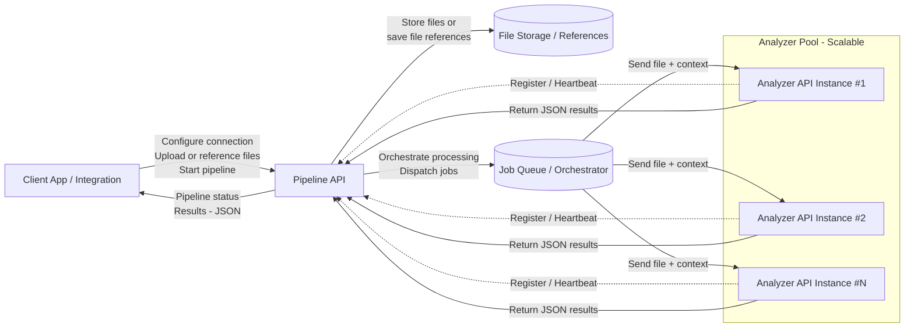

# Dynizer Pipeline API

The Pipeline API is the primary interface used by client applications to interact with Dynizer. Client systems do not communicate directly with the Analyzer API.

The Analyzer API is a dedicated processing service. Its sole responsibility is to analyze files and return structured results in JSON format. It does not manage files, workflows, or configurations.

All orchestration is handled by the Pipeline API. Through this API, clients configure their connection to Dynizer, upload or reference files, and start processing pipelines. Once a pipeline is initiated, the Pipeline API automatically invokes one or more Analyzer services to process the data.

This architecture is designed for scalability and reliability. Multiple Analyzer instances can run in parallel and register with the Pipeline API, allowing Dynizer to scale processing capacity based on demand.



---

## API Reference

All paths below are relative to the server base URL (e.g. `https://example.dynizer.com/pipeline-api/v1`). Authentication is via JWT bearer tokens obtained through the `/login` endpoint.

### Authentication

| Method | Endpoint | Description |
| ------ | -------- | ----------- |
| POST | `/login` | Obtain a JWT bearer token |

### Authentication Configurations

Credentials (basic, bearer, or Dynizer auth) used by connections.

| Method | Endpoint | Description |
| ------ | -------- | ----------- |
| GET | `/authentication_configurations` | List all auth configs |
| POST | `/authentication_configurations` | Create an auth config |
| GET | `/authentication_configurations/{id}` | Get an auth config by ID |
| PUT | `/authentication_configurations/{id}` | Update an auth config |
| DELETE | `/authentication_configurations/{id}` | Delete an auth config |

### Connections

External services for sourcing documents or storing results.

| Method | Endpoint | Description |
| ------ | -------- | ----------- |
| GET | `/connections` | List all connections |
| POST | `/connections` | Create a connection |
| GET | `/connections/{id}` | Get a connection by ID |
| PUT | `/connections/{id}` | Update a connection |
| DELETE | `/connections/{id}` | Delete a connection |
| GET | `/connections/{id}/storage` | Get connection storage config |
| POST | `/connections/{id}/storage` | Set connection storage config |
| DELETE | `/connections/{id}/storage` | Delete connection storage config |

### Connection Types

| Method | Endpoint | Description |
| ------ | -------- | ----------- |
| GET | `/connectiontypes` | List available connection types |
| GET | `/connectiontypes/{name}` | Get a connection type by name |

### Documents

Documents hold or reference data to be analyzed — as inline text/base64, private storage references, or public URIs.

| Method | Endpoint | Description |
| ------ | -------- | ----------- |
| GET | `/documents` | List all documents |
| POST | `/documents` | Create/upload a document |
| GET | `/documents/{id}` | Get a document by ID |
| PUT | `/documents/{id}` | Update a document |
| DELETE | `/documents/{id}` | Delete a document |

### Filetype Configurations

| Method | Endpoint | Description |
| ------ | -------- | ----------- |
| GET | `/filetype_configurations` | List supported filetypes and their config schemas |
| GET | `/filetype_configurations/{name}` | Get a filetype config by name |

### Flow Endpoints

| Method | Endpoint | Description |
| ------ | -------- | ----------- |
| GET | `/flows` | List available flows with their config schemas |
| GET | `/flows/{name}` | Get a flow by name |

### Pipeline Configurations

| Method | Endpoint | Description |
| ------ | -------- | ----------- |
| GET | `/pipeline_configurations` | List all pipeline configurations |
| POST | `/pipeline_configurations` | Create a pipeline configuration |
| GET | `/pipeline_configurations/{id}` | Get a pipeline configuration by ID |
| PUT | `/pipeline_configurations/{id}` | Update a pipeline configuration |
| DELETE | `/pipeline_configurations/{id}` | Delete a pipeline configuration |

### Pipelines

| Method | Endpoint | Description |
| ------ | -------- | ----------- |
| GET | `/pipelines` | List all pipelines |
| POST | `/pipelines` | Create and start a pipeline |
| GET | `/pipelines/{id}` | Get a pipeline by ID (status, output, steps) |
| PUT | `/pipelines/{id}` | Update a pipeline (cancel, pause, resume) |
| DELETE | `/pipelines/{id}` | Delete a pipeline |
| POST | `/pipelines/{id}/restart` | Restart a failed or completed pipeline |
| POST | `/pipelines/filter` | Filter pipelines by criteria |

### Plugin Endpoints

| Method | Endpoint | Description |
| ------ | -------- | ----------- |
| GET | `/plugins` | List all plugins with their JSON Schema |
| POST | `/plugins` | Register a new plugin |
| GET | `/plugins/{name}` | Get a plugin's schema by name |
| PUT | `/plugins/{name}` | Update a plugin |
| DELETE | `/plugins/{name}` | Delete a plugin |

### Analyzers & Extractors

| Method | Endpoint | Description |
| ------ | -------- | ----------- |
| GET | `/analyzers` | List registered analyzer instances |
| GET | `/extractors` | List registered extractor instances |

### Health

| Method | Endpoint | Description |
| ------ | -------- | ----------- |
| GET | `/healthz` | Kubernetes-style health check |

---

## Pipeline Configuration

A **pipeline configuration** is a reusable template that defines how documents should be analyzed. It bundles together:

- Which **flow** (analysis method) to use and its configuration
- Whether **text extraction** should happen before analysis
- Whether **splitting** should happen before analysis
- Which **plugins** to run after analysis
- An optional **instance** schema for custom plugin output labels
- Which **connection** to store results in (e.g., Dynizer)
- An optional **webhook** to notify on completion
- An optional **client ID** for grouping

Pipeline configurations are created at runtime via the API and are persisted in pipeline-api's embedded database.

### Configuration fields

| Field | Required | Type | Description |
| ----- | -------- | ---- | ----------- |
| `name` | Yes | string | Human-readable name for the configuration |
| `flow_configuration` | No* | object | Which flow to use and its config |
| `flow_configuration.name` | Yes (if flow_configuration set) | string | Flow name: `analyze`, `analyze_v2`, `analyze_redact`, `summary` |
| `flow_configuration.config` | No | object | Flow-specific settings (schema from `GET /flows`) |
| `extract` | No | boolean | `true` to extract text before analysis (default: `false`) |
| `split` | No | boolean | `true` to split text into segments before analysis (default: `false`) |
| `connection_id` | No* | UUID | Dynizer connection for storing results |
| `plugins` | No | array | List of post-analysis plugins with optional configs |
| `instance` | No | object | Schema declarations for action labels (used by the `script` plugin for `create_action` label registration) |
| `webhook` | No | object | Webhook endpoint to notify on completion |
| `client_id` | No | string | Client identifier for grouping pipelines |

*If `flow_configuration` or `connection_id` are omitted, they must be provided when starting the pipeline.
### Creating a pipeline configuration

```http
POST /pipeline_configurations
Authorization: Bearer <jwt-token>
Content-Type: application/json
```

**Minimal example** (only name is required):

```json
{
  "name": "my-config"
}
```

**Full example** with analyze_v2, extraction, split, and a plugin:

```json
{
  "name": "full-nlp-pipeline",
  "extract": true,
  "split": true,
  "flow_configuration": {
    "name": "analyze_v2",
    "config": {
      "language": {
        "target_languages": ["en", "nl", "fr", "it"]
      },
      "mode": "full",
      "output_format": "v1"
    }
  },
  "connection_id": "<dynizer-connection-uuid>",
  "plugins": [
    {
      "name": "pseudonymize",
      "config": {}
    }
  ],
  "webhook": {
    "endpoint": "https://my-app/on-complete"
  },
  "client_id": "my-client-app"
}
```

**Response:**

```json
{
  "id": "<generated-uuid>"
}
```

---

## Flows

A flow is a single analysis method. Query available flows and their config schemas:

```http
GET /flows
```

### `analyze` (v1)

The original analysis flow.

| Key | Type | Default | Values |
| --- | ---- | ------- | ------ |
| `analyze.merge_entities` | boolean | `true` | Merge named entities |
| `analyze.tokenizer` | string | `"stanford"` | stanford, spacy |
| `keysegments.keysegments_type` | string | `"default"` | default, global, section |
| `keysegments.labels` | string[] | `[]` | Document section labels |
| `keysegments.lower_keysegment_text` | boolean | `true` | Lowercase keysegment text |
| `keysegments.max_keywords` | integer | `50` | Maximum keywords to keep |
| `language.target` | string[] | `["de","en","es","fr","it","nl","pt"]` | de, en, es, fr, it, nl, pt |
| `summary.generate_text_summary` | boolean | `true` | Include text summary in output |
| `summary.labels` | string[] | `[]` | Document section labels |
| `summary.method` | string | `"default"` | default, sum, sentence_tidf, tidf |
| `summary.min_sentences` | integer | `1` | Minimum sentences in summary |
| `summary.percentage` | integer | `25` | Percentage of sentences to keep |

### `analyze_v2`

The v2 NLP pipeline (analyze-api-v2).

| Key | Type | Default | Values |
| --- | ---- | ------- | ------ |
| `language.target_languages` | string[] | `["en","nl","fr","it"]` | en, nl, fr, it |
| `mode` | string | `"full"` | full, decomposition, action, segments, entities |
| `output_format` | string | `"v1"` | v1 (legacy, compatible with plugins), v2 (native flat) |

### `analyze_redact`

Analyzes a document and redacts it, storing the redacted version via a Storage API.

| Key | Type | Default | Description |
| --- | ---- | ------- | ----------- |
| `language.target` | string[] | `["de","en","es","fr","it","nl","pt"]` | Target languages (de, en, es, fr, it, nl, pt) |
| `endpoint` | string | `""` | Storage API endpoint URL |
| `document_id` | string | `""` | Document ID to use for storage |
| `secret` | string | `""` | Storage API secret |

### `summary`

A dedicated summary-only flow. Uses a subset of the `analyze` flow's configuration.

| Key | Type | Default | Values |
| --- | ---- | ------- | ------ |
| `language.target` | string[] | `["de","en","es","fr","it","nl","pt"]` | de, en, es, fr, it, nl, pt |
| `analyze.tokenizer` | string | `"stanford"` | stanford, spacy |
| `summary.method` | string | `"default"` | default, sum, sentence_tidf, tidf |
| `summary.min_sentences` | integer | `1` | Minimum sentences in summary |
| `summary.generate_text_summary` | boolean | `true` | Include text summary in output |
| `summary.percentage` | integer | `25` | Percentage of sentences to keep |
| `summary.labels` | string[] | `[]` | Document section labels |

---

## Plugins

Plugins are **post-processing steps** that run sequentially after a flow has analyzed a document. Each plugin takes the analyzer output, transforms or filters it, and stores the result in the Dynizer under a configurable action / action label.

You enable plugins via the `plugins` array inside a pipeline configuration. Each entry has a `name` (matching the plugin's registered identifier) and an optional `config` object.

### Discovery

```http
GET /plugins            # List all plugins with their JSON Schema
GET /plugins/{name}     # Schema for a single plugin
```

Any field omitted from a plugin's `config` falls back to the default listed in its schema.

### Available plugins

| Name | Purpose |
| ---- | ------- |
| `raw` | Store the complete raw JSON analyzer result |
| `text` | Store the extracted document text (and optional summary) |
| `sentences` | Store sentence-level output |
| `segments` | Store segments grouped by component type |
| `segments_wide` | Wide-format segments with entity-type filtering |
| `tokens` | Store token-level output |
| `pseudonymize` | Pseudonymize selected component / entity types; store both full and anonymized versions |
| `deka` | Dashboard-oriented storage: entities, verbs, keysegments and their links |
| `script` | Run a user-supplied Starlark script on the analyzer output in a sandbox |

### Custom plugins with `script`

The `script` plugin lets you run a **Starlark** script (Python-like syntax) against the analyzer output without deploying any code. The script runs in a sandbox — no network, no filesystem, no imports — bounded by an execution-step limit and a wall-clock timeout.

The script must define `def execute(data, config)` and return a list of instance elements:

```python
def execute(data, config):
    doc = data["document"]
    return [
        {"action_label": "summary_upper", "values": [doc.get("summary", "").upper()]},
        {"action_label": "lang",          "values": [doc.get("language", "")]},
    ]
```

Key config fields:

| Field | Type | Default | Description |
| ----- | ---- | ------- | ----------- |
| `script` | string | *(required)* | Starlark source code |
| `action` | string | `"document_script"` | Action under which output is stored |
| `user_config` | object | `{}` | Arbitrary JSON passed to the script as `config` |
| `max_steps` | integer | `1000000` | Hard cap on execution steps |
| `timeout_ms` | integer | `5000` | Wall-clock timeout in milliseconds |

When `create_action` is `true` (default), the plugin registers labels using the pipeline-level `instance.instance_elements` block. Entries without `values` are treated as schema-only declarations — the script's output supplies their values at runtime.

> For full plugin configuration details, schemas, and examples see [plugins.md](plugins.md).

---

## Running a Pipeline

Once you have a pipeline configuration, you run a pipeline by combining it with a document.

```http
POST /pipelines
Authorization: Bearer <jwt-token>
Content-Type: application/json
```

**Using an existing configuration and document:**

```json
{
  "configuration_id": "<config-uuid>",
  "document_id": "<document-uuid>"
}
```

**Inline document with existing configuration:**

```json
{
  "configuration_id": "<config-uuid>",
  "document": {
    "filetype_configuration": {
      "name": "pdf"
    },
    "base64": {
      "data": "<base64-encoded-file>"
    }
  }
}
```

### Pipeline operations

| Operation | Method | Endpoint |
| --------- | ------ | -------- |
| Get status & output | GET | `/pipelines/{id}` |
| Cancel, pause, or resume | PUT | `/pipelines/{id}` |
| Restart | POST | `/pipelines/{id}/restart` |
| Delete | DELETE | `/pipelines/{id}` |
| Filter by criteria | POST | `/pipelines/filter` |

---

## Pipeline Execution

### Processing steps

A pipeline is an ordered multi-step orchestration:

```text
Extract (optional) → Split (optional) → Flow (analysis) → Plugins (optional, sequential)
```

Which steps run is controlled by the `extract` and `split` flags:

| `extract` | `split` | Pipeline chain |
| --------- | ------- | -------------- |
| false | false | Analyze only |
| true | false | Extract → Analyze |
| false | true | Split → Analyze |
| true | true | Extract → Split → Analyze |

### Lifecycle

When a pipeline is created, it enters an internal queue with status `QUEUED_LOCAL`. A background job picks up queued pipelines and processes them through the configured steps.

**Statuses:**

| Status | Description |
| ------ | ----------- |
| `QUEUED_LOCAL` | Waiting in the internal queue for the next step |
| `QUEUED` | Dispatched to an external service (extractor or analyzer) |
| `RUNNING` | Being processed by an external service |
| `SPLITTING` | Being processed by the split service |
| `SUCCESS` | All steps completed successfully |
| `FAILED` | A step failed |
| `CANCELED` | Canceled by the user |
| `PAUSED` | Paused by the user |

```text
Pipeline created
    |
    v
QUEUED_LOCAL
    |
    +-- needs extraction? (extract=true AND filetype != txt AND not already extracted)
    |       |
    |      YES → Send to extraction service → QUEUED/RUNNING
    |       |
    |       +-- success: replace document with extracted text, re-queue
    |       +-- failed: pipeline FAILED
    |
    +-- needs split? (split=true AND not already split)
    |       |
    |      YES → Send to split service → SPLITTING
    |       |
    |       +-- success: store segments, re-queue
    |       +-- failed: pipeline FAILED
    |
    +-- no more pre-processing needed
            |
            v
        Send to analyzer → QUEUED/RUNNING
            |
            +-- success: run plugins, store results → SUCCESS
            +-- failed: pipeline FAILED
```

### Key behaviors

- **Extract → Split → Analyze**: When both flags are enabled, each step completes before the next begins. Each step re-queues the pipeline for the next.
- **Text documents skip extraction**: `.txt` documents skip straight to the next step even if `extract: true`.
- **Split segments text**: The split service divides text into sentence-sized segments that are forwarded inline to the analyzer.
- **Idempotent steps**: If a step already completed (e.g., on retry), it is not repeated.
- **Plugins run inline**: After analysis completes, plugins execute sequentially without re-queuing.

### Data flow between steps

| Transition | What happens |
| ---------- | ------------ |
| Extract → Split/Analyze | The extracted text replaces the document content; the pipeline re-enters the queue. |
| Split → Analyze | The split service returns segments (`{index, text, start, end}`). These are stored on the pipeline and included inline in the analyzer request. |
| Analyze → Plugins | The analyzer returns its output. Each plugin receives that output sequentially as input. |

---

## CLI (`pipeline-api-cli`)

The CLI provides an interactive menu-driven interface to the Pipeline API. It authenticates on startup via user/password or a bearer token.

### Configuration

The CLI reads configuration from flags, environment variables, or a config file (`~/.pipeline-api-cli.yaml`):

| Flag | Env var | Description |
| ---- | ------- | ----------- |
| `--url` | `PIPELINE_API_URL` | Pipeline API base URL (required) |
| `--user` | `PIPELINE_API_USER` | Username for login |
| `--password` | `PIPELINE_API_PASSWORD` | Password for login |
| `--secret` | `PIPELINE_API_SECRET` | Bearer token (alternative to user/password) |
| `--insecure`, `-k` | `PIPELINE_API_INSECURE` | Disable TLS certificate verification |
| `--verbose`, `-v` | — | Show HTTP requests |

A `.env` file in the working directory is also loaded automatically.

### Available commands

#### CLI Auth Config Commands

| Command | Description |
| ------- | ----------- |
| `create-auth-config` | Create an authentication configuration |
| `list-auth-configs` | List all authentication configurations |
| `view-auth-config` | View an authentication configuration |
| `delete-auth-config` | Delete an authentication configuration |

#### CLI Connection Commands

| Command | Description |
| ------- | ----------- |
| `create-connection` | Create a connection |
| `list-connections` | List all connections |
| `view-connection` | View a connection |
| `delete-connection` | Delete a connection |

#### CLI Document Commands

| Command | Description |
| ------- | ----------- |
| `create-document` | Create/upload a document |
| `list-documents` | List all documents |
| `view-document` | View a document |
| `delete-document` | Delete a document |

#### CLI Pipeline Config Commands

| Command | Description |
| ------- | ----------- |
| `create-pipeline-config` | Create a pipeline configuration (interactive wizard) |
| `list-pipeline-configs` | List all pipeline configurations |
| `view-pipeline-config` | View a pipeline configuration |
| `delete-pipeline-config` | Delete a pipeline configuration |

#### CLI Pipeline Commands

| Command | Description |
| ------- | ----------- |
| `run-pipeline` | Create a pipeline with a file (uploads, encodes, and runs) |
| `run-pipeline-document` | Create a pipeline with an existing document |
| `restart-pipeline` | Restart a failed or completed pipeline |
| `list-pipelines` | List all pipelines |
| `view-pipeline` | View a pipeline (status, steps, errors) |
| `view-pipeline-data` | View pipeline output data |
| `export-pipeline-data` | Export pipeline output data to a file |
| `export-pipeline-errors` | Export pipeline errors to a file |
| `delete-pipeline` | Delete a single pipeline |
| `delete-pipelines` | Delete pipelines by status |

#### CLI Batch Processing Commands

The batch processing commands allow processing multiple files in bulk against a pipeline configuration.

| Command | Description |
| ------- | ----------- |
| `batch-process` | Process multiple files from a directory against a pipeline configuration |
| `batch-status` | View the status of a batch run |
| `batch-retry` | Retry failed pipelines in a batch |
| `batch-export` | Export batch processing status to a file |
| `batch-clear` | Clear batch processing state |

#### CLI Analyzer Commands

| Command | Description |
| ------- | ----------- |
| `list-analyzers` | List registered analyzer instances |

---

## End-to-End Example

### 1. Create an auth config

```http
POST /authentication_configurations
```

```json
{
  "name": "my-dynizer-auth",
  "dynizer_service_token": { "token": "<service-token>" }
}
```

### 2. Create a connection

```http
POST /connections
```

```json
{
  "name": "my-dynizer",
  "type": "dynizer",
  "authentication_configuration_id": "<auth-config-uuid>"
}
```

### 3. Create a pipeline configuration

```http
POST /pipeline_configurations
```

```json
{
  "name": "analyze-v2-with-extraction-and-split",
  "extract": true,
  "split": true,
  "flow_configuration": {
    "name": "analyze_v2",
    "config": {
      "language": { "target_languages": ["en"] },
      "mode": "full",
      "output_format": "v1"
    }
  },
  "connection_id": "<connection-uuid>",
  "plugins": [
    {
      "name": "raw",
      "config": {
        "action": "document_raw",
        "action_label": "document"
      }
    },
    {
      "name": "script",
      "config": {
        "action": "document_script",
        "script": "def execute(data, config):\n    doc = data['document']\n    return [\n        {'action_label': 'lang', 'values': [doc.get('language', '')]},\n    ]\n"
      }
    }
  ]
}
```

### 4. Upload a document

```http
POST /documents
```

```json
{
  "filetype_configuration": { "name": "pdf" },
  "base64": { "data": "<base64-pdf-data>" }
}
```

### 5. Run the pipeline

```http
POST /pipelines
```

```json
{
  "configuration_id": "<config-uuid>",
  "document_id": "<document-uuid>"
}
```

### 6. Poll for results

```http
GET /pipelines/<pipeline-uuid>
```

The pipeline will transition through: `QUEUED_LOCAL` → `QUEUED` → `RUNNING` → `SUCCESS` (or `FAILED`).

If extraction is enabled, the steps array will show both `extract` and `analyze` steps with their individual statuses.

---

## Configuration Sources Summary

| What | Where | Purpose |
| ---- | ----- | ------- |
| `config/config.yml` | On disk (deployed with the service) | Server settings: port, TLS, auth secrets, endpoints, timeouts |
| `POST /pipeline_configurations` | API call at runtime | What to analyze: flow, plugins, extraction, connection |
| `POST /pipelines` | API call at runtime | Execute: combines a config + document into a run |
| `pipeline-api-cli` | Interactive CLI tool | Convenience wrapper around the API calls above |
